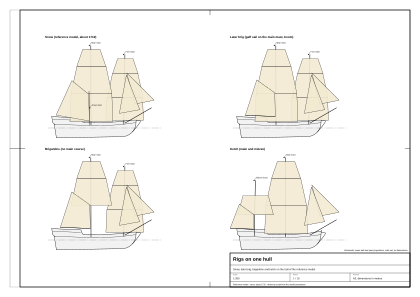

# 01. Ship type and era

## What this stage is for

Before you draw a single line you must decide **what kind of ship** you are building and **when** she was built.
Type and date fix almost everything that follows: hull proportions, the shape of the stern and head, the rig, the
deck fittings, even the paint. A beautiful model with a coppered bottom and a steering wheel on a 1705 sloop is
simply wrong, and an informed viewer sees it at once.

At the end of this chapter you will have:

- a named type and a date range for your ship;
- main dimensions (deck length, breadth, depth in hold, draught) taken from documented prototypes;
- a short list of anachronisms to avoid;
- a note of which of your choices are documented and which are your own inference.

The rest of the guide uses one **reference model**: a small two-masted naval vessel of about 1710, rigged as a
**snow**. Its data are in `data/parameters.json` and its generator scripts in `blender/`. Every number marked
"reference model" comes from that file. The model is still being refined, so check the file for the current value.

## How to read the numbers

Every number in this guide carries a source and one of four confidence labels:

| Label | Meaning |
|---|---|
| **period** | A source from the time (a shipwright's manual, an Admiralty record, a contemporary dictionary), or a scholarly edition of one. |
| **secondary** | A later study, a reference database, Wikipedia, or a modelling forum that cites its source. |
| **our inference** | Our own calculation, scaling or reconstruction. Good as a working value, not as a historical fact. |
| **reference model** | The value used in the reference model (`data/parameters.json`). Usually one of the above, chosen inside its range. |

Units are metres and millimetres. Where the source uses English feet and inches, the original value is given in
brackets (1 ft = 0.3048 m, 1 in = 25.4 mm).

## Concepts

- **Rig** is how the masts and sails are arranged (snow, brig, brigantine, ketch, sloop). **Hull type** is the shape
  and build of the hull. **Rate or category** is how a navy classed the ship for pay and manning. These are three
  different things, and period names often mix them.
- **Sloop of war**: in the Royal Navy of the early 18th century this was a *category*, not a rig. It meant a small
  unrated vessel below the sixth rate, with up to about 18 guns. Such sloops could be rigged as ketches, snows,
  brigantines or, rarely, with one mast [5] (secondary).
- **Snow**: two square-rigged masts, plus a thin **trysail mast** (snow mast) standing just abaft the mainmast. The
  gaff sail is hoisted on that thin mast, so the mainmast can carry a square main course as well. Known from the late
  17th century; navies used snows with 5–16 guns early in the 18th century [5] (secondary).
- **Brig** in the later, strict sense (both masts fully square-rigged, gaff mainsail set on the mainmast itself) is a
  rig of about 1770 [2] (period records via a scholarly study). Around 1700–1718 the word "brig" existed, but as a
  short form of "brigantine": dictionaries date it to 1705–1715 and 1712, and Boston customs clerks shortened
  "brigantine" to "briga" and "brig" [2] (period), [6] (secondary).
- **Brigantine** around 1695: square-rigged foremast, fore-and-aft (gaff) mainsail on the mainmast, sometimes with
  small square topsails above it [2] (period). In the Massachusetts registers of 1686–1715 brigantines measured
  8–100 tons [2] (period).
- **Ketch**: used for bomb vessels and small sloops of war; in Massachusetts trade usually double-ended and
  flush-decked, 10–70 tons [2] (period).
- **Merchant sloop** (Bermuda, Jamaica): one mast, gaff mainsail, staysail and jib; larger ones with a square
  topsail; 15–80 tons, mostly with a flat (square) stern [2] (period). Pirate vessels of 1715–1720 were usually
  of this kind (secondary; general statement in our notes, no single source).
- **Sixth rate**: three masts, one gun deck, 20–24 guns. The 1719 Establishment gave 106 ft (32.3 m) on the gun deck
  and 28 ft 4 in (8.64 m) breadth [5] (secondary, quoting the Establishment).
- **Builder's measurement (bm)**: the "tons burthen" of a ship, a volume-like number calculated from keel length and
  breadth. It is not weight. Formula and checks are in [chapter 02](02-hull-lines-and-offsets.md).

*Figure 1. Snow, brig (later), brigantine and ketch on the same hull, so that only the rig differs.*

## What is documented and what is not

| Statement | Status | Source |
|---|---|---|
| Royal Navy sloops of 1704–1711 (Swift, Jamaica and Hazard groups) were small, about 17–20 m on deck. | secondary | [5] |
| From 1721 new sloops were built as two-masters. | secondary | [5] |
| A two-masted square-rigged ship of 27–29 m with 10–18 guns has **no well-documented English naval prototype from 1702–1718**. Ships of that length were then three-masted sixth rates or large merchantmen and privateers. | our inference | from [3], [5] |
| The nearest documented hulls of this size are the snow-sloops of 1741–1742 (*Drake* class, *Wolf* class) and the sloop-brigantine model SLR0229 of about 1740. | secondary / period (model) | [4], [5] |
| Hulls of 1740 differ little from those of 1710–1720: the same design methods (Sutherland 1711 and his successors) were in use. | our inference | [1] |
| *Ferret* (1711) is listed by one database as "brig" rigged, while the museum catalogue of her plan calls her single-masted, cutter rigged. We follow the museum catalogue. | conflict | [3], [4] |

The practical consequence: if your ship must be *strictly* a Royal Navy vessel of 1710, she should be about
19–20 m long (like *Ferret*). If you want a 27–29 m two-master in 1710, call her a snow or a brigantine and accept
that her hull is based on slightly later sloops (our inference).

## Prototype dimensions

Dimensions as given in the sources, in feet and inches, with metres in brackets. "Keel" is the keel length for
tonnage.

| Ship | Year | Type, guns | Gun deck | Keel | Breadth | Depth in hold | Tons bm | Plans or model | Source |
|---|---|---|---|---|---|---|---|---|---|
| *Cruizer* (purchased) | 1709 | sloop, 14 (12 × 3 pdr) | – | 56 ft 7½ in (17.08) | 20 ft 3 in (6.17) | 10 ft 1 in (3.07) | 123 | no plan | [3] secondary |
| *Ferret* | 1711 | sloop, Jamaica group, 10 | 64 ft 7 in (19.69) | 50 ft 5 in (15.37) | 20 ft 8 in (6.30) | 9 ft 1 in (2.77) | 114 | RMG plan ZAZ4877, 1:48 | [3], [4] |
| *Bonetta* | 1721 | sloop, 4 | 55 ft 2 in (16.81) | 42 ft 11¼ in (13.09) | 17 ft 0 in (5.18) | 7 ft 6 in (2.29) | 66 | – | [3] secondary |
| *Cruizer* | 1721 | two-masted sloop, 8 | 62 ft 0 in (18.90) | 47 ft 10 in (14.58) | 19 ft 10 in (6.05) | 9 ft 0 in (2.74) | 100 | – | [3] secondary |
| *Swift* | 1721 | sloop, snow, 6 | – | – | – | – | – | RMG plan ZAZ4853, 1:48, with "scroll" head | [4] period (plan) |
| model SLR0416 | c. 1720 | sloop, 12 | – | – | – | – | – | RMG model: oar ports between gun ports, scroll head, raised forecastle with bell, quarterdeck, wheel, capstan, pumps | [4] period (model) |
| model SLR0229 | c. 1740 | sloop-brigantine, 12–14 × 6 pdr | c. 85 ft (25.9) | – | c. 23 ft (7.0) | – | c. 200 | RMG model: raised quarterdeck, tiller, capstan, swivels on posts | [4] period (model) |
| *Drake* class | 1741 | sloop, snow, 8–10 × 4 pdr + 14 swivels | 85 ft 0 in (25.91) | 68 ft 8 in (20.93) | 23 ft 6 in (7.16) | 9 ft 6 in (2.90) | 202 | 7 port pairs | [5] secondary |
| *Wolf* class | 1742 | sloop, snow, 10–14 × 4 pdr | 87 ft 6 in (26.67) | 73 ft 4¾ in (22.37) | 25 ft 0 in (7.62) | 10 ft 6 in–11 ft (3.20–3.35) | 244 | 8 port pairs | [5] secondary |
| sixth rate, 1719 Establishment | 1719 | 20 guns | 106 ft 0 in (32.31) | 87 ft 9 in (26.75) | 28 ft 4 in (8.64) | 9 ft 2 in (2.79) | 375 | – | [5] secondary |
| *Cruizer* class (for contrast) | 1797 | brig-sloop, carronades | 100 ft 0 in (30.48) | 77 ft 3½ in (23.56) | 30 ft 6 in (9.30) | 12 ft 9 in (3.89) | 382 | RMG plans | [5] secondary |

The *Cruizer* of 1797 is listed only to show how a late 18th-century brig differs: wider, with carronades and a
different stern. Use it for nothing in a 1710 hull except perhaps deck proportions (our inference).

### Proportions derived from the prototypes

Calculated by us from the table above (our inference, arithmetic on secondary data):

| Ship | Deck length / breadth | Depth in hold / breadth | Keel / deck length |
|---|---|---|---|
| *Ferret* 1711 | 3.12 | 0.44 | 0.78 |
| *Cruizer* 1721 | 3.13 | 0.45 | 0.77 |
| *Bonetta* 1721 | 3.25 | 0.44 | 0.78 |
| *Drake* 1741 | 3.62 | 0.40 | 0.81 |
| *Wolf* 1742 | 3.50 | 0.42 | 0.84 |
| sixth rate 1719 | 3.74 | 0.32 | 0.83 |

Rules that follow (our inference):

- Deck length is 3.1–3.7 breadths. Sloops of 1710–1720 sit near 3.1–3.3, snow-sloops of the 1740s near 3.5–3.7.
- Depth in hold is 0.40–0.45 of the breadth.
- The keel is 0.77–0.84 of the deck length; stem and sternpost together overhang the keel by 16–23 % of the
  deck length.

## The reference model in one table

| Item | Value | Confidence and source |
|---|---|---|
| Rig | snow: fore and main masts square-rigged, trysail mast abaft the mainmast with a gaff; the gaff sail has no boom and is brailed to the mast | reference model (`has_boom = false` in `data/parameters.json`); snow suits 1702–1718 best for a ship carrying a square main course [5] (secondary); a boom belongs only to the later brig variant (see [chapter 05](05-masts-and-spars.md)) |
| Date represented | c. 1710 | reference model |
| Deck length between rabbets | 28.0 m | reference model, chosen from the *Wolf* / *Drake* range |
| Breadth, moulded / over planking | 7.46 m / 7.60 m | reference model; *Wolf* 25 ft (7.62 m) [5] |
| Depth in hold | 3.20 m | reference model; *Wolf* [5] |
| Draught at the dead flat, underside of keel | 3.10 m | our inference (≈ depth in hold) |
| Keel length | 22.4 m | reference model = *Wolf* keel [5] |
| Tons burthen | 243 bm | our calculation with the bm formula (*Wolf*: 243 74/94 [5]) |
| Displacement | about 300 t | our calculation from the offsets, see chapter 02 |
| Guns | 10 carriage guns (5 per side) in 6 open port pairs, one empty open pair and one closed pair under the quarterdeck; 8 swivel guns | reference model; *Drake*: 7 pairs, *Wolf*: 8 pairs [5] |
| Decks | one flush main deck, raised quarterdeck aft (1.70 m higher), no forecastle | reference model; SLR0229 has a raised quarterdeck [4] |
| Stern | flat transom (square tuck), counter, four cabin windows | reference model; flat transoms usual on small ships of 1710 [1], [2] (period) |
| Head | knee of the head with a scroll | reference model; scroll on *Swift* 1721 and SLR0416 [4] (period) |
| Steering | wheel by default, deck tiller as a variant | reference model; see [chapter 09](09-deck-machinery.md) for dates |
| Crew | 80–110 | our inference from the *Drake* class (80) and later sloops [5] |

## Step by step: choosing type and era for your own ship

1. **Write down the purpose.** Navy, privateer, merchant, pirate? Which sea? This decides the type: a navy prefers a
   sloop of war (ketch or snow in 1702–1718), a merchant on the American coast a sloop or brigantine, a pirate
   usually a captured merchant sloop [2], [5].
2. **Fix a date, not a century.** Pick a ten-year window (for example 1705–1715). Many features changed within
   twenty years (see the anachronism table below).
3. **Choose the rig from the date.** For 1702–1718 the safe two-masted rigs are ketch, snow and brigantine. Call a
   two-master with a square main course a snow, not a brig (our inference from [2], [5]).
4. **Find two or three prototypes** of the same type and size, no more than about 30 years apart. Use the table
   above, or the sources at the end of this chapter. Write down deck length, keel, breadth, depth in hold and tons.
5. **Check the prototypes against the bm formula** (chapter 02). If a database figure does not reproduce the
   recorded tons, one of its numbers is wrong.
6. **Set the main dimensions.** Choose deck length first, then breadth from the length-to-breadth ratio (3.1–3.7),
   depth in hold 0.40–0.45 of breadth, keel 0.77–0.84 of deck length.
7. **Set the armament from the length.** Gun ports were about 2.3–2.6 m apart on 26–27 m sloops (*Wolf*: 8 pairs,
   *Drake*: 7 pairs) [5] (secondary; spacing is our inference). Count the pairs that fit between the forward end of
   the waist and the quarterdeck.
8. **Decide stern, head and steering** from the date (chapters 04 and 09).
9. **Record certainty.** Keep a table like the one above with a source and a confidence for every number.
10. **Run the anachronism check** below before modelling details.

## Anachronisms to avoid for 1702–1718

| Feature | Earliest date | Confidence and source |
|---|---|---|
| Copper sheathing of the bottom | first full coppering HMS *Alarm*, 1761 (proposed 1708 and rejected) | secondary, two agreeing sources [7] |
| Carronades | from the 1770s | secondary; widely stated, no single source in our notes |
| Chain anchor cable | navy use from about 1810 | secondary; widely stated, no single source in our notes |
| Boat davits at the side or stern | between 1790 and 1804 | secondary, quoting a period witness [8] |
| Gunlocks (flintlock firing of great guns) | Royal Navy from the mid-18th century | secondary; no single source in our notes |
| Pump-brake windlass | 19th century | secondary (modelling forum) [9] |
| Black-and-yellow "Nelson chequer" paint scheme, billethead, round stern | late 18th to 19th century | secondary [7] |
| A ship called "brig" with a gaff mainsail on the mainmast | later 18th century usage | period and secondary [2], [6] |
| Stern galleries and quarter galleries like those of a ship of the line on a 25 m sloop | not for this size | our inference |

## Worked example: the reference model

1. Purpose: a small naval two-master for the Caribbean, about 1710, large enough to carry ten guns and a crew of
   about one hundred.
2. Window: 1705–1715.
3. Rig: a two-master with a square main course, so a snow (not a brig).
4. Prototypes: *Wolf* (1742) and *Drake* (1741) for the size; *Ferret* (1711) and *Swift* (1721) for period detail;
   SLR0416 (c. 1720) and SLR0229 (c. 1740) for deck layout.
5. Check: *Wolf* keel 73.40 ft, breadth 25.0 ft: 73.40 × 25.0 × 12.5 / 94 = 244.0 tons; recorded 243 74/94. The
   numbers agree (our calculation).
6. Dimensions: deck 28.0 m; breadth 28.0 / 3.68 = 7.6 m over planking; depth in hold 0.42 × 7.6 = 3.2 m; keel
   0.80 × 28.0 = 22.4 m.
7. Ports: 7 pairs at 2.45 m spacing (reference model).
8. Flat transom, scroll head, wheel (with a tiller variant).

Result: a hull with the size of a 1740s snow-sloop and the details of 1710–1720. This is a reasoned compromise, and
it is stated as such in the model's data.

## Check yourself

- [ ] Deck length / breadth between 3.1 and 3.7 (reference model: 28.0 / 7.6 = 3.68).
- [ ] Depth in hold 0.40–0.45 of breadth (reference model: 3.20 / 7.60 = 0.42).
- [ ] Keel 0.77–0.84 of deck length (reference model: 22.4 / 28.0 = 0.80).
- [ ] Your tons bm agree with a prototype of the same size within about 10 % (reference model 243, *Wolf* 244).
- [ ] The rig name matches the date (no "brig" with a gaff main before about 1770).
- [ ] No item from the anachronism table is present.
- [ ] Every number you keep has a source and a confidence label.

## Typical mistakes

1. Calling a 1710 two-master a "brig" and giving her the rig of 1800.
2. Taking dimensions from a famous late brig (*Niagara* 1813, *Cruizer* 1797) and putting them on a 1710 ship.
3. Mixing a sloop-of-war *category* with a sloop *rig*.
4. Trusting a single database entry without checking the tons formula.
5. A copper bottom, carronades, davits or chain cable on an early 18th-century ship.
6. A ship of the line's decoration (galleries, large carved stern) on a 25 m vessel.

## Sources

1. T. Kenchington, "The Structures of English Wooden Ships: William Sutherland's Ship, circa 1710", *The Northern
   Mariner* III/1 (1993), 1–43. https://cnrs-scrn.org/northern_mariner/vol03/tnm_3_1_1-43.pdf. © CNRS-SCRN; used
   for facts only. Scholarly edition of Sutherland, *The Ship-builders Assistant* (1711).
2. W. A. Baker, "Vessel Types of Colonial Massachusetts", *Seafaring in Colonial Massachusetts*, Colonial Society of
   Massachusetts vol. 52. https://www.colonialsociety.org/node/1977. Based on the Massachusetts registers 1686–1715.
3. threedecks.org ship database (sources: ADM records, Colledge, Winfield):
   *Ferret* 1711 https://threedecks.org/index.php?display_type=show_ship&id=4242;
   *Bonetta* 1721 https://threedecks.org/index.php?display_type=show_ship&id=3364;
   *Cruizer* 1721 https://threedecks.org/index.php?display_type=show_ship&id=3755;
   *Cruizer* 1709 https://threedecks.org/index.php?display_type=show_ship&id=3753;
   *Drake* 1705 https://threedecks.org/index.php?display_type=show_ship&id=3974.
4. Royal Museums Greenwich, collections (view only; images under RMG licensing terms, not free):
   plan ZAZ4877 *Ferret* (1711) https://www.rmg.co.uk/collections/objects/rmgc-object-84668;
   plan ZAZ4853 *Swift* (1721) https://www.rmg.co.uk/collections/objects/rmgc-object-84644;
   model SLR0416, 12-gun sloop c. 1720 https://www.rmg.co.uk/collections/objects/rmgc-object-66377;
   model SLR0229, sloop-brigantine 1740 https://www.rmg.co.uk/collections/objects/rmgc-object-66190.
5. Wikipedia (text CC BY-SA): "Sloop-of-war" https://en.wikipedia.org/wiki/Sloop-of-war;
   "List of corvette and sloop classes of the Royal Navy"
   https://en.wikipedia.org/wiki/List_of_corvette_and_sloop_classes_of_the_Royal_Navy;
   "Snow (ship)" https://en.wikipedia.org/wiki/Snow_(ship);
   "Drake-class sloop" https://en.wikipedia.org/wiki/Drake-class_sloop;
   "Wolf-class sloop" https://en.wikipedia.org/wiki/Wolf-class_sloop;
   "1719 Establishment" https://en.wikipedia.org/wiki/1719_Establishment;
   "Cruizer-class brig-sloop" https://en.wikipedia.org/wiki/Cruizer-class_brig-sloop.
6. Merriam-Webster, "brig" https://www.merriam-webster.com/dictionary/brig; Wikipedia "Brig"
   https://en.wikipedia.org/wiki/Brig and "Brigantine" https://en.wikipedia.org/wiki/Brigantine (CC BY-SA).
7. USNI *Naval History*, "Copper-Bottoming the Royal Navy" (2019)
   https://www.usni.org/magazines/naval-history-magazine/2019/june/copper-bottoming-royal-navy; Wikipedia "Copper
   sheathing" https://en.wikipedia.org/wiki/Copper_sheathing and "Nelson Chequer"
   https://en.wikipedia.org/wiki/Nelson_Chequer (CC BY-SA).
8. Article on navy ship's boats (Zenodo), quoting Sir Byam Martin on davits:
   https://zenodo.org/records/1838693/files/article.pdf.
9. Windlass design discussion (modelling forum):
   https://shipsofscale.com/sosforums/threads/windlass-design-details.17586.
10. Further reading, not used directly: I. McLaughlan, *The Sloop of War 1650–1763* (Seaforth 2014); R. Winfield,
    *British Warships in the Age of Sail 1603–1714* and *1714–1792*. Best sources for sloop dimensions.
11. Mariner's Mirror 108/4 (2022), "Revisiting the Brigantine Problem"
    https://www.tandfonline.com/doi/abs/10.1080/00253359.2022.2117456 (title only seen; settles terminology).

## Terms used in this chapter

| English | Polish | Explanation |
|---|---|---|
| rig | ożaglowanie, typ ożaglowania | Arrangement of masts and sails that names the vessel type. |
| sloop of war | slup wojenny | Royal Navy category of small unrated warship, regardless of rig. |
| snow | snow | Two square-rigged masts and a thin trysail mast abaft the mainmast for the gaff sail. |
| trysail mast, snow mast | maszt snow (maszcik gaflowy) | Thin spar standing just abaft the mainmast; the gaff slides on it. |
| brig | bryg | Two square-rigged masts with the gaff mainsail on the mainmast; strict sense from about 1770. |
| brigantine | brygantyna | Square foremast, gaff mainsail; around 1700 the commonest small two-master in trade. |
| ketch | kecz | Two-master with a tall mainmast and a short mizzen; used for bomb vessels and small sloops. |
| sixth rate | okręt VI rangi | Smallest rated warship: three masts, one gun deck, 20–24 guns. |
| builder's measurement (bm), tons burthen | tonaż wg budowniczych (bm) | Capacity number from keel and breadth, not a weight. |
| gun deck length | długość pokładu działowego | Length on the gun deck between the rabbets of stem and sternpost. |
| depth in hold | głębokość ładowni | Inside height of the hull at midships, from the ceiling beside the keelson up to the deck beams. |
| draught | zanurzenie | Depth of the lowest point of the keel below the waterline. |
| anachronism | anachronizm | A feature that did not yet exist at the chosen date. |
