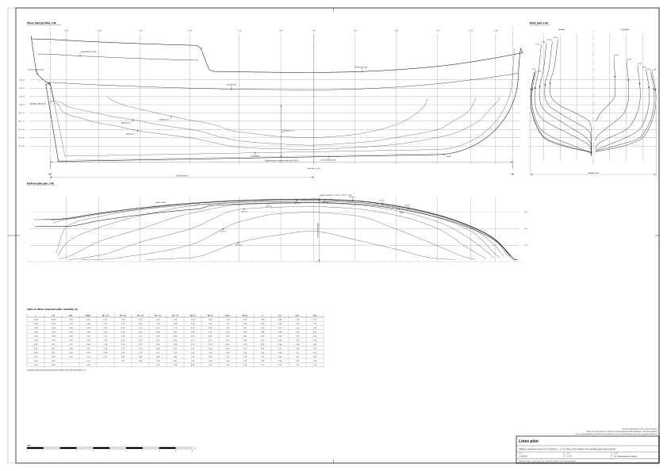
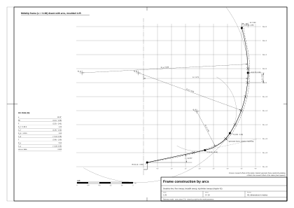

# 02. Hull lines and offsets

## What this stage is for

The lines plan is the hull's shape written down: three views of the same surface and a table of numbers that
describes it. Everything later (frames, planking, decks, ports, the placing of guns and masts) is measured from this
surface. If the lines are wrong, nothing built on them will look right.

At the end of this chapter you will have:

- the main dimensions turned into a set of shape numbers (sheer, deadrise, tumblehome, position of the dead flat);
- a midship frame drawn with the period method of arcs;
- the **table of offsets of the reference model**;
- a faired hull surface in Blender, in a CAD program or on paper;
- checks of displacement, form coefficients, entrance and run.

Type and main dimensions come from [chapter 01](01-ship-type-and-era.md). Confidence labels (period, secondary, our
inference, reference model) are explained there.

## Concepts

- **Lines plan**: a drawing of three projections of the hull surface. Old English plans are drawn to the *outside of
  the frames*, without planking ("moulded" lines) [3] (secondary). Planking adds 65–90 mm per side on our ship (see
  chapter 03).
- **Body plan**: cross-sections (stations, theoretical frames) drawn on top of each other. By convention the left half
  shows the after stations and the right half the forward ones.
- **Half-breadth plan**: view from above, showing waterlines.
- **Sheer plan**: view from the side, showing sheer of the deck, keel, stem, sternpost and the buttock lines.
- **Waterline**: section of the hull by a horizontal plane.
- **Buttock**: section by a vertical plane parallel to the centreline, at a fixed distance from it.
- **Diagonal**: section by a plane inclined from the centreline; shipwrights used it to check the fairness of the
  bilge.
- **Table of offsets**: the numbers of the lines plan: half-breadth for each pair (station, waterline) and height for
  each pair (station, buttock) [4] (secondary).
- **Dead flat**: the station of greatest section, where the frames have the same shape for a short length.
- **Deadrise**: the angle at which the bottom rises from the keel at the dead flat.
- **Tumblehome**: the inward lean of the side above the greatest breadth.
- **Sheer**: the rise of the deck line towards the ends, seen from the side.
- **Drag**: the keel is deeper aft than forward.
- **Rabbet**: the groove in keel, stem and sternpost into which the planking fits; lines are measured from the rabbet
  line.
- **Fair**: a curve or surface without bumps, flats or sudden changes of curvature.



*Figure 1. Lines plan of the reference model at 1:48, with all stations, waterlines and buttocks labelled in metres.*

## Coordinates used in this guide

The reference model uses (reference model, `data/parameters.json`):

- **s** along the ship, positive forward, **s = 0 at the middle of the 28.0 m deck length**;
- **x** across, positive to port (larboard), 0 on the centreline;
- **z** up, **z = 0 on the design waterline**.

Important points in these coordinates:

| Point | s (m) | z (m) | Confidence |
|---|---|---|---|
| Stem rabbet at the deck | +14.00 | +1.85 | reference model |
| Start of the stem curve (forefoot) | +9.30 | −2.72 | reference model |
| Stem rabbet at the waterline | +13.58 | 0.00 | our calculation from the stem curve |
| Dead flat | +1.96 | – | reference model (0.43 L from the stem) |
| Sternpost rabbet at the heel | −13.10 | −3.12 | reference model |
| Sternpost rake | 11.4° from vertical | – | reference model (research range 8–15°, our inference) |
| Flat transom at the waterline | −13.73 | 0.00 | our calculation |
| Wing transom | – | +1.25 | reference model |
| Keel rabbet line | z = −2.885 + 0.01786 · s | – | reference model (drag 0.40 m over the 22.4 m keel) |

Our research notes measure stations from the dead flat (call it z_df). Conversion: **s = z_df + 1.96**. The deck
layout file `data/deck-layout.json` uses a game-engine convention (y up, z forward); read its header before use.

## Rules and proportions

### Main formulas

| Quantity | Formula | Confidence and source |
|---|---|---|
| Tons burthen (builder's measurement) | tons = K × B × (B / 2) / 94, with K = keel length for tonnage (ft), B = greatest breadth (ft) | secondary [5]; in practice from 1720, by statute from 1773; before 1694 L × B × D / 94 [5] |
| Keel for tonnage | K ≈ L_deck − 3/5 B | secondary [5]; our check: *Wolf* 72.5 ft vs 73.4 recorded, *Drake* 70.9 vs 68.7, *Ferret* 52.2 vs 50.4 (within 3–4 %) |
| Displacement | Δ = 1.025 t/m³ × V (seawater) | standard naval architecture [4] |
| Block coefficient | Cb = V / (L_wl · B_wl · T) | [4] |
| Midship coefficient | Cm = A_m / (B_wl · T) | [4] |
| Prismatic coefficient | Cp = V / (A_m · L_wl) = Cb / Cm | [4] |
| Waterplane coefficient | Cwp = A_wp / (L_wl · B_wl) | [4] |

We checked the tonnage formula on three ships with recorded keel and tons: *Ferret* 50.42 × 20.67 × 10.33 / 94 =
114.5 (recorded 114 51/94), *Cruizer* 1721 gives 100.1 (recorded 100 7/94), *Drake* 1741 gives 201.7 (recorded
201 66/94) (our calculation on secondary data [6], [7]).

### Shape numbers for a 27–29 m snow

| Quantity | Reference model | Range | Confidence and source |
|---|---|---|---|
| Deck length L between rabbets | 28.0 m | 26.0–29.5 | reference model; *Wolf* / *Drake* [7] |
| Breadth, moulded | 7.46 m | 6.9–7.8 | reference model; L/B ≈ 3.7 |
| Breadth over planking | 7.60 m | 7.0–8.0 | reference model; *Wolf* 25 ft [7] |
| Depth in hold | 3.20 m | 2.9–3.4 | reference model; *Wolf* [7] |
| Draught, underside of keel at dead flat | 3.10 m | 2.8–3.4 | our inference (≈ depth in hold, as in later brigs) |
| Drag over the keel length | 0.40 m | 0.2–0.6 | our inference |
| Dead flat from the stem | 0.43 L | 0.38–0.48 L | our inference ("full bow, fine run") |
| Sternpost rake | about 12° | 8–15° | our inference |
| Sheer of the deck at the stem | +0.95 m | 0.7–1.3 | our inference from RMG models [8] |
| Sheer of the deck at the transom | +0.45 m | 0.3–0.7 | our inference |
| Deck camber | 0.12 m on 7.5 m (1.6 % B) | 1–2 % B | period for a 500-ton ship: 4.8 in (122 mm) [1]; scaled by us |
| Tumblehome at the rail, midships | 0.22 m per side | 0.15–0.35 | our inference |
| Deadrise at the dead flat | 12° | 8–18° | our inference |
| Bulwark height in the waist | 1.05 m | 0.95–1.15 | our inference |

None of the angles above was read from a period plan; they are reasoned values (our inference). Free period lines
for a ship of this size and date have not been found: the RMG plans of *Ferret* and *Swift* exist but are not free
and carry no offsets in their catalogue entries [8].

### Longitudinal curves (the parametric recipe)

An old shipwright controlled the shape with a few lengthwise curves, the **rising line** (height of the floor heads
at each frame) and the **narrowing lines** (half-breadths of floor and breadth at each frame) [9] (secondary). Our
offsets were generated the same way, with smooth functions of the position along the ship. Let u be the fraction of
the distance from the dead flat to the end (u = 0 at the dead flat, u = 1 at the stem rabbet at deck, 12.04 m
forward of the dead flat; u = 1 at the sternpost at deck, 15.96 m aft of it). All values below are our inference.

| Curve | Forward of the dead flat | Aft of the dead flat |
|---|---|---|
| Greatest half-breadth b | 3.73 · (1 − u²)^0.6 | 3.73 · (1 − 0.36 u^2.2) (broad transom) |
| Height of greatest breadth h_b | 0.35 + 0.45 u² | 0.35 + 0.60 u² |
| Deck at side | 0.90 + 0.95 u² | 0.90 + 0.45 u² |
| Rail (waist) | deck + 1.05 | deck + 1.05 (quarterdeck separate) |
| Tumblehome Δ (b minus rail half-breadth) | 0.22 − 0.17 u² | 0.22 + 0.08 u² |
| Deadrise angle α | 12° + 50° u^1.8 | 12° + 66° u^1.5 |
| Floor sweep radius R_f | 0.38 b | 0.38 b |
| Breadth sweep radius R_b | 1.05 b (increase if no solution) | 1.05 b |
| Bearding line above the rabbet | 0.5 u³ | 2.2 u^3.2 (high after deadwood) |

## Drawing a frame with arcs (the period method)

English shipwrights from the 17th century drew frames as arcs of circles ("sweeps") with centres at set points;
Bushnell (1664) describes moulds made "of sweeps" [10] (period, via dictionary citations). The arcs, from the keel
upward, are the floor sweep, the lower breadth sweep, a reconciling sweep where needed, and the top-timber sweep
[10]. Published radii vary between authors (half the breadth for the breadth sweep in one reconstruction; one
quarter of the breadth for the bilge of a French frigate of 1686) [11] (secondary, forum), so treat radii as design
choices.



*Figure 2. Construction of the midship frame with three arcs; numbers in metres, moulded.*

### Step by step: one frame

Use the numbers of the station from Table B below. Coordinates: x = half-breadth from the centreline, y = height
above the design waterline.

1. Draw the centreline and the waterline grid. Mark the start point R0 = (0.13, bearding height): 0.13 m is half the
   keel width.
2. From R0 draw the **deadrise line** at the angle α upwards and outwards, to the **floor head** (fx, fy).
3. Draw the **floor sweep**: an arc of radius R_f tangent to the deadrise line at the floor head. Its centre lies on
   the inward normal of the line, R_f away from the floor head.
4. Draw the **breadth sweep**: centre at (b − R_b, h_b), radius R_b. Its vertical tangent is at the greatest
   half-breadth b, height h_b. It must touch the floor sweep from inside: the distance between the two centres must
   equal R_b − R_f. The touching point lies on the line through both centres.
5. If the two arcs do not meet: reduce R_f by 15 %; if still not, increase R_b; last, reduce α by 2° and repeat. (A
   period shipwright solved the same problem with a reconciling sweep.)
6. Near the ends, where α exceeds about 30°, put a **hollow** (reverse) arc of 0.5–0.8 m radius between the vertical
   side of the deadwood and the deadrise line.
7. Above the greatest breadth draw the **top-timber sweep** from (b, h_b) to the rail point (t, y_n). Its radius is
   R_u = ((y_n − h_b)² + Δ²) / (2 Δ), with Δ = b − t, centre at (b − R_u, h_b).
8. Read off the half-breadths where the frame crosses each waterline and the heights where it crosses each buttock,
   and write them into your own offsets table.

### Worked example: the midship frame (station s = +1.96)

All values are moulded, in metres (reference model, derived from our inference).

1. R0 = (0.13, −2.85).
2. Deadrise 12°: floor head at (2.20, −2.41). Check: rise 0.44 over 2.07, tan 12° = 0.213.
3. Floor sweep R_f = 1.42; inward normal of the line (−0.208, 0.978); centre C_f = (1.905, −1.021).
4. Breadth sweep R_b = 3.92, centre C_b = (3.73 − 3.92, 0.35) = (−0.19, 0.35). Distance C_f to C_b = 2.50 =
   R_b − R_f. The arcs touch at (3.09, −1.80).
5. Not needed.
6. Not needed at midships (α = 12°).
7. Top-timber sweep from (3.73, 0.35) to (3.51, 1.95): Δ = 0.22, R_u = (1.60² + 0.22²) / 0.44 = 5.93, centre
   (−2.20, 0.35). Check at the deck height 0.90: x = −2.20 + √(5.93² − 0.55²) = 3.70, the table gives 3.70.
8. Waterline crossings agree with Table A within 0.05 m.

## Table of offsets of the reference model

Moulded (outside of frames, no planking), metres. Half-breadths from the centreline; heights from the design
waterline. Stations are denser near the ends; between stations interpolate with a spline along the length, not
linearly. "–" means the frame does not reach this waterline (the stem is further aft at that height); 0.13 is
half the width of the deadwood, so only the deadwood is there.

These numbers were **derived from rules** (sections above) and fitted to the *Wolf* class dimensions; they were not
read from a period plan (our inference). Source file: `data/offsets.csv`.

### Table A: heights and half-breadths on waterlines

| s | z_df | Keel underside | Rabbet | Bearding | WL −2.5 | WL −2.0 | WL −1.5 | WL −1.0 | WL −0.5 | WL 0 | WL +0.5 |
|---|---|---|---|---|---|---|---|---|---|---|---|
| −13.04 | −15.0 | −3.37 | −3.12 | −1.31 | 0.13 | 0.13 | 0.13 | 0.22 | 1.03 | 2.04 | 2.49 |
| −11.04 | −13.0 | −3.33 | −3.08 | −1.94 | 0.13 | 0.13 | 0.32 | 1.15 | 1.99 | 2.66 | 2.86 |
| −8.54 | −10.5 | −3.29 | −3.04 | −2.46 | 0.13 | 0.35 | 1.13 | 1.92 | 2.71 | 3.10 | 3.19 |
| −5.54 | −7.5 | −3.23 | −2.98 | −2.79 | 0.20 | 0.95 | 1.90 | 2.86 | 3.30 | 3.44 | 3.47 |
| −2.54 | −4.5 | −3.18 | −2.93 | −2.89 | 1.11 | 2.35 | 3.11 | 3.38 | 3.54 | 3.63 | 3.65 |
| −0.04 | −2.0 | −3.14 | −2.89 | −2.88 | 1.57 | 2.87 | 3.24 | 3.47 | 3.62 | 3.70 | 3.71 |
| +1.96 | 0.0 | −3.10 | −2.85 | −2.85 | 1.78 | 2.93 | 3.27 | 3.49 | 3.64 | 3.71 | 3.73 |
| +4.46 | +2.5 | −3.06 | −2.81 | −2.80 | 1.26 | 2.73 | 3.14 | 3.38 | 3.53 | 3.61 | 3.63 |
| +6.96 | +5.0 | −3.01 | −2.76 | −2.72 | 0.68 | 1.90 | 2.74 | 3.02 | 3.20 | 3.30 | 3.33 |
| +9.46 | +7.5 | −2.97 | −2.72 | −2.72 | 0.17 | 0.90 | 1.96 | 2.35 | 2.59 | 2.73 | 2.78 |
| +11.46 | +9.5 | – | −2.21 | −2.21 | – | 0.17 | 0.66 | 1.28 | 1.81 | 2.00 | 2.08 |
| +12.96 | +11.0 | – | −1.02 | −1.02 | – | – | – | 0.13 | 0.39 | 0.86 | 1.24 |

### Table B: deck, greatest breadth, rail and arc data

| s | Deck at side: height | half-breadth | Greatest half-breadth b | at height h_b | Rail (waist): height | half-breadth | Deadrise α | Floor head (fx, fy) | R_f | R_b |
|---|---|---|---|---|---|---|---|---|---|---|
| −13.04 | 1.30 | 2.54 | 2.56 | 0.88 | 2.35 | 2.27 | 34° | (2.13, 0.04) | 0.97 | 2.69 |
| −11.04 | 1.20 | 2.85 | 2.87 | 0.75 | 2.25 | 2.60 | 37° | (2.43, −0.24) | 1.09 | 3.02 |
| −8.54 | 1.09 | 3.17 | 3.20 | 0.61 | 2.14 | 2.94 | 37° | (2.71, −0.50) | 1.21 | 3.36 |
| −5.54 | 1.00 | 3.45 | 3.48 | 0.48 | 2.05 | 3.24 | 33° | (2.85, −1.01) | 1.32 | 3.65 |
| −2.54 | 0.94 | 3.62 | 3.65 | 0.40 | 1.99 | 3.42 | 22° | (2.55, −1.92) | 1.39 | 3.83 |
| −0.04 | 0.91 | 3.69 | 3.72 | 0.36 | 1.96 | 3.49 | 15° | (2.30, −2.30) | 1.41 | 3.90 |
| +1.96 | 0.90 | 3.70 | 3.73 | 0.35 | 1.95 | 3.51 | 12° | (2.20, −2.41) | 1.42 | 3.92 |
| +4.46 | 0.94 | 3.61 | 3.63 | 0.37 | 1.99 | 3.42 | 15° | (2.25, −2.23) | 1.38 | 3.81 |
| +6.96 | 1.06 | 3.30 | 3.33 | 0.43 | 2.11 | 3.14 | 22° | (2.25, −1.86) | 1.27 | 3.50 |
| +9.46 | 1.27 | 2.75 | 2.78 | 0.52 | 2.32 | 2.62 | 33° | (1.83, −1.60) | 1.06 | 2.92 |
| +11.46 | 1.49 | 2.06 | 2.08 | 0.63 | 2.54 | 1.96 | 45° | (1.67, −0.69) | 0.79 | 2.51 |
| +12.96 | 1.69 | 1.25 | 1.27 | 0.73 | 2.74 | 1.19 | 52° | (1.16, 0.33) | 0.48 | 1.33 |

The "rail" columns give the waist bulwark (deck + 1.05 m). Aft of s = −5.04 the quarterdeck and its bulwark rise
above this line (chapter 04).

### Table C: buttocks (height of the bottom at a given half-breadth)

| Buttock | −13.04 | −11.04 | −8.54 | −5.54 | −2.54 | −0.04 | +1.96 | +4.46 | +6.96 | +9.46 | +11.46 | +12.96 |
|---|---|---|---|---|---|---|---|---|---|---|---|---|
| 1.0 m | −0.52 | −1.09 | −1.58 | −1.97 | −2.54 | −2.65 | −2.67 | −2.57 | −2.37 | −1.96 | −1.23 | +0.15 |
| 2.0 m | −0.02 | −0.49 | −0.95 | −1.45 | −2.14 | −2.38 | −2.45 | −2.30 | −1.96 | −1.46 | +0.01 | – |
| 3.0 m | – | – | −0.19 | −0.89 | −1.63 | −1.87 | −1.92 | −1.73 | −1.05 | – | – | – |

"–" means the buttock does not cut the bottom below the greatest breadth at that station.

### Notes on the table

- The stern is a **flat transom with its lower edge (tuck) at the waterline** (square tuck). That is why WL 0 and
  WL +0.5 are still wide (2.0–2.5 m) at the aftermost station, while below WL −1.0 only the deadwood remains. With a
  round tuck WL 0 at that station would be about 0.8–1.2 m (our inference). A flat transom suits 1710: English
  builders had dropped it almost only in two-deckers [1] (period), and Boston merchant sloops mostly had square sterns
  [2] (period). In the reference model the transom face reaches about 0.3 m below the waterline at the centreline
  (reference model).
- `data/offsets.csv` also contains the **generator table** of the reference model: half-breadths **outside the
  planking** (0.065 m added, tapering to nothing at the deadwood), on 28 lines parallel to the keel (heights 0 to
  7.5 m above the rabbet) at the same 12 stations. The generator in `blender/` interpolates each line along the
  length, normalised between the transom and the stem rabbet, so the mesh ends exactly on the stem and the transom
  (reference model).

## Step by step: from the offsets to a surface

### On paper

1. **Scale and sheet.** Use 1:48 (the scale of the RMG plans [8]): the hull of about 29.2 m overall fits on 610 mm,
   so an A1 sheet (841 × 594 mm) holds the sheer plan above, the half-breadth plan below and the body plan to one
   side (our inference).
2. **Grid.** With a hard pencil (2H) and a steel rule draw the baseline, the waterlines every 0.5 m (10.4 mm at 1:48),
   the station lines at the positions of Table A, and the buttock lines at 1, 2 and 3 m in the half-breadth and body
   plans. Check the grid diagonals: a grid that is not square ruins everything later.
3. **Profile.** In the sheer plan plot the keel underside and the rabbet from Table A, the stem curve (forefoot at
   s = +9.30, rabbet at deck at +14.00), the sternpost at 11.4° from vertical, the deck at side and the rail from
   Table B.
4. **Body plan.** For each station plot the points of Table A (half-breadth at each waterline), the greatest breadth
   point and the deck and rail points of Table B. Join them with a ship curve (French curve), or draw them with
   arcs as described above.
5. **Half-breadth plan.** For each waterline transfer the half-breadths of all stations with dividers and join them
   with a **batten**: a thin, straight-grained strip of wood or plastic held on the points by weights ("ducks") or
   pins. Let the batten find its own curve; do not force it through a point that makes it kink.
6. **Fairing.** Where the batten leaves a point, do not move the batten, move the point: correct the offset in the
   body plan too. Then draw the buttocks in the sheer plan from the half-breadth and body plans, and check that every
   intersection appears at the same place in all three views.
7. **Tolerance.** Accept a difference of up to 1 mm on paper at 1:48 (about 50 mm full size) between views (our
   inference); correct anything larger.
8. **Diagonals.** As a last check draw one diagonal from the centreline at the height of the keel rabbet through the
   bilge; its curve in the expanded view must have no hollow or bump.
9. **Write the corrected table.** The faired drawing is the truth now, not the first table. Measure new offsets and
   record them.

### In a CAD program

1. Create a 3D polyline (or point list) for each station from Tables A and B, in the coordinates (x, s, z).
2. Replace each polyline by an **interpolating spline** through the points (degree 3).
3. Build the stem and transom outlines as separate curves (stem rabbet from the profile, transom plane at 11.4°).
4. **Loft** a surface through the station splines, from transom to stem (smooth, not ruled).
5. Cut the surface with planes at the waterlines and buttocks and compare the cuts with Tables A and C. Use a
   curvature plot (curvature comb) on each cut: the comb must change smoothly and must not flip sign except where you
   intend a hollow.
6. Correct station points, not the surface, and loft again.
7. Mirror the surface about the centre plane.

### In Blender

The full generator is in `blender/` and builds the reference model from `data/parameters.json`. To build only the
moulded hull from the offsets, run this script in Blender's Text Editor. It joins the stations of Tables A and B into
a mesh and mirrors it. It does not close the stem and the transom; draw those from the profile points.

```python
import bpy, math

WL = [-2.5, -2.0, -1.5, -1.0, -0.5, 0.0, 0.5]
# s, rabbet z, bearding z, half-breadths at WL, (deck z, deck hb), (greatest hb, its z), (rail z, rail hb)
ST = [
    (-13.04, -3.12, -1.31, [0.13, 0.13, 0.13, 0.22, 1.03, 2.04, 2.49], (1.30, 2.54), (2.56, 0.88), (2.35, 2.27)),
    (-11.04, -3.08, -1.94, [0.13, 0.13, 0.32, 1.15, 1.99, 2.66, 2.86], (1.20, 2.85), (2.87, 0.75), (2.25, 2.60)),
    (-8.54, -3.04, -2.46, [0.13, 0.35, 1.13, 1.92, 2.71, 3.10, 3.19], (1.09, 3.17), (3.20, 0.61), (2.14, 2.94)),
    (-5.54, -2.98, -2.79, [0.20, 0.95, 1.90, 2.86, 3.30, 3.44, 3.47], (1.00, 3.45), (3.48, 0.48), (2.05, 3.24)),
    (-2.54, -2.93, -2.89, [1.11, 2.35, 3.11, 3.38, 3.54, 3.63, 3.65], (0.94, 3.62), (3.65, 0.40), (1.99, 3.42)),
    (-0.04, -2.89, -2.88, [1.57, 2.87, 3.24, 3.47, 3.62, 3.70, 3.71], (0.91, 3.69), (3.72, 0.36), (1.96, 3.49)),
    (1.96, -2.85, -2.85, [1.78, 2.93, 3.27, 3.49, 3.64, 3.71, 3.73], (0.90, 3.70), (3.73, 0.35), (1.95, 3.51)),
    (4.46, -2.81, -2.80, [1.26, 2.73, 3.14, 3.38, 3.53, 3.61, 3.63], (0.94, 3.61), (3.63, 0.37), (1.99, 3.42)),
    (6.96, -2.76, -2.72, [0.68, 1.90, 2.74, 3.02, 3.20, 3.30, 3.33], (1.06, 3.30), (3.33, 0.43), (2.11, 3.14)),
    (9.46, -2.72, -2.72, [0.17, 0.90, 1.96, 2.35, 2.59, 2.73, 2.78], (1.27, 2.75), (2.78, 0.52), (2.32, 2.62)),
    (11.46, -2.21, -2.21, [None, 0.17, 0.66, 1.28, 1.81, 2.00, 2.08], (1.49, 2.06), (2.08, 0.63), (2.54, 1.96)),
    (12.96, -1.02, -1.02, [None, None, None, 0.13, 0.39, 0.86, 1.24], (1.69, 1.25), (1.27, 0.73), (2.74, 1.19)),
]
N = 32  # points per half-section


def section(st):
    s, rab, beard, wl, (dz, dhb), (b, hb), (rz, rhb) = st
    pts = [(0.13, rab)]
    if beard > rab + 0.05:
        pts.append((0.13, beard))
    pts += [(y, z) for z, y in zip(WL, wl) if y is not None and z > beard + 0.02]
    pts += [(b, hb), (dhb, dz), (rhb, rz)]
    pts.sort(key=lambda p: p[1])                 # bottom to top
    d = [0.0]                                    # arc length along the section
    for a, c in zip(pts, pts[1:]):
        d.append(d[-1] + math.dist(a, c))
    out, k = [], 0
    for i in range(N):                           # same number of points on every station
        t = d[-1] * i / (N - 1)
        while k < len(d) - 2 and d[k + 1] < t:
            k += 1
        f = 0.0 if d[k + 1] == d[k] else (t - d[k]) / (d[k + 1] - d[k])
        (x0, z0), (x1, z1) = pts[k], pts[k + 1]
        out.append((x0 + f * (x1 - x0), s, z0 + f * (z1 - z0)))
    return out


verts, faces = [], []
for i, st in enumerate(ST):
    verts += section(st)
    if i:
        a, b = (i - 1) * N, i * N
        faces += [(a + j, a + j + 1, b + j + 1, b + j) for j in range(N - 1)]
me = bpy.data.meshes.new("hull_moulded")
me.from_pydata(verts, [], faces)
me.update()
ob = bpy.data.objects.new("hull_moulded", me)
bpy.context.collection.objects.link(ob)
ob.modifiers.new("mirror", "MIRROR")             # mirror across x = 0
```

Then, step by step:

1. Select the object, Shade Smooth, and check the normals point outwards (Mesh > Normals > Recalculate Outside).
2. Look at it from the top, side and front in orthographic views with a reference image of your lines plan behind it.
3. Add stations: a mesh with 12 stations is too coarse to look at closely. Either add intermediate stations to the
   table (faired on paper or in CAD) or let a Subdivision Surface modifier smooth it and then compare again with the
   table.
4. Add the stem and transom: extrude the first and last section to the profile points and merge.
5. Check fairness with a reflective material (a striped "zebra" environment or matcap): reflections must run in
   smooth bands, without kinks at the stations.

## Checks

### Worked example: hydrostatics of the reference model

Calculated by us from Table A with the trapezoid rule over the 12 stations plus the two ends (our calculation;
moulded, without planking and keel):

| Quantity | Value |
|---|---|
| Waterline length L_wl (stem rabbet at WL to transom at WL) | 27.31 m |
| Waterline breadth B_wl, moulded | 7.42 m |
| Draught T to the rabbet at the dead flat | 2.85 m |
| Midship section area A_m | 16.74 m² |
| Volume V | 289 m³ |
| Displacement, moulded | 296 t |
| Displacement with planking (+0.065 m over about 6 m girth × 2 sides × 27 m) | about 317 t |
| Cb | 0.50 |
| Cm | 0.79 |
| Cp | 0.63 |
| Cwp | 0.82 |
| Centre of buoyancy | 1.5 m aft of the dead flat (s ≈ +0.45), near mid-length |
| Half-angle of entrance at WL 0, stem to station +11.46 | about 41° |

Our research notes give 320 t, Cb 0.50, Cm 0.77, Cp 0.65 (our inference). The differences come from the coarse
station spacing and from how the ends are treated; agreement within 5 % is good enough. A rule sometimes quoted,
"tons burthen ≈ 3/5 of displacement" [5], would give 405 t here; it does not fit a small ship with fine ends, so do
not use it to check your hull (our inference).

### Check yourself

- [ ] Tons bm from your keel and breadth within 10 % of a prototype of the same size (reference model: 243 bm).
- [ ] Cb 0.45–0.55, Cm 0.72–0.82, Cp 0.60–0.67 (reference model 0.50 / 0.79 / 0.63) (our inference, ranges from our
      research notes).
- [ ] Displacement 300–400 t for a 28 m snow (reference model about 300–320 t).
- [ ] Greatest breadth at or a little above the waterline (reference model 0.35 m above it at midships).
- [ ] Deck at side about 0.9 m above the water at midships, so the port sills are about 1.2 m above it (reference
      model 1.22–1.50 m, measured in the model).
- [ ] Waterlines seen from above: no bumps, no flat spots; the bow fuller than the run.
- [ ] Buttocks seen from the side: smooth curves, rising towards both ends.
- [ ] Every point appears at the same place in all three views (1 mm at 1:48).
- [ ] Midship girth from rabbet to deck about 6.0 m per side moulded (reference model 6.0 m); at station +12.96
      about 3.1 m (our calculation). You will need these for the planking in chapter 03.

### How fair is the reference model? A measurement

We applied the last three checks to the reference model with numbers, not by eye. The surface was cut by waterlines
every 0.5 m, by buttocks every 0.5 m and by 27 station planes. Each cut was sampled densely and split into
**lobes**: stretches where the curvature keeps one sign (hollow or full). A lobe counts when its **sagitta**, the
greatest distance between the curve and the straight chord under it, is more than 4 mm. A fair waterline has at most
three lobes: a hollow run, a full middle body, and sometimes a hollow entrance (our inference).

| Cut | Lobes | Verdict |
|---|---|---|
| Waterlines −0.5, 0.0, +0.5, +1.0, +1.5 | 1–2 | fair |
| Waterlines −2.5 and −2.0 | 3 | fair |
| Waterline −1.5 | 5 | one extra bump of 46 mm in the run, between s = −9.5 and −7.2 |
| Waterline −1.0 | 4 | one extra bump of 18 mm in the run, between s = −9.4 and −7.5 |
| Buttocks 0.5, 1.0, 1.5, 2.0, 2.5 m | 7–11 | several bumps of 4–50 mm, almost all between s = −13 and −4.5 |
| Buttock 3.0 m | 5 | two bumps of 7–56 mm between s = −5 and −1 |
| Stations | 3 of 27 have a fourth or fifth lobe | 5–57 mm, close to the keel |

(reference model, our measurement)

In plain words: the topsides and the whole fore body are fair. The **run below the waterline**, between the
sternpost and about s = −4, carries bumps of 1–5 cm. You will not see them in a render, and at 1:48 the largest is
1 mm on paper, but a shipwright would plane them off, and a learner should know they are there.

The bumps are in the table, not in the way the surface is interpolated. We tried two quick repairs and neither
worked (our measurement; "surplus" = lobes beyond three per line, summed over all waterlines and buttocks):

| Trial | Surplus lobes | Largest change of the hull |
|---|---|---|
| As built: each line of the generator table interpolated with a monotone cubic | 34 | – |
| Curvature-continuous cubic spline through the same numbers | 25 | 108 mm, near the sternpost |
| The same spline, each line of the table also smoothed by up to 20 mm | 20 | 20 mm at the stations |
| Smoothed by up to 30 mm | 18 | 30 mm |
| Smoothed by up to 50 mm | 20 | 50 mm |

Smoothing line by line cannot cure it, because the fault is in how the sections change from one station to the next.
The proper cure is the period one: redraw the run from a **rising line** and a **narrowing line** (smooth curves that
give the height and half-breadth of the floor and of the greatest breadth at every station) and derive every section
from them with the same arcs, as in "Drawing a frame with arcs" above. Sections drawn that way form a smooth family by
construction. This is planned for the next revision of the reference model. Until then, when you loft your own hull
from Table A, treat the offsets aft of s = −4 and below WL −1.0 as "to be faired": let the batten decide, and correct
the numbers as described in step 6 above.

## Typical mistakes

1. Wall sides and a flat bottom: the "bathtub" section. Keep deadrise and tumblehome, even small ones.
2. No sheer, or sheer only on the rail.
3. Bow and stern equally fine. In 1710 the bow was full and the run under water fine.
4. Linear interpolation between stations: it gives visible facets. Use splines.
5. Forgetting that period plans are moulded and adding no planking, or adding it twice.
6. Fairing the surface and not the numbers, so the table and the model disagree.
7. Draught or freeboard wrong: half the keel visible, or ports in the water.
8. A round tuck or round stern on a small ship of 1710.

## Sources

1. T. Kenchington, "The Structures of English Wooden Ships: William Sutherland's Ship, circa 1710", *The Northern
   Mariner* III/1 (1993), 1–43. https://cnrs-scrn.org/northern_mariner/vol03/tnm_3_1_1-43.pdf. © CNRS-SCRN.
2. W. A. Baker, "Vessel Types of Colonial Massachusetts". https://www.colonialsociety.org/node/1977.
3. Note: that English plans were drawn moulded is general knowledge of the period practice; our research notes give
   no single source for it.
4. US Naval Academy, EN400, chapter 2 "Hull Form and Geometry" (definitions of offsets and coefficients).
   https://www.usna.edu/NAOE/_files/documents/Courses/EN400/02.02%20Chapter%202.pdf.
5. Wikipedia, "Builder's Old Measurement" https://en.wikipedia.org/wiki/Builder%27s_Old_Measurement (CC BY-SA).
6. threedecks.org: *Ferret* 1711 https://threedecks.org/index.php?display_type=show_ship&id=4242; *Cruizer* 1721
   https://threedecks.org/index.php?display_type=show_ship&id=3755.
7. Wikipedia, "Drake-class sloop" https://en.wikipedia.org/wiki/Drake-class_sloop and "Wolf-class sloop"
   https://en.wikipedia.org/wiki/Wolf-class_sloop (CC BY-SA).
8. Royal Museums Greenwich: plan ZAZ4877 *Ferret* https://www.rmg.co.uk/collections/objects/rmgc-object-84668; plan
   ZAZ4853 *Swift* https://www.rmg.co.uk/collections/objects/rmgc-object-84644 (view only, RMG licensing terms).
9. Boats & Builders Project, "Whole Moulding" (after McKee 1983, King and Lee 1976).
   https://www.boatsandbuilders.com/blog/boat-building/whole-moulding.
10. Oxford English Dictionary, "sweep, n." (quotations from Bushnell 1664 and the Encyclopaedia Britannica 1797).
    https://www.oed.com/dictionary/sweep_n (partial access).
11. ShipsOfScale forum: "17th Century Ship Design and the Sovereign of the Seas", p. 4
    https://shipsofscale.com/sosforums/threads/17th-century-ship-design-and-the-sovereign-of-the-seas-1637.14668/page-4;
    "French heavy frigate of 1686 – designing a ship in the Dutch manner"
    https://shipsofscale.com/sosforums/threads/french-heavy-frigate-of-1686-%E2%80%93-designing-a-ship-in-the-dutch-manner.12230/.
12. Free period lines for calibration: F. H. af Chapman, *Architectura Navalis Mercatoria* (1768), public domain:
    Wikimedia Commons https://commons.wikimedia.org/wiki/Category:Architectura_Navalis_Mercatoria; Sjöhistoriska
    museet https://sjohistoriska.se/en/explore/collections/archives/ritningar/fredrik-henrik-af-chapman (Public
    Domain Mark). Fifty years later and Swedish, but complete lines with a scale.
13. FREE!ship (GPLv2), hull modelling with offsets export: https://sourceforge.net/projects/freeship/.

## Terms used in this chapter

| English | Polish | Explanation |
|---|---|---|
| lines plan | plan linii teoretycznych | The three projections of the hull surface. |
| body plan | plan wręgów | Cross-sections of the hull drawn over each other. |
| half-breadth plan | plan półszerokości | Top view with the waterlines. |
| sheer plan | plan boczny | Side view with sheer, keel, stem, sternpost and buttocks. |
| station, theoretical frame | wręg teoretyczny | A cross-section at a chosen position along the ship. |
| waterline | wodnica | Horizontal section of the hull. |
| buttock (line) | przekrój wzdłużny | Vertical section parallel to the centreline. |
| diagonal | diagonala | Section by an inclined plane, used to check the bilge. |
| table of offsets | tabela rzędnych | The numbers that define the lines. |
| moulded | po wręgach (bez poszycia) | Measured to the outside of the frames. |
| dead flat, midship section | owręże | The largest section. |
| deadrise, rising of floor | podniesienie dna | Angle of the bottom at the keel. |
| floor head | głowica dennika | Upper end of the floor timber, end of the straight deadrise line. |
| floor sweep | łuk dna | Arc forming the bilge, tangent to the deadrise line. |
| breadth sweep | łuk szerokości | Arc whose vertical tangent gives the greatest breadth. |
| reconciling sweep | łuk łączący | Arc that joins two others smoothly. |
| top-timber sweep | łuk wierzchołków | Arc above the greatest breadth that forms the tumblehome. |
| hollow (back) sweep | łuk wklęsły | Reverse arc between deadwood and bottom near the ends. |
| rising line | linia podniesienia | Lengthwise curve of the floor-head heights. |
| narrowing line | linia zwężenia | Lengthwise curve of half-breadths. |
| bilge | obło | The turn of the hull between bottom and side. |
| tumblehome | zawał burty | Inward lean of the side above the greatest breadth. |
| sheer | wznios pokładu | Rise of the deck line towards the ends. |
| camber, round-up | wypukłość pokładu | Rise of the deck towards the centreline. |
| drag | przegłębienie | Keel deeper aft than forward. |
| rabbet | wrąb, rabat | Groove in keel, stem and post for the planking. |
| bearding line | linia brodaty | Line where the hull surface meets the deadwood. |
| deadwood | dejwud | Solid timber filling the narrow ends above the keel. |
| forefoot | przejście stępki w dziobnicę (forefoot) | Where the keel curves up into the stem. |
| square tuck | płaska pawęż (rufa pawężowa) | Flat transom whose lower edge meets the bottom planking. |
| batten | listwa krzywikowa | Thin strip bent through points to draw a fair curve. |
| ship curve, French curve | krzywik | Template for drawing curves of varying radius. |
| displacement | wyporność | Mass of water the hull displaces. |
| block / midship / prismatic / waterplane coefficient | współczynnik pełnotliwości / owręża / wzdłużnej pełnotliwości / wodnicy | Ratios describing how full the hull is. |
| entrance, run | wejście (część dziobowa), wybieg (część rufowa) | Forward and after underwater parts of the hull. |
| fair | gładki (wygładzony) | Free of bumps and kinks. |
