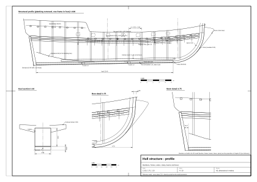
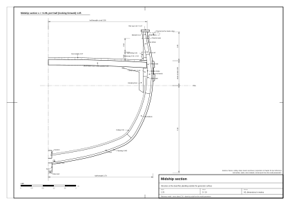

# 03. Hull construction

## What this stage is for

The lines of [chapter 02](02-hull-lines-and-offsets.md) give a smooth surface. A real hull is a structure of
hundreds of timbers: keel, stem and sternpost, frames, longitudinal strengthening, planking. Most of it is hidden,
but it decides what you *can* see: the step of the wales, the seams and butts of the planking, the frame heads inside
the bulwark, the thickness at a port opening, the keel below the water.

At the end of this chapter you will know, for each structural member, what it does, how big it is, how it looks from
outside and from the deck, and how to model it. You will also know the order in which a shipyard built the hull,
which is the best order for a model too.

Deck structure above the beams (deck planking, bulwarks, ports, stern and head) is in
[chapter 04](04-decks-bulwarks-stern-head.md).

## Concepts

- **Carvel planking**: planks laid edge to edge, seams caulked; the hull is smooth. Ships of this size were
  carvel-built. (Clinker, with overlapping planks, is for small boats only.)
- **Frame**: a transverse rib made of several pieces: the **floor** across the keel, **futtocks** above it, the
  **top timber** at the top. Pieces are joined with overlaps, not end to end.
- **Room and space**: the distance from the centre of one frame to the next.
- **Scarph (scarf)**: a long overlapping joint of two timbers, used in keel, stem, wales and clamps.
- **Treenail**: a wooden peg fastening planking to frames.
- **Wale**: a thick strake of planking that stiffens the hull lengthwise and protrudes from the side.
- **Stealer**: a short plank that ends inside the run of the planking, so that the strakes do not get too narrow
  towards the ends.
- **Sutherland 1711**: William Sutherland, *The Ship-builders Assistant*, an English shipwright's manual. Its numbers
  are for a ship of **500 tons**; we use them through the scholarly study by Kenchington [1], who warns that real
  hulls were much less tidy than manuals and models (period, via [1]).

Scaling rule used below (our inference): for a 240-ton ship we take cross-sections about 0.7–0.8 of Sutherland's 500
tons, but keep the frame spacing almost unchanged, because the spacing hardly depended on size (a 100-ton merchant
sloop wreck from Jamaica had the same 21¾ in, 552 mm) [2] (secondary).

*Figure 1. Profile of the structure of the reference model; one frame in four is drawn.*

*Figure 2. Midship structural section of the reference model, port half.*

## Rules and proportions

### Backbone

| Member | Purpose | Sutherland, 500 t (period [1]) | Our 240 t ship (our inference unless stated) | Reference model |
|---|---|---|---|---|
| Keel | Backbone; rabbet on each side takes the garboard strake | elm, up to 4 pieces; vertical scarphs ≥ 4 ft (1.2 m) with 8 bolts of 0.95 in; sided 14 in (356 mm) midships, 9.2 in (234 mm) at the post; straight, nearly constant depth | sided 0.26, moulded 0.30, scarphs 1.0 m; Jamaica sloop wreck: sided 9⅝ in (245 mm) [2] (secondary) | 0.26 sided; 0.25 below the rabbet + 0.06 false keel = 0.31 |
| False keel | Protects the keel | elm, 3.15 in (80 mm), fitted late | 0.06 | 0.06 |
| Deadwood | Fills the narrow ends with solid timber; carries the half frames | two, each about ¼ of the keel; stepped top | up to the bearding line of the offsets table | used to set the bearding line, not modelled |
| Stem | Front of the backbone; rabbet takes the plank ends | two pieces of oak; at the foot as wide as the keel, at the head as wide as the bowsprit (about 30 in) | sided 0.26 at the foot to 0.40 at the head; moulded 0.35 | same |
| Apron (false stem) | Inner doubling of the stem | 8.13 × 22.9 in (207 × 582 mm) | 0.15 × 0.40 | not modelled |
| Gripe | Forward part of the forefoot; joins keel and knee of the head; helps the ship hold her course | bolted to the stem, tapering forward | as the stem, sharper edge | part of the keel-stem solid |
| Sternpost | Carries the rudder and the transoms | one piece of oak, 32 ft (9.75 m) long, 17.25 in (438 mm) square at the head, 25.8 in (655 mm) at the heel; tenoned into the keel; inner and outer (false) posts | 0.26 sided, 0.40 at the heel, 0.28 at the head | same; after edge = hinge line of the rudder |
| Transoms | Horizontal timbers across the post forming the stern | 10–11.4 in deep, every 13 in; highest the **wing transom**, at deck the deck transom; wing transom knees 12.5 ft | 4–6 transoms; wing transom 0.30 × 0.30 | wing transom at z = +1.25 shown as a moulding 0.24 high, 0.12 proud |
| Fashion piece | Edge frame of the flat stern, joins the transom ends | lower end weakly fastened (Sutherland); later carried down to the keel | – | edge of the flat transom |
| Keelson | Longitudinal timber on top of the floors | 14 × 15 in (356 × 381 mm); bolted through every second floor | 0.25 × 0.28 | not modelled (hold not built) |

### Frames

| Member | Sutherland, 500 t (period [1]) | Our 240 t ship (our inference) | Reference model |
|---|---|---|---|
| Floor | sided 9.4 in (239 mm), moulded 14 in (356 mm) at the keel, 11 in (279 mm) at the heads | 0.20 × 0.26 | – |
| Room and space | **21.5 in (546 mm)** centre to centre; gap 12.1 in (307 mm) | **0.50–0.55** | **0.52** |
| Futtocks | 3 tiers plus top timber; overlaps ≥ 5.5 ft (1.7 m) | 2 tiers plus top timber | – |
| Top timber | 8.6 in (218 mm) sided at the head; moulding falls from 14 in at the keel to about 2.4 in at the rail (as printed; possibly an OCR error) | 0.18 × 0.12 at the head | inside the bulwark: 0.18 wide, 0.11 proud, every 0.52 |
| Half timbers | Near the ends instead of floors: two halves with the deadwood between | as Sutherland | – |
| Hawse pieces | 4 (2 per side), 22 in (559 mm) wide, flat pieces along the hull | 2 per side, 0.40 | – |
| Cant frames | not in Sutherland; one side of a framed model of about 1715 already has them [1] | optional | – |

Sutherland did **not** match the frame spacing to the gun ports: ports were cut between the timbers, with local
additions [1] (period). In a model, ports need not land on frames; but from inside you see vertical frame heads about
every 0.5 m between the ports.

### Longitudinal strength outside: wales and planking

| Member | Sutherland, 500 t (period [1]) | Our 240 t ship (our inference) | Reference model |
|---|---|---|---|
| Main wales | **two strakes 14 × 8.5 in (356 × 216 mm) with a thinner strake between**, together over 3 ft (0.9 m) wide; placed so that the bolts of the deck knees pass through them; horizontal scarphs; bent by fire at the bow ("harpings"); end on the wing transom | 2 × (0.26 × 0.13) + middle strake 0.22 × 0.09; top edge at the deck line, following the sheer | strakes 0.00–0.26 and 0.48–0.74 below the deck line, **0.06 proud**; middle strake 0.26–0.48, **0.02 proud** |
| Upper wales | 11.45 × 8 in (two-deckers) | none (one deck) | none |
| Channel wale | 8 × 4 in (203 × 102 mm) | 0.18 × 0.08, just below the channels | – |
| Sheer rail, mouldings | several mouldings near the top of the side | 0.10 × 0.06 at the rail, one at the quarterdeck level | mouldings along the rail and the quarterdeck level |
| Bottom planking | **3.35 in (85 mm)**; next to the wales up to 5 in (127 mm); near the top timbers 2 in (51 mm); thickness changes over 3–4 strakes | bottom 0.065; near the wales 0.09; side above the deck 0.05 | **0.065** |
| Garboard strake | runs into the keel rabbet | 0.07 thick, wider (0.30–0.35) | – |
| Fastening | treenails 1.75 in (44 mm), no metal | treenails 35–40 mm, 2 per plank at each frame | in the texture |
| Butts | ≥ 6 ft (1.8 m) apart along the ship, or ≥ 3 whole strakes between butts on the same frame; away from keel scarphs, pumps and ports | plank length 6–9 m (forum: usually 20–30 ft [3], secondary); butts always on a frame | in the texture |
| Stealers | not named by Sutherland; one in the *Dartmouth* wreck (1655), perhaps a repair [1] | needed: 2–4 near bow and stern, low down | not modelled (planks are a texture) |
| Plank width | not given in the study | 0.25–0.30 on bottom and sides, about 0.20 near the ends (our inference) | texture planks 0.22 wide |
| Timber | oak; in *Yarmouth* (1695) the lowest 10 ft of elm or beech; above the decks often fir deals [1] | – | – |

Near the bow and stern Sutherland preferred tapering the strakes to cutting curved planks from large timber
("snying") [1] (period).

### Inside: clamps, beams, knees

| Member | Sutherland, 500 t (period [1]) | Our 240 t ship (our inference) | Seen from the deck |
|---|---|---|---|
| Deck beam | 13 × 11.7 in (330 × 297 mm), cambered 4.8 in (122 mm); one under or beside every port and one between | 0.22 × 0.20, about every 1.1–1.3 m; camber 0.12 | from below, in the hold and cabin |
| Hanging and lodging knees | about 8.5 in thick (printed "85"), arms up to 4 ft; bolts 1.6 in every 16–18 in; forward of the dead flat the hanging knee is on the fore side of the beam, abaft it on the after side | 0.15 thick, arms 0.8–1.0 | in the hold and cabin |
| Carlings | 7.3 × 10.6 in, two rows each side | 0.13 × 0.18 | from below |
| Ledges | 3.8 × 4.5 in every 8 in | 0.07 × 0.09 every 0.20 | from below |
| Clamp | 2 strakes 15.5 × 6 in | 1 strake 0.30 × 0.12 | – |
| Spirketting (inner planking above the waterway) | 4 in between waterway and port sills; 3 in between ports | 0.06 | inside of the bulwark |
| Breasthook, crutch | horizontal knees across the bow and stern | – | – |

## Element by element: what it looks like and how to model it

**Keel and false keel.** Under water only the lowest 0.15–0.25 m shows below the planking; on a slip or in dry dock
you see a heavy beam with long scarphs and a row of bolt heads, and a lighter strip (the false keel) underneath
(our inference). *Model:* one solid strip along the rabbet line, constant section, from the sternpost heel to the
forefoot, merging into the stem. In the reference model keel and stem are one solid built along the rabbet curve.

**Stem, gripe, apron.** From outside: a broad vertical band at the bow, widening upwards to 0.40 m, with the knee of
the head projecting in front of it. *Model:* sweep a rectangle along the stem rabbet curve, widening with height; the
outer face 0.35 m in front of the rabbet. Do not model the apron.

**Sternpost.** A slightly raked vertical band at the stern, carrying the gudgeons of the rudder. *Model:* a straight
solid from below the keel to the wing transom; its after edge is the rudder's hinge line. In the reference model the
post face stays 35 mm forward of the hinge line so the rudder can turn ±35° without touching it.

**Deadwood.** Invisible under the planking, but it gives the after body its "fin" shape. *Model:* do not build it;
use it only to define the bearding line in the offsets (chapter 02).

**Frames.** Visible only inside the bulwark (frame heads, every 0.52 m) and in the hold. *Model:* boxes 0.18 × 0.11
inside the bulwark between deck and rail, skipping port openings; nothing below the deck unless you build the hold.

**Wales.** The most important detail seen from the water. They stand **50–70 mm proud** of the planking, and the
upper and lower faces of the proud part are **horizontal**, not square to the side; up close they read as sharp
shelves [1] (period) and (our inference for the size). Above and below them the planking thickens gradually over 3–4
strakes [1]. *Model:* separate thicker strips that follow the deck sheer (not the bottom strakes), pushed outward
along the surface normal, with horizontal top and bottom faces. The reference model builds them as rows of the hull
mesh offset outward by 0.06 and 0.02.

**Planking.** Smooth carvel surface; seams caulked and payed, so they show as dark lines 6–10 mm wide; butts as
short darker vertical lines every few metres, stepped; treenail heads as pale dots, in pairs at each frame, irregular
rather than in a perfect grid (the *Dartmouth* wreck is irregular [1]). *Model:* for a game or film model, one
surface with seams, butts and treenails in the texture and normal map is enough; give real thickness only where a
cut edge is seen (port openings, the stern, the rail). For a close study model, build strakes as separate ribbons
(see the planking steps below).

**Hawse pieces.** Not visible as such; they are where the hawse holes are cut (chapter 04).

**Beams, knees, carlings, ledges.** Visible only from below decks. If you build a cabin or a hold, the beams must
follow the camber and sit on the clamp; knees are where people hit their heads.

**Bottom protection.** Copper sheathing did not yet exist: proposed in 1708 and rejected for its cost; the first full
coppering was HMS *Alarm* in 1761 [4] (secondary, two agreeing sources). Instead (period and our inference):

- **wooden sheathing**: the *Dartmouth* wreck (1655) had ½ in (13 mm) pine boards over a layer of hair and tar,
  nailed with flat-headed nails, covering the seams of the planking [1] (period, archaeology). In Caribbean waters,
  against shipworm, this was normal (our inference);
- **coatings**: "white stuff" (train oil, rosin, sulphur), "black stuff" (tar and pitch), "brown stuff" (black stuff
  with sulphur) [4] (secondary). Appearance: a creamy-white bottom when fresh, turning dirty grey, with green weed at
  the waterline; or black (our inference).

**Paint of the period.**

- Most hulls: **oiled bare wood**, renewed by scraping and oiling; **wales tarred black** [5] (secondary).
- An Admiralty order of 12 July 1715 asked for **yellow and black** outside and one colour inside; according to
  Konstam (via Wikipedia) it was widely ignored [5] (secondary).
- Yellow or buff ochre gradually replaced plain oil [5] (secondary). Carvings and friezes were often yellow or gilt;
  the RMG model SLR0416 (c. 1720) has painted bulwark panels (friezes) and a painted counter [6] (period, model).
- **Red inside the bulwarks** is repeated in modelling literature, but we found no source for 1700–1720 (unconfirmed).

| Region | Reference model, scheme A (period-based) | Reference model, scheme B (darker variant) |
|---|---|---|
| Bottom up to 0.05 m above the waterline | off-white (white stuff) | dark red-brown |
| Side from the waterline to the wales | oiled oak | black |
| Wales | black | black |
| Side above the wales and port band | yellow ochre | black, ochre band along the ports |
| Rail and mouldings | black | black |
| Inside the bulwark | oiled wood (red as an option) | red |
| Carvings | yellow (gilt-looking) | yellow |

Scheme A follows the period evidence above; scheme B is a later-looking variant (reference model; colour choice is
our inference).

## The shipyard order of building

Sequence of a wooden shipyard of the period, as far as we can reconstruct it (our inference; Sutherland's text, as
summarised in [1], describes the members, not a dated schedule). Build your model in the same order: each step
depends on the one before.

1. **Lay the keel** on the building blocks on a slip sloping towards the water; scarph the pieces and bolt them.
2. **Raise the stem and the sternpost**, tenoned into the keel, and shore them; fit apron, inner post, gripe.
3. **Fit the deadwood** fore and aft, stepped on top, up to the bearding line.
4. **Raise the midship frames** first (the dead flat), then frame by frame towards the ends, using the body mould,
   the rising line and the narrowing lines ("whole moulding") [7] (secondary). Near the ends set half timbers on the
   deadwood, and the transoms and fashion pieces at the stern.
5. **Hold the frames with ribbands**: temporary battens nailed round the outside, which also show whether the
   frames are fair. Dub (adze) the frames fair where they are not.
6. **Fit the keelson** over the floors and bolt it through to the keel.
7. **Fit the wales**, the thickest strakes, which give the shape of the sheer.
8. **Plank the bottom**: from the garboard strake upwards and from the wales downwards, closing in the middle;
   stealers where the girth shrinks. Butts on frames, spread out.
9. **Fit the inside**: ceiling in the hold, clamps, then the **deck beams** on the clamps, the knees, carlings and
   ledges, the waterways.
10. **Lay the deck** (chapter 04) and build the **bulwarks**, ports, rails, stern and head.
11. **Caulk**: drive oakum into all seams, pay them with hot pitch; scrape the side fair.
12. **Treat the bottom**: coating, and wooden sheathing where shipworm is a danger.
13. **Launch**, then step the masts and rig the ship (chapters 05–08, starting with [chapter 05](05-masts-and-spars.md)), fit the deck machinery ([chapter 09](09-deck-machinery.md)).

## Step by step: modelling the structure

1. **Decide the level of detail.** For a ship seen from 5 m or more, build: keel and stem solid, sternpost, wales as
   proud strips, a single planking surface with a planking texture, frame heads inside the bulwark. For a close
   study model add the strakes as ribbons, the butts and treenails as geometry or normal map, and the inner
   structure below deck.
2. **Keel and stem.** Sweep a rectangle 0.26 wide along the rabbet line from the post heel to the forefoot, then
   along the stem curve; let the depth below the rabbet be 0.31 (keel) and 0.35 in front of the stem rabbet; widen
   the stem from 0.26 to 0.40 towards the head.
3. **Sternpost.** A straight solid along the post line at 11.4° rake, 0.26 sided, 0.40 to 0.28 moulded, from the
   underside of the keel to the wing transom.
4. **Planking surface.** Take the moulded surface from chapter 02 and offset it outward by the planking thickness
   (0.065 m), tapering to zero where it meets the deadwood and stem rabbet.
5. **Strakes (if needed).** Measure the girth of each station from rabbet to deck. In the reference model it is
   about 6.0 m per side at midships and about 3.1 m at station +12.96 (our calculation from the offsets). Divide the
   midships girth into 22–24 strakes of 0.25–0.28 m. At the ends 24 strakes would be only 0.13 m wide, too narrow,
   so end 2–4 low strakes early as stealers where the girth shrinks fastest (our inference; a general shipwright's
   rule, not described by Sutherland [1]).
6. **Strake lines.** Let the seams follow the sheer in the middle of the side and fall more and more towards the
   ends lower down; they are not parallel to the waterline. Twist the garboard and the 2–3 lowest strakes so that
   they stand nearly vertical against the after deadwood; without this the stern looks like a box (our inference).
7. **Wales.** Build them as separate solids above the planking: two strakes 0.26 high, 0.06 proud, with a 0.22 strake
   0.02 proud between them, the upper edge on the deck line at the side, following the sheer, ending on the wing
   transom aft.
8. **Butts and treenails.** Plank lengths 6–9 m; at any frame at least 3 whole strakes between two butts; no butts at
   ports. Treenails 35–44 mm at each frame crossing, two per plank, slightly irregular.
9. **Frame heads inside.** Every 0.52 m, boxes 0.18 × 0.11 from deck to rail, left out where a port is cut, and with
   a gap wide enough for a gun carriage at each port.
10. **Paint regions.** Split the surface at the waterline (+0.05 m), the lower edge of the wales and the upper edge of
    the port band, so each region gets its own material.

## Worked example: the planking of the reference model

- Girth at midships, moulded, rabbet to deck: about 6.0 m per side (our calculation). Our research notes give
  6.5 m, measured probably to a different point (discrepancy noted).
- 6.0 / 0.26 = 23 strakes per side; with the wales counted as three of them, 20 ordinary strakes.
- At station +12.96 the girth is 3.1 m: 23 strakes would be 0.135 m wide, half the midship width. With three stealers
  ending between stations +9.46 and +12.96, 20 strakes remain at the stem, each about 0.155 m (our inference).
- Planks of 7.5 m: 28 m / 7.5 m ≈ 4 planks per strake; butts shifted by 1.8–2.5 m between neighbouring strakes,
  always on a frame (frames every 0.52 m, so a shift of 4 frames = 2.08 m).
- Treenails: 2 per plank per frame, so about 2 × 54 = 108 per strake on each side (54 frames in 28 m).

## Check yourself

- [ ] Keel shows 0.15–0.25 m below the planking (reference model: 0.31 m including false keel).
- [ ] Frame spacing 0.50–0.55 m (reference model 0.52).
- [ ] Planking 60–90 mm thick (reference model 0.065); plank width 0.20–0.30.
- [ ] Wales 50–70 mm proud, with horizontal top and bottom faces, top edge at the deck line.
- [ ] 20–26 strakes at midships; no strake narrower than about half its midship width at the ends.
- [ ] Butts 6–9 m apart along a strake, never two adjacent strakes butting on the same frame.
- [ ] No copper on the bottom; whitish, black or brownish bottom.
- [ ] Ports cut between frames, with frame heads visible inside between them.

## Typical mistakes

1. Strakes as straight horizontal lines from bow to stern, without convergence and without stealers.
2. Planks too wide (0.4–0.6 m) or a single "wood" texture with no seams.
3. Wales missing or only painted on, without protrusion.
4. Keel of constant depth with no gripe; stem as a plain wedge.
5. Bulwark as thin as paper; no frame heads inside.
6. Copper bottom on a ship of 1710.
7. Butts lined up vertically on several strakes.
8. Treenails in a perfect grid.

## Sources

1. T. Kenchington, "The Structures of English Wooden Ships: William Sutherland's Ship, circa 1710", *The Northern
   Mariner* III/1 (1993), 1–43, with the framed model of c. 1715, the *Yarmouth* contract (1695) and the *Dartmouth*
   wreck (1655). https://cnrs-scrn.org/northern_mariner/vol03/tnm_3_1_1-43.pdf. © CNRS-SCRN; summarised in our own
   words. Main source of this chapter.
2. "Analysis of Wooden Vessel Structure Remaining at BISC-0002", quoting G. Cook (1997) on an 18th-century merchant
   sloop at St. Ann's Bay, Jamaica (second-hand data; the wreck may be late 18th century).
   https://www.researchgate.net/publication/292145951_Analysis_of_Wooden_Vessel_Structure_Remaining_at_BISC-0002.
3. Modelling forums on planking and butts (low certainty):
   https://modelshipworld.com/topic/14192-18th-century-deck-planking-shifts.
4. USNI *Naval History*, "Copper-Bottoming the Royal Navy" (2019)
   https://www.usni.org/magazines/naval-history-magazine/2019/june/copper-bottoming-royal-navy; Wikipedia "Copper
   sheathing" https://en.wikipedia.org/wiki/Copper_sheathing (CC BY-SA).
5. Wikipedia, "Nelson Chequer" (after Konstam 2010 and Goodwin 2013) https://en.wikipedia.org/wiki/Nelson_Chequer
   (CC BY-SA).
6. Royal Museums Greenwich, model SLR0416, 12-gun sloop c. 1720
   https://www.rmg.co.uk/collections/objects/rmgc-object-66377 (view only, RMG licensing terms).
7. Boats & Builders Project, "Whole Moulding" https://www.boatsandbuilders.com/blog/boat-building/whole-moulding.
8. W. Sutherland, *The Ship-builders Assistant* (1711), public domain scan:
   https://archive.org/details/bim_eighteenth-century_the-ship-builders-assist_sutherland-william-shi_1711 (we used
   it through [1]).
9. D. Steel, *The Shipwright's Vade-Mecum* (1805), public domain scan:
   https://archive.org/details/shipwrightsvade00steegoog (later; for member names and general practice).

## Terms used in this chapter

| English | Polish | Explanation |
|---|---|---|
| keel | stępka | Main longitudinal timber at the bottom. |
| false keel | fałszywa stępka | Sacrificial strip under the keel. |
| keelson (kelson) | nadstępka | Longitudinal timber on top of the floors, over the keel. |
| deadwood | dejwud | Solid timber in the narrow ends above the keel. |
| stem | dziobnica | Forward member of the backbone. |
| apron, false stem | kontrdziobnica | Inner doubling of the stem. |
| gripe, forefoot | gryf (ostroga podwodna) | Forward lower part where keel turns into stem. |
| sternpost | tylnica | After member of the backbone; carries the rudder. |
| inner post / false post | tylnica wewnętrzna / zewnętrzna | Doublings of the sternpost. |
| transom | pawęż (belka pawężowa) | Horizontal timber across the sternpost. |
| wing transom | pawęż skrzydłowa | Highest transom, at the top of the flat stern. |
| fashion piece | wręg ramowy rufy (wręg skośny rufowy) | Frame forming the edge of the flat stern. |
| frame, timber | wręg | Transverse rib. |
| floor (timber) | dennik | Lowest piece of a frame, across the keel. |
| futtock | futoks | Middle pieces of a frame. |
| top timber | wierzchołek wręgu | Upper piece of a frame; its head shows inside the bulwark. |
| half timber | pół-wręg | Frame half standing on the deadwood near the ends. |
| cant frame | wręg skośny | Frame not square to the keel, near the ends. |
| room and space | odstęp wręgów | Frame spacing, centre to centre. |
| hawse piece | kłodzina kluzowa | Fore-and-aft timber at the bow in which the hawse holes are cut. |
| scarph (scarf) | zamek (połączenie na zakładkę) | Long overlapping joint. |
| planking, strake, plank | poszycie, pas poszycia, klepka | Outer skin; one run of planks; one plank. |
| garboard strake | pas przystępkowy | Strake next to the keel. |
| stealer | klepka wklinowana | Strake that ends early to keep widths even. |
| butt | styk klepek | End-to-end joint of two planks. |
| treenail (trenail) | kołek (gwóźdź drewniany) | Wooden peg fastening plank to frame. |
| carvel | karawelowe (krawędź w krawędź) | Planks laid edge to edge. |
| wale, main wale | berghołt | Thick protruding strake for longitudinal strength. |
| channel wale | pas wantowy | Thin wale under the channels. |
| sheer rail, moulding | listwa burtowa | Decorative strip along the side. |
| deck beam | pokładnik | Transverse timber carrying the deck. |
| hanging / lodging knee | kolano wiszące / leżące | Angle brackets joining beam and side, vertical / horizontal. |
| carling | wzdłużnik pokładu | Short longitudinal between beams. |
| ledge | legar | Small transverse timber between carlings. |
| clamp | wzdłużnik podpokładnikowy | Inner longitudinal strake on which the beams rest. |
| spirketting, ceiling | wewnętrzne poszycie burty | Inner planking of the side. |
| breasthook / crutch | wzmocnienie dziobu / rufy (poziome kolano) | Horizontal knee across the bow / stern. |
| ribband | listwa montażowa (rybanda) [uncertain] | Temporary batten holding frames before planking. |
| caulking, oakum, paying | uszczelnianie (kalfatowanie), pakuły, zalewanie smołą | Making seams watertight. |
| sheathing | poszycie ochronne | Thin protective skin on the bottom. |
| coppering | miedziowanie | Copper sheathing; not before 1761. |
| shipworm | świdrak | Marine mollusc that bores into wood. |
