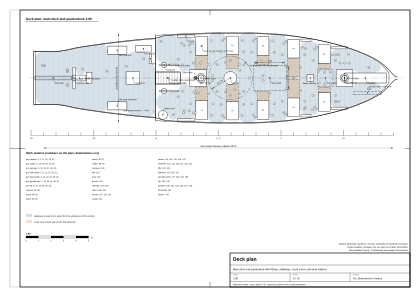
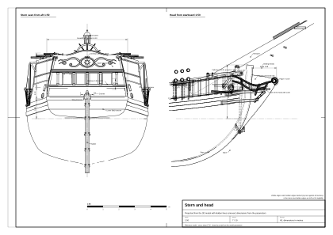

# 04. Decks, bulwarks, stern and head

## What this stage is for

This stage closes the hull at the top and gives it its face: the deck people walk on, the bulwarks they lean on, the
gun ports, the fittings that carry rigging and anchors, the decorated stern and the head. These are the parts seen
most closely in a game, a film or on a model's display stand, so they need the most care with size and placing.

At the end of this chapter you will have:

- the main deck and quarterdeck with planking, camber and sheer;
- bulwarks with rail, ports and lids, scuppers, channels;
- catheads, hawse holes and knightheads at the bow;
- a flat transom with windows, counter and carvings;
- a rudder hung on pintles and gudgeons;
- the knee of the head with cheeks, rails, gratings and a scroll;
- a deck layout that leaves room to walk and to work.

The hull surface comes from [chapter 02](02-hull-lines-and-offsets.md), the structure under the deck from
[chapter 03](03-hull-construction.md). Machinery placed on the deck is described in
[chapter 09](09-deck-machinery.md); here we only reserve its space.

## Concepts

- **Waist**: the open part of the main deck between forecastle (if any) and quarterdeck.
- **Quarterdeck**: a raised deck over the after part of the ship; the cabin is below it.
- **Forecastle**: a raised deck at the bow. The reference model has none.
- **Break**: the bulkhead where a raised deck ends; the step in the bulwark there is the **hance**.
- **Waterway**: a thick plank along the edge of the deck at the side that leads water to the scuppers.
- **Rail, rail cap**: the top of the bulwark.
- **Channel**: a thick board outside the hull that spreads the shrouds clear of the rail.
- **Counter**: the overhanging part of the stern between the wing transom and the windows; the rudder stock passes
  through the **helm port** in it.
- **Head**: the structure in front of the stem: the knee of the head, cheeks, head rails, gratings, figure.

*Figure 1. Deck plan of the reference model with the walkway test result.*

## Rules and proportions

### Decks

| Item | Period or secondary value | Reference model | Confidence |
|---|---|---|---|
| Main deck at side, midships | – | z = +0.90 (0.91 at s = 0), 1.03 m in the centreline | reference model |
| Sheer at stem / transom | – | +1.05 at s = +14.6, +0.48 at s = −15.0 above the midship value | reference model; research range 0.7–1.3 / 0.3–0.7 (our inference) |
| Camber | 4.8 in (122 mm) on the gun deck of a 500-ton ship [1] | 0.12 m (parabolic, measured at the side half-breadth 3.80) | period, scaled (our inference) |
| Deck planking thickness | oak 2.9 in (74 mm) for 500 t [1]; *Yarmouth* 4 in (102 mm) with fir between the hatches [1] | 0.07 | period; reference model |
| Deck plank width | *Royal Caroline* 1749 about 5.75 in (146 mm) [2] | 0.18–0.25 (texture 0.24) | secondary (forum); our inference |
| Deck plank length, butts | butts on beams, ≥ 3 strakes between butts on the same beam [2] | 6–9 m | secondary; our inference |
| Fastening | 2 nails per beam, 2 treenails per ledge [1] | in the texture | period |
| Waterway | *Yarmouth*: 6 in sunk, 14 in wide, L section leading water to the scuppers [1] | 0.25 wide, 0.10 thick | period; reference model |
| Quarterdeck height above main deck | – | 1.70 | reference model (research 1.6–1.8, our inference) |
| Quarterdeck start (break) | about ⅓ of the length from the stern | s = −5.04 | reference model |
| Quarterdeck beams, planking | 7.2 × 4.8 in every 24–28 in; deck 2 in, no carlings [1] (500 t) | beams 0.15 × 0.11 every 0.6; planks 0.05 | period; our inference |
| Clear height in the cabin | – | about 1.5–1.6 (1.70 minus beams) | our inference |

### Bulwarks and ports

| Item | Period or secondary value | Reference model | Confidence |
|---|---|---|---|
| Bulwark height in the waist | – | 1.05 above the deck at side, rising to 1.20 at the bow | reference model (research 0.95–1.15, our inference) |
| Bulwark at the quarterdeck | – | 0.90 above the quarterdeck (rail 2.60 above the main deck line) | reference model |
| Bulwark thickness | – | 0.14 (planking 0.05 + top timbers 0.12, the rest inside) | reference model |
| Rail cap | – | 0.30 × 0.07 | reference model, provisional |
| Port, 500-ton ship | 32 × 27 in (813 × 686 mm), sill 25 in (635 mm) above the deck planks [1] | – | period |
| Port width, 20-gun sixth rate (6 pdr) | 2 ft 3 in (686 mm) [3] | – | secondary (forum, "Establishment dimension") |
| Murray's rule (1765) | sill ≈ 3.5 shot diameters above the deck; port height ≈ 6 diameters [3] | – | secondary (forum transcription) |
| Port for a 4-pounder (shot 77 mm) | – | **0.60 wide × 0.50 high, sill 0.32 above the deck** | our inference from the rows above; reference model |
| Port for a 6-pounder (shot 89 mm) | – | 0.66 × 0.55, sill 0.35 | our inference |
| Port spacing | *Wolf*: 8 pairs in 87.5 ft; *Drake*: 7 pairs in 85 ft [4] | 2.45 m between centres | secondary; spacing our inference |
| Ports in the reference model | – | 7 pairs, centres at s = −6.24 (closed, under the quarterdeck), −3.79, −1.34, +1.11, +3.56, +6.01, +8.46 | reference model |
| Sill above the waterline | – | 1.22–1.50 (lowest at midships) | measured in the reference model |
| Port lids | hinged at the top, opened outward by a lanyard through a hole above the port to a small tackle inside; a bar inside to close [5] | 0.07 thick, curved like the side, two iron hinge straps; open 95°, range 0–100° (85° at ports under the channels, 75° at the aftmost) | secondary (later drill book); reference model |
| Lids on sloops | not all ports had lids [5] | all ports have lids | secondary |
| Oar (sweep) ports | between gun ports; *Drake*: two pairs at each gun port [4]; SLR0416: 10 oar ports [6] | not in the reference model; suggested 0.15–0.20 square, centre 0.30–0.40 above the deck | secondary / period (model); size our inference |
| Scuppers | lead-lined holes through the waterway, leather flap outside [5] | between the ports plus one fore and one aft, 7 per side; lead lips 0.16 × 0.08 | secondary; reference model |

### Fittings at the side and bow

| Item | Period or secondary value | Reference model | Confidence |
|---|---|---|---|
| Channels | 500 t: up to 26 in wide × 3–5 in thick [1] | 0.45 wide × 0.09 thick, at the top of the bulwark above the ports | period; reference model (research 0.40–0.50 × 0.08–0.10) |
| Chain plates | iron links from the deadeyes down to bolts in the channel wale or main wale [1] | between the ports | period; placing our inference from models |
| Catheads | beam projecting sideways and forward at about 45°, 2–3 sheaves at the outer end, inner end on a cat-beam [7] | 0.25 square, 1.15 outboard, at s = +12.35, at rail height, with a curved supporter below | secondary; reference model (research 1.0–1.6 outboard) |
| Hawse holes | in the hawse pieces, 1 (sometimes 2) per side, high near the stem under the cathead; lead-lined; plugged in bad weather [5] | 1 per side, Ø 0.28, centre at s = +13.05, z = +1.50, wooden bolster ring | secondary; size our inference |
| Knightheads | upright timbers each side of the bowsprit over the stem: new around 1710; a generation earlier the bowsprit lay beside the stem [1] | 0.22 square, at x = ±0.31 | period; reference model |

### Stern

| Item | Period or secondary value | Reference model | Confidence |
|---|---|---|---|
| Stern type | flat transom (square tuck): in 1710 English builders had given it up almost only in two-deckers [1]; Boston sloops mostly square sterns [8] | flat transom, raked 11.4° with the post | period; reference model |
| Wing transom | top of the flat transom; wales end on it [1] | z = +1.25 | period; reference model |
| Counter | above the wing transom, overhanging; helm port in it; counter rail about 10 × 7.5 in for 500 t [1] | from z = +1.25 to +1.97, overhang 0.85 m | period; reference model (research suggested 0.6, enlarged so the rudder head fits) |
| Upper transom (window panel) | – | from z = +1.97 to +4.15, raked about 8°, rounded 0.22 m in plan | reference model, provisional |
| Stern windows | on a sloop 2–4 | 4 windows 0.54 × 0.70, sills at z = +2.18, centres x = ±0.42, ±1.26, pilasters between | our inference; reference model |
| Galleries | stern and quarter galleries belong to large ships; on a 20–28 m sloop a carved quarter piece or nothing | no galleries; one small window 0.46 × 0.36 in each quarter, with carved frame | our inference; reference model |
| Decoration | SLR0416: painted and carved counter [6] | frieze above the windows (cartouche, S scrolls), carved corners, crown on the taffrail, lantern | period (model); reference model, carving shapes provisional |

### Rudder

| Item | Period or secondary value | Reference model | Confidence |
|---|---|---|---|
| Hanging | pintles on the rudder, gudgeons on the post; 3–5 pairs [5] | 5 pairs, pintles at z = −2.9, −1.9, −0.9, +0.1, +0.95 | secondary; reference model |
| Rudder head | enclosed inside the hull in English ships from 1690–1700 [1] | stock Ø 0.34 through the helm port into the cabin | period; reference model |
| Blade width | 0.8–1.0 at the foot | 0.95 at the foot, 0.92 at z −2.0, 0.82 at −0.5, 0.66 at +0.5, 0.45 at +1.1, 0.30 above +1.45 | our inference; reference model |
| Blade thickness | – | 0.26 at the hinge edge, 0.13 at the after edge | reference model |
| Rudder angle | about ±35° | ±35° | secondary (game value) [5]; reference model |

### Head

| Item | Period or secondary value | Reference model | Confidence |
|---|---|---|---|
| Knee of the head | bolted through the stem, tapering forward [1] | projects up to 1.58 m before the stem face, 0.24 thick narrowing upward | period; reference model (research 1.5–2.0) |
| Figure | small ships about 1720: a **scroll** (*Swift* 1721 plan, SLR0416) [6], [9]; the standard figure of smaller RN ships in the 17th–18th centuries was a **lion** [10]; a Navy Board letter of 1710 criticises excessive decoration [11] | scroll of 0.30 m radius, 1.6 turns, at z = +2.30 | period (plan, model); secondary |
| Cheeks | curved knees joining the knee of the head to the bow | 2 per side, at z = +1.05 and +1.62, section 0.16 × 0.11 | our inference; reference model |
| Head rails, timbers, gratings | 2–3 curved rails per side from the cathead to the figure, gratings between (seat of ease for the crew) | 2 rails per side (Ø 0.10), 3 head timbers per side, gratings at z = +1.86 with battens every 0.075 | our inference; reference model |

## Step by step: building the deck and its edges

1. **Deck line at the side.** Take the deck heights at side from Table B of chapter 02 and draw a smooth curve along
   the inside of the hull (sheer). In the reference model: z = 0.90 at s = +1.96, rising to 1.85 at the stem and 1.38
   at s = −15.0.
2. **Camber.** For each position s, the deck height at a distance x from the centre is
   z = z_side + 0.12 · (1 − (x / 3.80)²) when the side is at the full half-breadth. In the reference model all beams
   come from one curve: z(s, x) = z_centre(s) − 0.12 · (x / 3.80)².
3. **Deck planks.** Lay them **parallel to the centreline, not to the side**. Width 0.18–0.25 (0.24 in the
   reference model texture), length 6–9 m, butts on beams, at least three strakes between butts on the same beam;
   black seams; rows of fastening heads across the deck over each beam.
4. **Waterway.** Along the side, a plank 0.25 × 0.10 standing above the deck with a rounded fillet up to the
   bulwark. At the ends, where the side curves, cut the deck planks into it rather than bending them (our
   inference).
5. **Bulwark.** Offset the hull surface inward by the bulwark thickness (0.14 in the reference model) from the deck
   to the rail. Inside, place the frame heads every 0.52 m (chapter 03) or planking (spirketting). Rail height: 1.05
   in the waist, 0.90 above the quarterdeck.
6. **Rail cap.** A board 0.30 × 0.07 on top, with a moulded outer edge, following the sheer; it continues across
   the stern as the taffrail.
7. **Quarterdeck.** Start at s = −5.04 with a bulkhead across the ship. Deck 1.70 above the main deck, with its own
   sheer and camber. In the bulkhead: two cabin doors 0.72 × 1.56 at x = ±1.25 and a ladder in the centre. On top:
   a rail (balustrade) 0.90 high with balusters every 0.22 m, open for the ladder.
8. **Hance.** Where the bulwark steps up to the quarterdeck, make the transition a curve with a carved volute.
9. **Ports.** Cut rectangular openings with vertical sides and sill and lintel following the sheer. Give the cut
   faces the full thickness of the side (they are seen from close). Sill 0.32 above the deck at side, lintel 0.82,
   width 0.60.
10. **Lids.** A separate object for each lid, 0.07 thick, shaped to the hull curvature, hinge axis along the top
    edge outside, opening outward and up; range 0–100°. Check each open lid against the channels and mouldings and
    limit its angle if it collides (85° and 75° in the reference model).
11. **Scuppers.** Small lead-lined openings just below the deck line, between ports.
12. **Channels and chain plates.** Board 0.45 × 0.09 outside, at the top of the bulwark, over the main and fore
    shrouds; chain plates down to the wales between the ports (rigging in [chapter 06](06-standing-rigging.md)).

## Step by step: the stern

1. **Transom plane.** Continue the sternpost rake (11.4°) upward from the heel to the wing transom; this plane is the
   flat lower stern. Its outline is the end of every waterline and of the planking.
2. **Wing transom.** A heavy moulding across the stern at z = +1.25 (0.24 high, 0.12 proud).
3. **Counter.** Above the wing transom the stern overhangs aft and curves up to z = +1.97 (overhang 0.85). Leave a
   helm port in its centre for the rudder stock.
4. **Upper transom.** From z = +1.97 to the taffrail, raked about 8°, slightly rounded in plan. Mouldings at the
   counter top, under and over the windows, at the quarterdeck level.
5. **Windows.** Four lights 0.54 × 0.70, sills at z = +2.18, centres ±0.42 and ±1.26; frames 0.07 wide; glass set
   just inside the face; pilasters between.
6. **Decoration.** A frieze above the windows (cartouche, S-shaped scrolls, small leaves), carved corner pilasters,
   a taffrail crown, a stern lantern on an iron bracket. Keep it flat (relief, not galleries).
7. **Quarters.** On each side of the quarterdeck: a moulding at mid-height, a small window with a carved frame. No
   quarter gallery.

*Figure 2. Stern and head of the reference model.*

## Step by step: the rudder

1. **Hinge line.** It is the after edge of the sternpost, a straight line at 10.1° to the vertical. The post tapers
   from 0.40 m at the heel to 0.28 m at the head, so its after edge stands a little steeper than the rabbet line
   (11.4°). All rotation happens about the hinge line; `data/moving-parts.csv` gives it as the `axis_dir` of the
   rudder.
2. **Blade.** Sweep a section along the hinge line from the keel bottom up to about z = +1.7: a half-round leading
   edge on the hinge line (0.26 thick) running back to a square after edge 0.13 thick; width 0.95 at the foot,
   narrowing upward (see the table).
3. **Stock.** A round stock Ø 0.34 continues up the hinge line through the helm port into the cabin, with iron
   hoops.
4. **Pintles and straps.** Five iron pintles on the hinge line; straps along both faces of the blade, ending 0.10 m
   aft of the hinge line so they never touch the post when the rudder turns.
5. **Gudgeons.** On the post, matching the pintles, with arms 0.65 m long along the hull on both sides.
6. **Pivot.** Put the object origin on the hinge line and its local axis along it; rotation ±35°. The tiller (deck
   variant) or the cabin tiller (wheel variant) are children of the rudder (chapter 09).

## Step by step: the head and the bow fittings

1. **Knee of the head.** A solid 0.24 thick in front of the stem, curving forward to project up to 1.58 m, then back
   under the figure.
2. **Figure.** A scroll (volute) of about 0.30 m radius at z = +2.30, eye on each side; or a lion for a navy ship
   that needs one.
3. **Trailboards and cheeks.** A carved board on each side of the knee; two cheeks per side from the bow planking to
   the knee.
4. **Head rails.** Two curved rails per side from just forward of the cathead down and forward to the back of the
   figure; three head timbers per side join them to the cheeks.
5. **Gratings.** Two half gratings on each side of the knee at z = +1.86, with a border.
6. **Catheads.** A beam 0.25 square from the deck, out through the bulwark at about 45° forward, 1.15 m beyond the
   side, with two sheave slots and a carved end; a curved supporter under it.
7. **Hawse holes.** One per side below and aft of the cathead, Ø 0.28, with a wooden bolster round it and an iron or
   lead lining.
8. **Knightheads.** Two posts 0.22 square either side of the bowsprit, rising above the rail.

## The deck layout of the reference model

Positions s from the mid-length of the deck, positive forward; x across, positive to port (reference model; the
current values are in `data/parameters.json` and `data/deck-layout.json`).

| Item | s (m) | x (m) | Size (m) | Level |
|---|---|---|---|---|
| Stem at the deck | +14.00 | 0 | – | main |
| Knightheads, hawse holes, catheads | +13.4 / +13.05 / +12.35 | ±0.31 / side / side | see above | main |
| Foremast | +10.08 | 0 | Ø 0.45 at deck | main |
| Fore hatch | +8.05 … +9.05 | 0 | 1.0 × 1.2, coaming 0.25 | main |
| Galley chimney | +7.35 | 0 | 0.35 × 0.35 × 0.8 | main |
| Main hatch | +2.90 … +5.30 | 0 | 2.4 × 1.8, coaming 0.25 | main |
| Capstan | +0.95 | 0 | head Ø 0.94, bars to radius 1.75 | main |
| Mainmast / trysail mast | −1.40 / −1.85 | 0 | Ø 0.49 / 0.17 | main |
| Pumps | −4.35 | ±1.05 | Ø 0.35, brake 1.5 | main |
| Drinking cask | −4.45 | −2.95 | Ø 0.65 × 0.9 | main |
| Quarterdeck break, ladder | −5.04 | 0 | ladder 0.9 wide, 9 steps | – |
| Bell | −5.45 | +1.55 | frame 0.75 wide | quarterdeck |
| Arms chest | −6.0 | +2.35 | 1.2 × 0.5 × 0.5 | quarterdeck |
| Companion to the cabin | −7.35 … −6.35 | 0 | 0.9 wide, 1.0 high | quarterdeck |
| Hen coops | −8.1 | about ±2.6 | 1.5 × 0.6 × 0.6 | quarterdeck |
| Binnacle | −10.35 | 0 | 0.9 × 0.45 × 0.85 | quarterdeck |
| Wheel (default) | −11.55 | 0 | Ø 1.40, axle 1.05 high | quarterdeck |
| Swivel guns | −6.6, −9.4, −12.2, +11.6 | both rails | – | rails |
| Carriage guns | −1.34, +1.11, +3.56, +6.01, +8.46 | both sides | carriage 1.5 × 0.8 | main |
| Boat (yawl) | towed astern by default | – | 5.0 × 1.72 × 0.72 | – |

### Placement rules

Used to test the reference model with a walking figure of radius 0.30 m and height 1.75 m (reference model; the
rules themselves are our inference):

1. **Walkways at least 0.8 m wide** everywhere between items and bulwarks (the test found none narrower).
2. **Every work station reachable** from the ladder without climbing over anything (127 stations on deck, all
   reachable).
3. **Capstan bars must turn free** of masts, hatches and pumps. In the reference model the bars reach 1.75 m from
   the centre (a 3.5 m circle); our research suggested bars of 2.8–3.2 m (a 6.5 m circle), which does not fit
   between the masts of a 7.6 m wide deck (conflict noted).
4. **Gun recoil** of about 1.5 m must not block the only walkway. In the reference model the recoil of some guns is
   limited by the mainmast fife rail, the capstan base, the main hatch and the fore hatch (0.4–1.3 m); only the guns
   at s = +6.01 recoil the full 1.5 m.
5. **Ladders** about 41°: rise 0.19, going 0.22, width 0.9 (reference model: 9 steps to the quarterdeck).
6. **Hatches** of a small ship 1.2–1.8 m, not 3 m (our inference); coamings 0.2–0.3 high (our inference).
7. **Bulwark** 1.0–1.1 m: hip to chest of a man; a port must never be taller than a man [3] (our inference from
   gun lengths: a 4-pounder barrel is about 1.8 m long).
8. **Headroom** under the quarterdeck about 1.5–1.6 m; officers stooped.

## Worked example: port sills of the reference model

The deck at side at the port s = +1.11 is at z = 0.90; the sill is 0.32 above it, so z = 1.22 above the water. At
the forward port s = +8.46 the deck has risen with the sheer to about 1.18, so the sill is at about 1.50. The model's
check file gives sills of 1.22–1.50 m above the waterline (measured in the reference model). The rule "port sill
about 1.2 m above the water at midships" (our inference) is met.

## Check yourself

- [ ] Deck planks parallel to the centreline; butts on beams; width 0.18–0.25.
- [ ] Camber 1–2 % of the breadth (reference model 0.12 on 7.6, 1.6 %).
- [ ] Waist bulwark 0.95–1.15 m (reference model 1.05); quarterdeck bulwark about 0.9.
- [ ] Ports 0.55–0.66 wide, 0.50–0.55 high; sill 0.30–0.55 above the deck (sources disagree, see below); spacing
      2.3–2.6 m; sills at least 1.2 m above the water.
- [ ] Lids open outward from a hinge at the top, and do not collide with channels when open.
- [ ] Flat transom with the tuck at the waterline; 2–4 stern windows; no galleries.
- [ ] Rudder on 4–5 pintles, turns ±35° without touching the post.
- [ ] Catheads 1.0–1.6 m outboard; hawse holes under them.
- [ ] Every walkway ≥ 0.8 m; capstan bars and guns can move without hitting anything.

## Typical mistakes

1. Deck planks running along the curve of the side, or without butts; no waterway.
2. A bulwark as thin as paper; a rail with no profile.
3. Ports too large (like an 18-pounder frigate), too high above the deck, or spread right to the stem and stern.
4. Port lids hinged at the side, or opening inward.
5. Stern galleries and a ship-of-the-line stern on a 25 m vessel; a round stern.
6. A rudder without pintles and gudgeons, glued to the post.
7. A billethead or a 19th-century figurehead; a missing knee of the head.
8. Ladders, doors and hatches oversized; headroom like a house.
9. Items placed where the capstan bars or the gun recoil would hit them.

### Where the sources disagree

- **Port sill height**: our hull notes give 0.32 m for a 4-pounder (from Murray's rule of 1765, 3.5 shot diameters),
  our deck-machinery notes give 0.45–0.55 m; Sutherland's 500-ton ship had 0.64 m. The reference model uses 0.32.
- **Cathead projection**: 1.0–1.3 m (hull notes) or 1.2–1.6 m (deck-machinery notes); the model uses 1.15.
- **Bell**: our hull notes put it on the forecastle (as on SLR0416); the reference model has no forecastle and hangs
  it at the fore edge of the quarterdeck.

## Sources

1. T. Kenchington, "The Structures of English Wooden Ships: William Sutherland's Ship, circa 1710", *The Northern
   Mariner* III/1 (1993), 1–43. https://cnrs-scrn.org/northern_mariner/vol03/tnm_3_1_1-43.pdf. © CNRS-SCRN.
2. ModelShipWorld forum, "18th century deck planking shifts" (low certainty)
   https://modelshipworld.com/topic/14192-18th-century-deck-planking-shifts.
3. ShipsOfScale forum, "18th Century British Gun Ports" (Murray 1765; 2 ft 3 in port)
   https://shipsofscale.com/sosforums/threads/18th-century-british-gun-ports.19006/; INA Quarterly 30/4 (*La Belle*
   gun lengths) https://nauticalarch.org/wp-content/uploads/2016/03/INAQ2003-30-4.pdf.
4. Wikipedia, "Drake-class sloop" https://en.wikipedia.org/wiki/Drake-class_sloop and "Wolf-class sloop"
   https://en.wikipedia.org/wiki/Wolf-class_sloop (CC BY-SA).
5. J. Mathews, "Gun Drill" (after Davis and Muller, 1780) https://navyandmarine.org/ondeck/1800gundrill.htm; our
   deck-machinery notes compiled from it and from modelling forums (port lids, scuppers, hawse holes, rudder angle).
6. Royal Museums Greenwich, model SLR0416 https://www.rmg.co.uk/collections/objects/rmgc-object-66377 (view only).
7. Wikipedia, "Cathead" https://en.wikipedia.org/wiki/Cathead (CC BY-SA).
8. W. A. Baker, "Vessel Types of Colonial Massachusetts" https://www.colonialsociety.org/node/1977.
9. Royal Museums Greenwich, plan ZAZ4853 *Swift* (1721) https://www.rmg.co.uk/collections/objects/rmgc-object-84644
   (view only).
10. Royal Museums Greenwich, lion figurehead from a small warship, late 17th / early 18th century
    https://www.rmg.co.uk/collections/objects/rmgc-object-18794 (view only).
11. History is Now, "What are naval figureheads?" (Navy Board letter of 1710)
    https://historyisnowmagazine.com/blog/2019/12/1/what-are-naval-figureheads-a-brief-history-of-this-curious-tradition
    (secondary).
12. Model SLR0229 (raised quarterdeck, tiller, swivels on posts)
    https://www.rmg.co.uk/collections/objects/rmgc-object-66190 (view only).

## Terms used in this chapter

| English | Polish | Explanation |
|---|---|---|
| main deck | pokład główny | The continuous upper deck of a single-decked ship. |
| waist | śródokręcie (pokład między bakiem a rufówką) | Open part of the main deck amidships. |
| quarterdeck | pokład rufowy (rufówka) | Raised after deck over the cabin. |
| forecastle | bak | Raised deck at the bow. |
| break, hance | próg (gródź) pokładu rufowego, uskok nadburcia | End of a raised deck; the step in the bulwark there. |
| deck planking | poszycie pokładu (deski pokładu) | Planks of the deck. |
| waterway | ściek | Thick plank at the deck edge leading water to the scuppers. |
| scupper | szpigat | Drain hole through the side at deck level. |
| bulwark | nadburcie | Side of the ship above the deck. |
| rail, rail cap, taffrail | reling, pokrywa relingu, reling rufowy | Top of the bulwark; across the stern. |
| gun port / port lid | furta działowa / pokrywa furty | Opening for a gun / its hinged cover. |
| port sill / lintel | próg / nadproże furty | Lower / upper edge of a port. |
| oar port, sweep port | furta wiosłowa | Small port for a long oar. |
| channel | ława wantowa | Board outside that spreads the shrouds. |
| chain plate | putting | Iron strap from the deadeye down to the hull. |
| cathead | kotbelka | Beam projecting at the bow to hold the anchor clear. |
| hawse hole, hawse bolster | kluza, obłożenie kluzy | Hole for the anchor cable; its thick surround. |
| knighthead | knecht bukszprytu | Upright timber beside the bowsprit. |
| head, knee of the head | galion, kolano galionu | Structure in front of the stem. |
| cheeks of the head | policzki galionu | Curved knees joining the head to the bow. |
| head rails, head timbers | relingi galionu, słupki galionu | Rails and uprights of the head. |
| grating | krata, kratownica | Lattice of battens. |
| figurehead, scroll | figura dziobowa, zwój (woluta) | Carving at the front of the head. |
| trailboard | deska ozdobna galionu [uncertain] | Carved board on the side of the knee. |
| flat transom (square tuck) | płaska pawęż (rufa pawężowa) | Flat lower stern. |
| counter, counter rail | kontra, listwa kontry | Overhang of the stern above the wing transom; its moulding. |
| helm port | otwór steru | Hole for the rudder stock. |
| stern lights | okna rufowe | Cabin windows in the stern. |
| stern gallery / quarter gallery | galeria rufowa / boczna | Balcony at the stern / at the quarters (not on small ships). |
| quarter piece, badge | płaskorzeźba narożnika rufy | Carving at the stern corners instead of a gallery. |
| rudder, pintle, gudgeon | ster, czop, okucie | Rudder; pin on the rudder; eye on the post. |
| rudder stock | trzon steru | Upper part of the rudder carrying the tiller. |
| companion | zejściówka | Covered hatch with steps down to a cabin. |
| ladder | schody, drabina | Steep steps between decks. |
| coaming | zrębnica | Raised frame around a hatch. |
