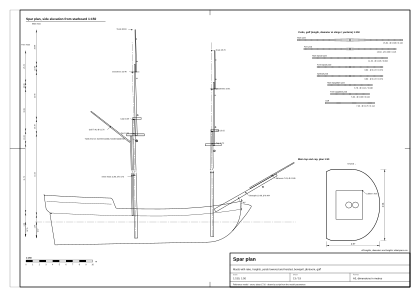

# 05. Masts and spars

## What this stage is for

The spars are the skeleton that every rope and sail hangs from. Before you can draw a
single shroud you need to know where each mast stands, how tall and thick it is, where its top, cap and crosstrees
sit, and where every yard hangs. This chapter turns two hull numbers (deck length and beam) into a complete spar
plan for a small two-masted square-rigger of about 1700–1720 (a snow or brig), and then tells you how to draw and
model it.

At the end of this chapter you will have:

- a spar table: length, diameter and taper of every mast, yard, gaff and bowsprit spar (and of the boom of the brig variant);
- a side elevation of the masts with all heights (doublings, tops, caps, crosstrees, yards);
- a 3D or CAD model of the spars, ready to receive the standing rigging of [Chapter 06](06-standing-rigging.md).

Confidence labels are the same as in the whole guide ([Chapter 01](01-ship-type-and-era.md)). Every number
carries a source number in square brackets (list at the end) and one of these labels:

- **(period)** period source, or several sources that agree. Our richest period source, Steel, was printed in
  **1794**, some 80 years after the target years; where the earlier sources (1707, 1711–1719) differ, we say so.
- **(secondary)** modern study, forum, model kit, replica, or a summary we could not check against the original.
- **(our inference)** our own calculation or reconstruction, with no direct source.
- **(reference model)** a number taken from the reference model data (`data/parameters.json`,
  `data/rigging-lines.json`, `data/spars.csv`). The model is still being refined; treat these numbers as an
  example, not as a rule.

Units: metres and millimetres. Period measurements are given in brackets in the original unit
(1 ft = 0.3048 m, 1 in = 25.4 mm, 1 yd = 0.9144 m).

## Concepts: parts of a mast (from the bottom up)

```
            truck  o
                   |      topgallant mast (with a short pole above the rigging)
        cap  [==]  |
             ||    |  <- topmast head (doubling with the topgallant mast)
  crosstrees ===+==+===
                |         topmast
                |
   cap   [=====]|
   masthead  || |  <- lower masthead (doubling: lower masthead + topmast heel)
   top  ======+=+======   trestle-trees, crosstrees, platform
   hounds    /|\
             |||          lower mast (woldings every ~1 m)
   deck  ====|||====      partners (wedges round the mast in the deck)
             |||
   keelson ==[_]==        step (heel of the mast sits in it)
```

| Part | What it is |
|---|---|
| Lower mast | The lowest and thickest spar. Its **heel** stands in a **step** on the keelson, it passes the deck through the **partners**, and its upper end is the **masthead**. |
| Hounds, cheeks | Timber shoulders on each side of the mast just below the masthead; they carry the trestle-trees. |
| Trestle-trees, crosstrees | Fore-and-aft and athwartship timbers at the foot of the masthead. They carry the **top**. |
| Top | A platform on the trestle-trees and crosstrees. It spreads the topmast shrouds and is a working station. |
| Cap | A thick block of timber on the very top of the masthead. Its after hole sits on a tenon of the lower mast, its forward hole holds the topmast. |
| Topmast | Raised from below **in front of** the lower masthead, through the cap. It rests on a **fid**, an iron or wooden bar through its heel, lying on the trestle-trees. |
| Doubling | The length over which two spars overlap (lower masthead and topmast heel; topmast head and topgallant heel). |
| Crosstrees (topmast) | A smaller frame at the topmast head; spreads the topgallant shrouds. |
| Topgallant mast | The highest spar. In the period short, sometimes with a short **pole** above the rigging, ending in a **truck**. |
| Woldings | Rope bands about 1 m apart round a lower mast made of several pieces. |
| Parrel | The rope collar with wooden balls (trucks) that holds a yard against its mast. |

## Which rig are we building?

| Question | State in 1702–1718 | Confidence and source |
|---|---|---|
| "Brig" | Short for "brigantine"; the later brig (both masts square-rigged, three-piece mainmast) is an 18th-century development | (secondary) [8] |
| Brigantine c. 1700–1720 | Foremast fully square-rigged; mainmast carries a fore-and-aft (gaff) sail plus a square topsail and sometimes a topgallant; 30–150 tons | (secondary) [8] |
| Snow | Two square-rigged masts, plus a thin **snow mast** (trysail mast) just abaft the mainmast that carries the gaff; this lets the snow keep a square main course. Common in navies early in the 18th century; the gaff sail was at first set without a boom | (secondary) [9] |
| Bowsprit | From 1705 small ships replace the sprit topmast with a **jib-boom**; within about 20 years all ships do so. The **spritsail yard under the bowsprit stays** until about 1800 | (period) [6], [7] |
| Tops | Round in the 17th century; we found no firm date for the change to square tops with a rounded front on small ships around 1700–1720 | (our inference) [10] |

The reference model is a **snow**: square main course, gaff on a snow mast, jib-boom, spritsail yard. Its gaff sail has
**no boom** and is brailed in to the mast, as was usual in 1700–1720 (reference model, `has_boom = false` in
`data/parameters.json`). A boom on the gaff sail belongs to the later brig, which this guide treats as a variant
([chapter 12](12-designing-other-ships.md)).



*Figure 1. Spar plan of the reference model, side elevation from starboard at 1:150, with the heights of heels,
deck, tops, caps, crosstrees and trucks above the waterline (sheet `plans/spar-plan.svg`).*

## Proportion rules

Start from two hull numbers (see [Chapter 02](02-hull-lines-and-offsets.md) for how the hull is defined):

- **L**: length of the (lower or only) deck, in metres;
- **B**: greatest beam, in metres.

The basic rule ("rule A") comes from Steel 1794 and is also credited to the 1711–1719 English establishment.

### Lengths

| Spar | Rule | Source and confidence |
|---|---|---|
| Main mast (whole lower mast, heel to cap) | **M = (L + B) / 2** | Steel p. 39 [1], [4] (period, 1794); same rule credited to 1711–1719 [5] (secondary) |
| Main mast, alternative | 3 × B (small ship, 1707); treat as an upper limit, it comes out very tall | [3] (secondary) |
| Main mast, alternative | 2.34 × B (60 guns, 1719); 2.22 × B (1745) | Lees via forum [5] (secondary) |
| Fore mast | 8/9 × M | [1] (period) |
| Main topmast | 3/5 × M | [1] (period) |
| Fore topmast | 8/9 × main topmast | [1] (period) |
| Topmasts, alternative | 2/3 of the lower masts | [3] 1707 (secondary) |
| Topgallant masts | 1/2 × topmast | [1] (period) |
| Bowsprit | 3/5 × M (ships up to 74 guns) | [1] (period) |
| Jib-boom | ≈ 5/7 × bowsprit; 1/3 of its length lies in the bowsprit cap and on the bowsprit | [1] (secondary: the summary mixes jib-boom and flying jib-boom) |
| Main yard | 8/9 × M | [1] (period) |
| Main yard, alternative | (2/3 + 1/12) × M = 0.75 × M | [3] 1707 (secondary) |
| Fore yard | 7/8 × main yard | [1] (period) |
| Main topsail yard | 5/7 × main yard | [1] (period) |
| Topsail yard, alternative | 1/2 × lower yard | [3] 1707 (secondary) |
| Fore topsail yard | 7/8 × main topsail yard | [1] (period) |
| Topgallant yards | 3/5 × their topsail yard (small ships); ratio 0.58 in 1719, 0.69 in 1745 | [1] (period); [5] (secondary) |
| Spritsail yard | = fore topsail yard | [1] (period) |
| Boom of a gaff sail | 2/3 × its mast (sloop); in ships the mizen boom = main topsail yard | [1] (period for sloops and ships; for a brig or snow by analogy: our inference) |
| Gaff | 3/5 × boom (sloop); 5/8 × boom (ship mizen) | [1] (period; for a brig or snow: our inference) |
| Lower masthead (doubling) | 5 in per yard of the mast's length (= 5/36 × length) | [1] (period) |
| Topmast head | 4 in per yard of the topmast's length (= 4/36 × length) | [1] (period) |
| Top, breadth (athwartships) | 1/3 × topmast length | [1] (period) |
| Top, length (fore and aft) | 3/4 × top breadth | [1] (period) |
| Snow mast | from the deck to the underside of the main trestle-trees, diameter ≈ 0.35 × main mast diameter | (our inference) |

### Diameters

Steel gives diameters as "inches per yard of length". One inch per yard is exactly **1/36 of the length**.

| Spar | Rule (diameter at the partners or at the slings) | Source and confidence |
|---|---|---|
| Main mast (brig) | 1 in per yard of length (= M / 36) | [1], [4] (period) |
| Fore mast | 9/10 × main mast diameter | [1] (period) |
| Topmasts, topgallant masts | 1 in per yard of their own length | [1] (period) |
| Lower yards | 0.7 in per yard (diameter in the middle) | [1] (period) |
| Topsail yards | 5/8 in per yard | [1] (period) |
| Topgallant yards | 0.6 in per yard | [1] (period) |
| Bowsprit | = main mast diameter (ships up to 50 guns) | [1] (period) |
| Jib-boom | 7/8 in per yard | [1] (period) |
| Lower cap | length 4 × topmast diameter + 3 in (76 mm); breadth 2 × topmast diameter + 2 in (51 mm); thickness 4/9 × breadth | [1] (period) |

### Taper

The diameter is not constant. Steel gives it at fixed stations as a fraction of the largest diameter (period) [1]:

| Spar | Stations (from the thickest point) | Fractions |
|---|---|---|
| Lower mast | partners, 1/4, 1/2, 3/4 of the way to the hounds; under the masthead; top of the masthead | 1, 60/61, 14/15, 6/7; 3/4; 5/8 |
| Topmast | at the cap, 1/4, 1/2, 3/4 of the way to the crosstrees; under the crosstrees; top | 1, 60/61, 14/15, 6/7; 13/16; 6/11 |
| Yard | middle (slings), 1/4, 1/2, 3/4 of the way to the yardarm; yardarm | 1, 30/31, 7/8, 7/10; 3/7 |

Lower yards and topsail yards are **octagonal in the middle**; other yards are round all along (period) [1]. The
masthead is square in section (our inference, from Steel's plates; the reference model makes it square with side 5/8
of the mast diameter, reference model).

### Position, rake, steeve

| Parameter | Value | Confidence and source |
|---|---|---|
| Main mast of a brig | about 2/3 of the length abaft the stem head | [1] (period) |
| Fore mast of a brig | 3/20 of the length abaft the stem head (for comparison, Royal Navy ships: fore 1/9, main 5/9, mizen 17/20 of the lower deck) | [1] (secondary: fraction for brigs from an automatic summary) |
| Main mast rake (aft) | 3/4 in per yard (≈ 1.2°; at 12 m above deck the masthead is about 0.25 m abaft the vertical) | [1] (period) |
| Fore mast rake | "full 1/8 in" per yard (≈ 0.2°, almost upright) | [1] (secondary) |
| General rule | short, beamy ships rake their masts more; long ships keep them upright | [1] (period) |
| Bowsprit steeve | about 36° above the horizontal (Steel, general) | [1] (period for 1794) |
| Lower yard | hangs on its slings **below** the top, about 0.5–1 m under the trestle-trees | [1] (period for slings; our inference for the distance) |

## Step by step: from hull numbers to a spar plan

1. **Get L and B** from the hull ([Chapter 02](02-hull-lines-and-offsets.md)). Use the deck length between the rabbets and the beam over the
   planking, in metres.
2. **Main mast length:** `M = (L + B) / 2`. This is the whole lower mast, from heel to the top of the masthead
   (where the cap sits).
3. **All other lengths** from the table "Lengths" above, in this order: fore mast, topmasts, topgallant masts, bowsprit,
   jib-boom, lower yards, topsail yards, topgallant yards, spritsail yard, boom, gaff. Keep full precision; round only
   at the end.
4. **Diameters:** for each spar `d = length / 36 × k`, with k from the table "Diameters" (1 for masts, 0.9 extra factor for the fore
   mast, 0.7 lower yards, 0.625 topsail yards, 0.6 topgallant yards, 0.875 jib-boom).
5. **Mastheads and topmast heads:** `lower masthead = 5/36 × mast length`, `topmast head = 4/36 × topmast length`.
6. **Tops and caps:** top breadth = topmast length / 3, top length = 3/4 of the breadth; cap from the table "Diameters".
7. **Place the masts on the deck.** Measure from the stem head along the deck: fore mast at 3/20 L (≈ 0.15 L), main
   mast at about 2/3 L. If a deck structure (quarterdeck break, hatch, capstan) is in the way, move the main mast
   forward and note it; the reference model does this (see "Where the reference model departs from the rules").
8. **Heel height.** The heel stands on the keelson. Mark it on the profile ([Chapter 03](03-hull-construction.md) gives the keelson). The
   lower mast length M runs from the heel, so the part above the deck depends on the depth of the hull.
9. **Rake.** Draw the mast axis through the deck point, leaning aft by the rake angle (main ≈ 1.2°, fore ≈ 0.2°).
   All heights below are measured along this axis; for 1° the difference between axis length and height is
   negligible (cos 1.2° = 0.9998).
10. **Lower masthead.** From the heel measure M along the axis: that is the top of the masthead (underside of the
    cap). Measure the masthead length back down: that point is the **top of the hounds**, where the trestle-trees
    and the top sit.
11. **Topmast.** Draw it **in front of** the lower masthead, parallel to the mast axis. The distance between axes is
    half the masthead square + half the topmast diameter + a small gap (the reference model uses 30 mm, reference model). Its
    heel (fid) lies just above the trestle-trees; it runs up through the cap. Measure its length; subtract the
    topmast head length to find the topmast crosstrees.
12. **Topgallant mast.** The same way, in front of the topmast head, through the topmast cap; heel just above the
    topmast crosstrees. Add a pole above the rigging if you want (the reference model adds 1.0 m, reference model), and a truck.
13. **Yards.** Hang the lower yard 0.5–1 m below the top. Put the topsail yard on the lower cap when lowered, or under
    the topmast crosstrees when hoisted. Put the topgallant yard just above the topmast cap when lowered.
14. **Gaff.** On a snow, draw the snow mast just abaft the main mast, from the deck to the underside of the
    main trestle-trees. The gaff jaws ride on it, a little below the top. The reference model has no boom; on a brig
    with a boom (variant), put the boom jaws a few metres above the deck, high enough to clear heads on the
    quarterdeck.
15. **Bowsprit.** From the heel (on the deck, behind the stem, often against bitts) up over the stem head at the
    steeve angle. Put the jib-boom on top of it so that about 1/3 of the jib-boom overlaps the bowsprit. Hang the
    spritsail yard under the outer part of the bowsprit.
16. **Check** against the list in "Check yourself" and write all numbers into a table (`data/spars.csv` has the reference one).

## Worked example: the reference model

Hull numbers of the reference model: deck length **L = 28.0 m**, beam over planking **B = 7.6 m** (reference model). Our
research note computed the same table for B = 8.5 m (M = 18.25 m); the difference is about 2% (our inference).

`M = (28.0 + 7.6) / 2 = 17.80 m` (reference model).

### Spar table (reference model, computed by the rules above unless noted)

| Spar | Rule | Length [m] | Diameter [m] | Head / doubling [m] | Note |
|---|---|---|---|---|---|
| Main lower mast | (L+B)/2 | 17.80 | 0.494 | masthead 2.47 | |
| Fore lower mast | 8/9 M | 15.82 | 0.445 | masthead 2.20 | |
| Main topmast | 3/5 M | 10.68 | 0.297 | head 1.19 | |
| Fore topmast | 8/9 main topmast | 9.49 | 0.264 | head 1.05 | |
| Main topgallant mast | 1/2 topmast | 5.34 (+1.00 pole) | 0.148 | | pole added by the model |
| Fore topgallant mast | 1/2 topmast | 4.75 (+1.00 pole) | 0.132 | | pole added by the model |
| Snow mast | (our inference) | deck to main trestle-trees | 0.173 | | 0.45 m abaft the main mast axis |
| Bowsprit | 3/5 M | 10.68 | 0.494 | | tapers to 0.62 × d over the outer 65% |
| Jib-boom | 5/7 bowsprit | 7.63 | 0.185 | | overlap: see the departures below |
| Main yard | 8/9 M | 15.82 | 0.308 | | octagonal middle |
| Fore yard | 7/8 main yard | 13.84 | 0.269 | | octagonal middle |
| Main topsail yard | 5/7 main yard | 11.30 | 0.196 | | octagonal middle |
| Fore topsail yard | 7/8 main topsail yard | 9.89 | 0.172 | | octagonal middle |
| Main topgallant yard | 3/5 topsail yard | 6.78 | 0.113 | | |
| Fore topgallant yard | 3/5 topsail yard | 5.93 | 0.099 | | |
| Spritsail yard | = fore topsail yard | 9.89 | 0.172 | | |
| Boom (brig variant only, not in the reference model) | chosen in 11.6–12.2 | 11.90 | 0.176 | | (our inference) choice; `boom_length_m` in `data/parameters.json` |
| Gaff | chosen in 7.3–7.6 | 7.40 | 0.176 | | (our inference) choice, 38° above horizontal |
| Main top | breadth × length | 3.56 × 2.67 | | | |
| Fore top | breadth × length | 3.16 × 2.37 | | | |
| Main lower cap | table "Diameters" | 1.27 × 0.64 × 0.29 | | | length × breadth × thickness |
| Fore lower cap | table "Diameters" | 1.14 × 0.58 × 0.26 | | | |

Check one diameter by hand: main mast 17.80 m = 19.47 yd, so 19.47 in = 0.494 m. Main yard: 15.82 m = 17.30 yd,
× 0.7 in = 12.1 in = 0.308 m.

### Taper of the main mast and main yard (reference model)

| Station | Main lower mast d [m] | Main topmast d [m] | Main yard d [m] |
|---|---|---|---|
| thickest point (partners / cap / slings) | 0.494 | 0.297 | 0.308 |
| 1/4 | 0.486 | 0.292 | 0.298 |
| 1/2 | 0.461 | 0.277 | 0.270 |
| 3/4 | 0.424 | 0.254 | 0.216 |
| under the head / yardarm | 0.371 | 0.241 | 0.132 |
| top of the head | 0.309 | 0.162 | |

### Positions and heights (reference model, z above the waterline)

| Item | Fore mast | Main mast |
|---|---|---|
| Deck position, abaft the stem head | 3.92 m (0.14 L) | 15.40 m (0.55 L) |
| Rake aft | 0.2° | 1.2° |
| Heel (on the keelson, 0.5 m above the keel rabbet) | −2.21 | −2.41 |
| Deck at the mast (centreline) | ≈ 1.44 | ≈ 1.04 |
| Top platform (upper surface) | 11.72 | 13.22 |
| Lower cap (top of masthead) | 13.62 | 15.39 |
| Topmast crosstrees | 19.91 | 22.46 |
| Topmast cap | 20.96 | 23.64 |
| Truck of the topgallant mast | 25.70 | 28.84 |
| Lower yard (0.75 m below the top) | 10.67 | 12.16 |
| Topsail yard, lowered on the cap | 14.22 | 16.02 |
| Topgallant yard, lowered | 21.40 | 24.08 |
| Gaff jaws (0.9 m below the main top, on the snow mast) | | 12.01 |
| Boom jaws (brig variant only) | | deck + 3.95 |

Bowsprit: steeve 30°, its underside 0.20 m above the stem head; jib-boom heel at 0.62 of the bowsprit length;
spritsail yard at 0.83 of the bowsprit length, hung about 0.25 m below it (reference model).

Plausibility check: Niagara (1813, beam 9.8 m) has its main truck about 36 m above the water [11]; scaled to a
beam of 7.6 m that gives about 28 m, close to the 28.84 m of the reference model (our inference).

## Where the reference model departs from the rules

| Item | Rule | Reference model | Difference | Why |
|---|---|---|---|---|
| Main mast position | ≈ 2/3 L abaft the stem head (18.7 m) | 0.55 L (15.4 m) | 3.3 m further forward | At 2/3 L the mast would stand on the quarterdeck break and the stairs would not fit (reference model) |
| Fore mast position | 3/20 L = 4.20 m | 0.14 L = 3.92 m | 0.28 m forward | (reference model) |
| Bowsprit steeve | ≈ 36° (Steel, general) | 30° | 6° flatter | our earlier estimate (our inference) |
| Jib-boom overlap | ≈ 1/3 of jib-boom (2.54 m) | 4.06 m (53%) | 1.5 m more | heel placed at 0.62 of the bowsprit (reference model) |
| Topgallant masts | 1/2 topmast | 1/2 topmast + 1.0 m pole | +1.0 m | pole above the rigging (reference model) |
| Height above deck | rule counts from the heel | the hull is shallow (about 3.4 m from deck to heel), so the lower mast stands ≈ 14.4 m above the deck | | follows from the rule, not an error (our inference) |

## Drawing and modelling the spars

### On paper or in 2D CAD

1. Draw the hull profile with the waterline and the keelson line (Chapters [02](02-hull-lines-and-offsets.md) and [03](03-hull-construction.md)).
2. Draw each mast axis as a line at its rake. Mark heel, deck, hounds, cap, crosstrees, truck by length along the
   axis.
3. Draw the outline of each spar from the taper table: offset half the diameter at each station either side of the
   axis and join the points with a smooth curve (a spline through 5–6 points is enough).
4. Draw the topmast and topgallant axes parallel to the lower mast axis, offset forward (step 11 above).
5. Draw the yards in the front view (athwartships) at full length; in the side view they appear as circles or short
   octagons at their heights.
6. Add a plan view of each top (D-shaped: square aft, rounded forward, with the lubber's hole in the middle) and of
   each cap.

### In Blender or 3D CAD

1. **One object per moving part.** Masts, tops, caps and crosstrees can be one mesh. Every yard and the gaff (and
   the boom of the brig variant) must be **separate objects**, because they rotate (bracing, peaking). Put each
   yard's origin on its pivot, with the local Z axis along the mast axis, so that a rotation about local Z is
   bracing. On a real ship a yard turns where its parrel holds it against the front of the mast. The reference
   model puts the pivot on the mast axis itself, at the height of the yard, so the middle of the yard lies a little
   forward of the pivot (reference model; pivots in `data/moving-parts.csv`, yard ends in `data/spars.csv`). In a
   game the difference is hardly visible; for close-up animation a pivot at the parrel keeps the yard against the
   mast (our inference). See Chapter 07.
2. **Lower mast:** sweep a circle (16 sides, reference model) along the axis with a scale curve from the taper table. Make the
   masthead a square box of side 5/8 of the mast diameter, from the trestle-trees to the cap.
3. **Hounds/cheeks:** two boxes on the sides of the mast, about 1.7 m long, ending under the trestle-trees (reference model).
4. **Woldings:** rope bands (3 turns) every ~0.95 m on the lower mast, from 1.5 m above the deck to 2 m below the
   top (reference model).
5. **Top:** two trestle-trees fore and aft, three crosstrees athwartships, a planked platform with a straight after
   edge and a semi-elliptical front, a lubber's hole about 40% of the breadth wide, and a rim batten (reference model).
6. **Cap:** a box with the dimensions from the table "Diameters".
7. **Topmast:** a 12-sided sweep with its own taper, a square heel (with the fid) and a square head (reference model).
8. **Topmast crosstrees:** two trestle-trees and two crosstrees, spread about 0.62 of the top breadth (reference model).
9. **Yards:** 12-sided sweep, taper from the yard table, two iron bands at each yardarm (at 0.93 and 0.985 of the
   half-length), cleats near the middle and at the yardarms (reference model). An octagonal middle can be a separate 8-sided
   section if you model close-ups.
10. **Gaff (and the boom of the brig variant):** a tapered sweep and two curved jaws that embrace the snow mast (or the main mast if there is no
    snow mast).
11. **Bowsprit:** a 16-sided sweep, constant diameter for the inner 35% and tapering outward; a cap at the end; bees
    (cheek pieces) near 0.8 of its length; bitts at the heel; the jib-boom as a tapered cylinder on top of it (reference model).
12. Save the spar table as data (CSV or JSON) and generate the geometry from it; then a change of L or B rebuilds
    the whole rig.

## Order of stepping masts and sending up spars

The research note gives the period order of **rigging** (Chapter 06); for the spars themselves:

1. Step the lower masts: heel into the step on the keelson, through the partners, wedged at the deck
   ([Chapter 03](03-hull-construction.md) covers the step and partners; the sheers used to lift the masts are not covered by our sources) (our inference).
2. Place the bowsprit, then gammon and stay it (Chapter 06, step 1) [1] (period).
3. Rig each lower masthead (shrouds, stays), then get the top over the masthead and put the cap on [1] (period).
4. Send up each topmast from below with the **top-rope** (through a block on the cap and a sheave in the topmast
   heel), through the trestle-trees and the cap; drive the fid when the heel is above the trestle-trees [1] (period).
5. Rig the topmasts, then sway up the lower yards and topsail yards; then the topgallant masts and their rigging
   [1] (period).
6. To strike a topmast (storm, damage), reverse step 4: take the weight on the top-rope, draw the fid, lower away
   [1], [2] (period).

## Check yourself

- [ ] Main mast M = (L + B) / 2; for L = 28.0 m, B = 7.6 m that is 17.80 m.
- [ ] Fore mast = 0.889 M (15.82 m); topmasts 0.6 M and 0.533 M (10.68 m, 9.49 m).
- [ ] Topgallant masts are **short**: half the topmast (5.34 m, 4.75 m), not as long as the topmast.
- [ ] Main yard 0.889 M (15.82 m) is about as long as the fore mast; fore yard 13.84 m.
- [ ] Main mast diameter is M/36 (0.494 m), i.e. about 1/36 of its length, **not** 1/20.
- [ ] Every topmast stands **in front of** its lower masthead.
- [ ] Lower yards hang **below** the tops (0.5–1 m), not above them.
- [ ] Main top breadth = main topmast / 3 (3.56 m).
- [ ] Masthead length is 5/36 of the mast (2.47 m main); topmast head 4/36 (1.19 m).
- [ ] Main mast rakes aft about 1.2°, fore mast almost upright.
- [ ] A spritsail yard hangs under the bowsprit (period detail until about 1800).
- [ ] Yards and gaff (and the boom of a brig) are separate objects with pivots on the mast axis.

## Typical mistakes

- **Spars far too thick.** Scanned or generated ship models often have masts 1.6–2.5 times too thick (a 0.8 m main
  mast belongs to a 74-gun ship, not to a small brig) (our inference).
- **Topgallant masts as long as topmasts.** In the period they were short (our inference, from the rules).
- **Lower yards above the top.** The lower yard hangs on its slings below the top [1] (period).
- **Tops too small.** A top must spread the topmast shrouds: breadth 1/3 of the topmast length.
- **Topmast behind the masthead,** or without a cap and fid.
- **Dolphin striker** under the bowsprit: an anachronism for 1710 (our inference).
- **No rake,** or the same rake on both masts.
- **Measuring M from the deck** instead of from the heel.
- **Forgetting the spritsail yard,** the most "period" detail of the silhouette.

## Sources

1. D. Steel, *The Elements and Practice of Rigging and Seamanship*, 1794, transcription:
   https://whalesite.org/anthology/1794_Steel_Elements_and_Practice.htm
2. D. Lever, *The Young Sea Officer's Sheet Anchor* (first published 1808; online copy: New York, Blunt
   edition): https://archive.org/details/youngseaofficers00leve
3. *The Sea-Man's Vade Mecum*, 1707, chapter on masts (page unavailable during our research; content from search
   results): http://www.bruzelius.info/Nautica/Rigging/Vademecum(1707)_p131.html
4. Nautical Research Guild, "Spreadsheets for Modelling Calculations": https://www.thenrg.org/articles/spreadsheets-for-modelling
5. Model Ship World, "Relationship between mast and hull dimensions":
   https://modelshipworld.com/topic/17315-relationship-between-mast-and-hull-dimensions/
6. Oxford Reference, "Jib-boom": https://www.oxfordreference.com/display/10.1093/oi/authority.20110803100020673
7. P. K. Allan, "The Evolution of Sails in Eighteenth-Century Warships":
   https://brewminate.com/the-evolution-of-sails-in-eighteenth-century-warships/
8. Wikipedia, "Brigantine": https://en.wikipedia.org/wiki/Brigantine
9. Wikipedia, "Snow (ship)": https://en.wikipedia.org/wiki/Snow_(ship)
10. Wikipedia, "Top (sailing ship)": https://en.wikipedia.org/wiki/Top_(sailing_ship)
11. Wikipedia, "USS Niagara (1813)": https://en.wikipedia.org/wiki/USS_Niagara_(1813)

Further reading we could not access: J. Lees, *The Masting and Rigging of English Ships of War 1625–1860*;
R. C. Anderson, *The Rigging of Ships in the Days of the Spritsail Topmast 1600–1720*.

## Terms used in this chapter

| English | Polish | Meaning |
|---|---|---|
| lower mast | kolumna masztu | The lowest, thickest piece of a built-up mast. |
| heel | pięta (masztu) | The lower end of a mast or spar. |
| step | jarzmo masztu | The socket on the keelson that holds the heel. |
| partners | opętnik (uncertain) | The framed opening and wedges where the mast passes the deck. |
| masthead | top (masztu) | The upper part of a lower mast or topmast, above the hounds. |
| hounds, cheeks | policzki (uncertain) | Shoulders on the mast that carry the trestle-trees. |
| trestle-trees | belki wzdłużne marsa (uncertain) | Fore-and-aft timbers at the masthead that carry the top. |
| crosstrees | saling; belki poprzeczne marsa | Athwartship timbers; at the topmast head they form the crosstrees (saling). |
| top | mars | Platform at the lower masthead. |
| lubber's hole | otwór w marsie | Opening in the top next to the mast. |
| cap | ezelhoft (uncertain) | Block on the masthead joining a mast to the one above. |
| topmast | stenga | Second piece of the mast. |
| fid | sztaba | Bar through the topmast heel, resting on the trestle-trees. |
| doubling | dublinka (uncertain) | Overlap of two mast pieces. |
| topgallant mast | bramstenga | Third, highest piece of the mast. |
| pole, truck | szczyt bramstengi, gałka (uncertain) | Bare top of the highest mast and the wooden disc on it. |
| woldings | wuldingi (uncertain) | Rope bands round a made mast. |
| snow mast, trysail mast | maszt snow | Thin mast abaft the main mast carrying the gaff. |
| bowsprit | bukszpryt | Spar projecting forward over the stem. |
| jib-boom | bomstenga | Extension of the bowsprit. |
| spritsail yard | blindareja | Yard under the bowsprit. |
| yard, yardarm | reja, nok | A horizontal spar for a square sail; its outer end. |
| slings | stropy | Rope or chain by which a lower yard hangs. |
| parrel | rak | Collar holding a yard to its mast. |
| gaff, boom, jaws | gafel, bom, szczęki | Spars of a fore-and-aft sail; the fork that embraces the mast. |
| rake | pochylenie (masztu) | Backward lean of a mast. |
| steeve | wznios (bukszprytu) | Upward angle of the bowsprit. |
| taper | zbieżność | Decrease of diameter along a spar. |
