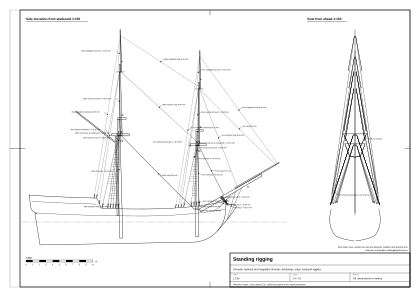
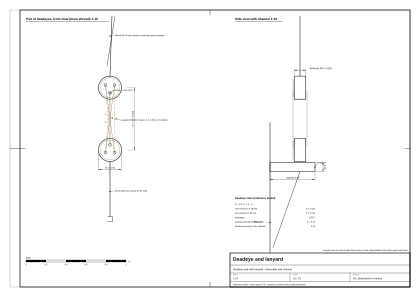

# 06. Standing rigging

## What this stage is for

Standing rigging holds the masts up. It does not move in normal sailing: it is set up
tight once and only adjusted (the lanyards are taken up) when the hemp stretches. Shrouds hold each mast against
sideways and backward loads, stays hold it from forward, and the bowsprit is held down against the pull of the fore
stays. Seen from close by, this is the most characteristic part of the ship: the fans of shrouds, the black rungs
of the ratlines, the pale lanyards between pairs of deadeyes, the stays meeting on the centreline.

At the end of this chapter you will have all standing ropes of a two-masted snow or brig: lower, topmast and topgallant
shrouds with deadeyes, lanyards and ratlines; futtock shrouds and catharpins; backstays; all stays; bowsprit
gammoning, bobstays and shrouds; and the standing ropes on the yards (slings, footropes, stirrups). You also get a table of
every line with its two ends, diameter, number and colour.

Before you start you need the spar plan of [Chapter 05](05-masts-and-spars.md) and the hull with its channels and
chainplates ([Chapter 04](04-decks-bulwarks-stern-head.md)). Confidence labels as in [Chapter 01](01-ship-type-and-era.md): (period; our main period sources are Steel 1794 and Lever 1808), (secondary), (our inference), (reference model). Rope sizes in period sources are given as
**circumference in inches**; we convert with **d [mm] = C [in] × 25.4 / π ≈ 8.09 × C**.



*Figure 1. Standing rigging of the reference model, side elevation from starboard at 1:150, each rope labelled
with its number and diameter (sheet `plans/standing-rigging.svg`).*

## Concepts

| Term | What it is |
|---|---|
| Shroud | A rope from a masthead down to the ship's side, abaft the mast. Shrouds are made **in pairs**: one rope doubled over the masthead, both legs going down the same side. An odd last shroud is the **swifter**. |
| Deadeye | A round wooden block with three holes and no sheave. One is turned into the lower end of the shroud, the other is fixed to the chainplate on the channel. |
| Lanyard | The thin rope rove through the holes of a pair of deadeyes; hauling it tightens the shroud. |
| Channel | A plank projecting from the ship's side that spreads the shrouds (part of the hull). |
| Chainplate | The iron link or plate from the lower deadeye down to the hull side. |
| Ratlines | Thin horizontal ropes tied across the shrouds as steps. |
| Futtock shrouds | Short ropes from the edge of the top down to a **futtock stave** lashed across the lower shrouds; they take the pull of the topmast shrouds. |
| Catharpins | Short ropes under the top bracing the shrouds of both sides towards each other. |
| Topmast / topgallant shrouds | The same for the upper masts; topmast shrouds end on deadeyes at the rim of the top, topgallant shrouds at the ends of the crosstrees. |
| Backstay | A rope from a topmast or topgallant head down to the channel abaft the shrouds. A **shifting backstay** can be set up on the weather side. |
| Stay | A rope from a masthead forward and down, on the centreline: main stay, fore stay, topmast stays, topgallant stays, jib stay. A **preventer stay** is a second, thinner stay parallel to the first. |
| Mouse | A pear-shaped swelling worked on a stay below the masthead; it stops the eye of the stay sliding down. |
| Collar, heart | The rope ring round a mast or bowsprit to which a stay is set up; the heart is a block with one big grooved hole used instead of deadeyes on stays. |
| Gammoning | The lashing that holds the bowsprit down to the stem. |
| Bobstay | A rope from the bowsprit down to the stem below the head. |
| Bowsprit shrouds | Ropes from the bowsprit to the bows, one or two each side. |
| Footrope, stirrup | A rope under a yard for the men to stand on, hung from the yard by short stirrups. |
| Slings | The rope (in battle: chain) from the masthead by which a lower yard hangs. |

## Rules and proportions

### Number of ropes

| Item | Value | Confidence and source |
|---|---|---|
| Lower shrouds | Pegasus sloop of 1776 (16 guns, close to our size): main **8 per side**, fore **7 per side** | [3] (secondary) |
| Lower shrouds of a brig | Steel: on brigs the fore has "four pairs", the foremost shroud and the pendant made of one piece; it is unclear whether per side. We take **5–7 per side** | [1] (secondary) / (our inference) |
| Topmast shrouds | 3 per side | (our inference) |
| Topgallant shrouds | 2 per side; in the two foremost pairs thimbles instead of blocks | [1] (period); number (our inference) |
| Futtock shrouds | as many as topmast shrouds, 3–4 per side | (our inference) |
| Catharpins | 4, the shortest forward (4 ft = 1.22 m on small ships), each next one 1 in longer | [1] (period) |
| Topmast backstays | 1–2 per side; topgallant backstays 1 per side | [1] (period); number (our inference) |
| Bobstays | 2 pairs on King's ships, usually 1 on merchant ships | [1] (period) |
| Bowsprit shrouds | 1–2 per side | [1] (period); number (our inference) |
| Gammoning | 9 or 11 turns, alternately over the bowsprit and through a hole in the knee of the head, frapped in the middle with cross turns | [1] (period) |
| Footropes | 1 per yardarm, hanging about 3 ft (0.9 m) under the lower yards; **4 stirrups per side** on lower yards | [1] (period) |

### Rope sizes

How the table was built (our inference): (1) Anderson's rule quoted on a forum, **main stay diameter = 1/6 of the main mast
diameter**, which for a 20 in mast gives a stay of about 10.5 in circumference [5] (secondary); (2) Pegasus 1776: main
stay 10 in, main shrouds 7 in [3] (secondary); (3) the Syren brig kit (1803, 94 ft, almost our size): lower shrouds about
4.2 in, stays about 5.6 in, converted from 1:64 thread [4] (secondary); (4) forum rules: shrouds = 1/2 stay, lanyards =
1/2 shroud, lifts = 3/8 shroud, brace pendants = 1/2 shroud [5] (secondary). Kits usually understate rope sizes and
Pegasus is a larger ship, so we take the middle. All defaults below are therefore **(our inference)** built on (secondary) sources.

| Rope | Circumference [in] (range) | Default diameter [mm] | Colour | Number |
|---|---|---|---|---|
| Main stay | 10 (8–10.5) | **80** | tarred | 1 (+1 thinner preventer, option) |
| Fore stay | 9 (7–9.5) | **73** | tarred | 1 |
| Main lower shrouds | 6 (4.5–7) | **49** | tarred | 5–7 per side |
| Fore lower shrouds | 5.5 (4.5–7) | **45** | tarred | 5–6 per side |
| Lanyards of lower shrouds | 3 | **24** | **untarred** | 1 per shroud |
| Ratlines | 1–1.5 | **10** | tarred | every 0.33–0.40 m |
| Futtock shrouds | 3.5 | **28** | tarred | 3–4 per side |
| Topmast shrouds | 3.5 (2.5–4) | **28** | tarred | 3 per side |
| Lanyards of topmast shrouds | 1.75 | **14** | untarred | |
| Topmast backstays | 4.5 | **36** | tarred | 1–2 per side |
| Topmast stays | 5 (4–5.5) | **40** | tarred | 1 per mast |
| Topgallant shrouds | 2 | **16** | tarred | 2 per side |
| Topgallant backstays | 2.5 | **20** | tarred | 1 per side |
| Topgallant stays | 2.5 | **20** | tarred | 1 per mast |
| Bobstay | 7 | **57** | tarred | 1 (merchant) – 2 |
| Bowsprit shrouds | 5 | **40** | tarred | 1–2 per side |
| Gammoning | 4 | **32** | tarred | 9–11 turns |
| Jib stay | 4 | **32** | tarred | 1 |
| Footropes of lower yards | 3 | **24** | tarred | 1 per yardarm |
| Stirrups | 2.5 | **20** | tarred | 4 per side on lower yards, 2–3 on topsail yards |

### Deadeyes, lanyards, ratlines, stays

| Item | Value | Confidence and source |
|---|---|---|
| Deadeye diameter | 1.5 × circumference of the shroud (shroud 6 in → deadeye 9 in ≈ 0.23 m); thickness about 1/2 diameter; 3 holes | [6], [10] (secondary) |
| Gap between upper and lower deadeye | about 2.5–3 deadeye diameters (0.6–0.7 m for the main shrouds) | [7] (secondary) |
| Lanyard | rove through the 3 holes of each deadeye (6 parts visible between them); a knot (walnut, Matthew Walker) at the end in the upper after hole; greased with tallow; **untarred, pale**; about 1/2 the shroud size | [1], [2] (period); [3] (secondary) |
| Masthead eyes | each pair seized together under the bolster, each next seizing one breadth lower; 7 turns under, 6 over and a double cross turn | [1] (period) |
| Service | the eye at the masthead is wormed, parcelled and served for 1/4 of the length; the fore leg of the foremost shroud is served all along (it chafes on the yard) | [1] (period); [3] (secondary) |
| Ratline spacing | first one 13 in (0.33 m) under the futtock stave, then **every 13 in** | [1] (period). Other sources and replicas: 15–16 in (0.38–0.41 m) (our inference) |
| Ratline hitch | clove hitch on the inner shrouds, an eye seized to the outer shrouds; the lowest 6 ratlines do not reach the outer shrouds | [1] (period); [9] (secondary) |
| Ratline sag | clearly visible, about 1–2% of the span | (our inference) |
| Futtock stave | lashed across the lower shrouds about 1.5–2 m under the top | [1], [8] (period) |
| Futtock shrouds | before the mid-19th century they ended on the lower shrouds, and the catharpins balanced their pull | [8] (secondary) |
| Topmast shrouds | from the topmast head to deadeyes on the rim of the top; on the foremost one a sister block for the topsail lift | [1] (period) |
| Mouse | about 1/3 of the stay length from the masthead; Steel: base of the mouse 1/3 of the stay circumference; modellers' practice: about 3 stay diameters | [1] (period); [3] (secondary) |
| Worming of stays | the stay is wormed for 1/3 of its length, the collar all along | [1] (period) |

### Where the stays go on a brig or snow

| Stay | Lead | Confidence and source |
|---|---|---|
| Main stay | from the main masthead (eye above the shrouds) forward and down to the deck at the foot of the fore mast, or through a heart on a collar round the fore mast | [1] (secondary); lead on a brig (our inference) |
| Fore stay | from the fore masthead to a collar on the bowsprit, set up with a heart on the collar and a lanyard through two hearts | [1] (period) |
| Main topmast stay | from the main topmast head through a block, set up with a tackle at the fore mast | [1] (period) |
| Fore topmast stay | from the fore topmast head through the bees on the bowsprit, set up with a tackle on deck | [1] (period) |
| Topgallant stays | main to the fore topmast crosstrees, fore to the jib-boom | (our inference) |
| Jib stay | along the jib-boom; the jib runs on it on hanks or on a traveller | (our inference) |
| Preventer stays | a second, thinner stay parallel to the main and fore stays | [3] (secondary) |

### Bowsprit

- **Gammoning**: 9 or 11 turns, each hove taut, frapped in the middle [1] (period).
- **Bobstays**: 2 pairs on King's ships, 1 on merchant ships; the lower end through the knee of the head, the upper
  end set up with a heart or deadeye and lanyard [1] (period).
- **Bowsprit shrouds**: hooked to an eyebolt on each bow, set up with a heart or deadeye [1] (period).
- **Bowsprit horses** (footropes): from the bowsprit cap to the knightheads, parallel to the bowsprit [1] (period).

### What is tarred

- **Dark (Stockholm tar, almost black brown):** all standing rigging, ratlines, footropes, service and seizings
  [1] (period); [4] (secondary: standing rigging black).
- **Pale (untarred, "white" hemp, straw coloured):** the lanyards of the shrouds [3] (secondary), tackle falls (Steel names
  a tackle fall of "5-inch white rope") [1] (period), most running rigging [4] (secondary). Some navies tarred running rigging
  lightly too, so the range runs from straw to middle brown (our inference).

## Period order of rigging

Steel's "progressive method of rigging" [1] (period):

1. **Bowsprit:** gammoning, bobstays, bowsprit shrouds, collars for the stays.
2. **Each lower masthead:** girtline blocks (temporary hoisting blocks), bolsters of tarred canvas on the
   trestle-trees, then **the shrouds in pairs, alternately: first pair starboard, first pair port, second pair
   starboard, and so on**; alternating the eyes this way lets the yards be braced up sharper. Last the swifter, the
   stay and the preventer stay.
3. **The top** swayed up over the masthead, then the cap.
4. **Deadeyes** turned into the lower ends of the shrouds (left-handed, against the lay, for cable-laid shrouds),
   lanyards rove, shrouds set up, then the ratlines.
5. **Topmasts:** top-rope, topmast shrouds, futtock shrouds, backstays, topmast stays, topmast cap.
6. **Lower yards, topsail yards, topgallant masts** and their rigging.

This order also fixes the **stack of eyes on the masthead**, from the bottom: shrouds → swifter → stay → preventer
stay. Seen from close by the stack is visible, so a model must keep this order [1] (period).

New hemp stretches: Steel stretches the shrouds with a tackle to the capstan, up to 1.5 times the eye length, and
leaves them for 24 hours; the stays are stretched until the core yarns crack [1] (period). After a gale the lanyards
must be set up again (see the [appendix](appendix-sail-handling.md)).

## Step by step: building the standing rigging

Coordinates as in the reference model: s along the ship (+ forward), x across (+ port), z up from the waterline.

### A. Channels and lower deadeyes

1. For each mast, find the channel ([Chapter 04](04-decks-bulwarks-stern-head.md)). In the reference model it sits just under the outer edge of the
   rail cap, 0.45 m wide and 0.09 m thick (reference model).
2. Place the lower deadeye positions along the channel: the first about 0.30 m abaft the mast, then every 0.40 m
   aft (reference model). Skip any gun port: keep each deadeye at least half a port width + 0.11 m from the port centre (reference model).
   You need one position per lower shroud plus one per backstay.
3. Deadeye size: `D = 1.5 × π × d_shroud` (that is 1.5 × circumference). Main: 1.5 × π × 0.049 = **0.231 m**; fore:
   **0.212 m**; backstay deadeyes 0.85 × D (reference model). Thickness D/2, three holes; [Chapter 08](08-ropes-blocks-and-sails.md)
   describes the deadeye itself.
4. Put the lower deadeye at the outer edge of the channel, its face turned outboard, and the chainplate from it down
   the side to the wale.

### B. Lower shrouds

5. **Masthead points.** Each shroud starts just above the trestle-trees, against the side of the square masthead
   (reference model: x = ±(half masthead + 0.13 m); each next pair 0.03 m higher and 0.05 m further aft) (reference model).
6. **Upper deadeye.** On the straight line from the lower deadeye to the masthead point, at a distance of 2.5–3 D
   (reference model 2.7 D = 0.62 m for the main shrouds) (reference model). The shroud runs from the top of the upper deadeye to
   the masthead point.
7. **Lanyard.** Reeve it as in Figure 2: knot behind the upper after hole, then down and up through the three
   holes of each deadeye, six parts showing; the end is hitched round the shroud above the upper deadeye.

```
   upper deadeye      o  o  o        (holes seen from outboard)
                      |\ |\ |
                      | \| \|        6 parts of the lanyard between the deadeyes
                      |  \  \
   lower deadeye      o  o  o
                         ||
                     chainplate
```



*Figure 2. A pair of deadeyes of a main shroud with the lanyard rove, at 1:10 (sheet
`plans/deadeye-and-lanyard.svg`).*

8. **Masthead eyes.** Model the eyes as rings round the masthead just above the trestle-trees, stacked in the order
   of the period order of rigging above (shrouds, swifter, stay, preventer). The reference model uses 4 rings per mast at shroud thickness (reference model).
9. **Order of shrouds.** Pairs alternate starboard–port; on a mast with an odd number per side the aftermost single
   one is the swifter.

### C. Futtock stave, futtock shrouds, catharpins, ratlines

10. **Futtock stave:** a wooden bar lashed across the shrouds of each side, 1.6 m under the top (reference model; period 1.5–2 m).
11. **Futtock shrouds:** from iron plates through the rim of the top down to the stave, one per topmast shroud
    (3 per side in the reference model, 28 mm, about 2.0–2.2 m long) (reference model).
12. **Catharpins:** 4 short ropes under the top joining the staves of both sides behind the mast (24 mm, 1.7–1.8 m
    in the reference model) (reference model).
13. **Ratlines:** start about 0.55–0.8 m above the upper deadeyes and stop just under the stave. Space them 0.33–0.40 m
    apart (reference model 0.36 m). Each ratline is a separate short rope between two neighbouring shrouds with a sag
    of 1–2% (reference model 1.5%). In the lowest 6 rows leave out the outer shrouds (reference model).

### D. Topmast and topgallant shrouds, backstays

14. **Topmast shrouds:** from the topmast head (just under the crosstrees) to small deadeyes on the rim of the top
    (D = 0.13 m, gap 2.7 D, lanyard 14 mm) (reference model). Add ratlines the same way, up to about 0.9 m under the topmast head
    (reference model).
15. **Topgallant shrouds:** from about 1 m below the topgallant truck down to the ends of the topmast crosstrees,
    no deadeyes, no ratlines (reference model).
16. **Backstays:** from the topmast head (and the topgallant head) to deadeyes on the channel abaft the shrouds,
    with lanyards (reference model).

### E. Stays

17. **Main stay:** from the main masthead (eye above the shrouds) to a heart on a collar round the fore mast foot,
    0.55 m above the deck, set up with a short pale lanyard (reference model). Work a mouse at 1/3 of the length from the masthead.
18. **Fore stay:** from the fore masthead to a collar on the bowsprit (reference model at 0.40 of the bowsprit
    length) (reference model), with a mouse.
19. **Topmast stays:** main topmast head to the fore masthead (just above the fore top); fore topmast head to the
    bowsprit (0.62 of its length in the reference model; period: through the bees and down to a tackle on deck)
    (reference model; [1]).
20. **Topgallant stays and jib stay:** main topgallant head to the fore topmast head; fore topgallant head to the end
    of the jib-boom; jib stay from the fore topmast head to near the end of the jib-boom (reference model).
21. All stays meet the centreline; a stay that passes a yard must pass **in front of** it (the furled sail on the yard
    gives way to the stay) (reference model).

### F. Bowsprit

22. **Gammoning:** 9 turns of 32 mm rope, close together, over the bowsprit just above the stem head and through a
    hole in the knee of the head (reference model).
23. **Bobstays:** from under the bowsprit (0.56 and 0.66 of its length) down to the knee of the head just above the
    water, with hearts (reference model).
24. **Bowsprit shrouds:** from the bowsprit (0.48 and 0.58 of its length) to eyebolts on each bow (reference model).

### G. Standing ropes on the yards

25. **Slings:** from the lower masthead to the middle of each lower yard (32 mm, tarred) (reference model).
26. **Footropes:** from the yardarm to 0.45 m past the middle of the yard, hanging behind (abaft) the yard. The period
    drop is about 0.9 m under lower yards [1]. The reference model sets a drop parameter of 0.9 m (lower yards) and
    0.6 m (topsail and spritsail yards) but draws the curve with 0.55 of it, so the lower footropes hang only about
    0.5 m under the yard (reference model).
27. **Stirrups:** 4 per side on lower yards, 3 per side on topsail and spritsail yards, from the yard down to the
    footrope (reference model).
28. Make footropes and stirrups **children of their yard** so that they turn with it (reference model).

### H. Materials

29. Give every line one of two materials: **tarred** (all of the above) or **pale** (lanyards, the lanyard of the
    main stay heart). See Chapter 08 for colours and textures.

## Worked example: standing rigging of the reference model

All values (reference model), from `data/parameters.json` (counts, diameters) and `data/rigging-lines.json` (geometry, lengths).
"Length" is the length of one rope in the model, without eyes and splices.

| Line | Count | d [mm] | From | To | Length each [m] | Colour |
|---|---|---|---|---|---|---|
| Main lower shrouds | 6 per side | 49 | main masthead, above trestle-trees | upper deadeyes on the main channel | 10.1–10.9 | tarred |
| Fore lower shrouds | 5 per side | 45 | fore masthead | upper deadeyes on the fore channel | 8.3–9.2 | tarred |
| Deadeye straps | 1 per upper deadeye | 39 / 36 | round the upper deadeye | | 0.78 / 0.72 | tarred |
| Lower deadeyes | per shroud | D 231 / 212 | channel | | | wood |
| Lanyards, lower shrouds | 5 parts per pair | 24 | upper deadeye | lower deadeye | 0.48–0.62 per part | pale |
| Ratlines | 464 pieces | 10 | shroud k | shroud k+1 | | tarred |
| Futtock shrouds | 3 per side per mast | 28 | rim of the top | futtock stave 1.6 m under the top | 2.0–2.2 | tarred |
| Catharpins | 4 (fore only) | 24 | stave, port | stave, starboard (behind the mast) | 1.7–1.8 | tarred |
| Topmast shrouds | 3 per side | 28 | topmast head | deadeyes (D 130) on the rim of the top | 7.8–8.9 | tarred |
| Lanyards, topmast shrouds | 5 parts per pair | 14 | | | | pale |
| Topgallant shrouds | 2 per side | 16 | 0.95 m under the truck | ends of the crosstrees | 4.7–5.3 | tarred |
| Topmast backstays | 2 per side per mast | 36 | topmast head | channel deadeyes abaft the shrouds | 17.7–19.7 | tarred |
| Topgallant backstays | 1 per side per mast | 20 | topgallant head | aftermost channel deadeye | 22.6 (fore), 24.2 (main) | tarred |
| Lanyards, backstays | 5 parts per pair | 19 | | | | pale |
| Main stay | 1 | 80 | main masthead | heart on a collar at the fore mast foot, 0.55 m above deck | 15.8 | tarred |
| Collar of the main stay | 1 | 50 | round the fore mast | | 1.6 | tarred |
| Lanyard of the main stay heart | 1 | 30 | heart | collar | 0.14 | pale |
| Fore stay | 1 | 73 | fore masthead | bowsprit, 0.40 of its length | 8.5 | tarred |
| Main topmast stay | 1 | 40 | main topmast head | fore masthead | 15.8 | tarred |
| Fore topmast stay | 1 | 40 | fore topmast head | bowsprit, 0.62 of its length | 15.8 | tarred |
| Main topgallant stay | 1 | 20 | main topgallant head | fore topmast head | 14.3 | tarred |
| Fore topgallant stay | 1 | 20 | fore topgallant head | end of the jib-boom | 19.8 | tarred |
| Jib stay | 1 | 32 | fore topmast head | 0.6 m from the end of the jib-boom | 16.1 | tarred |
| Bobstays | 2 | 57 | bowsprit at 0.56 and 0.66 | knee of the head, 0.25 and 0.50 m above water | 4.4, 5.0 | tarred |
| Bowsprit shrouds | 2 per side | 40 | bowsprit at 0.48 and 0.58 | bows | 3.6, 4.9 | tarred |
| Gammoning | 9 turns | 32 | over the bowsprit | through the knee of the head | 3.7 per turn | tarred |
| Slings | 1 per lower yard | 32 | lower masthead | middle of the yard | 0.7 | tarred |
| Footropes | 1 per yardarm on lower, topsail and spritsail yards | 24 | yardarm | 0.45 m past the middle of the yard | 5.2–8.0 | tarred |
| Stirrups | 4 per side (lower), 3 (topsail, spritsail) | 20 | yard | footrope | 0.4–0.7 | tarred |

Totals in the model (reference model): ratlines 96 m, lanyards 116 m, lower shrouds with straps and masthead rings 247 m, topmast
shrouds 100 m, topgallant shrouds 40 m, backstays 242 m, stays with bobstays and bowsprit shrouds 134 m, gammoning
33 m. Ratlines run from 3.35 m to 21.37 m above the waterline.

### Where the reference model departs from the rules

| Item | Rule / research | Reference model | Note |
|---|---|---|---|
| Lanyard parts | 6 parts between deadeyes | 5 parts | one part short (reference model) |
| Start of ratlines | about 0.8 m above the deadeye (research table) | 0.55 m above the top of the upper deadeye | about 0.1–0.2 m lower (reference model) |
| Fore stay collar | about 1/4 of the bowsprit length from its heel | 0.40 of the length | kept in front of the fore yard (reference model) |
| Main topmast stay | through a block, set up with a tackle at the fore mast | ends at the fore masthead | no block or tackle (reference model) |
| Fore topmast stay | through the bees, down to a tackle on deck | ends on the bowsprit | no lead to deck (reference model) |
| Catharpins on the main mast | 4 | none | the snow mast stands there (reference model) |
| Masthead eyes | pairs, each seizing one breadth lower, stay above | 4 uniform rings | simplified stack (reference model) |
| Footrope drop under lower yards | about 0.9 m (3 ft) | about 0.5 m (0.55 × the 0.9 m parameter) | about 0.4 m too high (reference model) |
| Bowsprit horses | present | not modelled | (reference model) |
| Preventer stays | optional | none | (reference model) |
| Sister block on the foremost topmast shroud | for the topsail lift | not modelled | see Chapter 07 (reference model) |

## Check yourself

- [ ] Main shrouds 5–7 per side (49 mm), fore 5–6 (45 mm); main stay about 1/6 of the main mast diameter (80 mm).
- [ ] Lower deadeyes about 0.23 m across (1.5 × the shroud circumference), pairs 0.6–0.7 m apart.
- [ ] Lanyards are **pale**, everything else in the standing rigging is **dark**.
- [ ] Ratlines 10 mm, every 0.33–0.40 m, with a slight sag; the lowest 6 skip the outer shrouds.
- [ ] Futtock shrouds run from the rim of the top to a stave 1.5–2 m lower, not to the deck.
- [ ] Topmast shrouds end on deadeyes on the rim of the top; topgallant shrouds at the crosstrees.
- [ ] Backstays come down **abaft** the shrouds to the same channel.
- [ ] Every stay lies on the centreline and runs forward and down; main stay to the fore mast foot, fore stay to the
      bowsprit.
- [ ] Each stay has a mouse under the masthead (main and fore stays at least).
- [ ] The bowsprit has gammoning (9–11 turns), bobstays and bowsprit shrouds.
- [ ] Footropes hang 0.9 m under the lower yards on 4 stirrups per side.
- [ ] The eyes on the masthead are stacked: shrouds, swifter, stay, preventer.

## Typical mistakes

- **Shrouds coming straight down to the hull** without deadeyes and lanyards (our inference).
- **All ropes the same colour.** The pale lanyards between dark shrouds are the signature of the period (our inference).
- **Ratlines as straight rigid bars** with no sag, or too widely spaced (our inference).
- **Futtock shrouds missing**, so that the topmast shrouds seem to hang from nothing (our inference).
- **Stays ending in the air** or on the wrong mast; the main stay goes to the fore mast foot, not to the bow (our inference).
- **Backstays in front of the shrouds** (our inference).
- **Tops too small** to spread the topmast shrouds (Chapter 05).
- **Forgetting the gammoning**, which makes the bowsprit look unsupported (our inference).
- **A dolphin striker under the bowsprit**: anachronism for 1710 (our inference).

## Sources

1. D. Steel, *The Elements and Practice of Rigging and Seamanship*, 1794:
   https://whalesite.org/anthology/1794_Steel_Elements_and_Practice.htm
2. D. Lever, *The Young Sea Officer's Sheet Anchor* (1808; online copy of the New York edition):
   https://archive.org/details/youngseaofficers00leve
3. Lehman Shipyard, HMS Pegasus (1776): Standing Rigging: https://lehmanshipyard.com/2024/04/06/standing-rigging-shrouds-stays/
4. Model Shipways kit 2003, instructions (pp. 12, 18): https://www.manualsdir.com/manuals/123057/model-shipways-2003.html?page=12
5. Model Ship World, rope size threads:
   https://modelshipworld.com/topic/28520-what-are-the-rules-for-determining-the-thicknesses-of-rope-for-standing-and-running-rigging/ ;
   https://modelshipworld.com/topic/27881-formula-for-the-thickness-of-rope-on-any-scale-ship/
6. VAKA, "Making Deadeyes and Wooden Blocks": https://www.vaka.earth/2026/04/making-deadeyes-and-wooden-blocks.html
7. Finescale Modeler Forum, "shrouds and lanyards": https://forum.finescale.com/t/shrouds-and-lanyards/143536
8. Wikipedia, "Futtock shrouds": https://en.wikipedia.org/wiki/Futtock_shrouds
9. Wikipedia, "Ratlines": https://en.wikipedia.org/wiki/Ratlines
10. Wikipedia (pl), "Jufers": https://pl.wikipedia.org/wiki/Jufers

## Terms used in this chapter

| English | Polish | Meaning |
|---|---|---|
| standing rigging | olinowanie stałe | Ropes that hold the masts and do not move in sailing. |
| shroud | wanta | Rope from a masthead to the side, abaft the mast. |
| swifter | swifter (no Polish term found) | Odd single shroud at the after end of a set. |
| topmast / topgallant shrouds | stenwanty / bramstenwanty (wanty stengowe / bramstengowe) | Shrouds of the upper masts. |
| deadeye | jufers | Three-holed block for setting up a shroud. |
| lanyard | talrep | Rope rove through a pair of deadeyes. |
| channel | ława wantowa (uncertain) | Plank on the side that spreads the shrouds. |
| chainplate | putting (uncertain) | Iron from the lower deadeye to the hull. |
| ratlines | wyblinki | Rope steps across the shrouds. |
| futtock shrouds, futtock stave | podwantki, drążek podwantek | Ropes from the top to a bar across the lower shrouds. |
| catharpins | ściągacze want (uncertain) | Ropes bracing the shrouds of both sides together under the top. |
| backstay | padun | Rope from a topmast head to the channel abaft the shrouds. |
| stay, preventer stay | sztag, sztag zapasowy | Rope from a masthead forward; a second parallel one. |
| main stay, fore stay | grotsztag, foksztag | Stays of the lower masts. |
| topmast stay, topgallant stay | sztag stengowy, sztag bramstengowy | Stays of the upper masts. |
| jib stay | sztag kliwra | Stay along which the jib is set. |
| mouse | mysz | Swelling on a stay that stops its eye. |
| collar, heart | obroża, serce | Ring round a spar for a stay; one-holed block for setting it up. |
| gammoning | wiązanie bukszprytu (uncertain) | Lashing of the bowsprit to the stem. |
| bobstay | watersztag | Rope from the bowsprit down to the stem. |
| bowsprit shrouds | wanty bukszprytu | Ropes from the bowsprit to the bows. |
| footrope, stirrup | perta, strzemię (szelka) | Rope to stand on under a yard; its hanger. |
| slings | stropy | Rope by which a lower yard hangs from the masthead. |
| service, worming, parcelling | obszywanie (no confirmed separate Polish terms) | Protective layers on a rope (Chapter 08). |
