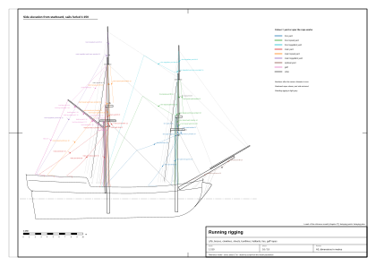
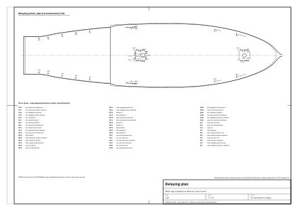

# 07. Running rigging and belaying

## What this stage is for

Running rigging is everything the crew hauls on: the ropes that hoist yards and sails,
turn the yards to the wind, spread the sails and gather them in. Each rope starts on a spar or a sail, runs through
one or more blocks and ends on deck, where it is **belayed** (made fast) to a pin, a cleat, a kevel or a bitt. To draw
it you must know three things for each rope: where it starts, which way it leads, and where it is belayed. For a game
you also need a fourth: which end moves when a yard is braced.

At the end of this chapter you will have:

- the lead of every rope of each square sail, the gaff sail, the staysails and the jib;
- a belaying plan (with a clear warning: for a brig or snow of about 1710 this is a reconstruction);
- the list of lines that are dynamic in the reference model (one end on a moving spar) and how the data describes them;
- the bracing limits of the yards.

Before you start you need: spars from [Chapter 05](05-masts-and-spars.md), standing rigging from
[Chapter 06](06-standing-rigging.md) (many running ropes lead through blocks on stays and shrouds). Confidence labels as in [Chapter 01](01-ship-type-and-era.md): (period; our main period sources are Steel 1794 and Lever 1808), (secondary), (our inference), (reference model).
Rope diameters below are our estimates **(our inference)** unless marked otherwise; how they were derived is in Chapter 06.



*Figure 1. Running rigging of the reference model with the sails furled, side elevation from starboard at 1:150,
each rope labelled with its diameter (sheet `plans/running-rigging.svg`).*

## Concepts

| Term | What it does |
|---|---|
| Halliard (halyard), tie | Hoists a yard, gaff or sail. A **tie** is the single rope from the yard over a sheave in the mast; the **halliard** is the tackle on its lower end. |
| Jeers, slings | The tackle and rope that carry a lower yard. |
| Lift | Holds a yardarm up and squares the yard vertically ("topping"). |
| Brace | Turns the yard horizontally about the mast. Usually a **pendant** (short rope with a block) on the yardarm, and the brace rove through it. |
| Sheet | Pulls the lower corner (clew) of a sail down and aft. |
| Tack | Holds the weather clew of a course forward. |
| Clewline, clew garnet | Hauls the clew up to the yard (clew garnet: the clewline of a course). |
| Buntline | Hauls the foot of a square sail up to the yard, in front of the sail. |
| Leechline | Hauls the side edge (leech) of a course up and in. |
| Bowline | Pulls the weather leech forward when sailing close to the wind; fixed to the leech by **bridles**. |
| Reef tackle | Hauls the reef cringle up to the yardarm before reefing. |
| Throat, peak halliard | Hoist the inner and outer end of a gaff. |
| Vang | Steadies the gaff peak sideways. |
| Topping lift (of a boom) | Holds the boom end up. |
| Brail | Gathers a boomless gaff sail in to the mast and gaff like a curtain. |
| Downhaul | Hauls a staysail or jib down its stay. |
| Belay, belaying pin, cleat, kevel, bitt | Make a rope fast; the wooden pin in a rail, the horned fitting, the large cleat on the bulwark, the strong timber posts. |
| Pin rail, fife rail | A rail with holes for pins along the bulwark; a frame of rails round the foot of a mast. |

## Rules: where each rope goes

### Lower yards and courses

| Rope | From → through → to | d [mm] (our inference) | Lead (tag) |
|---|---|---|---|
| Slings, jeers | masthead → middle of the yard; jeer tackle from the masthead to the deck at the mast | 32 | [1] (period) |
| Lift | yardarm → block under the cap (on a strop round the masthead) → down beside the mast → cleat or bitt at the mast | 20 | [1] (period) |
| Brace (+ pendant) | yardarm (pendant with block) → **fore: to the collar of the main stay and down to the deck at the main mast; main: aft, to a sheave in the bulwark at the stern** ("brigs lead the same", Steel) | pendant 24, brace 18 | [1] (period) |
| Tack | clew → bow (fore course) or the side before the main mast through the chesstree (main course) | 32 (tapered) | [2] (period) |
| Sheet | clew → block → sheave in the side → cleat or bitt on the side, aft | 28 | [2] (period) |
| Clew garnet | block on the yard 4 ft (1.22 m) from the middle → clew → deck | 16 | [1], [2] (period) |
| Buntlines | blocks under the top → down **in front of** the sail → foot rope of the sail (2–4 per sail) → deck | 12 | [2] (period) |
| Leechlines | block under the top → block on the yard 10 ft (3.05 m) from the yardarm → leech (bowline cringles) | 10 | [1], [2] (period) |
| Bowline (+ bridles) | cringles on the weather leech → fore: to the forecastle; main: through a block on the fore mast to the other side | 16 | [2] (period) |

### Topsails and topgallants

| Rope | Lead | d [mm] (our inference) | Confidence and source |
|---|---|---|---|
| Tie and halliard of the topsail yard | from the yard over a sheave in the topmast, down to the tie; tackle to an eyebolt in the channel; fore and main halliards on **opposite sides** | 32 / 20 | [1], [3] (period) |
| Topsail lifts | yardarm → sister block in the topmast shroud → to the deck, belayed at the lower deadeyes | 16 | [1] (period) |
| Fore topsail braces | pendant on the yardarm → block on the collar of the main stay → near the hatch → belayed to a pin | 16 | [1] (period) |
| Main topsail braces (brig) | on a ship the standing part is at the mizen; **a brig has no mizen**, so to the taffrail or to the backstays | 16 | (secondary)/(our inference) |
| Topsail sheets | clew → sheave in the lower yardarm → quarter block in the middle of the lower yard → deck at the mast (bitts) | 28 | [1], [3] (period) |
| Topsail clewlines | block 3 ft (0.91 m) from the middle of the yard → clew → down through the lubber's hole | 14 | [1], [2] (period) |
| Reef tackles | through a sheave in the yardarm and a block at the reef cringle → deck | 16 | [1], [2] (period) |
| Topgallant braces | standing part on the topmast stay of the next mast → block → deck | 10 | [1] (period) |
| Topgallant lifts | single, through a thimble in the topgallant shrouds → top → deadeyes | 10 | [1] (period) |

### Gaff (and the boom of a brig)

| Rope | Lead | d [mm] (our inference) | Confidence and source |
|---|---|---|---|
| Throat halliard | block at the masthead → block at the gaff jaws; tackle to the deck | 20 | [2] (period) |
| Peak halliard | double block under the crosstrees → block on the gaff → back → hook at the cap (brigs often use a single gaff tie instead) | 20 | [2] (period) |
| Vangs | from the gaff peak to both quarters of the stern (tackles) | 16 | [1] (period) |
| Main sheet (brig with a boom only) | boom end to the quarterdeck (tackle) | 24 | [2] (period) |
| Boom topping lifts (brig with a boom only) | from the masthead through blocks to both sides of the boom end, belayed on cleats on the boom | 20 | [2], [1] (period) |
| Brails | on a boomless sail (1700–1720): from blocks on the gaff to the after leech; they gather the sail to the mast | 12 | [1] (Steel's mizen brails, by analogy) (secondary) |

### Staysails and jib

Each has a **halliard** (from the masthead through a block, down to the deck), a pair of **sheets** (one to each side,
through blocks on the sides) and a **downhaul** (from the head of the sail along the stay to the bow). The jib also has
a **traveller** (iron ring) on the jib-boom with an outhaul [2] (period). Lever's order for taking in the jib: man the
downhaul, let go the halliard, ease the sheet, haul the sail down the stay, pull it in under the bowsprit cap and stow
it [2] (period).

## Belaying: principles and a reconstructed plan

**Warning.** We found **no period belaying plan for a brig or snow**. A forum description of a 1719 plan mentions
racks on the mizen shrouds and upright racks at the mast, but nothing in the bulwarks [4] (secondary). On small vessels
pin racks on the shrouds appear early; on large English ships pin rails come only in the second half of the 18th
century. Around 1710 ropes were made fast mostly to **cleats, timberheads, bitts and kevels, and cleats on the
shrouds** [4] (secondary). The plan below is our **reconstruction (our inference)**, built on the leads in Steel and Lever.

### Six rules

1. A rope comes down close to the mast it belongs to; the higher the sail, the further aft by the shrouds its pin or
   cleat (our inference).
2. Port and starboard are mirror images; the exception is the topsail halliards, fore and main on opposite sides
   [3] (secondary).
3. Halliards, ties and topsail sheets end at the foot of the mast (bitts with sheaves, cleats on the mast) (our
   inference, from [1]).
4. Clewlines, buntlines and leechlines end on cleats or racks inside the lower shrouds or on timberheads by the
   shrouds (our inference).
5. Fore braces lead aft (towards the main mast); main braces lead aft to the stern, bulwark or taffrail (our
   inference, from [1]).
6. Tacks end forward of their sail, sheets aft; the sheets of the courses through sheaves in the side (our inference, from [2]).

### Reconstructed plan for a small snow of about 1710 (our inference)

```
                 BOW
       [forecastle] jib halliard and sheets, jib downhaul, fore bowlines, fore tack
  ------------------------------------------------------------------------
   fore shrouds (cleats/racks):  fore clew garnets | fore buntlines | leechlines
                                  fore topsail clewlines | fore topsail lifts (at the deadeyes)
   fore bitts (at the mast):      fore topsail tie/halliard | fore topsail sheets | fore lifts
                                  fore topgallant halliard | fore topmast staysail halliard
  ------------------------------------------------------------------------
   waist, sides:                  fore sheets (sheave in the side -> cleat)
                                  fore and fore topsail braces (block on the main stay -> deck at the main mast)
                                  main tack (chesstree) | fore topgallant braces
  ------------------------------------------------------------------------
   main shrouds (cleats/racks):   main clew garnets | buntlines | leechlines | main topsail clewlines
                                  main topsail lifts | main bowlines (from the fore mast, crossed)
   main bitts (at the mast):      main topsail tie/halliard | main topsail sheets | main lifts
                                  throat halliard | peak halliard | main topgallant halliard
  ------------------------------------------------------------------------
   stern, bulwark, taffrail:      main sheets | main braces | main topsail braces (?)
                                  gaff vangs | gaff sail brails
                 STERN
```



*Figure 2. Belaying points of the reference model, plan at 1:80, every pin, cleat and kevel numbered with the rope on
it; marked "reconstruction" (sheet `plans/belaying-plan.svg`).*

### Coils

After belaying, the slack is coiled **with the lay** (right-laid rope **clockwise**), and the coil is hung on the pin
or cleat; tackle falls are coiled down on deck. Flat decorative spirals ("Flemish coils") are a later harbour habit
[5], [6] (secondary).

## Step by step: building the running rigging

1. **Decide the sail state** first: set, clewed up, reefed or furled. The lead of a rope does not change, but whether
   it is taut or slack, and where its spar end is, does (our inference). The reference model shows all sails furled, ship at
   anchor (reference model).
2. **Place the belaying points:** fife rail round each mast foot, pin rails or racks by the shrouds, kevels on the
   quarterdeck bulwark, bitts ([Chapter 09](09-deck-machinery.md)). Number every pin.
3. **For each yard, both sides,** in this order: lift, brace pendant and brace, clewline (clew garnet), sheet, then
   buntlines and leechlines. For each rope:
   1. mark the start point on the spar (e.g. the yardarm at 0.96 of the half-length, slightly above the yard);
   2. place each block on its strop (under the cap, on a stay, on the yard);
   3. pick the pin by the six rules above and the pin nearest to the lead;
   4. draw straight segments block to block; give sag only to slack ropes (Chapter 08);
   5. hang a coil on the pin.
4. **Topsail halliards:** tie from the middle of the topsail yard up to the sheave in the topmast head, tackle down to
   the channel, fore and main on opposite sides.
5. **Gaff:** throat halliard from the masthead to the jaws, peak halliard from under the topmast head to two or three
   points along the gaff, vangs from the peak to the quarters.
6. **Boom (brig variant only):** topping lifts from the masthead to the boom end on both sides, main sheet tackle
   from the boom end to the taffrail. The reference model has no boom: its gaff sail is brailed to the snow mast
   (three brails a side; see the worked example below).
7. **Spritsail yard:** lifts to the bowsprit cap, braces to the bow rail (and, for a set spritsail, sheets and
   clewlines, not modelled in the reference model).
8. **Head sails:** halliards, sheets, downhauls (not modelled in the reference model while the sails are stowed).
9. **Record each rope in data:** group, diameter, material, points, and for every end that lies on a moving part the
   name of that part and the end point in the part's local coordinates (see "Dynamic lines" below).

## Worked example: running rigging of the reference model

All entries (reference model) from `data/rigging-lines.json` and `data/parameters.json`. "L/R" means both sides, mirrored.

### Belaying points in the model (reference model)

| Point | Where | Size |
|---|---|---|
| Fife rail, fore and main | round the foot of each mast | 1.2 × 1.2 m, 0.9 m high, pins every 0.2 m |
| Pin rails | along the inside of the bulwark: s −3.30 to −1.92 (main), 6.60 to 7.40 and 9.05 to 10.30 (fore) | 0.82 m above deck |
| Kevels | quarterdeck bulwark, near s −7.4, −8.9, −10.5, −12.1, −13.1, both sides | 0.62 m above the quarterdeck |
| Blocks on the rail cap | on eyebolts in the rail cap, for main braces, vangs, lower sheets, spritsail braces | |

The pin rails along the bulwark are a likely **anachronism** for an English vessel of 1710 (see the belaying section above); racks on the
shrouds and cleats would be closer to the period (our inference).

### Lines and leads in the model (reference model)

| Rope | d [mm] | From (spar end) | Through | Belayed | Dynamic end |
|---|---|---|---|---|---|
| Lower lift, L/R | 20 | yardarm | block under the lower cap, 0.42 m off the centreline; point 0.9 m below the top | fife rail of the same mast | yard |
| Topsail lift, L/R | 16 | yardarm | block under the topmast cap; down by the masthead | fife rail | yard |
| Topgallant lift, L/R | 10 | yardarm | block 1 m under the topgallant truck | fife rail | yard |
| Brace pendant, L/R | 24 (16 on topgallant yards), tarred | yardarm | 0.89 m, block at the end | | yard |
| Fore braces, L/R | 18 (12 topgallant) | pendant block | block halfway along the main stay (fore yard), the main topmast stay (fore topsail yard), the main topgallant stay (fore topgallant yard) | pin rail by the main mast at s ≈ −2.15 to −2.55 | |
| Main braces, L/R | 18 (12 topgallant) | pendant block | block on the rail cap at s −12.95 (main yard), −11.55 (main topsail), −13.4 (main topgallant) | kevel on the quarterdeck | |
| Lower clew garnets, L/R | 16 | block on the yard 1.25 m from the middle | | pin rail by the mast (fore s ≈ 9.2, main s ≈ −2.75) | yard |
| Topsail clewlines, L/R | 14 | block on the yard 0.9 m from the middle | lubber's hole | fife rail | yard |
| Lower sheets, L/R | 28 | clew of the furled course under the yard | hangs slack (sag 7%) to a block on the rail cap, 4.75 m abaft the fore mast or 6.9 m abaft the main mast | pin rail at s ≈ 6.75 (fore), kevel at s ≈ −7.4 (main) | |
| Topsail sheets, L/R | 28 | clew of the furled topsail | lower yardarm, along the lower yard, quarter block 0.45 m from the middle | fife rail | topsail yard, lower yard |
| Buntlines | 12 | block under the top / crosstrees | to the yard only (lower part not modelled) | | |
| Topsail tie | 32, pale | middle of the topsail yard | to the topmast head | | topsail yard |
| Topsail halliard | 20, three parts | block at the topmast head | block 0.6 m above the channel | fore: starboard; main: port | |
| Throat halliard | 20 | main masthead | gaff jaws | main fife rail | not flagged at the time of writing |
| Peak halliard | 20 | under the main topmast head | two spans to the gaff at 0.55 and 0.92 of its length | main fife rail | |
| Vangs, L/R | 16 | gaff peak (sag 2%) | block on the rail cap at s −13.6 | kevel | gaff |
| Brails, L/R, three a side | 12 | gaff at 0.30, 0.55 and 0.80 of its length, each with a short leg below the gaff | block between the main mast and the snow mast, 11.3–11.7 m above the water | main fife rail | gaff (only the outermost brail at the time of writing) |
| Spritsail lifts, L/R | 16 | spritsail yardarm | | bowsprit cap | spritsail yard |
| Spritsail braces, L/R | 16 | spritsail yardarm (sag 1.5%) | | block on the bow rail at s 11.9 | spritsail yard |
| Coils | ≤ 20 | | | 54 coils of four turns each (216 segments), 0.45 m, hung on used pins | |

**Not modelled** in the reference model (sails furled): tacks, bowlines, leechlines, reef tackles, topgallant
clewlines and sheets, staysail and jib halliards, sheets and downhauls, spritsail sheets and clewlines, the
lower part of the buntlines (reference model).

### Where the model's leads depart from the period

| Rope | Period lead | Reference model | Note |
|---|---|---|---|
| Fore braces | to the main stay collar, down to the deck **at the main mast** | via a block halfway along the main stay, down to a pin rail by the main mast at s ≈ −2.15 to −2.55 | close to the period lead (reference model) |
| Topsail lifts | through a sister block in the topmast shroud, belayed at the lower deadeyes | block under the topmast cap, belayed on the fife rail | (reference model) |
| Topgallant lifts | through a thimble in the topgallant shrouds, to the top, to the deadeyes | block under the truck, to the fife rail | (reference model) |
| Lower sheets | block, sheave in the side, cleat | slack to a block on the rail cap, then to a pin rail (fore) or a kevel (main) | (reference model) |
| Peak halliard | double block under the crosstrees, block on the gaff, hook at the cap | two fixed spans to the gaff | (reference model) |
| Gaff sail | boomless, brailed (1700–1720); brails from blocks on the gaff to the after leech | boomless; three brails a side from the gaff through blocks by the mast to the main fife rail | (reference model) |
| Belaying | cleats, timberheads, bitts, racks on the shrouds | pin rails in the bulwark | likely anachronism (our inference) |

## Dynamic lines: ropes with an end on a moving part

When a yard is braced or a gaff is peaked or swung, every rope fastened to it must follow. The reference model
marks such ropes in the data and in the model file.

**Three kinds of attachment (reference model):**

1. **Children of the spar.** Footropes, stirrups, parrels and furled sails are parented to their yard and rotate
   with it automatically. In `data/rigging-lines.json` their `parent` field names the yard.
2. **Dynamic lines.** A line with no parent whose start or end lies on a moving part (yard, gaff, gun carriage,
   port lid, tiller, wheel and others). The data gives the part's name in `from_object` / `to_object` and the end point
   in that part's local coordinates in `from_local` / `to_local`. In the model file each one is a separate node named
   `rope_dynamic_<group>_<id>_glb` (`<id>` is the segment's `id`), with the extras `from_object`, `to_object`,
   `dynamic` and, where relevant, `variant` (chapter 14).
3. **Static lines.** Everything else, merged into one object per group.

**Fields of one entry in `data/rigging-lines.json`** (at the time of writing; see also `data/SCHEMA.md`):

| Field | Meaning |
|---|---|
| `id` | index of the segment (order of the generator) |
| `rope`, `segment`, `segments` | rope name, and the number of this segment within the rope |
| `group` | rope family, e.g. `running`, `stays`, `main_shrouds`, `ratlines` |
| `kind` | `standing`, `running` or `coil` |
| `material` | `tarred` or `untarred` |
| `diameter_m`, `length_m` | true diameter in metres; length of the polyline |
| `from`, `to` | end points in ship coordinates [x, s, z] (x + to port, s + forward, z up from the waterline) |
| `via` | intermediate points [x, s, z] (sag curve or lead points); an empty list if there are none |
| `parent` | spar the segment is fixed to (it moves with it), or null |
| `from_object`, `to_object` | moving part under that end, or null |
| `dynamic` | true if an end lies on a moving part |
| `from_local`, `to_local` | that end in the local coordinates of the moving part (axes of the modelling program, Z up; see chapter 14 for glTF) |
| `variant` | design variant the segment belongs to (`steering_wheel_variant`, `deck_tiller_variant`), or null |
| `belayed_to` | id of the belaying point of the rope's last segment |
| `one_sided` | the rope exists on one side only (no mirror) |

**How to update a dynamic line when its spar moves (our inference):**

1. Take the moving end in local coordinates (`from_local` or `to_local`) and transform it with the spar's current
   world matrix.
2. Keep the other end fixed (it is on a block, a stay or a pin).
3. If the line had a sag (`via` points), recompute the sag curve between the new ends (Chapter 08); if it was
   straight, draw it straight.
4. Only the segment touching the spar is dynamic: a rope that runs from the yardarm to a block and on to a pin is
   stored as several segments, and the segments from the block to the pin stay where they are (in reality the rope
   pays out or is hauled in through the block; its geometry beyond the block does not change).

**What is dynamic in the reference model** (at the time of writing): 100 segments (`counts` in
`data/rigging-lines.json`). They are running rigging on the yards and the gaff (lifts, brace pendants, clew
garnets and clewlines, topsail sheets, the vangs, brails and halliards of the gaff, spritsail lifts and braces), the group
`slings_and_ties` (the slings of the lower yards and the topsail ties), and deck gear (gun tackles, tiller ropes
and tiller tackles, the bell rope). The numbers change whenever the model is rebuilt; take them from the file and
find the dynamic segments by their `dynamic` flag.

## Bracing limits

| Item | Value | Confidence and source |
|---|---|---|
| Why shrouds alternate in pairs | so that the yards can be braced up sharper | [1] (period) |
| Yards braced sharp up (close-hauled) | turned about 30–35° (research estimate) | (our inference) |
| Best pointing | 6 points (67.5°) off the wind for the best ships; typically 7 points (78.75°); about 70° | [7], [8] (secondary) |
| What stops a yard | lower yards: the lower shrouds and backstays; topsail yards: topmast shrouds and backstays; furled sails make the yard thicker | (our inference) |

**Limits in the reference model** (at the time of writing; the current values are in `data/moving-parts.csv`:
`range_min` / `range_max` for the yard as it hangs in the model, lowered with its sail furled, and
`range_hoisted_min` / `range_hoisted_max` for the yard hoisted to its working position by `working_height_dz_m`). Each
yard was turned in steps of 5° up to 35° each way until it, its furled sail or its ropes touched shrouds, stays,
ratlines or a mast; in the hoisted test the furled sail is left out, because with the yard hoisted the sail is set:

| Yard | Lowered, sail furled | Limited by | Hoisted to the working position | Hoist |
|---|---|---|---|---|
| Fore yard | ±5° | stays | ±35° | 0 (lower yards are not hoisted) |
| Fore topsail yard | ±10° | ratlines | ±35° | 4.78 m |
| Fore topgallant yard | ±35° | nothing within the tested range | ±35° | 2.90 m |
| Main yard | ±10° | stays | ±35° | 0 |
| Main topsail yard | ±5° | ratlines | ±35° | 5.53 m |
| Main topgallant yard | ±35° | nothing within the tested range | ±35° | 3.36 m |
| Spritsail yard | ±35° | not covered by the test; range as set in the data | – | – |
| Gaff | ±35° | not covered by the test; range as set in the data | – | – |

**What this means (our inference):** with the yards lowered and the sails furled, as at anchor, the lower and topsail
yards can hardly be braced; the lower yards are stopped by their furled sails against the stays, the topsail yards
by the ratlines. Hoisted to the working position, with the sails set, every yard reaches ±35°, which covers the
30–35° expected for yards braced sharp up. The test stops at 35°, so a larger angle is not excluded, only not tested.

**Game notes (our inference):** hoist a yard (set its sail) before bracing it beyond its lowered range; brace the
yards of each mast as a group; a badly braced main topsail takes the wind from the fore sails; recompute the dynamic
lines after each bracing step, or hide the thin ones beyond 60 m (Chapter 08).

## Check yourself

- [ ] Every square yard has, per side: a lift, a brace with pendant, a clewline, a sheet (and for courses: tack,
      bowline, buntlines, leechlines when the sail is set).
- [ ] Fore braces lead **aft** towards the main mast; main braces lead aft to the stern.
- [ ] Topsail sheets run through the **lower** yardarm and along the lower yard to a quarter block near the middle.
- [ ] Clew garnet blocks about 1.2 m from the middle of a lower yard; topsail clewline blocks about 0.9 m.
- [ ] Fore and main topsail halliards are on **opposite** sides.
- [ ] Buntlines run **in front of** the sail.
- [ ] The gaff has a throat and a peak halliard and two vangs (and, on a brig with a boom, the boom has two topping
      lifts and a sheet).
- [ ] Running rigging is pale (except brace pendants, which are tarred standing-type rope).
- [ ] Every belayed rope has a coil hanging on its pin.
- [ ] Lines with an end on a moving spar are flagged and stored with local end points.
- [ ] Yard rotation limits are checked against shrouds, backstays and stays.

## Typical mistakes

- **Running rigging ending in the air** or on the hull side with no belaying point (our inference).
- **Fore braces led forward** to the bow (our inference).
- **Sheets of topsails to the deck directly**, skipping the lower yardarm (our inference).
- **All ropes tarred black** (our inference).
- **Static ropes on rotating yards:** the yard turns and the lift stays where it was (our inference).
- **Pin rails on every bulwark** in a 1710 ship (likely anachronism) (our inference).
- **Every rope drawn**, even far away: the model becomes a grey haze (Chapter 08 on levels of detail).

## Sources

1. D. Steel, *The Elements and Practice of Rigging and Seamanship*, 1794:
   https://whalesite.org/anthology/1794_Steel_Elements_and_Practice.htm
2. D. Lever, *The Young Sea Officer's Sheet Anchor* (1808), OCR text:
   https://archive.org/stream/youngseaofficers00leve/youngseaofficers00leve_djvu.txt ; page:
   https://archive.org/details/youngseaofficers00leve
3. Model Shipways kit 2003, instructions: https://www.manualsdir.com/manuals/123057/model-shipways-2003.html?page=12
4. Finescale Modeler Forum, "Pin Rails and Belaying Pins": https://forum.finescale.com/t/pin-rails-and-belaying-pins/144639
5. Wikipedia, "Belaying pin": https://en.wikipedia.org/wiki/Belaying_pin
6. Sail Magazine, "Coil with the sun": https://sailmagazine.com/diy/coil-with-the-sun/
7. Improve Sailing, "How did old ships sail against the wind":
   https://improvesailing.com/questions/how-did-old-ships-sail-against-the-wind
8. Wikipedia, "Battle of Trafalgar order of battle": https://en.wikipedia.org/wiki/Battle_of_Trafalgar_order_of_battle

## Terms used in this chapter

| English | Polish | Meaning |
|---|---|---|
| running rigging | olinowanie ruchome | Ropes the crew hauls on. |
| halliard, tie | fał, tie (no common Polish term for tie) | Hoists a yard or sail; the single rope over the mast sheave. |
| jeers | fał dolnej rei | Tackle that hoists a lower yard. |
| lift | topenanta | Holds the yardarm up. |
| brace, pendant | bras, wisior | Turns the yard; short rope with a block on the yardarm. |
| sheet, tack | szot, hals | Pull the clews aft / forward. |
| clewline, clew garnet | gejtawa (grejtawa) | Hauls the clew up to the yard. |
| buntline, leechline | gording, nokgording | Haul the foot / the leech up. |
| bowline, bridles | bulina, wąsy | Pulls the weather leech forward. |
| reef tackle | talia refowa | Hauls the reef cringle to the yardarm. |
| throat / peak halliard | gardafał (uncertain) / pikfał | Hoist the inner / outer end of the gaff. |
| vang | gaja (gafla) | Steadies the gaff peak. |
| topping lift (boom) | dirka | Holds up the boom end. |
| main sheet (boom) | szot bomu | Tackle from the boom to the stern. |
| brail | gejtawa żagla gaflowego | Gathers a gaff sail to the mast. |
| downhaul | kontrafał (niderhol) | Hauls a staysail down its stay. |
| traveller | pierścień (traveller) | Ring on the jib-boom carrying the jib tack. |
| belay | belegować, obkładać | Make a rope fast. |
| belaying pin, pin rail, fife rail | nagiel (kołek), kołkownica, nagielbank | Pin; rail with pins at the side; frame round the mast foot. |
| cleat, kevel, bitts | knaga, knaga relingowa (uncertain), bity (polery) | Fittings for making ropes fast. |
| block, sheave, quarter block, sister block | blok, krążek, blok ćwiartkowy, blok siostrzany | See Chapter 08. |
| coil | buchta | Coiled slack of a belayed rope. |
| brace up, square the yards | brasować ostro, brasować prostopadle | Turn yards toward the fore-and-aft line / back across. |
