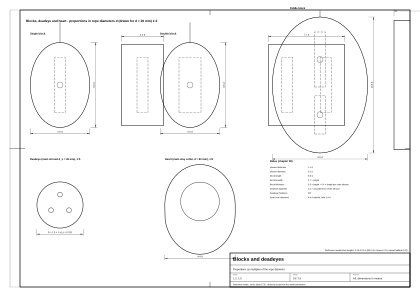
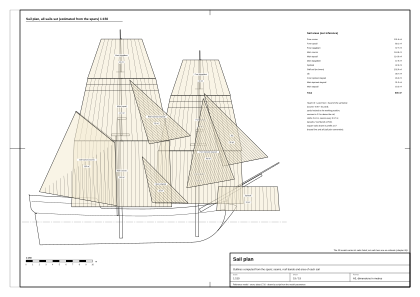

# 08. Ropes, blocks and sails

## What this stage is for

Chapters 06 and 07 say where each rope goes. This chapter is about the things
themselves: how a hemp rope is made and how strong and heavy it is, what blocks and deadeyes look like and how big
they are, how a sail is put together and what it looks like in each state, and how to show all this in 3D graphics
without the rigging turning into flickering noise.

At the end of this chapter you will have rules for rope lay, size, strength and weight; proportions of blocks, deadeyes and
hearts; the construction of square and gaff sails with cloth counts for the reference model; furled and set sail
shapes; and a recipe for rope geometry, rope texture, sag curves, minimum on-screen thickness and levels of detail.

Confidence labels as in [Chapter 01](01-ship-type-and-era.md): (period; our main period sources are Steel 1794 and Lever 1808), (secondary), (our inference), (reference model). Rope size: **d [mm] = C [in] × 25.4 / π ≈ 8.09 × C**.

## Concepts

- **Lay**: the direction in which the strands of a rope are twisted: right-hand (Z) or left-hand (S).
- **Circumference**: period sources give a rope's size as its girth in inches; d [mm] ≈ 8.09 × C.
- **Block**: a wooden shell with one or more sheaves (grooved wheels) for a rope to run over.
- **Deadeye**: a round wooden block with three holes and no sheave, used in pairs with a lanyard.
- **Heart**: a block with one large grooved hole, used to set up a stay.
- **Cloth**: one strip of sailcloth; a sail is sewn from cloths. **Bolt-rope**: the rope sewn round the edge.
- **Head, foot, leech, clew**: the top edge, bottom edge, side edge and lower corner of a sail.
- **Reef band**: a strip across a sail with reef points, used to make the sail smaller.
- **Set, furled**: spread to the wind; rolled up and tied on its yard.
- **Sag, catenary**: how far a rope hangs below the line between its ends; the curve of a hanging rope.
- **Level of detail (LOD)**: simpler versions of a model shown from far away.

## Rope

### How a hemp rope is made

| Item | Value | Confidence and source |
|---|---|---|
| Structure | hemp fibres are spun into **yarns**, yarns twisted into **strands**, strands laid into the rope | [2] (period) |
| Hawser-laid | 3 strands, **right-hand** lay ("with the sun", Z) | [2] (period) |
| Shroud-laid | 4 strands, right-hand lay | [2] (period) |
| Cable-laid | 9 strands (3 ropes of 3), **left-hand** lay (S) | [2] (period) |
| Lower shrouds | Steel makes them of "cablet", small cable-laid rope (so the deadeye is turned in left-handed); topmast stays are cable-laid | [1] (period) |
| Yarns per strand | bolt-rope of 6 in has 98 yarns per strand, 3 in has 25, 1.5 in has 7 | [1] (period) |
| Yarns in a rope | ≈ 8–9 × C² (C in inches) | (our inference) |
| Spun-yarn, marline | 3–4 yarns from old rope, tarred and twisted; used for service and seizings | [1] (period) |

### Strength, weight, stretch

| Item | Value | Confidence and source |
|---|---|---|
| Breaking strength, untarred hemp | ≈ 1371 × C² pounds (C in inches) | [3] (secondary, 19th century) |
| Breaking strength, tarred hemp | ≈ 1045 × C² pounds | [3] (secondary) |
| Cautious working rule | C² / 3 tons | [3] (secondary) |
| Example: tarred shroud of 6 in (49 mm) | ≈ 37,600 lb ≈ 167 kN (≈ 17 t) | (our inference) |
| Weight | ≈ 0.07–0.08 × d² kg/m, with d in cm: shroud 49 mm ≈ 1.8 kg/m, main stay 80 mm ≈ 4.8 kg/m, ratline 10 mm ≈ 0.08 kg/m | (our inference) |
| Stretch | new hemp stretches: Steel stretches shrouds with a tackle to the capstan and leaves them 24 h; after a gale the lanyards are set up again | [1] (period) |

### Seizings, service, splices, knots

- **Round seizing:** 6–10 riding turns, one fewer on top, two cross turns; **throat seizing:** turns without crossing,
  used at deadeyes, hearts, blocks [2] (period); Steel: 7 under, 6 over [1] (period).
- **Worming → parcelling → serving:** spun-yarn laid into the grooves between strands → wrapped with tarred canvas →
  tight turns of spun-yarn against the lay, put on with a serving mallet [2] (period).
- **Splices:** short splice (joins two ends, will not pass a block), long splice (rope keeps its size, passes a
  block), eye splice, cut splice (for pendants) [2] (period). Small strands are tucked twice, large ones three times [1] (period).
- **Knots on deck:** clove hitch (ratlines), half hitch, timber hitch, rolling hitch, reef knot (reef points),
  bowline, sheet bend, fisherman's bend (anchor), wall, crown, Matthew Walker (end of a lanyard), shroud knot
  (repairing a shot-through shroud) [2] (period).

### Coils

Coil the slack **with the lay**: right-laid rope clockwise; hang it on the pin or cleat; tackle falls are coiled on
deck. Flemish coils are a later harbour habit [8], [9] (secondary). The reference model hangs 54 coils of 0.45 m on
the used pins, with rope no thicker than 20 mm (reference model).

## Blocks, deadeyes, hearts

*Figure 1. Blocks, deadeye and heart with their proportions in rope diameters d, drawn for d = 20 mm at 1:2 (sheet
`plans/blocks-and-deadeyes.svg`): single, double, fiddle, sister and quarter block, deadeye and heart, each with its main
dimensions as multiples of the rope diameter d.*

### Kinds

| Kind | Use |
|---|---|
| Single / double / treble block | tackles, halliards, braces |
| Fiddle block | two sheaves of different size one above the other, for narrow places (e.g. at a yard) |
| Sister block | two sheaves in one long shell seized between the legs of a shroud; topsail lifts [1] |
| Quarter block | double block in the middle of a yard on long and short legs; topsail sheets and clewlines [1] |
| Deadeye | round block with no sheave and three holes; shrouds and backstays [1], [6] |
| Heart | one large grooved hole; stays and bobstays [1] |
| Bull's eye | wooden ring with a groove; fairlead [7] |
| Thimble | iron ring in an eye of rope; rope ends, hooks [1] |

### Proportions

| Item | Rule | Confidence and source |
|---|---|---|
| Sheave thickness | 1.1 × rope diameter | [1] (period) |
| Sheave diameter | 5 × sheave thickness (≈ 5.5 d) | [1] (period) |
| Block breadth | 6 × sheave thickness | [1] (period) |
| Block thickness | about 1/2 of its length; each extra sheave adds a little less than one sheave slot | [1] (period) |
| Block strop | e.g. a 17 in block has a strop of 5 in rope, a 6 in block of 1.5 in rope | [1] (period) |
| Simple rule for modelling | length ≈ 8–9 × d of the rope (rope 20 mm → block ≈ 0.17 m), width ≈ 0.7 × length, thickness ≈ 0.5 × length (+0.4 × length per extra sheave) | (our inference) |
| Deadeye | diameter 1.5 × circumference of the shroud; thickness ≈ 1/2 diameter; 3 holes; groove round the edge for the strop | [4], [6] (secondary) |
| Deadeye gap | 2.5–3 diameters between the upper and lower deadeye | [5] (secondary) |

**Reference model:** block lengths 0.14 m (lower and topsail lifts), 0.10 m (topgallant lifts, buntlines),
0.16 m (brace pendants of lower and topsail yards, topsail sheet quarter blocks), 0.12 m (blocks on stays, clewlines,
rail blocks), 0.20 m (topsail halliard), 0.22 m (main sheet). Deadeyes: a lathe profile with a groove, 10 sides, holes
at 0.45 of the radius at 90°, 210° and 330° (shown only by the lanyards entering the face); main 0.231 m, fore
0.212 m, backstays 0.85 of that, topmast 0.13 m.

## Sails

### Which sails (1700–1720)

| Sail | Late brig | Brigantine 1700–1720 | Snow 1700–1720 |
|---|---|---|---|
| Fore course | yes | yes | yes |
| Fore topsail | yes | yes | yes |
| Fore topgallant | yes | small, sometimes | sometimes |
| Main course (square) | from mid-18th century ("snow-brig") | **no** | yes |
| Main topsail, main topgallant | yes | yes (topgallant sometimes) | yes |
| Gaff sail on the main / trysail | yes (with boom) | yes (main gaff sail; boom later) | on the snow mast, no boom |
| Spritsail under the bowsprit | until about 1800 | yes | yes |
| Jib | yes | from about 1705 | from about 1705 |
| Fore topmast staysail | yes | yes | yes |
| Main staysail, main topmast staysail | yes | yes (staysails from 1709 in the Royal Navy, earlier on fore-and-aft craft) | yes |
| Studding sails | yes | sometimes | sometimes |

Sources: [14], [15], [16], [17] (secondary); column "late brig" [1], [2] (period).

*Figure 2. Sail plan of the reference model with all sails set (estimated from the spars), side elevation at 1:150,
cloth seams and reef bands drawn, area of each sail written in it (sheet `plans/sail-plan.svg`).*

### How a sail is made

| Item | Value | Confidence and source |
|---|---|---|
| Cloth width | **24 in = 0.61 m**; a bolt of 38 yd; British statutory standard from 1746 (24 or 18 in also in the 16th–18th centuries) | [1] (period); [10], [11] (secondary) |
| Seam | flat seam, overlap 1.25 in (topgallants) to 1.5 in (courses, topsails); Steel's brig gaff mainsail: 3 in at the foot, 2 in at the head, 1 in in the middle | [11] (secondary); [1] (period) |
| Seam spacing | 0.61 m − 0.038 m overlap ≈ **0.57 m** | (our inference) |
| Canvas | in the Royal Navy hemp or flax canvas nos. 1–8 (brig gaff mainsail: nos. 5–6); "Holland duck" counted best | [1] (period); [10] (secondary) |
| Bolt-rope | Riga hemp, tarred; in a sloop's mainsail 2.5–3 in at the mast, 1.5 in elsewhere | [1] (period) |
| Cringles | from strands of bolt-rope 0.5 in thinner than the bolt-rope; clews worked of 14 turns of strand | [1] (period) |
| Reef bands | brig gaff mainsail (1794): **3 reef bands of 6 in, parallel to the foot**; topsails of the late 18th century up to 4 reefs; courses 1–2 | [1] (period); [11] (secondary) |
| Reefs in 1700–1720 | reefing returns at the end of the 17th century, first on topsails; about 1710 **topsails 1–2 reefs, courses rather bonnets** (a laced-on strip at the foot) instead of reefs | (our inference) ([12] not accessible; [13]) |
| Reinforcing bands | middle band halfway between the lowest reef and the foot; buntline cloths (4 on a course, 2 on a topsail, 0 on a topgallant); linings at the leech | [11] (secondary, for about 1800) |
| Slack at the luff of a gaff sail | 4 in per yard (11%) | [1] (period) |
| Colour | natural hemp or flax: **cream to buff, new cloth lighter, old greyish, patches in another shade**; not dacron white; tanned brown sails belong to fishing smacks, not to ships | (our inference); [10] (secondary: tanning) |
| Reef points | about one per cloth, i.e. every ~0.6 m, hanging 0.6–0.8 m, about 5 mm | (our inference) |
| Gaskets | flat braided bands 25–40 mm wide, every 1–1.5 m | (our inference) |

### Step by step: laying out a square sail

1. **Head:** about 0.9 × the yard length (the yardarms stay free for lifts, braces and footropes) (our inference).
2. **Foot:** about the head of the sail below (a topsail's foot spans the lower yard; a course's foot about 0.95 × its
   own yard) (our inference).
3. **Depth:** from the yard to the yard below; for a course, down to about the height of the rail (our inference).
4. **Cloths:** divide the head by the seam spacing (0.57 m) for the cloths at the head; add gores (wedge-shaped
   cloths) at the leeches to reach the foot (our inference).
5. **Tablings and bands:** turn in a tabling along all edges; add reef bands under the head (topsails: 1–2 in 1710),
   the middle band and buntline cloths (our inference, [11]).
6. **Bolt-rope and cringles:** bolt-rope round the edges, cringles at the clews, at each reef band and for the
   bowline bridles on the leeches [1] (period).
7. **Reef points:** one per cloth on each reef band [1]/(our inference).

### Worked example: sails of the reference model (our inference)

The reference model has **only furled sails** (reference model). The set sails below are our estimates from its spars (Chapter 05), as stored in
`set_sail_estimates` in `data/parameters.json`: head = 0.9 × yard; foot = the head of the sail below (a course:
0.95 × its own yard); yards hoisted to the working position (topsail yards 0.9 m under the crosstrees, topgallant
yards 1.4 m under the truck); courses down to the rail. Areas as trapezoids; cloths 0.61 m wide with a seam every
0.57 m. All (our inference). The numbers change when the spars change; take the current values from the file.

| Sail | Head [m] | Foot [m] | Depth [m] | Cloths head / foot | Area [m²] |
|---|---|---|---|---|---|
| Main course | 14.24 | 15.03 | 9.90 | 25 / 26 | 144.8 |
| Main topsail | 10.17 | 14.24 | 9.39 | 18 / 25 | 114.6 |
| Main topgallant | 6.10 | 10.17 | 5.89 | 11 / 18 | 47.9 |
| Fore course | 12.46 | 13.15 | 7.94 | 22 / 23 | 101.7 |
| Fore topsail | 8.90 | 12.46 | 8.34 | 16 / 22 | 89.1 |
| Fore topgallant | 5.34 | 8.90 | 5.30 | 9 / 16 | 37.7 |
| Gaff sail (on the snow mast, no boom) | | | | | 102.6 |
| Jib | | | | | 38.7 |
| Fore topmast staysail | | | | | 46.3 |
| Main topmast staysail | | | | | 31.3 |
| Main staysail | | | | | 18.3 |
| **Total (without spritsail and studding sails)** | | | | | **773** |
| Spritsail | 8.90 | 9.39 | 3.60 | 16 / 16 | 32.9 |

Cross-check: our research note estimated about 660 m² for a slightly wider hull with shorter masts above the deck;
Lady Washington (brigantine replica, deck 20 m, beam 6.7 m) carries 410 m² [19], which scaled by the square of the
beam gives about 530 m² for a beam of 7.6 m; Niagara (1813 war brig, beam 9.8 m) carries 1177 m² [20], scaled about
710 m² (our inference); our estimate of 773 m² is about 9 % more. Our courses are deep because the reference hull is shallow and the lower masts stand high above the deck
(Chapter 05).

### States of a sail

| State | Look | Confidence and source |
|---|---|---|
| **Set, wind aft** | belly (camber) about 10–15% of the chord; the foot of the courses curves forward; clews hauled down and to leeward | (our inference) |
| **Braced sharp up** | yards turned about 30–35° (Chapter 07); bowlines pull the weather leech forward | (our inference); [1] (period) |
| **Aback** | wind from ahead, canvas pressed against the mast; when heaving to, one topsail stands aback | [2] (period) |
| **Reefed** | the strip above the reef band rolled up on the yard, reef points tied with reef knots; the weather earing first | [2] (period) |
| **Clewed up** | clews hauled up under the middle of the yard by the clewlines, the foot raised by the buntlines; the sail hangs in festoons under the yard; an intermediate state, important in battle and when going about | [18], [2] (period) |
| **Furled** | a roll of canvas on top of and in front of the yard, tightly bound with gaskets every 1–1.5 m; a harbour furl gathers all canvas into one bunt at the mast | (our inference) |
| **Gaff sail without boom (1700–1720)** | brailed in to the mast, not furled on a boom | [15] (secondary) |

### Furled sails in the reference model

- Each furled square sail is a roll lying on top of and in front of its yard, from −0.86 to +0.86 of the half-length,
  thicker in the middle (bunt) and thinner at the ends, with small random bulges between gaskets.
- Roll radius in the middle / at the ends: courses 0.30 / 0.15 m, topsails 0.25 / 0.12 m, topgallants 0.16 / 0.085 m,
  spritsail 0.21 / 0.11 m.
- Near the middle the bunt is drawn back toward the yard, and near any stay the roll radius is reduced, so the stay
  passes in front of the yard without cutting the canvas.
- Gaskets every 1.1 m, flat bands 6 × 35 mm, left out where a stay passes.
- The furled sail is a **child of its yard**, so it turns with it.
- The gaff sail is gathered under the gaff and down the snow mast; the jib is stowed on the jib-boom, the fore topmast
  staysail on the bowsprit, the main staysail lowered at the foot of the fore mast.

## Showing ropes and sails in 3D graphics

### Rope geometry

A rope is a tube swept along a polyline. Number of sides (our inference, research recommendation):

| Rope | Close by | Normal | Far |
|---|---|---|---|
| ≥ 40 mm (stays, shrouds) | 8 | 6 | 3 or a line |
| 10–30 mm | 6 | 5 | 3 or a line |
| ratlines, lanyards, seizings | 4 | 3 | omit |

The reference model uses: d ≥ 60 mm → 8 sides, ≥ 35 mm → 6, ≥ 20 mm → 5, below → 4 (reference model). Do **not** model the lay
in the geometry, except in the closest level of detail for the thickest stays and bobstays, where three humps show in
the silhouette (our inference). A normal map and a texture are enough.

### Rope texture and lay direction

- **Lay length** (one full turn of a strand along the rope) is about **3–3.5 × d** (our inference). Scale the texture along the
  rope by the **diameter**, not by a fixed length in metres; otherwise a 10 mm ratline shows almost straight strands
  while a stay looks right (our inference).
- **UV mapping (reference model):** v goes round the rope (0 to 1), u goes along it; one texture tile spans **two lays**, so
  `u = length / (2 × 3.3 × d)`.
- **Direction:** standing rigging of cablet or cable-laid rope is **left-hand** (S lay), running rigging and
  hawser-laid rope **right-hand** (Z lay) (period, [2], [1]). The reference model mirrors u for tarred ropes to get the
  left-hand lay (reference model). **Check on screen:** on a vertical right-laid rope the strands slope like the middle stroke of
  the letter Z (our inference).

### Colour and material

| Material | Colour (our inference) | Roughness (our inference) | Reference model |
|---|---|---|---|
| Tarred rope | `#2e241b` to `#3d3024` (almost black brown, slightly glossy) | ≈ 0.7 | rope texture × (0.26, 0.21, 0.16) |
| Pale rope | `#a18a66` to `#8c7b5e` (hemp, straw to buff) | ≈ 0.95 | rope texture × (0.86, 0.78, 0.62) |
| Canvas | cream to buff, about `#d9cdb0` | high | canvas texture; photographic linen variant tinted (0.86, 0.82, 0.72) |

Merge geometry into one mesh per material (tarred, pale, canvas, wood) per level of detail (our inference).

### Sag

A rope hanging between two points follows a **catenary** [21] (secondary):

`y(x) = a · (cosh((x − x₀) / a) − 1)`, with `a = H / w` (H: horizontal tension in N, w: weight of the rope in N/m).

For a sag f smaller than about 10% of the span L a **parabola** is enough:

- `f = w · L² / (8 H)`;
- the downward offset at a fraction t ∈ [0, 1] along the chord is **δ(t) = 4 f · t · (1 − t)**, measured
  **vertically** (gravity), not along the rope's normal;
- length and sag: `S ≈ L + 8 f² / (3 L)`, so `f ≈ √(3 L (S − L) / 8)`, where S is the length of the rope. A rope 1% longer than its chord sags about 6%
  of the span (our inference).

The reference model solves `f = a (cosh(L / 2a) − 1)` for a by bisection and samples the cosh curve (reference model).

| Rope | Sag f / L (our inference) | Reference model |
|---|---|---|
| Shrouds, topmast stays | 0–0.002 | 0 |
| Main stay, fore stay (heavy, long) | 0.004–0.008 | 0.005, 0.004 |
| Backstays | 0.002–0.004 | 0 |
| Lifts (yards lowered or hoisted) | 0.003–0.01 | 0 |
| Braces | 0.01–0.03 | 0.012 |
| Ratlines | 0.01–0.02 | 0.015 |
| Sheets and tacks, slack with sail furled | 0.04–0.10 | lower sheets 0.07 |
| Clewlines, buntlines with sail furled | taut (the sail hangs on them) | straight |
| Gaff vangs, spritsail braces | | 0.02, 0.015 |

### Thin ropes far away

On-screen radius in pixels: **r_px = r · H_px / (2 · D · tan(fov / 2))** (r: rope radius, D: distance, H_px: screen
height). At 1080p and a 50° field of view this is about **1158 · r / D**. A rope reaches 1 px diameter at: ratline
(r = 5 mm) **11.6 m**, shroud (r = 25 mm) **58 m**, main stay (r = 40 mm) **93 m** (our inference). Beyond that a thin tube breaks
into dots and flickers.

The proven fix is **"phone-wire anti-aliasing"** [22] (secondary; a graphics technique published in 2012): in the vertex shader widen the radius to at least
0.5–0.7 px, and in the fragment shader lower the coverage (alpha) by the ratio true radius / widened radius; use
alpha-to-coverage with MSAA, or dithering, so no transparency sorting is needed. In three.js this can be done with
`onBeforeCompile` on a standard material (a uniform with the screen height and projection, and a per-vertex rope axis
or an offset along the normal) (our inference). The reference model's game export simply clamps every rope to at least **14 mm**
diameter (reference model), which keeps thin ropes visible but makes ratlines 40% too thick close up.

### Levels of detail

| Distance | Draw (our inference) |
|---|---|
| < 15 m | everything: ratlines as 3–4-sided tubes, lanyards (6 parts), seizings, mice, blocks with sheaves, reef points, gaskets |
| 15–60 m | ratlines as one strip per shroud fan (alpha-textured quad, or 3-sided tubes with AA); blocks as plain boxes; no reef points or seizings |
| 60–250 m | only shrouds, backstays, stays, lifts and braces (AA lines, at least 1 px with coverage); no ropes under 20 mm |
| > 250 m | spars, sails, shadow; rigging as 4–6 dark lines per mast or nothing |

The reference model's farthest level (LOD2) leaves out ratlines, lanyards, footropes, catharpins, futtock shrouds,
coils, slings, gammoning, all running rigging and all dynamic lines (reference model).

**Keep at every distance where they are visible (our inference):** the fan of shrouds narrowing from the wide channel to the
masthead; pairs of deadeyes with pale lanyards; the horizontal rhythm of the ratlines with a slight sag; the stack of
eyes on the masthead; caps and doublings (topmast **in front of** the lower mast); footropes under the yards; sag only
downward; two rope colours; the furled roll on top of and in front of the yard; stays meeting on the centreline; the
gammoning; futtock shrouds seen from the deck.

## Check yourself

- [ ] Shrouds and stays left-laid, running rigging right-laid; the lay length scales with the diameter (≈ 3.3 d).
- [ ] Tarred ropes almost black brown, pale ropes straw to buff, sails cream, not white.
- [ ] Deadeyes 1.5 × the shroud circumference across (≈ 0.23 m for 49 mm shrouds), three holes.
- [ ] Blocks about 8–9 × the rope diameter long (≈ 0.17 m for a 20 mm rope).
- [ ] Cloths 0.61 m wide, seams about 0.57 m apart; main course about 25 cloths at the head.
- [ ] In 1710 topsails have 1–2 reef bands; courses use bonnets rather than reefs.
- [ ] Furled sail on top of and in front of the yard, with gaskets every 1–1.5 m.
- [ ] Sag is vertical; shrouds almost straight, braces 1–3%, slack sheets 4–10%.
- [ ] Ratlines (10 mm) are thinner than 1 px beyond about 12 m; you have a plan for that (AA or LOD).

## Typical mistakes

- **One rope colour** for everything (our inference).
- **Rope texture with a fixed lay in metres**, so thin ropes look like smooth wire (our inference).
- **Sag along the normal** instead of straight down (our inference).
- **White sails** like modern dacron (our inference).
- **Many reef bands on 1710 topsails**, or reefs on the courses (our inference).
- **Furled sail under the yard** or wrapped round it like a sausage (our inference).
- **Real-diameter ratlines at all distances,** which flicker into dots (our inference).
- **Blocks too big** (the size of a man's head on a 16 mm line) (our inference).

## Sources

1. D. Steel, *The Elements and Practice of Rigging and Seamanship*, 1794:
   https://whalesite.org/anthology/1794_Steel_Elements_and_Practice.htm
2. D. Lever, *The Young Sea Officer's Sheet Anchor* (1808): https://archive.org/details/youngseaofficers00leve
3. S. B. Luce, *Text-Book of Seamanship* (rope strength; from search results, page did not respond):
   https://legacy.maritime.org/doc/luce/part1.php
4. VAKA, "Making Deadeyes and Wooden Blocks": https://www.vaka.earth/2026/04/making-deadeyes-and-wooden-blocks.html
5. Finescale Modeler Forum, "shrouds and lanyards": https://forum.finescale.com/t/shrouds-and-lanyards/143536
6. Wikipedia (pl), "Jufers": https://pl.wikipedia.org/wiki/Jufers
7. potempski.com, sail and rigging names: https://potempski.com/rejowe/inne/zagle.htm
8. Wikipedia, "Belaying pin": https://en.wikipedia.org/wiki/Belaying_pin
9. Sail Magazine, "Coil with the sun": https://sailmagazine.com/diy/coil-with-the-sun/
10. Wikipedia, "Sailcloth": https://en.wikipedia.org/wiki/Sailcloth
11. HMS Richmond (living history), "Sailmaker": https://www.hmsrichmond.org/sailmker.htm
12. Society for Nautical Research, "Early Reefs" (not accessible, 403): https://snr.org.uk/early-reefs/
13. Wikipedia, "Top (sailing ship)": https://en.wikipedia.org/wiki/Top_(sailing_ship)
14. Wikipedia, "Brigantine": https://en.wikipedia.org/wiki/Brigantine
15. Wikipedia, "Snow (ship)": https://en.wikipedia.org/wiki/Snow_(ship)
16. Oxford Reference, "Jib-boom": https://www.oxfordreference.com/display/10.1093/oi/authority.20110803100020673
17. P. K. Allan, "The Evolution of Sails in Eighteenth-Century Warships":
    https://brewminate.com/the-evolution-of-sails-in-eighteenth-century-warships/
18. Wikipedia (pl), "Gejtawa": https://pl.wikipedia.org/wiki/Gejtawa
19. Wikipedia, "Lady Washington": https://en.wikipedia.org/wiki/Lady_Washington
20. Wikipedia, "USS Niagara (1813)": https://en.wikipedia.org/wiki/USS_Niagara_(1813)
21. Wikipedia, "Catenary": https://en.wikipedia.org/wiki/Catenary
22. E. Persson (Humus), "Phone-wire AA": http://www.humus.name/index.php?page=3D&ID=89
23. three.js, TubeGeometry (MIT licence): https://threejs.org/docs/#api/en/geometries/TubeGeometry
24. M. DesLauriers, "Shaping Curves with Parametric Equations" (building tubes by hand; code licence not checked):
    https://mattdesl.svbtle.com/shaping-curves-with-parametric-equations

## Terms used in this chapter

| English | Polish | Meaning |
|---|---|---|
| yarn, strand | przędza, pokrętka (splotka) | Twisted fibres; twisted yarns that form a rope. |
| hawser-laid, shroud-laid, cable-laid | lina trzypokrętkowa, czteropokrętkowa, kablowa (uncertain) | 3 strands right; 4 strands right; 9 strands left. |
| lay (right / left) | skręt (prawy / lewy) | Direction in which the strands twist. |
| spun-yarn, marline | marlina | Small tarred line for seizings and service. |
| seizing (round, throat) | opaska, bendzel (bencle) | Binding of two ropes or a rope and a block. |
| worming, parcelling, serving | obszywanie (no confirmed separate Polish terms) | Filling, canvas wrap and tight binding against chafe. |
| splice (short, long, eye) | splot (krótki, długi, oko) | Joining or forming a rope by tucking strands. |
| block, shell, sheave, strop | blok, kloc (uncertain), krążek, strop | Pulley; its body; its wheel; the rope round it. |
| fiddle, sister, quarter block | blok skrzypcowy, siostrzany, ćwiartkowy (uncertain) | Special blocks (see "Kinds"). |
| deadeye, heart, bull's eye, thimble | jufers, serce, baranek, kausza | Sheaveless blocks and rings. |
| sail, cloth, seam | żagiel, bryt, szew | Sail; a strip of canvas; the join of two strips. |
| bolt-rope, leech, head, foot | liklina, lik boczny, lik górny, lik dolny | Edge rope; side, top and bottom edges. |
| clew, earing, cringle | róg szotowy, ucho refowe (nok refowy), ucho | Lower corner; reef corner rope; rope eye in the edge. |
| reef band, reef point, bonnet | refbant, refsejzing, boneta (uncertain) | Strengthening strip with reef points; tie; laced-on extra strip. |
| gasket | krawat (sejzing) | Band tying a furled sail to its yard. |
| bunt | środek żagla (bunt) (uncertain) | Middle part of a square sail / of the furled roll. |
| course, topsail, topgallant | fok/grot, marsel, bramsel | Lower, second and third square sails. |
| jib, staysail, spritsail | kliwer, sztaksel, blinda | Head sails; sail under the bowsprit. |
| studding sail | lizel | Extra sail set outside the leech of a square sail. |
| aback, clewed up, furled | na kontrę, zgejtowany, zwinięty | Sail states (see "States of a sail"). |
| catenary | krzywa łańcuchowa | Curve of a hanging rope. |
| level of detail (LOD) | poziom szczegółów | Simpler versions of a model for larger distances. |
