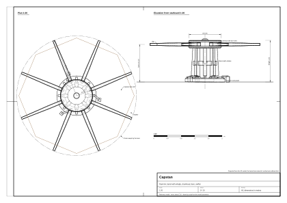
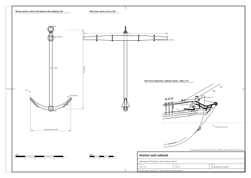
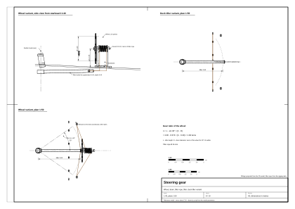
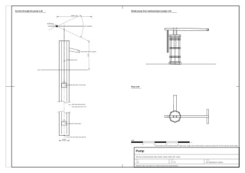
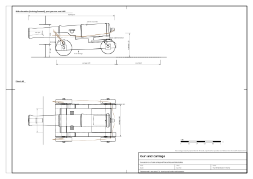

# 09. Deck machinery and fittings

## What this stage is for

The hull and rig make a ship; the deck machinery makes her work. The capstan raises the anchors, the pumps keep her
afloat, the wheel or tiller steers her, the guns fight her. Each machine has a size fixed by the people who work it,
a place fixed by what it pulls or moves, and parts that move in a known way. Get these right and the deck looks
alive; get them wrong and no amount of texture will help.

At the end of this chapter you will have, for each item: its parts, dimensions, how it is worked step by step, what
moves (axis and range), how many people work it, and notes for modelling and animation. The place of each item on
the reference model's deck is listed in [chapter 04](04-decks-bulwarks-stern-head.md); the rudder itself is also
there.

Confidence labels (period, secondary, our inference, reference model) are explained in
[chapter 01](01-ship-type-and-era.md). Many machine dimensions for small ships of 1700–1720 are **not recorded**;
those values are our estimates and are marked so. Some sources are later than our date; they are marked "(later)"
with a note on whether they can be carried back.

Units: 1 fathom = 6 ft = 1.83 m; 1 cwt (hundredweight) = 112 lb = 50.8 kg.

## Concepts

- **Capstan**: vertical winch turned by men pushing bars; for the anchor cable and heavy lifts.
- **Windlass**: horizontal winch turned by handspikes, for merchant ships with small crews.
- **Messenger**: an endless rope round the capstan, to which the thick anchor cable is lashed with short **nippers**.
- **Cathead, catting, fishing**: hoisting the anchor ring up to the cathead; then lifting the flukes onto the side.
- **Tiller, whipstaff, wheel**: three ways to turn the rudder.
- **Binnacle**: the cupboard holding the compasses, sandglasses and a light in front of the helmsman.
- **Truck carriage**: the four-wheeled wooden gun carriage of a naval gun.
- **Swivel gun**: a small gun on a pivot fork set into the rail.

## Capstan

**Parts** [1] (period, 1797 encyclopaedia), [2] (period, 1750):

- **Spindle**: a vertical oak post through the deck, standing in a **step** on a lower deck or on beams.
- **Barrel**: the part the rope is wound on, polygonal in section.
- **Whelps**: 6–8 wedge-shaped ribs fixed to the barrel; they increase its girth so each turn takes in more rope.
- **Drumhead**: a broad round head at the top, compared in the encyclopaedia to a millstone, with square holes for the
  bars.
- **Bars**: wooden levers fitted into the holes, numbered to match their holes, each secured by a pin on a chain.
- **Pawls**: iron bars that stop the capstan turning back. Deck pawls drop onto a toothed **pawl rim** at the foot.
  "Pawl the capstan" means drop the pawls during a pause.
- **Messenger** and **nippers**: known for frigates; for a small sloop of 1710 it is our assumption (secondary for
  frigates [1], our inference for sloops).

**Where it stands.** Blanckley (1750) distinguishes the main capstan abaft the mainmast and the jeer capstan between
the masts; a small ship has one capstan on the upper deck, abaft the mainmast or between the masts [2] (period,
later).

| Dimension | Estimate for a 28 m ship | Reference model |
|---|---|---|
| Drumhead diameter | 0.85–0.95 (our inference) | 0.94 |
| Barrel with whelps | Ø 0.6–0.75 (our inference) | Ø 0.80 (core Ø 0.52 octagonal, 8 whelps) |
| Height above deck | 0.95–1.05, about waist high (our inference) | 1.22 to the top of the head; bars at 1.10 |
| Bars | 8 bars of 2.8–3.2 m; with bars shipped the capstan needs a circle of about 6.5 m (our inference) | 8 bars reaching 1.75 m from the centre (a 3.5 m circle), to fit between masts and hatches |
| Pawls | – | pawl rim on the deck (outer Ø 1.16, 16 iron teeth) and 3 pawls on short posts |
| Position | abaft the mainmast or between the masts | s = +0.95, 2.35 m forward of the mainmast, on the centreline |

**How it works, step by step** [1], [2] and our inference for numbers:

1. Ship the bars and pin them. Pass a rope (**swifter**) round the outer ends so the bars cannot slip out.
2. Man the bars: 2–4 men per bar, 16–30 men in all.
3. Walk round pushing the bars, by convention clockwise seen from above. The barrel winds in the messenger: at
   Ø 0.7 m one turn takes in about 2.2 m (in the reference model, Ø 0.80, about 2.5 m).
4. The pawls click over the teeth of the rim. When the men rest, the pawls hold the load.
5. If the men let go of the bars with the pawls lifted, the capstan runs back and the bars strike them: a common
   accident.
6. The turns of rope creep along the barrel and must from time to time be eased back (**surge**).

**What moves** (reference model): barrel, head and bars together about the vertical axis, unlimited; pawls tip up and
drop once per tooth; men walk the circle leaning forward. Rough rate: 20 men give 4–6 turns per minute in shallow
water and 1–2 when breaking the anchor out (our inference, game value).

**Modelling and animation.** Make the base (pawl rim, pawl posts) one static object and the barrel, head and bars
one moving object with its origin on the axis, at deck level. Keep the bars removable (separate objects or a
visibility switch). Play a click per tooth: with 16 teeth, 16 clicks per turn. Test the bar circle against masts,
hatches, pumps and guns run in (chapter 04, placement rules).

*Figure 1. Capstan of the reference model.*

## Windlass (merchant variant)

Not in the reference model; useful for merchant ships and privateers converted from them.

- **Parts** (secondary [3]): an octagonal **barrel** across the fore deck between two **bitts** (windlass bitts,
  carrick bitts); **handspike holes** in several rows; **handspikes** 1.8–2.1 m; a central **pawl bitt** with a pawl
  dropping on a toothed rim on the barrel.
- **Size** (our inference): barrel 3.5–4.5 m long, Ø 0.4–0.5; bitts 0.30 × 0.35, 1.0–1.2 high.
- **Working**: put a handspike in a hole, heave it down a quarter turn, pull it out, put it in the next hole. Slower
  than a capstan, but needs fewer men and less room. A 1771 encyclopaedia describes it worked by handspikes for
  anchors and weights [4] (period). The pump-brake windlass with a rocking lever is 19th century (later) [3].
- **What moves**: the barrel in steps, the pawl clicking; 6–12 men in a rhythm "down, out, in".
- **Which ship**: navy ships with big crews used capstans; merchant ships with small crews and crowded decks
  preferred windlasses [5] (secondary); Blanckley mentions the windlass for small ships [2].

## Anchors and their handling

### The anchor

| Part | Description (period [2], secondary [6]) |
|---|---|
| Shank | Straight wrought-iron bar. |
| Arms | Two curved arms at the lower end. |
| Flukes (palms) | Triangular plates at the ends of the arms. |
| Bills (peaks) | Points of the flukes. |
| Crown | Where the arms meet the shank. |
| Stock | Two oak halves hooped together with iron, at right angles to the arms; it turns the anchor so a fluke bites. |
| Square | Upper part of the shank on which the stock sits. |
| Ring | For the cable; usually wrapped with rope (**puddening**). |

Stream and kedge anchors often had a removable stock for stowage [6] (secondary).

### Number and weight

- Blanckley (1750): bower, sheet and spare anchors weigh the same; the stream anchor ¼ of a bower; the kedge ⅛ [2]
  (period, later). A later dictionary gives stream ⅓ of a bower and kedge ⅓ of a stream for large ships [6].
- Steel (1794), via a modelling forum (secondary, later): a 200-ton sloop: 3 bowers of 15 cwt (762 kg), 1 kedge of
  3 cwt (152 kg); a 268–300-ton sloop: 3 of 20 cwt (1016 kg), 1 stream of 7 cwt (356 kg), 1 kedge of 3.5 cwt
  (178 kg) [7].
- For a ship of 200–250 tons (our inference): 2 bowers at the catheads, 1 spare stowed in the waist, 1 stream,
  1 kedge.

| Dimension, bower of 800–1000 kg | Estimate (our inference) | Reference model |
|---|---|---|
| Shank | 3.2–3.5 m | 3.3 m, 0.11 square |
| Spread of the arms | 1.9–2.1 m | arms of 1.05 m radius over 52° each side, about 1.7 m across the flukes |
| Stock | about 3.5 m long, 0.3 × 0.3 at the shank, tapering | 3.5 m, 0.20 square at the centre tapering to 0.12, 4 iron hoops |
| Ring | – | outer Ø about 0.27 |

### Cable, hawse, bitts

- **Cable**: hemp, cable-laid (three ropes laid together). Standard length 100–120 fathoms (183–220 m). For a sloop
  about 9–11 in circumference, Ø 73–89 mm (our inference). Our hull notes size the hawse holes for a cable of
  0.15–0.18 m; the reference model draws the cable Ø 0.16 (conflict noted).
- **Hawse holes**: one, sometimes two, per side; lined with lead; stopped with **hawse plugs** in heavy weather
  (secondary).
- **Riding bitts**: two heavy posts with a crosspiece behind the hawse holes; the cable is turned round them when the
  ship rides at anchor (secondary). Not in the reference model; the cable runs aft along the deck towards the
  foremast.
- **No chain cable**: it came into navy use about 1810 (secondary).

### Cathead gear

The **cathead** holds the iron anchor clear of the wooden side while it is raised [8] (secondary). Its gear
(secondary [9]): the **cat block** with a large hook; the **cat fall** rove between the cathead sheaves and the
block; the **cat (ring) stopper**; the **shank painter** for the flukes and shank; and a **fish davit** with its
tackle and **fish hook**. Cathead sizes are in chapter 04.

### Anchoring, step by step (secondary [9]; scope numbers our inference)

1. Bring the ship head to wind or tide; take in or back the sails until she nearly stops.
2. The anchor hangs ready at the cathead, held by the ring stopper and the shank painter.
3. "Let go!": release both stoppers; the anchor falls and drags the cable out through the hawse.
4. Veer cable to 3–5 times the depth (a game parameter: more cable, better holding).
5. Turn the cable round the bitts and put on stoppers; the ship swings head to wind or stream.
6. The leadsman checks the depth and someone watches marks ashore to see whether the anchor drags.

### Weighing, step by step (secondary [9])

1. Man the capstan; lash the messenger to the cable with nippers.
2. **Heave short**: when the cable is up and down, the anchor is **apeak**.
3. **Break out**: the anchor comes free (**aweigh**) and the ship begins to drift, so the sails are set now. The
   moment where capstan and topmen must work together is the best dramatic beat for a game.
4. Heave until the anchor is out of the water, "clear" or "foul".
5. **Cat** the anchor: hook the cat block into the ring and haul the cat fall (6–10 men) until the ring is at the
   cathead; secure it with the stopper.
6. **Fish** it: with the fish hook from the davit lift the flukes onto the side, and lash the shank with the shank
   painter. Falconer (1780) defines fishing as hoisting the flukes up after catting [10] (period).
7. Unlash the cable from the messenger and stow it in the **cable tier** below.

Time (our inference): in 10 m of water with 40 m of cable, heaving 10–20 min, catting and fishing 5–10 min.

**What moves** (reference model): the port anchor hangs from the cathead (catted); the starboard anchor is let go,
its cable running from the hawse into the water. Animate the anchor as one object hanging from the cat block, the
cable as a curve from the hawse.

*Figure 2. Anchor, cathead and stowage.*

## Steering

The rudder, its pintles and gudgeons are in chapter 04 (5 pintles, ±35° in the reference model).

### Tiller

- A wooden lever fitted into the rudder head. Small vessels steered with a tiller throughout the century, even
  fairly large sloops and schooners [11] (secondary, forum). *Ferret* (1711) is shown with a tiller on a small open
  deck over the cabin [11] (secondary, low). The RMG model SLR0229 (1740) has a tiller [12] (period, model).
- **Tiller tackles**: one each side, from the tiller to the bulwarks; they ease the helmsman and hold the rudder in a
  storm [11] (secondary).
- Size (our inference): 3–4 m long, 0.18 × 0.18 at the rudder head, tapering to the grip.
- Crew (our inference): 1 helmsman in fair weather, 2–4 in a storm.
- **Reference model, tiller variant**: on the rudder head above the quarterdeck, about 3.5 m long (shortened if it
  would touch the rail at full helm), 0.18 square, 0.45 above the deck at the head and 0.90 at the grip, with a
  carved knob; two tiller tackles to ring bolts in the bulwark at 0.75 of the tiller length.
- **What moves**: the tiller turns in the horizontal plane about the rudder axis, ±35°; the helmsman walks sideways
  with it; the tackles lengthen on one side and shorten on the other.

### Whipstaff

- A vertical lever; its lower end joins the tiller one deck below, its middle passes through a pivoting block in the
  deck (**rowle**) [13] (secondary).
- The helmsman leans it to either side; the movement goes to the tiller. Rudder angle only about 5–10° each way
  (secondary).
- Used in our period in ships with the tiller below deck. Blanckley (1750) says whipstaffs had largely been replaced
  by wheels [2] (period, later). In merchant ships it lasted to about 1750 [14] (period, via scholarly study).

### Wheel

- **When**: early 18th century; inventor and exact date unknown. Most often given as about 1703 (models dated by
  their decoration); some researchers prefer about 1710 and larger ships first. An NMM model of 1705 already has
  ropes led to a drum instead of a whipstaff. The French adopted the wheel officially in 1709, the Venetians in 1719
  [15] (secondary). Our hull notes, after Kenchington, put the wheel in England from the 1690s and in general use on
  warships a few years later [14] (period, via study). The RMG model SLR0416 (about 1720) has a wheel [12].
- **Advice** (our inference): for a sloop of 1702–1712 the tiller is the safest choice; a wheel suits an English
  ship built after about 1712, as a novelty. **The reference model shows the wheel by default and keeps the deck
  tiller as a variant.**
- **Parts** (secondary, general 18th–19th century description): a rim with 8–10 spokes passing through it as handles;
  Ø 1.2–1.5 for a small ship; on a horizontal axle with a **drum** between two **standards**, abaft the binnacle.
  The **tiller rope** is wound about 5 times on the drum, the middle turn nailed so that the rudder is amidships when
  the wheel is centred. Both ends go through blocks to the sides and from there to the end of the tiller.

| Wheel, reference model | Value |
|---|---|
| Position | plane of the wheel at s = −11.55 on the quarterdeck, centreline; the pivot in `data/moving-parts.csv` (s = −11.13) is the middle of the drum, another point on the same fore-and-aft axle |
| Wheel | Ø 1.40, 10 turned spokes with handles beyond the rim |
| Axle height | 1.05 above the quarterdeck |
| Drum | Ø 0.30, 0.50 long, between two standards, flanged |
| Tiller rope | Ø 26 mm, 6 turns on the drum |
| Lead of the rope | from the drum down through two fairleads with sheaves in the quarterdeck, to sheaves near the sides under the deck, to the tiller end |
| Tiller (below deck) | 3.0 m long, 0.16 square, 0.40 below the quarterdeck in the cabin; a child of the rudder |

**Gear ratio of the wheel.** When the tiller turns by α, its end moves across by L_r · sin α; the rope winds the same
length on the drum. So the turns of the wheel are

n = L_r · sin α / (π · D_drum)

For the reference model: n = 3.0 × sin 35° / (π × 0.30) = 3.0 × 0.574 / 0.942 = **1.83 turns** from amidships to
hard over, 3.66 turns from hard over to hard over (reference model, our calculation). Our deck notes suggest 2–3
turns as a game value; a longer tiller or a smaller drum gives more turns.

**What moves**: the wheel and drum about the fore-and-aft axle (unlimited, but ±1.83 turns map to ±35° rudder);
the rope creeps along the drum; the tiller and rudder turn together.

**Modelling and animation.** Make the rudder the parent of both tillers; drive the rudder angle and derive the wheel
angle as rudder angle × (360° × 1.83 / 35°). Hide the variant not in use. The wheel's origin lies on the axle; its
local axis points forward. The helmsman stands aft of the wheel facing forward, hands on the spokes at axle height.

*Figure 3. Steering gear, both variants.*

## Binnacle and compass

- Blanckley (1750): a cupboard of fir on the quarterdeck just before the wheel, holding the compass, the glass and a
  candle so the helmsman can keep his course [2] (period, later).
- Falconer (1780): three compartments with sliding doors; compasses in the two side ones, a lamp or candle behind
  glass in the middle one, lighting both compasses at night [16] (period, later).
- The two-compass cupboard type is described in navigation manuals from the mid-17th century [17] (secondary).
- **Compass**: a dry card with 32 points, in a wooden bowl on **gimbals** (secondary).
- **Size** (our inference): 0.9 wide × 0.45 deep × 0.8–0.9 high.
- **Reference model**: s = −10.35, forward of the wheel, 0.90 × 0.45 × 0.85 on a plinth, gabled roof, three
  compartments with glazed doors facing the helmsman (aft).
- **What moves**: the card swings slightly, the candle flame flickers, the doors slide.

## Log, sandglasses and traverse board

**Chip log** [18] (secondary): a quadrant of wood (**log-ship**) weighted with lead on the arc so it floats upright;
a three-leg bridle, one leg on a peg that pulls out with a jerk so the log can be hauled back; the **log line** on a
reel, knotted at equal intervals, with a first length (**stray line**) to let the log clear the wake.

- Knot spacing: early 7 fathoms (42 ft) with a 30-second glass, the mile being taken as 5000 ft; later 47 ft 3 in
  with a 28-second glass [18] (secondary). For 1702–1718 use 42 ft and 30 s or similar; practice varied (our
  inference).
- **Working**, 3 men: one holds the reel; one holds the glass and calls "Turn!" and "Stop!"; an officer throws the
  log and counts the knots running through his fingers. Every hour or two hours.
- **Glasses**: 28 s (log), 14 s (at high speed), 30 min (the watch glass, for the bell).
- **Traverse board**: a board with a compass rose and pegs; every half hour a peg marks the course steered
  (secondary).
- **Reference model**: no log object; a work station on the taffrail at s = −13.9.
- **Animation**: throw, line running out through the hand, glass turned, line stopped and hauled in.

## Hand lead and deep-sea lead

- **Hand lead** [19] (secondary): a lead of 7–14 lb (3–6 kg) with a hollow in its base **armed** with tallow to bring
  up a sample of the bottom (sand, shell, mud, coral). Line of 20–25 fathoms, marked by feel and colour:

| Fathoms | Mark |
|---|---|
| 2 | leather with two ends |
| 3 | leather with three ends |
| 5 | white calico |
| 7 | red bunting |
| 10 | leather with a hole |
| 13 | blue serge or calico |
| 15 | white calico |
| 17 | red bunting |
| 20 | cord with two knots |

  Depths without a mark (**deeps**) the leadsman judges.
- **Leadsman**: stands in the fore chains on the channel, outside the bulwark, with a breast rope; swings the lead
  and throws it forward; when the line is vertical he calls, e.g. "By the mark, five!" or "Deep, six!" [19]
  (secondary).
- **Deep-sea lead**: 28 lb and more, line 100–200 fathoms; several men along the side (secondary).
- **Reference model**: no lead object; a work station by the fore shrouds.
- **Animation**: 2–3 swings, throw, splash, line through the hand, call.

## Pumps

### Elm-tree pump (common pump, brake pump)

- The pump tube was a hollowed elm trunk; on small ships without chain pumps it was the main way to clear the hold
  [20] (secondary, forum).
- **Parts** [20], [21]:
  1. **Pump tree**: elm bored to about 15–18 cm, from the well in the bilge to the deck; for our ship about 4–5 m
     long, 0.8–1.0 m above the deck (our inference).
  2. **Lower box**: a fixed valve with a leather flap.
  3. **Upper box (bucket)**: the piston valve, on the **pump spear**, also with a leather flap.
  4. **Brake**: the handle, with two iron bolts; one rests in "ears" at the top of the tube as the pivot, the other
     joins the brake to the spear [21] (period, later).
  5. **Spout** into a wooden trough (**pump dale**) leading to a scupper.
- **Output**: about 25 gallons per minute at about 40 strokes per minute, i.e. about 95–115 l/min [20] (secondary).
- **Crew**: 2–4 men on the brake, changed every few minutes (our inference; about 100 l/min for 2 men for about
  10 minutes).
- **Number and place**: 2, either side abaft the mainmast, where the hold is lowest (our inference).
- **Burr pump**: an older type in which a leather cone is drawn up by a rope instead of a valve piston [22]
  (secondary).
- **Reference model**: 2 pumps at s = −4.35, x = ±1.05 (about 3 m abaft the mainmast, beside the quarterdeck ladder;
  closer to the mast they blocked the walkway): tube Ø 0.35, 1.0 high, three iron hoops, spout to the side, iron
  fork at the top; brake 1.5 m pointing forward, pivot 0.2 above the tube, swinging ±25°, with the iron spear
  hanging from it.
- **What moves**: the brake rocks ±25° about a horizontal athwartships axis; the spear moves up and down; water
  spurts from the spout on each down-stroke of the brake end.
- **Learning model**: an animated cut-away of a common bilge pump from Museum Batavialand parts, CC BY 4.0 [23].

*Figure 4. Elm-tree pump.*

### Chain pump and well

- **Chain pump**: an endless chain with leather-covered discs running up one tube and down another, driven by a wheel
  with cranks and many men. In 18th-century Europe used at sea almost only on warships; the Bentinck and Cole
  improvements date from the 1770s [22] (secondary). For a sloop of 1702–1718 two elm pumps are enough (our
  inference).
- **Pump well**: a boarded box round the lower ends of the pumps by the mainmast step. Water is measured with an iron
  **sounding rod** lowered through a pipe on a line; done every watch (secondary).

## Guns

### Barrels

- Borgard (1716) named guns by the weight of the shot: 4, 6, 9, 12, 18, 24, 32, 42 pounds, with the bore 21/20 of the
  shot diameter; Armstrong revised the designs in 1722 and 1724 [24] (secondary). Before about 1715 ships still
  carried guns with older names (minion, saker) and mixed patterns, so a mixed armament is correct (secondary).

| Gun | Barrel length | Barrel mass | Bore / shot | Confidence |
|---|---|---|---|---|
| 3-pounder | 4.5 ft (1.37 m) | about 7 cwt (355 kg) | about 2.9 in | low (typical literature values) |
| 4-pounder | 5.5–6 ft (1.7–1.8 m) | 10–12 cwt (510–610 kg) | about 3.2 in (81 mm) | low |
| 6-pounder | 6–7 ft (1.8–2.1 m) | 16–19 cwt (810–965 kg) | shot 3.5 in (89 mm) [25], bore about 3.7 in | medium |

The Armstrong tables could not be read (source site unreachable); lengths and masses are typical values to be
checked against Muller (1768) [24].

**Barrel parts** (for the model): muzzle with muzzle ring; **trunnions** on which the barrel tips, a little forward of
its centre of gravity so the breech is heavier; **vent** (touch-hole); **cascabel** at the breech, round which the
breeching passes [25]; **reinforces** (thicker rings). No "dolphins" (lifting handles) on these English guns (our
inference, reference model).

**Range** (low; typical literature values): point blank about 270–370 m; greatest, at elevation, about 1.1–1.4 km.

**Reference model barrel**: 2.0 m long, trunnions 0.92 m from the base ring; breech Ø 0.34, muzzle Ø 0.26; bore
Ø 94 mm; trunnions Ø 92 mm. That is a 6-pounder size, while the ports are sized for 4-pounders (conflict noted).

### Truck carriage

Parts [26] (secondary; regulations of the mid-18th century):

- **Cheeks (brackets)**: two planks of oak or elm, stepped at the back for the handspikes; about one calibre thick.
  British rules required dry elm, which does not split, for cheeks and transom.
- **Transom**: joins the cheeks at the front.
- **Axletrees**: front and rear, wooden.
- **Trucks**: four solid wheels, often of several planks bolted together; the front ones a little larger than the
  rear (this suits the sheer of the deck).
- **Bed (stool bed)** and **quoin**: a board on the rear axletree and a wooden wedge with a handle under the breech;
  pushed in or out to change elevation.
- **Cap squares**: iron straps over the trunnions.
- **Eyebolts and rings**: in the cheeks for the breeching and side tackles; at the rear for the train tackle.

| Dimension, 6-pounder carriage | Estimate (our inference) | Reference model |
|---|---|---|
| Length | 1.4–1.6 | 1.5 |
| Width | 0.75–0.85 | 0.8 (cheeks 0.10 thick) |
| Bore axis above the deck | about 0.6 | 0.60 |
| Trucks | Ø 0.35–0.40 | front Ø 0.40, rear Ø 0.36, 0.09 thick |

### Gun tackle

- **Breeching**: a thick rope through the cheeks and round the cascabel, both ends to ringbolts in the side; about
  3 barrel lengths long; the recoil ends when it comes taut [25] (secondary).
- **Side (gun) tackles**: two, from the side to the carriage; hauling them runs the gun out [25].
- **Train tackle**: at the rear, to a ringbolt in the deck; holds the gun in for loading and when the ship heels [27]
  (secondary, later).
- **At sea**: the gun is secured run in, or against the side with the muzzle lowered. A gun that breaks loose is a
  danger to the whole deck (secondary).

### Gun implements

Sources [27], [28] (secondary): **sponge and rammer** (sometimes on one staff; sheepskin sponge dipped in a bucket);
**worm** (iron corkscrew); **ladle** (by our period cartridges in bags were largely used); **priming wire and vent
bit**; **priming horn**; **linstock** with slow match, and **match tubs**; **handspikes**; **tompion** and lead
**apron** over the vent; **cartridge (passing) box** carried by the powder boys; **shot garlands** (boards with
holes) by the side or the hatches; leather **thumbstall**. Flintlock **gunlocks** came later (mid-18th century), so
our gunners fire with match (secondary).

### Gun drill, step by step

Command pattern from a later drill book based on Davis and Muller, 1780 (later) [27]; order of actions after [25].

| Step | Command | What happens | Who |
|---|---|---|---|
| 0 | "Silence! Man the starboard guns!" | crews take post at the guns of one side | all |
| 1 | "Cast loose and provide!" | cast off the lashings, take out the tompion, hand round the implements | all |
| 2 | "Sponge!" | wet sponge to the bottom of the bore, twist | sponger |
| 3 | "Load cartridge!" | cartridge into the bore, seam up | loader |
| 4 | "Ram cartridge!" | ram it home; the gun captain checks with the priming wire through the vent | sponger, captain |
| 5 | "Load shot!" | wad, shot, wad | loader |
| 6 | "Ram shot!" | ram home | sponger |
| 7 | "Run out!" | haul the side tackles until the carriage is against the side | 4–6 men |
| 8 | "Prime!" | pierce the cartridge, fill the vent from the horn | captain |
| 9 | "Point!" | train with handspikes, elevate with the quoin | second captain, handspike men |
| 10 | "Fire!" ("Fire as your guns bear!") | touch the linstock to the vent; everyone clear of the recoil | captain |
| 11 | recoil | the gun runs back until the breeching is taut; it stays in for loading | – |

- **Crew**: 6-pounder 6 men and a powder boy [27] (secondary); we take 4–5 men for a 4-pounder and 3–4 for a
  3-pounder (our inference). When one side fights, the crews of both guns of a pair go to that side; when both
  sides fight, they split [27].
- **Roles**: gun captain (aims and fires), second captain, loader, sponger, side tackle men, train tackle man,
  handspike men, powder boy [27].
- **Rate**: late in the 18th century a good British crew fired 2–3 broadsides in about 5 minutes (secondary, later);
  for 1702–1718 take 1 shot per 2–3 minutes, 1 per 1.5 minutes for an elite crew (our inference).
- **Recoil**: 1–1.5 m for a light gun (our inference).
- **Reference model**: 10 guns (5 per side) at s = −1.34, +1.11, +3.56, +6.01, +8.46; 7 work stations per gun
  (captain, loader, sponger, 2 side tackle men, train tackle man, powder boy); full ropes (breeching, side tackles,
  train tackle) on two guns per side; a shot garland of 5 balls beside each gun.

**What moves** (reference model): the carriage slides along its local axis inboard for recoil and outboard for
running out, up to 1.5 m (limited for some guns by fittings, chapter 04); the barrel tips about the trunnion axis
−5° to +10°; the quoin slides; the tackles lengthen and shorten. Put the carriage origin at the trunnion position,
on the deck, so recoil is a simple translation; set the carriage on the cambered deck so both axles touch it.

*Figure 5. Gun and carriage.*

### Gun port with lid

See chapter 04 (size, sill, lid hinge, lanyard and port bar). The lid swings about 90–100° on its top hinge and the
lanyard comes taut (secondary).

## Swivel guns

- **Calibre**: usually ½ pound, up to about 4 pounds in general use [29] (secondary).
- **Barrel examples**: a Royal Navy bronze barrel of about 1780: 23.5 in (0.60 m) long, bore 1⅜ in (35 mm) (later);
  whole iron swivels about 30–42 in (0.76–1.07 m) (low; collectors' offers) [29].
- **Build**: barrel in a **yoke** (crotch) with a pin dropping into a socket in the rail or in a post (**swivel
  stock**); a handle (tiller) at the breech for aiming.
- **Crew**: 1–2 men; modern demonstrations use 3 [28] (secondary).
- **Ammunition**: case shot (a bag of musket balls), for repelling boarders and firing at boats.
- **Place**: quarterdeck and forecastle rails, waist rails. The *Swan* class (1766, later) carried 12 [30]; the
  *Drake* class 14 [31] (secondary). SLR0229 has swivels on posts behind the bulwark [12].
- **Reference model**: 8 swivels (pairs at s = −6.6, −9.4, −12.2 on the quarterdeck rails and +11.6 at the bow);
  barrel 0.9 m with its handle, Ø up to 0.12, bore Ø 40 mm; iron yoke; the pin sits in a socket in the rail cap.
- **What moves**: rotation 360° about the vertical pin; elevation ±30° in the yoke.
- **Learning model**: scan of an 18th-century swivel gun from the wreck "Queen Anne", CC BY [32].

## Hatches, gratings, ladders

| Item | Description | Reference model |
|---|---|---|
| Main hatch | rectangular frame (**coaming**) 0.2–0.3 above the deck, covered by a grating or boards; in a storm a tarpaulin wedged with battens (secondary) | s = +2.90 … +5.30, 2.4 × 1.8 inside, coaming 0.25 high, 0.11 thick, grating with a fore-and-aft batten under it; ladder below (10 steps, 2.6 m) |
| Fore hatch, scuttles | smaller frames; scuttles 0.5–0.6 | s = +8.05 … +9.05, 1.0 × 1.2 |
| Grating | lattice of battens and ledges, holes about 5–7 cm; lets in light and air (secondary) | a 35 mm plate with a cut-out texture of battens (light geometry) |
| Ladder, companion | steep ladders, rope handrails; a hood over the cabin entrance (secondary) | ladder to the quarterdeck: 9 steps, rise 0.19, going 0.22, 0.9 wide; companion on the quarterdeck 1.0 × 0.9, arched hood, sliding cover |
| Skylight | glazed box over the captain's cabin; rare on small ships (low) | none |

**What moves**: gratings lift off; hatch covers and companion slides open.

## Ship's boats

| Type | Use | Length for our ship | Oars | Confidence |
|---|---|---|---|---|
| Longboat | largest and strongest; carries water and stores [2]; lays out the kedge anchor for warping | 18–24 ft (5.5–7.3 m); mid-18th-century longboats of large ships seldom over 36 ft, average 32 [33] | 8–10 | low |
| Pinnace | the commander's boat; every ship had one [2]; 26, 28 and 30 ft pinnaces issued in 1781 (later) [33] | rather not on a sloop | 6–8 | medium |
| Yawl | the smallest ship's boat [2], [33] | 14–18 ft (4.3–5.5 m) | 4–6 | low |

- **For our ship** (our inference): a longboat and a yawl, the yawl stowed inside the longboat on the booms in the
  waist; in fair weather and in harbour one boat towed astern.
- **No davits**: according to Sir Byam Martin boats were not carried in davits at the side or stern before 1790;
  davits came between 1790 and 1804 [34] (secondary, quoting a period witness). From about 1625 boats were
  increasingly hoisted aboard, and by the later 17th century this was normal [35] (secondary, forum).
- **Launching, step by step** (secondary, forum [35]; not a period manual):
  1. **Stay tackles** from the stay between the masts lift the boat from its chocks.
  2. **Yard tackles** from the ends of the main and fore yards swing it out over the side.
  3. The yard tackles lower it to the water while the stay tackles are eased.
- **Crew**: 10–20 men on the tackles, 2 in the boat to unhook (our inference).
- **Before battle** boats were put in the water and towed astern so they would not be smashed to splinters on deck
  (secondary).
- **Reference model**: one clinker yawl 5.0 × 1.72 × 0.72 (6 strakes per side, frames, thwarts, oars inside, rowlocks),
  in one of three states: **towed astern** on a painter (default, ship at anchor), **on the booms** 0.42 m above the
  deck over the main hatch, or **absent**.
- **Animation**: the boat swings on two hooks, the tackles pay out, the boat touches the water, the oars are
  shipped.

## Galley

- **Fire hearth**: until the mid-18th century a brick hearth built round a copper kettle, good only for boiling;
  iron stoves from the 1750s (later) [36] (secondary).
- **Place**: under the forecastle or forward on the lower deck [36] (secondary); on a small sloop unknown (low).
- **Reference model**: no galley interior; only the chimney on the centreline at s = +7.35, 0.35 square, 0.8 high,
  with a cowl and a wooden collar on the deck.
- **What moves**: smoke from the chimney, fire inside; in battle the fire is put out.

## Bell and watches

- **Bell**: bronze, Ø 0.25–0.3 in a wooden frame (**belfry**), on the forecastle or the fore edge of the quarterdeck
  (secondary).
- **Watches** [37] (secondary): two watches, starboard and larboard, 4 hours on, 4 off; the 16:00–20:00 watch split
  into two **dog watches** of 2 hours so that the pattern shifts each day; **idlers** (cook, carpenter, sailmaker,
  cooper) work by day.
- **Bells**: a boy turns the half-hour glass and strikes the bell each time, one more stroke each half hour; after 4
  hours "eight bells" and the watch changes; strokes in pairs [37]. The pattern in the dog watches varies between
  sources.
- **Reference model**: bell Ø 0.28 at s = −5.45, x = +1.55 on the quarterdeck, in a frame 0.75 wide and 1.1 high
  with a small roof; swings ±30° about the fore-and-aft axis; a short rope from the clapper.

## Lanterns

- **Stern lantern**: cut-glass lantern at the stern; large ships 3, a sloop 0–1 [2] (period for the type, our
  inference for the number).
- **Hand lanterns**: for the boatswain and carpenter; in the magazine and store rooms fixed lanterns behind a glazed
  partition [2] (period).
- **Reference model**: one hexagonal stern lantern Ø 0.4, about 0.9 high with its dome, on an iron bracket above
  the taffrail crown.
- **What moves**: the flame.

## Other deck fittings

| Item | Build and look | Where | What moves | Confidence | Reference model |
|---|---|---|---|---|---|
| Scuttlebutt (drinking cask) | cask with a hole and a dipper; hogshead about 0.9 high × Ø 0.65 | by the mainmast | bung, cup | secondary; size low | s = −4.45, x = −2.95, Ø 0.66 × 0.9 |
| Hen coops | crates with gratings for poultry; aft also a goat or pig | quarterdeck, by the rails | animals | secondary | one per side, 1.5 × 0.6 × 0.6, s = −8.1 |
| Arms chest | chest for small arms | quarterdeck | lid | secondary | s = −6.0, x = +2.35, 1.2 × 0.5 × 0.5 |
| Shot garlands | boards with holes for round shot | by the side or hatch coamings | shot taken | secondary | one per gun, 5 shot |
| Match tubs, fire buckets | Ø 0.4 × 0.45, one per two guns | by the guns | smoke from the match | low | not modelled |
| Fife rails, pin rails | rails with holes for belaying pins ([chapter 07](07-running-rigging-and-belaying.md)) | by the masts and the side | pins | secondary | fife rails round both masts, pin rails between guns |
| Boat booms (skids) | beams across the waist on which boats and spare spars lie | waist | – | secondary | only when the boat is on deck |
| Hammock nettings | nets along the rails filled with hammocks as protection | rails | – | **low for 1702–1718**, typical later | not modelled |

## Moving parts summary (reference model)

| Object | Axis | Range | Source of the range |
|---|---|---|---|
| Capstan barrel with head and bars | vertical, on the capstan axis | unlimited | reference model |
| Pump brake | athwartships, through the fork | ±25° | secondary [20] |
| Rudder | hinge line (10.1° from vertical) | ±35° | secondary, game value |
| Deck tiller / cabin tiller | children of the rudder | ±35° | reference model |
| Wheel with drum | fore-and-aft axle | ±1.83 turns for ±35° | our calculation |
| Gun carriage | along its own length | 0 to 1.5 m inboard (less where blocked) | our inference; reference model |
| Gun barrel | trunnion axis | −5° to +10° | reference model |
| Port lid | top hinge | 0–100° (85° or 75° where limited) | reference model |
| Swivel gun | vertical pin / yoke | 360° / ±30° | reference model |
| Bell | fore-and-aft | ±30° | reference model |
| Anchor | hangs from the cat block | free | – |

## Worked example: weighing anchor in the reference model

Depth 10 m, scope 4 × 10 = 40 m of cable out (our inference).

1. Heave short: about 30 m of cable to bring in. The barrel with whelps is Ø 0.80, so one turn takes in about
   π × 0.80 = 2.5 m; 30 / 2.5 = 12 turns. At 4–6 turns per minute: 2–3 minutes.
2. Break out: 1–2 turns per minute while the anchor tears out; then the remaining 10 m (4 turns) at the faster rate.
3. Men: 8 bars × 2–3 men = 16–24 men (the model has 8 marked stations, one per bar).
4. Catting: 6–10 men on the cat fall at the cathead (s = +12.35); fishing with the davit.
5. Total for the game: about 10–20 minutes with catting and fishing, matching the estimate above.

## Check yourself

- [ ] Capstan head 0.85–0.95 across, bars at about waist height, bar circle clear of everything.
- [ ] One rope turn on the barrel takes in about 2.2–2.5 m.
- [ ] Anchors with wooden stocks at right angles to the arms; rope cable, no chain.
- [ ] Steering fits the date: tiller for 1702–1712; wheel possible after about 1712 (wheel ratio stated).
- [ ] Binnacle just forward of the wheel or tiller, with compass, glass and light.
- [ ] Two elm pumps by the mainmast; brakes swing ±25°.
- [ ] Guns 1.7–2.1 m long on four-truck carriages, front trucks larger; ports sized for the guns.
- [ ] 6–7 people per 6-pounder, 4–5 per 4-pounder; recoil space 1–1.5 m.
- [ ] Swivel guns on pins in the rails, turning 360°.
- [ ] Boats on booms or towed; no davits.
- [ ] No pump-brake windlass, no chain pump on a small sloop, no gunlocks, no hammock nettings without reason.

## Typical mistakes

1. A 19th-century wheel with brass fittings on a 1705 sloop.
2. A capstan without pawls, or with bars too short to put a man to.
3. Anchors with iron stocks and chain cable (19th century).
4. Guns too long for the ports, carriages with spoked wheels, iron carriages.
5. Guns placed so that recoil hits a hatch, mast or the capstan.
6. Davits at the stern; lifeboats.
7. Pumps with a modern lever and spout.
8. Every fitting oversized, as if made for a ship twice as big.

## Sources

1. Encyclopaedia Britannica, 3rd ed. (1797), "Capstan", transcription
   https://jimclifford.ca/early_encyclopedia_britannica/articles/1797/eb_3rd_1797_005267.html; Falconer (1780) on
   pawls https://paulturnbull.org/project/southseas/refs/falc/0283.html (period texts, public domain).
2. T. R. Blanckley, *A Naval Expositor* (1750), Project Gutenberg https://www.gutenberg.org/ebooks/52902 (public
   domain in the USA). Entries Capston, Anchors, Long-boat, Pinnace, Yawl, Bittacle, Helm, Lanterns, Pump.
3. Windlass design threads (forums): https://shipsofscale.com/sosforums/threads/windlass-design-details.17586;
   https://modelshipworld.com/topic/38867-design-of-a-windlass-mounted-on-bitts.
4. Encyclopaedia Britannica, 1st ed. (1771), "Windlass"
   https://jimclifford.ca/early_encyclopedia_britannica/articles/1771/eb_1st_1771_013273.html.
5. SS Great Britain Trust, "MMC Fittings" https://www.ssgreatbritain.org/wp-content/uploads/2021/07/MMC-Fittings.pdf.
6. 1805 Club Dictionary https://www.1805club.org/resources/1805_www4/books/Dictionary/12-13/ (licence unclear).
7. ShipsOfScale forum, sloop anchors after Steel https://shipsofscale.com/sosforums/goto/post?id=500019.
8. Wikipedia, "Cathead" https://en.wikipedia.org/wiki/Cathead (CC BY-SA).
9. Catting and stowing threads: https://www.shipsofscale.com/sosforums/threads/anchor-catting-stowage.11667/;
   https://modelshipworld.com/topic/18252-raising-and-lowering-an-anchor-on-a-sloop.
10. Falconer (1780), "Fish" https://paulturnbull.org/project/southseas/refs/falc/0055.html.
11. Tiller threads: https://modelshipworld.com/topic/36381-bermuda-and-early-colonial-sloop-steering;
    https://modelshipworld.com/topic/34708-tiller-tackle.
12. Royal Museums Greenwich, models SLR0229 https://www.rmg.co.uk/collections/objects/rmgc-object-66190 and SLR0416
    https://www.rmg.co.uk/collections/objects/rmgc-object-66377 (view only, RMG licensing terms).
13. Wikipedia, "Whipstaff" https://en.wikipedia.org/wiki/Whipstaff (CC BY-SA).
14. T. Kenchington, "The Structures of English Wooden Ships: William Sutherland's Ship, circa 1710", *The Northern
    Mariner* III/1 (1993) https://cnrs-scrn.org/northern_mariner/vol03/tnm_3_1_1-43.pdf (© CNRS-SCRN).
15. Wikipedia, "Ship's wheel" https://en.wikipedia.org/wiki/Ship%27s_wheel; dating discussions
    https://forums.ybw.com/threads/sailing-history-wheels-and-tillers.553601;
    https://www.unseenhistories.com/the-history-of-the-steering-wheel/.
16. Falconer (1780), "Binnacle" https://paulturnbull.org/project/southseas/refs/falc/0148.html.
17. *Journal of Navigation*, "The binnacle at the conn"
    https://www.cambridge.org/core/journals/journal-of-navigation/article/binnacle-at-the-conn/278DA8259E23BD0CEA55F7948B14BAEB.
18. Wikipedia, "Chip log" https://en.wikipedia.org/wiki/Chip_log;
    https://siranah.de/sources/Heaving_the_Log__by__Stuart_Wier_and_Charlotte_Tay_Tahk.pdf.
19. Lead line: https://navyandmarine.org/planspatterns/soundingline.htm; https://oceannavigator.com/?p=45610;
    https://www.ahoy.tk-jk.net/macslog/HeavingtheLeadandMarkings.html.
20. Elm-tree pump thread https://modelshipworld.com/topic/35215-query-for-knowledge-elm-tree-pumps.
21. Falconer (1780), "Brake" https://paulturnbull.org/project/southseas/refs/falc/0198.html.
22. T. Oertling, *Ships' Bilge Pumps 1500–1900* (description) https://search.worldcat.org/oclc/44956284;
    https://muse.jhu.edu/article/33301/summary; Bentinck and Cole pump https://pictures.royalsociety.org/image-rs-5469.
23. "Animation common bilge pump (zuigerpomp)", Frank Postma / Museum Batavialand, Sketchfab, **CC BY 4.0**
    https://sketchfab.com/models/e20752751c2947e3b44a398224e5cc12.
24. A. R. Collins, "British Cannon Design 1600–1800" https://arc.id.au/Cannon.html (site unreachable when checked;
    data from search summaries); J. Muller, *A Treatise of Artillery* (1768), public domain
    https://archive.org/details/bim_eighteenth-century_a-treatise-of-artillery_muller-john_1768.
25. Wikipedia, "Naval artillery in the Age of Sail" https://en.wikipedia.org/wiki/Naval_artillery_in_the_Age_of_Sail
    (CC BY-SA).
26. NPS, gun carriages https://npshistory.com/series/interpretive/3/is3c2.htm;
    https://www.tastesofhistory.co.uk/post/how-to-building-a-cannon-part-three.
27. J. Mathews, "Gun Drill" (after Davis and Muller, 1780) https://navyandmarine.org/ondeck/1800gundrill.htm.
28. NPS, *18th Century Artillery Manual*
    https://webarchive.library.unt.edu/web/20090509060526/http://www.nps.gov/stri/upload/18thCArtyManual_2009-03-12.pdf;
    NPS, *Swivel Gun Manual* (2016)
    https://www.npshistory.com/publications/battlefield/hwp/18th-century-swivel-gun-manual-2016.pdf.
29. Swivel barrels (collectors' offers, low certainty):
    https://ima-usa.com/products/original-british-18th-century-royal-navy-bronze-swivel-cannon-barrel-with-1-3-8-smooth-bore-circa-1780.
30. Wikipedia, "Swan-class ship-sloop" https://en.wikipedia.org/wiki/Swan-class_ship-sloop (CC BY-SA).
31. Wikipedia, "Drake-class sloop" https://en.wikipedia.org/wiki/Drake-class_sloop (CC BY-SA).
32. "18th century swivel gun (Queen Anne NK47-11)", Stichting Maritieme Archeologie, Sketchfab, **CC BY**
    https://sketchfab.com/models/09141c5ca89f4c6d85bf806f4e3408e1.
33. Wikipedia, "Ship's boat" https://en.wikipedia-on-ipfs.org/wiki/Ship's_boat (CC BY-SA).
34. Article on navy ship's boats (Zenodo) https://zenodo.org/records/1838693/files/article.pdf.
35. Boat launching threads:
    https://modelshipworld.com/topic/2313-how-were-boats-launched-from-the-deck;
    https://modelshipworld.com/topic/14688-how-would-the-ships-boats-or-anything-else-that-was-heavy-be-brought-on-board-or-lowered-off-edited-by-admin.
36. The Dockyard, "Fire Brick from Galley" https://collection.thedockyard.co.uk/objects/8916/fire-brick-from-galley;
    RMG fire hearth model https://www.rmg.co.uk/collections/objects/rmgc-object-37331; forum
    https://shipsofscale.com/sosforums/threads/stove-galley-oven-firehearth-chimney-tech-details-and-development-over-time-at-different-navies.2159/page-2.
37. Wikipedia, "Ship's bell" https://en.wikipedia.org/wiki/Ship%27s_bell (CC BY-SA);
    https://historicnavalfiction.com/general-hnf-info/naval-facts/the-watch-system.
38. Free reference props: Poly Haven "Cannon 01", **CC0**, rigged https://polyhaven.com/a/cannon_01.

## Terms used in this chapter

| English | Polish | Explanation |
|---|---|---|
| capstan | kabestan | Vertical winch turned with bars. |
| barrel, whelps, drumhead | bęben, żebra, głowica | Parts of the capstan. |
| capstan bar, swifter | drąg kabestanu, linka spinająca drągi | Lever pushed by the men; rope joining the bar ends. |
| pawl, pawl rim | zapadka, wieniec zapadkowy | Stop against turning back; its toothed ring. |
| messenger, nipper | posłaniec, linka przywiązująca (nipper) | Endless rope on the capstan; short lashing to the cable. |
| windlass, handspike | winda kotwiczna (bratszpil), drąg ręczny | Horizontal winch; its lever. |
| bitts, riding bitts | pachołki, pachołki cumownicze | Heavy posts for turning a cable round. |
| anchor: shank, arm, fluke, crown, stock, ring | kotwica: trzon, ramię, łapa, korona, poprzeczka, pierścień | Parts of an anchor. |
| bower, stream, kedge anchor | kotwica główna, strumieniowa, warpowa | Main, medium and small anchors. |
| cable, cable-laid | lina kotwiczna, kręcona z trzech lin | Hemp anchor rope. |
| cat block, cat fall, stopper, shank painter, fish davit | blok kotbelki, talia kotbelki, stoper, stoper trzonu, żurawik do łap | Gear for raising and stowing the anchor. |
| to cat, to fish | zakotbelkować, odłożyć łapy na burtę | Raise the ring to the cathead; lift the flukes onto the side. |
| apeak, aweigh, heave short, break out | na pionie, puściła z dna, wybierać do pionu, wyrwać z dna | Stages of weighing. |
| tiller, tiller tackle | rumpel, talie rumpla | Lever on the rudder head; tackles easing it. |
| whipstaff, rowle | kolderstok, krążek obrotowy kolderstoku [uncertain] | Vertical steering lever; its pivot in the deck. |
| wheel, spoke, drum, standard | koło sterowe, szprycha, bęben, stojak | Parts of the steering wheel. |
| tiller rope | sterlina (lina sterowa) | Rope from the wheel drum to the tiller. |
| binnacle (bittacle) | szafka kompasowa | Cupboard with compasses and a light. |
| gimbals | zawieszenie Cardana | Rings keeping the compass level. |
| chip log, log line, log-ship | log ręczny, linka logu, deszczułka logu | Speed measuring device. |
| sandglass | klepsydra | Glass timing the log or the watch. |
| traverse board | tablica kursów | Pegboard recording courses steered. |
| hand lead, deep-sea lead, arming | sonda ręczna, sonda głębinowa, uzbrojenie łojem | Depth sounding gear. |
| leadsman, chains | leadsman (sondujący) [uncertain], ławy wantowe | Man sounding from the fore channel. |
| elm-tree pump, pump spear, brake, dale | pompa wiązowa, drąg pompy, dźwignia, koryto pompy | Parts of the common pump. |
| chain pump | pompa łańcuchowa | Pump with a chain of discs. |
| pump well | studzienka pomp | Boarded box round the pump feet. |
| truck carriage, cheek, transom, axletree, truck | laweta okrętowa, policzek, poprzeczka, oś, koło | Parts of a gun carriage. |
| quoin, bed | klin, ława (podstawa klina) | Elevation wedge and its board. |
| trunnion, cascabel, vent, muzzle, reinforce | czop, gałka tylna, otwór zapałowy, wylot, obręcz | Parts of a gun barrel. |
| breeching, side tackle, train tackle | lina hamująca, talia boczna, talia odciągowa | Gun ropes. |
| sponge, rammer, worm, ladle, linstock | wycior, pobijak, ślimak, szufla, lontownica | Gun implements. |
| cartridge, tompion | ładunek (worek z prochem), korek wylotu | Powder bag; muzzle plug. |
| powder boy (monkey) | chłopiec z prochem | Boy carrying cartridges. |
| swivel gun, yoke | działko relingowe, widełki | Small pivoting gun; its fork. |
| hatch, coaming, grating, scuttle | luk, zrębnica, krata, właz | Deck openings and covers. |
| longboat, pinnace, yawl | szalupa, pinasa, jol | Ship's boats. |
| stay tackle, yard tackle | talia ze sztagu, talia z rei | Tackles for hoisting boats. |
| davit | żurawik łodziowy | Boat crane; not before about 1790. |
| fire hearth, galley | palenisko kambuzowe, kambuz | Ship's kitchen. |
| ship's bell, belfry | dzwon okrętowy, rama dzwonu | Bell and its frame. |
| watch, dog watch, idlers | wachta, psia wachta, idlerzy (bez wacht) [uncertain] | Duty system. |
| poop lantern, stern lantern | latarnia rufowa | Lantern at the stern. |
| scuttlebutt | beczka do picia | Drinking-water cask on deck. |
| shot garland | stojak na kule | Board with holes for shot. |
| match tub | kubeł z lontem | Tub holding the slow match. |
| fife rail, pin rail | nagielbank, kołkownica | Rails for belaying pins. |
| booms, skids | ławy na łodzie | Beams carrying boats in the waist. |
| hammock netting | siatki na hamaki | Nets on the rails for stowed hammocks. |
