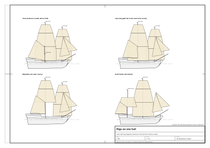

# 01. Typ okrętu i epoka

## Po co ten etap

Zanim narysujesz pierwszą linię, musisz ustalić, **jaki to statek** i **kiedy** go zbudowano. Typ i data przesądzają
prawie o wszystkim, co dalej: o proporcjach kadłuba, kształcie rufy i galionu, ożaglowaniu, wyposażeniu pokładu,
nawet o malowaniu. Piękny model slupu z 1705 r. z miedzianym dnem i kołem sterowym jest po prostu błędny, a znawca
widzi to od razu.

Na końcu tego rozdziału będziesz mieć:

- nazwany typ i przedział lat dla swojego statku;
- wymiary główne (długość pokładu, szerokość, głębokość ładowni, zanurzenie) wzięte z udokumentowanych pierwowzorów;
- krótką listę anachronizmów do uniknięcia;
- zapis, które decyzje są udokumentowane, a które są twoim wnioskiem.

Cały przewodnik korzysta z jednego **modelu wzorcowego**: małego dwumasztowego okrętu wojennego z ok. 1710 r.
o ożaglowaniu **snow**. Jego dane są w `data/parameters.json`, a skrypty generatora w `blender/`. Każda liczba
oznaczona „model wzorcowy” pochodzi z tego pliku. Model jest jeszcze poprawiany, więc aktualną wartość sprawdzaj
w pliku.

## Jak czytać liczby

Każda liczba w przewodniku ma źródło i jedno z czterech oznaczeń pewności:

| Oznaczenie | Znaczenie |
|---|---|
| **z epoki** | Źródło z tamtego czasu (podręcznik szkutnika, zapis Admiralicji, słownik z epoki) albo jego naukowe opracowanie. |
| **wtórne** | Późniejsze opracowanie, baza danych, Wikipedia albo forum modelarskie, które podaje swoje źródło. |
| **nasz wniosek** | Nasze obliczenie, przeskalowanie albo rekonstrukcja. Dobre jako wartość robocza, nie jako fakt historyczny. |
| **model wzorcowy** | Wartość użyta w modelu wzorcowym (`data/parameters.json`). Zwykle jedna z powyższych, wybrana z zakresu. |

Jednostki: metry i milimetry. Gdy źródło podaje stopy i cale angielskie, wartość oryginalna jest w nawiasie
(1 ft = 0,3048 m, 1 in = 25,4 mm).

## Pojęcia

- **Ożaglowanie** to układ masztów i żagli (snow, bryg, brygantyna, kecz, slup). **Typ kadłuba** to kształt i budowa
  kadłuba. **Ranga albo kategoria** to sposób, w jaki marynarka klasyfikowała okręt do płac i obsady. To trzy różne
  rzeczy, a nazwy z epoki często je mieszają.
- **Slup wojenny** (*sloop of war*): w Royal Navy początku XVIII w. była to *kategoria*, nie ożaglowanie: mały okręt
  bez rangi, poniżej VI rangi, do ok. 18 dział. Takie slupy mogły mieć ożaglowanie keczu, snow, brygantyny albo,
  rzadko, jeden maszt [5] (wtórne).
- **Snow**: dwa maszty rejowe i cienki **maszt snow** (*trysail mast*) tuż za grotmasztem. Żagiel gaflowy chodzi na
  tym cienkim maszcie, więc grotmaszt może nosić także rejowy grot. Znany od końca XVII w.; marynarki używały snow
  z 5–16 działami na początku XVIII w. [5] (wtórne).
- **Bryg** w późniejszym, ścisłym sensie (oba maszty w pełni rejowe, grot gaflowy na samym grotmaszcie) to
  ożaglowanie z ok. 1770 r. [2] (zapisy z epoki w opracowaniu naukowym). W latach 1700–1718 słowo „brig” istniało,
  ale jako skrót od „brigantine”: słowniki datują je na 1705–1715 i 1712, a urzędnicy celni w Bostonie skracali
  „brigantine” do „briga” i „brig” [2] (z epoki), [6] (wtórne).
- **Brygantyna** ok. 1695 r.: fokmaszt rejowy, na grotmaszcie żagiel skośny (gaflowy), czasem z małymi rejowymi
  marslami nad nim [2] (z epoki). W rejestrach Massachusetts z lat 1686–1715 brygantyny miały 8–100 ton [2] (z epoki).
- **Kecz**: używany jako bombardiera i mały slup wojenny; w handlu Massachusetts zwykle o dwóch końcach (szpiczasta
  rufa) i gładkopokładowy, 10–70 ton [2] (z epoki).
- **Slup handlowy** (Bermudy, Jamajka): jeden maszt, grot gaflowy, sztaksel i kliwer; większe z rejowym marslem;
  15–80 ton, przeważnie z płaską rufą pawężową [2] (z epoki). Statki piratów z lat 1715–1720 to zwykle właśnie takie
  slupy (wtórne; ogólne stwierdzenie w naszych notatkach, bez jednego źródła).
- **Okręt VI rangi**: trzy maszty, jeden pokład działowy, 20–24 działa. Etat z 1719 r. podawał 106 ft (32,3 m)
  pokładu działowego i 28 ft 4 in (8,64 m) szerokości [5] (wtórne, za etatem).
- **Tonaż według budowniczych (bm)**: „tony ładowności”, liczba podobna do objętości, liczona z długości stępki
  i szerokości. To nie jest masa. Wzór i sprawdzenie są w [rozdziale 02](02-hull-lines-and-offsets.md).

*Rysunek 1. Snow, bryg (późniejszy), brygantyna i kecz na tym samym kadłubie, żeby różniło się tylko ożaglowanie.*

## Co jest udokumentowane, a co nie

| Twierdzenie | Status | Źródło |
|---|---|---|
| Slupy Royal Navy z lat 1704–1711 (grupy Swift, Jamaica i Hazard) były małe, ok. 17–20 m pokładu. | wtórne | [5] |
| Od 1721 r. nowe slupy budowano jako dwumasztowce. | wtórne | [5] |
| Dwumasztowiec rejowy o długości 27–29 m z 10–18 działami **nie ma dobrze udokumentowanego angielskiego wojennego pierwowzoru z lat 1702–1718**. Okręty tej długości były wtedy trzymasztowymi okrętami VI rangi albo dużymi statkami handlowymi i kaperskimi. | nasz wniosek | z [3], [5] |
| Najbliższe udokumentowane kadłuby tej wielkości to snow-slupy z lat 1741–1742 (klasy *Drake* i *Wolf*) oraz model slupu-brygantyny SLR0229 z ok. 1740 r. | wtórne / z epoki (model) | [4], [5] |
| Kadłuby z 1740 r. niewiele różnią się od kadłubów z lat 1710–1720: obowiązywały te same metody projektowania (Sutherland 1711 i jego następcy). | nasz wniosek | [1] |
| Jedna baza danych podaje dla *Ferret* (1711) ożaglowanie „brig”, a katalog muzealny jej planu opisuje ją jako jednomasztowiec z ożaglowaniem kutra. Przyjmujemy opis muzeum. | sprzeczność | [3], [4] |

Wniosek praktyczny: jeśli twój statek ma być *ściśle* okrętem Royal Navy z 1710 r., powinien mieć ok. 19–20 m (jak
*Ferret*). Jeśli chcesz dwumasztowca 27–29 m w 1710 r., nazwij go snow albo brygantyną i przyjmij, że jego kadłub
wzorowany jest na nieco późniejszych slupach (nasz wniosek).

## Wymiary pierwowzorów

Wymiary jak w źródłach, w stopach i calach, metry w nawiasie. „Stępka” to długość stępki do tonażu.

| Statek | Rok | Typ, działa | Pokład działowy | Stępka | Szerokość | Głębokość ładowni | Tony bm | Plany albo model | Źródło |
|---|---|---|---|---|---|---|---|---|---|
| *Cruizer* (zakupiony) | 1709 | slup, 14 (12 × 3 lb) | – | 56 ft 7½ in (17,08) | 20 ft 3 in (6,17) | 10 ft 1 in (3,07) | 123 | brak planu | [3] wtórne |
| *Ferret* | 1711 | slup grupy Jamaica, 10 | 64 ft 7 in (19,69) | 50 ft 5 in (15,37) | 20 ft 8 in (6,30) | 9 ft 1 in (2,77) | 114 | plan RMG ZAZ4877, 1:48 | [3], [4] |
| *Bonetta* | 1721 | slup, 4 | 55 ft 2 in (16,81) | 42 ft 11¼ in (13,09) | 17 ft 0 in (5,18) | 7 ft 6 in (2,29) | 66 | – | [3] wtórne |
| *Cruizer* | 1721 | slup dwumasztowy, 8 | 62 ft 0 in (18,90) | 47 ft 10 in (14,58) | 19 ft 10 in (6,05) | 9 ft 0 in (2,74) | 100 | – | [3] wtórne |
| *Swift* | 1721 | slup, snow, 6 | – | – | – | – | – | plan RMG ZAZ4853, 1:48, galion ze „zwojem” | [4] z epoki (plan) |
| model SLR0416 | ok. 1720 | slup, 12 | – | – | – | – | – | model RMG: furty wiosłowe między działowymi, galion ze zwojem, podniesiony bak z dzwonem, pokład rufowy, koło sterowe, kabestan, pompy | [4] z epoki (model) |
| model SLR0229 | ok. 1740 | slup-brygantyna, 12–14 × 6 lb | ok. 85 ft (25,9) | – | ok. 23 ft (7,0) | – | ok. 200 | model RMG: podniesiony pokład rufowy, rumpel, kabestan, działka relingowe na słupkach | [4] z epoki (model) |
| klasa *Drake* | 1741 | slup, snow, 8–10 × 4 lb + 14 działek relingowych | 85 ft 0 in (25,91) | 68 ft 8 in (20,93) | 23 ft 6 in (7,16) | 9 ft 6 in (2,90) | 202 | 7 par furt | [5] wtórne |
| klasa *Wolf* | 1742 | slup, snow, 10–14 × 4 lb | 87 ft 6 in (26,67) | 73 ft 4¾ in (22,37) | 25 ft 0 in (7,62) | 10 ft 6 in–11 ft (3,20–3,35) | 244 | 8 par furt | [5] wtórne |
| VI ranga według etatu 1719 | 1719 | 20 dział | 106 ft 0 in (32,31) | 87 ft 9 in (26,75) | 28 ft 4 in (8,64) | 9 ft 2 in (2,79) | 375 | – | [5] wtórne |
| klasa *Cruizer* (dla porównania) | 1797 | bryg-slup, karonady | 100 ft 0 in (30,48) | 77 ft 3½ in (23,56) | 30 ft 6 in (9,30) | 12 ft 9 in (3,89) | 382 | plany RMG | [5] wtórne |

*Cruizer* z 1797 r. jest tu tylko po to, żeby pokazać, czym różni się późny bryg: jest szerszy, ma karonady i inną
rufę. Do kadłuba z 1710 r. nie bierz z niego niczego, najwyżej proporcje pokładu (nasz wniosek).

### Proporcje wyliczone z pierwowzorów

Policzone przez nas z tabeli wyżej (nasz wniosek, rachunek na danych wtórnych):

| Statek | Długość pokładu / szerokość | Głębokość ładowni / szerokość | Stępka / długość pokładu |
|---|---|---|---|
| *Ferret* 1711 | 3,12 | 0,44 | 0,78 |
| *Cruizer* 1721 | 3,13 | 0,45 | 0,77 |
| *Bonetta* 1721 | 3,25 | 0,44 | 0,78 |
| *Drake* 1741 | 3,62 | 0,40 | 0,81 |
| *Wolf* 1742 | 3,50 | 0,42 | 0,84 |
| VI ranga 1719 | 3,74 | 0,32 | 0,83 |

Reguły, które z tego wynikają (nasz wniosek):

- Długość pokładu to 3,1–3,7 szerokości. Slupy z lat 1710–1720 są bliżej 3,1–3,3, snow-slupy z lat 40. bliżej
  3,5–3,7.
- Głębokość ładowni to 0,40–0,45 szerokości.
- Stępka to 0,77–0,84 długości pokładu; dziobnica i tylnica razem wystają poza stępkę o 16–23 % długości pokładu.

## Model wzorcowy w jednej tabeli

| Cecha | Wartość | Pewność i źródło |
|---|---|---|
| Ożaglowanie | snow: fokmaszt i grotmaszt rejowe, maszt snow za grotmasztem z gaflem; żagiel gaflowy jest bez bomu, podgarniany gejtawami do masztu | model wzorcowy (`has_boom = false` w `data/parameters.json`); dla statku z rejowym grotem w latach 1702–1718 snow pasuje najlepiej [5] (wtórne); bom ma tylko późniejszy wariant brygu (zob. [rozdział 05](05-masts-and-spars.md)) |
| Przedstawiany rok | ok. 1710 | model wzorcowy |
| Długość pokładu między wrębami | 28,0 m | model wzorcowy, wybrana z zakresu *Wolf* / *Drake* |
| Szerokość po wręgach / z poszyciem | 7,46 m / 7,60 m | model wzorcowy; *Wolf* 25 ft (7,62 m) [5] |
| Głębokość ładowni | 3,20 m | model wzorcowy; *Wolf* [5] |
| Zanurzenie na owrężu, spód stępki | 3,10 m | nasz wniosek (≈ głębokość ładowni) |
| Długość stępki | 22,4 m | model wzorcowy = stępka *Wolf* [5] |
| Tonaż | 243 bm | nasze obliczenie wzorem bm (*Wolf*: 243 74/94 [5]) |
| Wyporność | ok. 300 t | nasze obliczenie z tabeli rzędnych, zob. rozdział 02 |
| Działa | 10 dział na lawetach (po 5 na burtę) w 6 otwartych parach furt, jedna otwarta para pusta i jedna para zamknięta pod pokładem rufowym; 8 działek relingowych | model wzorcowy; *Drake*: 7 par, *Wolf*: 8 par [5] |
| Pokłady | jeden gładki pokład główny, na rufie podniesiony pokład rufowy (1,70 m wyżej), bez baku | model wzorcowy; SLR0229 ma podniesiony pokład rufowy [4] |
| Rufa | płaska pawęż (*square tuck*), kontra, cztery okna kabiny | model wzorcowy; płaskie pawęże typowe dla małych statków z 1710 r. [1], [2] (z epoki) |
| Galion | kolano galionu ze zwojem | model wzorcowy; zwój na planie *Swift* 1721 i modelu SLR0416 [4] (z epoki) |
| Sterowanie | domyślnie koło, rumpel na pokładzie jako wariant | model wzorcowy; daty w [rozdziale 09](09-deck-machinery.md) |
| Załoga | 80–110 | nasz wniosek z klasy *Drake* (80) i późniejszych slupów [5] |

## Instrukcja krok po kroku: jak wybrać typ i epokę dla własnego statku

1. **Zapisz przeznaczenie.** Marynarka, kaper, kupiec, pirat? Jakie morze? To wyznacza typ: marynarka woli slup
   wojenny (kecz albo snow w latach 1702–1718), kupiec z wybrzeża Ameryki slup albo brygantynę, pirat zwykle
   zdobyty slup handlowy [2], [5].
2. **Ustal datę, nie stulecie.** Wybierz okno dziesięciu lat (np. 1705–1715). Wiele cech zmieniło się w ciągu
   dwudziestu lat (zob. tabelę anachronizmów niżej).
3. **Wybierz ożaglowanie według daty.** Dla lat 1702–1718 bezpieczne dwumasztowe ożaglowania to kecz, snow
   i brygantyna. Dwumasztowiec z rejowym grotem nazwij snow, nie bryg (nasz wniosek z [2], [5]).
4. **Znajdź dwa–trzy pierwowzory** tego samego typu i wielkości, oddalone o nie więcej niż ok. 30 lat. Użyj tabeli
   wyżej albo źródeł na końcu rozdziału. Zapisz długość pokładu, stępkę, szerokość, głębokość ładowni i tony.
5. **Sprawdź pierwowzory wzorem bm** (rozdział 02). Jeśli liczby z bazy nie dają zapisanego tonażu, jedna z nich
   jest błędna.
6. **Ustal wymiary główne.** Najpierw długość pokładu, potem szerokość ze stosunku długości do szerokości (3,1–3,7),
   głębokość ładowni 0,40–0,45 szerokości, stępkę 0,77–0,84 długości pokładu.
7. **Ustal uzbrojenie z długości.** Furty na slupach 26–27 m były co ok. 2,3–2,6 m (*Wolf*: 8 par, *Drake*: 7 par)
   [5] (wtórne; rozstaw to nasz wniosek). Policz pary, które mieszczą się między przednim końcem śródokręcia
   a pokładem rufowym.
8. **Zdecyduj o rufie, galionie i sterowaniu** według daty (rozdziały 04 i 09).
9. **Zapisz pewność.** Prowadź tabelę taką jak wyżej, ze źródłem i pewnością każdej liczby.
10. **Sprawdź anachronizmy** według tabeli niżej, zanim zaczniesz modelować szczegóły.

## Anachronizmy, których trzeba unikać w latach 1702–1718

| Cecha | Najwcześniejsza data | Pewność i źródło |
|---|---|---|
| Miedziowanie dna | pierwsze pełne miedziowanie HMS *Alarm*, 1761 (zaproponowane w 1708 r. i odrzucone) | wtórne, dwa zgodne źródła [7] |
| Karonady | od lat 70. XVIII w. | wtórne; powszechnie podawane, bez jednego źródła w naszych notatkach |
| Łańcuch kotwiczny | w marynarce od ok. 1810 r. | wtórne; powszechnie podawane, bez jednego źródła w naszych notatkach |
| Żurawiki łodziowe przy burcie lub na rufie | między 1790 a 1804 r. | wtórne, za świadkiem z epoki [8] |
| Zamki skałkowe dział | w Royal Navy od połowy XVIII w. | wtórne; bez jednego źródła w naszych notatkach |
| Winda kotwiczna z dźwignią wahadłową (*pump-brake windlass*) | XIX w. | wtórne (forum modelarskie) [9] |
| Czarno-żółta „szachownica Nelsona”, galion „billethead”, rufa okrągła | koniec XVIII–XIX w. | wtórne [7] |
| Statek nazwany „brig” z gaflowym grotem na grotmaszcie | znaczenie z drugiej połowy XVIII w. | z epoki i wtórne [2], [6] |
| Galerie rufowe i boczne jak na liniowcu na slupie 25 m | nie dla tej wielkości | nasz wniosek |

## Przykład policzony: model wzorcowy

1. Przeznaczenie: mały wojenny dwumasztowiec na Karaiby, ok. 1710 r., dość duży na dziesięć dział i ok. stu ludzi
   załogi.
2. Okno: 1705–1715.
3. Ożaglowanie: dwumasztowiec z rejowym grotem, czyli snow (nie bryg).
4. Pierwowzory: *Wolf* (1742) i *Drake* (1741) dla wielkości; *Ferret* (1711) i *Swift* (1721) dla detali epoki;
   SLR0416 (ok. 1720) i SLR0229 (ok. 1740) dla układu pokładu.
5. Sprawdzenie: stępka *Wolf* 73,40 ft, szerokość 25,0 ft: 73,40 × 25,0 × 12,5 / 94 = 244,0 tony; zapisano
   243 74/94. Liczby się zgadzają (nasze obliczenie).
6. Wymiary: pokład 28,0 m; szerokość 28,0 / 3,68 = 7,6 m z poszyciem; głębokość ładowni 0,42 × 7,6 = 3,2 m; stępka
   0,80 × 28,0 = 22,4 m.
7. Furty: 7 par co 2,45 m (model wzorcowy).
8. Płaska pawęż, galion ze zwojem, koło sterowe (z wariantem rumpla).

Wynik: kadłub wielkości snow-slupa z lat 40. XVIII w. z detalami z lat 1710–1720. To przemyślany kompromis i tak go
opisują dane modelu.

## Sprawdź się

- [ ] Długość pokładu / szerokość między 3,1 a 3,7 (model wzorcowy: 28,0 / 7,6 = 3,68).
- [ ] Głębokość ładowni 0,40–0,45 szerokości (model wzorcowy: 3,20 / 7,60 = 0,42).
- [ ] Stępka 0,77–0,84 długości pokładu (model wzorcowy: 22,4 / 28,0 = 0,80).
- [ ] Twój tonaż bm zgadza się z pierwowzorem tej samej wielkości z dokładnością ok. 10 % (model wzorcowy 243,
      *Wolf* 244).
- [ ] Nazwa ożaglowania pasuje do daty (żadnego „brygu” z gaflowym grotem przed ok. 1770 r.).
- [ ] Nie ma żadnej pozycji z tabeli anachronizmów.
- [ ] Każda liczba, którą zostawiasz, ma źródło i oznaczenie pewności.

## Typowe błędy

1. Nazywanie dwumasztowca z 1710 r. „brygiem” i dawanie mu takielunku z 1800 r.
2. Branie wymiarów ze słynnego późnego brygu (*Niagara* 1813, *Cruizer* 1797) i przenoszenie ich na statek z 1710 r.
3. Mylenie *kategorii* slupa wojennego z *ożaglowaniem* slupa.
4. Zaufanie jednemu wpisowi w bazie bez sprawdzenia wzorem tonażu.
5. Miedziane dno, karonady, żurawiki łodziowe albo łańcuch kotwiczny na statku z początku XVIII w.
6. Dekoracja liniowca (galerie, wielka rzeźbiona rufa) na jednostce 25 m.

## Źródła

1. T. Kenchington, „The Structures of English Wooden Ships: William Sutherland's Ship, circa 1710”, *The Northern
   Mariner* III/1 (1993), 1–43. https://cnrs-scrn.org/northern_mariner/vol03/tnm_3_1_1-43.pdf. © CNRS-SCRN; użyte
   tylko fakty. Naukowe opracowanie Sutherlanda, *The Ship-builders Assistant* (1711).
2. W. A. Baker, „Vessel Types of Colonial Massachusetts”, *Seafaring in Colonial Massachusetts*, Colonial Society of
   Massachusetts t. 52. https://www.colonialsociety.org/node/1977. Na podstawie rejestrów Massachusetts 1686–1715.
3. Baza okrętów threedecks.org (źródła: akta ADM, Colledge, Winfield):
   *Ferret* 1711 https://threedecks.org/index.php?display_type=show_ship&id=4242;
   *Bonetta* 1721 https://threedecks.org/index.php?display_type=show_ship&id=3364;
   *Cruizer* 1721 https://threedecks.org/index.php?display_type=show_ship&id=3755;
   *Cruizer* 1709 https://threedecks.org/index.php?display_type=show_ship&id=3753;
   *Drake* 1705 https://threedecks.org/index.php?display_type=show_ship&id=3974.
4. Royal Museums Greenwich, zbiory (tylko do oglądania; obrazy na zasadach licencji RMG, niewolne):
   plan ZAZ4877 *Ferret* (1711) https://www.rmg.co.uk/collections/objects/rmgc-object-84668;
   plan ZAZ4853 *Swift* (1721) https://www.rmg.co.uk/collections/objects/rmgc-object-84644;
   model SLR0416, slup 12-działowy ok. 1720 https://www.rmg.co.uk/collections/objects/rmgc-object-66377;
   model SLR0229, slup-brygantyna 1740 https://www.rmg.co.uk/collections/objects/rmgc-object-66190.
5. Wikipedia (tekst CC BY-SA): „Sloop-of-war” https://en.wikipedia.org/wiki/Sloop-of-war;
   „List of corvette and sloop classes of the Royal Navy”
   https://en.wikipedia.org/wiki/List_of_corvette_and_sloop_classes_of_the_Royal_Navy;
   „Snow (ship)” https://en.wikipedia.org/wiki/Snow_(ship);
   „Drake-class sloop” https://en.wikipedia.org/wiki/Drake-class_sloop;
   „Wolf-class sloop” https://en.wikipedia.org/wiki/Wolf-class_sloop;
   „1719 Establishment” https://en.wikipedia.org/wiki/1719_Establishment;
   „Cruizer-class brig-sloop” https://en.wikipedia.org/wiki/Cruizer-class_brig-sloop.
6. Merriam-Webster, „brig” https://www.merriam-webster.com/dictionary/brig; Wikipedia „Brig”
   https://en.wikipedia.org/wiki/Brig i „Brigantine” https://en.wikipedia.org/wiki/Brigantine (CC BY-SA).
7. USNI *Naval History*, „Copper-Bottoming the Royal Navy” (2019)
   https://www.usni.org/magazines/naval-history-magazine/2019/june/copper-bottoming-royal-navy; Wikipedia „Copper
   sheathing” https://en.wikipedia.org/wiki/Copper_sheathing i „Nelson Chequer”
   https://en.wikipedia.org/wiki/Nelson_Chequer (CC BY-SA).
8. Artykuł o łodziach marynarki (Zenodo), za sir Byamem Martinem o żurawikach:
   https://zenodo.org/records/1838693/files/article.pdf.
9. Dyskusja o budowie windy kotwicznej (forum modelarskie):
   https://shipsofscale.com/sosforums/threads/windlass-design-details.17586.
10. Do dalszej lektury, nieczytane bezpośrednio: I. McLaughlan, *The Sloop of War 1650–1763* (Seaforth 2014);
    R. Winfield, *British Warships in the Age of Sail 1603–1714* i *1714–1792*. Najlepsze źródła wymiarów slupów.
11. Mariner's Mirror 108/4 (2022), „Revisiting the Brigantine Problem”
    https://www.tandfonline.com/doi/abs/10.1080/00253359.2022.2117456 (widziany tylko tytuł; rozstrzyga terminologię).

## Terminy użyte w rozdziale

| Angielski | Polski | Objaśnienie |
|---|---|---|
| rig | ożaglowanie, typ ożaglowania | Układ masztów i żagli, od którego pochodzi nazwa typu jednostki. |
| sloop of war | slup wojenny | Kategoria Royal Navy: mały okręt bez rangi, niezależnie od ożaglowania. |
| snow | snow | Dwa maszty rejowe i cienki maszt snow za grotmasztem dla żagla gaflowego. |
| trysail mast, snow mast | maszt snow (maszcik gaflowy) | Cienkie drzewce tuż za grotmasztem, po którym chodzi gafel. |
| brig | bryg | Dwa maszty rejowe z gaflowym grotem na grotmaszcie; w ścisłym sensie od ok. 1770 r. |
| brigantine | brygantyna | Rejowy fokmaszt, gaflowy grot; ok. 1700 r. najczęstszy mały dwumasztowiec handlowy. |
| ketch | kecz | Dwumasztowiec z wysokim grotmasztem i krótkim bezanem; bombardiery i małe slupy. |
| sixth rate | okręt VI rangi | Najmniejszy okręt z rangą: trzy maszty, jeden pokład działowy, 20–24 działa. |
| builder's measurement (bm), tons burthen | tonaż wg budowniczych (bm) | Liczba ładowności ze stępki i szerokości, nie masa. |
| gun deck length | długość pokładu działowego | Długość na pokładzie działowym między wrębami dziobnicy i tylnicy. |
| depth in hold | głębokość ładowni | Wewnętrzna wysokość kadłuba na owrężu, od wewnętrznego poszycia przy nadstępce do pokładników. |
| draught | zanurzenie | Głębokość najniższego punktu stępki pod linią wody. |
| anachronism | anachronizm | Cecha, której w wybranym roku jeszcze nie było. |
