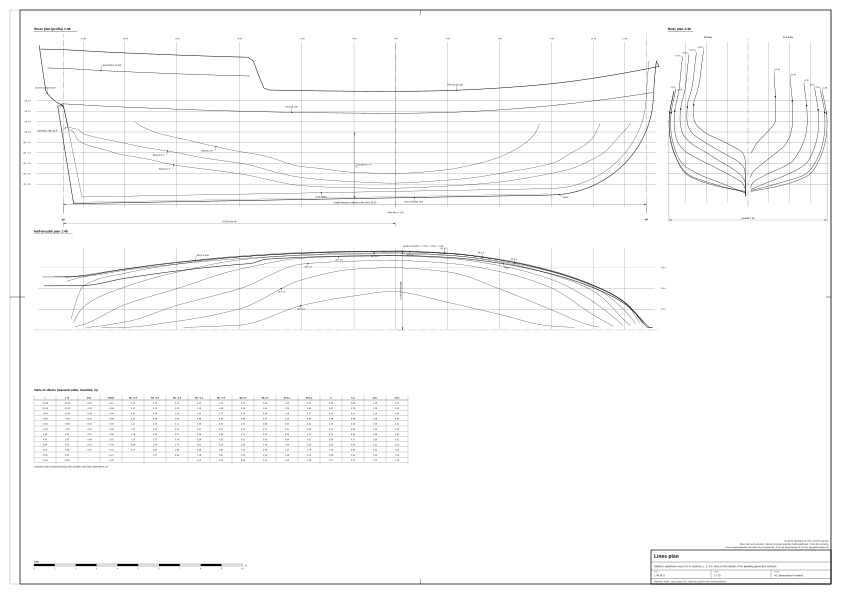
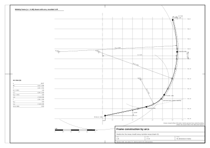

# 02. Linie teoretyczne kadłuba i tabela rzędnych

## Po co ten etap

Plan linii teoretycznych to zapisany kształt kadłuba: trzy rzuty tej samej powierzchni i tabela liczb, która ją
opisuje. Wszystko, co powstaje później (wręgi, poszycie, pokłady, furty, rozmieszczenie dział i masztów), mierzy się
od tej powierzchni. Jeśli linie są złe, nic, co na nich zbudujesz, nie będzie wyglądać dobrze.

Na końcu tego rozdziału będziesz mieć:

- wymiary główne zamienione na zestaw liczb kształtu (wznios, podniesienie dna, zawał, położenie owręża);
- wręg owręża wykreślony metodą łuków z epoki;
- **tabelę rzędnych modelu wzorcowego**;
- wygładzoną powierzchnię kadłuba w Blenderze, w programie CAD albo na papierze;
- sprawdzenie wyporności, współczynników kształtu, wejścia i wybiegu.

Typ i wymiary główne pochodzą z [rozdziału 01](01-ship-type-and-era.md). Tam też są objaśnione oznaczenia pewności
(z epoki, wtórne, nasz wniosek, model wzorcowy).

## Pojęcia

- **Plan linii teoretycznych**: rysunek trzech rzutów powierzchni kadłuba. Dawne plany angielskie rysowano *po
  zewnętrznej stronie wręgów*, bez poszycia (linie „moulded”, po wręgach) [3] (wtórne). Poszycie dodaje na naszym
  statku 65–90 mm na burtę (zob. rozdział 03).
- **Plan wręgów** (*body plan*): przekroje poprzeczne (wręgi teoretyczne) narysowane jeden na drugim. Zwyczajowo lewa
  połowa pokazuje wręgi rufowe, a prawa dziobowe.
- **Plan półszerokości** (*half-breadth plan*): widok z góry z wodnicami.
- **Plan boczny** (*sheer plan*): widok z boku z wzniosem pokładu, stępką, dziobnicą, tylnicą i przekrojami
  wzdłużnymi.
- **Wodnica**: przekrój kadłuba płaszczyzną poziomą.
- **Przekrój wzdłużny** (*buttock*): przekrój płaszczyzną pionową równoległą do osi, w stałej odległości od niej.
- **Diagonala**: przekrój płaszczyzną skośną wychodzącą z osi; szkutnicy sprawdzali nią gładkość obła.
- **Tabela rzędnych** (*table of offsets*): liczby planu linii: półszerokość dla każdej pary (wręg, wodnica)
  i wysokość dla każdej pary (wręg, przekrój wzdłużny) [4] (wtórne).
- **Owręże** (*dead flat*): wręg największego przekroju; na krótkim odcinku wręgi mają tam ten sam kształt.
- **Podniesienie dna** (*deadrise*): kąt, pod jakim dno wznosi się od stępki na owrężu.
- **Zawał burty** (*tumblehome*): pochylenie burty do środka powyżej największej szerokości.
- **Wznios pokładu** (*sheer*): podnoszenie się linii pokładu ku końcom, widziane z boku.
- **Przegłębienie** (*drag*): stępka głębiej na rufie niż na dziobie.
- **Wrąb, rabat** (*rabbet*): rowek w stępce, dziobnicy i tylnicy, w który wchodzi poszycie; linie mierzy się od linii
  wrębu.
- **Gładka** (*fair*) krzywa albo powierzchnia: bez wybrzuszeń, płaskich miejsc i nagłych zmian krzywizny.



*Rysunek 1. Plan linii modelu wzorcowego w skali 1:48, wszystkie wręgi, wodnice i przekroje wzdłużne opisane
w metrach.*

## Układ współrzędnych przewodnika

Model wzorcowy używa (model wzorcowy, `data/parameters.json`):

- **s** wzdłuż statku, dodatnie ku dziobowi, **s = 0 w połowie długości pokładu 28,0 m**;
- **x** w poprzek, dodatnie ku lewej burcie, 0 w osi;
- **z** w górę, **z = 0 na konstrukcyjnej wodnicy**.

Ważne punkty w tym układzie:

| Punkt | s (m) | z (m) | Pewność |
|---|---|---|---|
| Wrąb dziobnicy na pokładzie | +14,00 | +1,85 | model wzorcowy |
| Początek łuku dziobnicy (*forefoot*) | +9,30 | −2,72 | model wzorcowy |
| Wrąb dziobnicy na wodnicy | +13,58 | 0,00 | nasze obliczenie z krzywej dziobnicy |
| Owręże | +1,96 | – | model wzorcowy (0,43 L od dziobnicy) |
| Wrąb tylnicy przy pięcie | −13,10 | −3,12 | model wzorcowy |
| Pochylenie tylnicy | 11,4° od pionu | – | model wzorcowy (zakres z badań 8–15°, nasz wniosek) |
| Płaska pawęż na wodnicy | −13,73 | 0,00 | nasze obliczenie |
| Pawęż skrzydłowa | – | +1,25 | model wzorcowy |
| Linia wrębu stępki | z = −2,885 + 0,01786 · s | – | model wzorcowy (przegłębienie 0,40 m na stępce 22,4 m) |

Nasze notatki badawcze mierzą wręgi od owręża (oznaczmy to z_ow). Przeliczenie: **s = z_ow + 1,96**. Plik układu
pokładu `data/deck-layout.json` używa konwencji silnika gry (y w górę, z ku dziobowi); przed użyciem przeczytaj jego
nagłówek.

## Reguły i proporcje

### Wzory główne

| Wielkość | Wzór | Pewność i źródło |
|---|---|---|
| Tonaż według budowniczych | tony = K × B × (B / 2) / 94, gdzie K – długość stępki do tonażu (ft), B – największa szerokość (ft) | wtórne [5]; w praktyce od 1720, ustawowo od 1773; przed 1694 L × B × D / 94 [5] |
| Stępka do tonażu | K ≈ L_pokładu − 3/5 B | wtórne [5]; nasze sprawdzenie: *Wolf* 72,5 ft wobec zapisanych 73,4, *Drake* 70,9 wobec 68,7, *Ferret* 52,2 wobec 50,4 (w granicach 3–4 %) |
| Wyporność | Δ = 1,025 t/m³ × V (woda morska) | standard teorii okrętu [4] |
| Współczynnik pełnotliwości | Cb = V / (L_wl · B_wl · T) | [4] |
| Współczynnik owręża | Cm = A_m / (B_wl · T) | [4] |
| Współczynnik pełnotliwości wzdłużnej | Cp = V / (A_m · L_wl) = Cb / Cm | [4] |
| Współczynnik pełnotliwości wodnicy | Cwp = A_wp / (L_wl · B_wl) | [4] |

Wzór tonażu sprawdziliśmy na trzech okrętach z zapisaną stępką i tonażem: *Ferret* 50,42 × 20,67 × 10,33 / 94 =
114,5 (zapisano 114 51/94), *Cruizer* 1721 daje 100,1 (zapisano 100 7/94), *Drake* 1741 daje 201,7 (zapisano
201 66/94) (nasze obliczenie na danych wtórnych [6], [7]).

### Liczby kształtu dla snow 27–29 m

| Wielkość | Model wzorcowy | Zakres | Pewność i źródło |
|---|---|---|---|
| Długość pokładu L między wrębami | 28,0 m | 26,0–29,5 | model wzorcowy; *Wolf* / *Drake* [7] |
| Szerokość po wręgach | 7,46 m | 6,9–7,8 | model wzorcowy; L/B ≈ 3,7 |
| Szerokość z poszyciem | 7,60 m | 7,0–8,0 | model wzorcowy; *Wolf* 25 ft [7] |
| Głębokość ładowni | 3,20 m | 2,9–3,4 | model wzorcowy; *Wolf* [7] |
| Zanurzenie, spód stępki na owrężu | 3,10 m | 2,8–3,4 | nasz wniosek (≈ głębokość ładowni, jak w późniejszych brygach) |
| Przegłębienie na długości stępki | 0,40 m | 0,2–0,6 | nasz wniosek |
| Owręże od dziobnicy | 0,43 L | 0,38–0,48 L | nasz wniosek („pełny dziób, ostra rufa”) |
| Pochylenie tylnicy | ok. 12° | 8–15° | nasz wniosek |
| Wznios pokładu przy dziobnicy | +0,95 m | 0,7–1,3 | nasz wniosek z modeli RMG [8] |
| Wznios pokładu przy pawęży | +0,45 m | 0,3–0,7 | nasz wniosek |
| Wypukłość pokładu | 0,12 m na 7,5 m (1,6 % B) | 1–2 % B | z epoki dla statku 500 t: 4,8 in (122 mm) [1]; przeskalowanie nasze |
| Zawał burty na relingu w śródokręciu | 0,22 m na burtę | 0,15–0,35 | nasz wniosek |
| Podniesienie dna na owrężu | 12° | 8–18° | nasz wniosek |
| Wysokość nadburcia w śródokręciu | 1,05 m | 0,95–1,15 | nasz wniosek |

Żadnego kąta z tabeli nie odczytano z planu z epoki; to wartości przemyślane (nasz wniosek). Wolnych linii z epoki
dla statku tej wielkości i daty nie znaleźliśmy: plany *Ferret* i *Swift* w RMG istnieją, ale nie są wolne i nie
mają rzędnych w opisie katalogowym [8].

### Krzywe podłużne (przepis parametryczny)

Dawny szkutnik sterował kształtem kilkoma krzywymi wzdłuż statku: **linią podniesienia** (wysokość głowic denników
przy każdym wręgu) i **liniami zwężenia** (półszerokości dna i szerokości przy każdym wręgu) [9] (wtórne). Nasze
rzędne powstały tak samo, z gładkich funkcji położenia wzdłuż statku. Niech u to ułamek odległości od owręża do końca
(u = 0 na owrężu, u = 1 na wrębie dziobnicy na pokładzie, 12,04 m przed owrężem; u = 1 przy tylnicy na pokładzie,
15,96 m za owrężem). Wszystkie wartości niżej to nasz wniosek.

| Krzywa | Przed owrężem | Za owrężem |
|---|---|---|
| Największa półszerokość b | 3,73 · (1 − u²)^0,6 | 3,73 · (1 − 0,36 u^2,2) (szeroka pawęż) |
| Wysokość największej szerokości h_b | 0,35 + 0,45 u² | 0,35 + 0,60 u² |
| Pokład przy burcie | 0,90 + 0,95 u² | 0,90 + 0,45 u² |
| Reling (śródokręcie) | pokład + 1,05 | pokład + 1,05 (pokład rufowy osobno) |
| Zawał Δ (b minus półszerokość relingu) | 0,22 − 0,17 u² | 0,22 + 0,08 u² |
| Kąt dna α | 12° + 50° u^1,8 | 12° + 66° u^1,5 |
| Promień łuku dna R_f | 0,38 b | 0,38 b |
| Promień łuku szerokości R_b | 1,05 b (zwiększyć, gdy brak rozwiązania) | 1,05 b |
| Linia brodaty nad wrębem | 0,5 u³ | 2,2 u^3,2 (wysoki dejwud rufowy) |

## Wykreślanie wręgu łukami (metoda z epoki)

Angielscy szkutnicy od XVII w. kreślili wręgi łukami okręgów (*sweeps*) o środkach w ustalonych punktach; Bushnell
(1664) opisuje formy robione „z łuków” [10] (z epoki, przez cytaty słownikowe). Łuki od stępki w górę to łuk dna,
dolny łuk szerokości, w razie potrzeby łuk łączący i łuk wierzchołków [10]. Promienie podawane przez autorów się
różnią (w jednej rekonstrukcji promień łuku szerokości to połowa szerokości statku; dla obła francuskiej fregaty
z 1686 r. ćwierć szerokości) [11] (wtórne, forum), więc promienie traktuj jako decyzje projektowe.



*Rysunek 2. Konstrukcja wręgu owręża trzema łukami; liczby w metrach, po wręgach.*

### Instrukcja krok po kroku: jeden wręg

Użyj liczb wręgu z tabeli B niżej. Współrzędne: x = półszerokość od osi, y = wysokość nad wodnicą konstrukcyjną.

1. Narysuj oś i siatkę wodnic. Zaznacz punkt startu R0 = (0,13; wysokość linii brodaty): 0,13 m to połowa szerokości
   stępki.
2. Z R0 poprowadź **prostą dna** pod kątem α w górę i na zewnątrz, do **głowicy dennika** (fx, fy).
3. Narysuj **łuk dna**: łuk o promieniu R_f styczny do prostej dna w głowicy dennika. Jego środek leży na normalnej
   do prostej, skierowanej do wnętrza kadłuba, w odległości R_f od głowicy.
4. Narysuj **łuk szerokości**: środek w (b − R_b, h_b), promień R_b. Jego styczna pionowa wypada w największej
   półszerokości b na wysokości h_b. Musi dotykać łuku dna od wewnątrz: odległość między środkami ma być równa
   R_b − R_f. Punkt styku leży na prostej przez oba środki.
5. Jeśli łuki się nie spotykają: zmniejsz R_f o 15 %; jeśli nadal nie, zwiększ R_b; na końcu zmniejsz α o 2°
   i powtórz. (Szkutnik z epoki rozwiązywał to samo łukiem łączącym.)
6. Przy końcach kadłuba, gdzie α przekracza ok. 30°, wstaw **łuk wklęsły** o promieniu 0,5–0,8 m między pionową ścianą
   dejwudu a prostą dna.
7. Nad największą szerokością narysuj **łuk wierzchołków** od (b, h_b) do punktu relingu (t, y_n). Jego promień to
   R_u = ((y_n − h_b)² + Δ²) / (2 Δ), gdzie Δ = b − t, środek w (b − R_u, h_b).
8. Odczytaj półszerokości w miejscach, gdzie wręg przecina każdą wodnicę, i wysokości przecięć z każdym przekrojem
   wzdłużnym; wpisz je do własnej tabeli rzędnych.

### Przykład policzony: wręg owręża (wręg s = +1,96)

Wszystkie wartości po wręgach, w metrach (model wzorcowy, wyprowadzony z naszego wniosku).

1. R0 = (0,13; −2,85).
2. Podniesienie dna 12°: głowica dennika w (2,20; −2,41). Sprawdzenie: wznios 0,44 na 2,07, tg 12° = 0,213.
3. Łuk dna R_f = 1,42; normalna do prostej do wnętrza (−0,208; 0,978); środek C_f = (1,905; −1,021).
4. Łuk szerokości R_b = 3,92, środek C_b = (3,73 − 3,92; 0,35) = (−0,19; 0,35). Odległość C_f od C_b = 2,50 =
   R_b − R_f. Łuki stykają się w (3,09; −1,80).
5. Niepotrzebne.
6. Niepotrzebne na owrężu (α = 12°).
7. Łuk wierzchołków od (3,73; 0,35) do (3,51; 1,95): Δ = 0,22, R_u = (1,60² + 0,22²) / 0,44 = 5,93, środek
   (−2,20; 0,35). Sprawdzenie na wysokości pokładu 0,90: x = −2,20 + √(5,93² − 0,55²) = 3,70, tabela podaje 3,70.
8. Przecięcia z wodnicami zgadzają się z tabelą A z dokładnością 0,05 m.

## Tabela rzędnych modelu wzorcowego

Po wręgach (zewnętrzna strona wręgów, bez poszycia), metry. Półszerokości od osi; wysokości od wodnicy
konstrukcyjnej. Wręgi są gęściej przy końcach; między wręgami interpoluj krzywą gładką (spline) wzdłuż statku, nie
liniowo. „–” znaczy, że wręg nie sięga tej wodnicy (dziobnica jest na tej wysokości dalej ku rufie); 0,13 to połowa
szerokości dejwudu, czyli w tym miejscu jest tylko dejwud.

Liczby **wyprowadzono z reguł** (rozdziały wyżej) i dopasowano do wymiarów klasy *Wolf*; nie odczytano ich z planu
z epoki (nasz wniosek). Plik źródłowy: `data/offsets.csv`.

### Tabela A: wysokości i półszerokości na wodnicach

| s | z_ow | Spód stępki | Wrąb | Linia brodaty | WL −2,5 | WL −2,0 | WL −1,5 | WL −1,0 | WL −0,5 | WL 0 | WL +0,5 |
|---|---|---|---|---|---|---|---|---|---|---|---|
| −13,04 | −15,0 | −3,37 | −3,12 | −1,31 | 0,13 | 0,13 | 0,13 | 0,22 | 1,03 | 2,04 | 2,49 |
| −11,04 | −13,0 | −3,33 | −3,08 | −1,94 | 0,13 | 0,13 | 0,32 | 1,15 | 1,99 | 2,66 | 2,86 |
| −8,54 | −10,5 | −3,29 | −3,04 | −2,46 | 0,13 | 0,35 | 1,13 | 1,92 | 2,71 | 3,10 | 3,19 |
| −5,54 | −7,5 | −3,23 | −2,98 | −2,79 | 0,20 | 0,95 | 1,90 | 2,86 | 3,30 | 3,44 | 3,47 |
| −2,54 | −4,5 | −3,18 | −2,93 | −2,89 | 1,11 | 2,35 | 3,11 | 3,38 | 3,54 | 3,63 | 3,65 |
| −0,04 | −2,0 | −3,14 | −2,89 | −2,88 | 1,57 | 2,87 | 3,24 | 3,47 | 3,62 | 3,70 | 3,71 |
| +1,96 | 0,0 | −3,10 | −2,85 | −2,85 | 1,78 | 2,93 | 3,27 | 3,49 | 3,64 | 3,71 | 3,73 |
| +4,46 | +2,5 | −3,06 | −2,81 | −2,80 | 1,26 | 2,73 | 3,14 | 3,38 | 3,53 | 3,61 | 3,63 |
| +6,96 | +5,0 | −3,01 | −2,76 | −2,72 | 0,68 | 1,90 | 2,74 | 3,02 | 3,20 | 3,30 | 3,33 |
| +9,46 | +7,5 | −2,97 | −2,72 | −2,72 | 0,17 | 0,90 | 1,96 | 2,35 | 2,59 | 2,73 | 2,78 |
| +11,46 | +9,5 | – | −2,21 | −2,21 | – | 0,17 | 0,66 | 1,28 | 1,81 | 2,00 | 2,08 |
| +12,96 | +11,0 | – | −1,02 | −1,02 | – | – | – | 0,13 | 0,39 | 0,86 | 1,24 |

### Tabela B: pokład, największa szerokość, reling i dane łuków

| s | Pokład przy burcie: wysokość | półszerokość | Największa półszerokość b | na wysokości h_b | Reling (śródokręcie): wysokość | półszerokość | Kąt dna α | Głowica dennika (fx, fy) | R_f | R_b |
|---|---|---|---|---|---|---|---|---|---|---|
| −13,04 | 1,30 | 2,54 | 2,56 | 0,88 | 2,35 | 2,27 | 34° | (2,13; 0,04) | 0,97 | 2,69 |
| −11,04 | 1,20 | 2,85 | 2,87 | 0,75 | 2,25 | 2,60 | 37° | (2,43; −0,24) | 1,09 | 3,02 |
| −8,54 | 1,09 | 3,17 | 3,20 | 0,61 | 2,14 | 2,94 | 37° | (2,71; −0,50) | 1,21 | 3,36 |
| −5,54 | 1,00 | 3,45 | 3,48 | 0,48 | 2,05 | 3,24 | 33° | (2,85; −1,01) | 1,32 | 3,65 |
| −2,54 | 0,94 | 3,62 | 3,65 | 0,40 | 1,99 | 3,42 | 22° | (2,55; −1,92) | 1,39 | 3,83 |
| −0,04 | 0,91 | 3,69 | 3,72 | 0,36 | 1,96 | 3,49 | 15° | (2,30; −2,30) | 1,41 | 3,90 |
| +1,96 | 0,90 | 3,70 | 3,73 | 0,35 | 1,95 | 3,51 | 12° | (2,20; −2,41) | 1,42 | 3,92 |
| +4,46 | 0,94 | 3,61 | 3,63 | 0,37 | 1,99 | 3,42 | 15° | (2,25; −2,23) | 1,38 | 3,81 |
| +6,96 | 1,06 | 3,30 | 3,33 | 0,43 | 2,11 | 3,14 | 22° | (2,25; −1,86) | 1,27 | 3,50 |
| +9,46 | 1,27 | 2,75 | 2,78 | 0,52 | 2,32 | 2,62 | 33° | (1,83; −1,60) | 1,06 | 2,92 |
| +11,46 | 1,49 | 2,06 | 2,08 | 0,63 | 2,54 | 1,96 | 45° | (1,67; −0,69) | 0,79 | 2,51 |
| +12,96 | 1,69 | 1,25 | 1,27 | 0,73 | 2,74 | 1,19 | 52° | (1,16; 0,33) | 0,48 | 1,33 |

Kolumny „reling” podają nadburcie śródokręcia (pokład + 1,05 m). Za s = −5,04 nad tę linię wznosi się pokład rufowy
i jego nadburcie (rozdział 04).

### Tabela C: przekroje wzdłużne (wysokość dna przy danej półszerokości)

| Przekrój | −13,04 | −11,04 | −8,54 | −5,54 | −2,54 | −0,04 | +1,96 | +4,46 | +6,96 | +9,46 | +11,46 | +12,96 |
|---|---|---|---|---|---|---|---|---|---|---|---|---|
| 1,0 m | −0,52 | −1,09 | −1,58 | −1,97 | −2,54 | −2,65 | −2,67 | −2,57 | −2,37 | −1,96 | −1,23 | +0,15 |
| 2,0 m | −0,02 | −0,49 | −0,95 | −1,45 | −2,14 | −2,38 | −2,45 | −2,30 | −1,96 | −1,46 | +0,01 | – |
| 3,0 m | – | – | −0,19 | −0,89 | −1,63 | −1,87 | −1,92 | −1,73 | −1,05 | – | – | – |

„–” znaczy, że przekrój wzdłużny nie przecina dna poniżej największej szerokości przy tym wręgu.

### Uwagi do tabeli

- Rufa to **płaska pawęż z dolną krawędzią (tuck) na wodnicy** (*square tuck*). Dlatego WL 0 i WL +0,5 są przy
  ostatnim wręgu jeszcze szerokie (2,0–2,5 m), a poniżej WL −1,0 został sam dejwud. Przy rufie zaokrąglonej pod
  pawężą (*round tuck*) WL 0 przy tym wręgu miałaby ok. 0,8–1,2 m (nasz wniosek). Płaska pawęż pasuje do 1710 r.:
  angielscy budowniczowie porzucili ją prawie wyłącznie w okrętach dwupokładowych [1] (z epoki), a slupy handlowe
  z Bostonu miały przeważnie rufy płaskie [2] (z epoki). W modelu wzorcowym lico pawęży schodzi w osi ok. 0,3 m pod
  wodnicę (model wzorcowy).
- `data/offsets.csv` zawiera też **tabelę generatora** modelu wzorcowego: półszerokości **po zewnętrznej stronie
  poszycia** (dodane 0,065 m, malejące do zera przy dejwudzie), na 28 liniach równoległych do stępki (wysokości od 0
  do 7,5 m nad wrębem) przy tych samych 12 wręgach. Generator w `blender/` interpoluje każdą linię wzdłuż długości
  znormalizowanej między pawężą a wrębem dziobnicy, więc siatka kończy się dokładnie na dziobnicy i pawęży (model
  wzorcowy).

## Instrukcja krok po kroku: od tabeli rzędnych do powierzchni

### Na papierze

1. **Skala i arkusz.** Użyj skali 1:48 (skala planów RMG [8]): kadłub o długości całkowitej ok. 29,2 m zajmuje
   610 mm, więc arkusz A1 (841 × 594 mm) mieści plan boczny u góry, plan półszerokości pod nim i plan wręgów z boku
   (nasz wniosek).
2. **Siatka.** Twardym ołówkiem (2H) i stalową linijką narysuj linię bazową, wodnice co 0,5 m (10,4 mm w 1:48),
   linie wręgów w położeniach z tabeli A i przekroje wzdłużne 1, 2 i 3 m w planie półszerokości i planie wręgów.
   Sprawdź przekątne siatki: siatka, która nie jest prostokątna, psuje wszystko dalej.
3. **Profil.** W planie bocznym nanieś spód stępki i wrąb z tabeli A, krzywą dziobnicy (początek łuku w s = +9,30,
   wrąb na pokładzie w +14,00), tylnicę pod kątem 11,4° od pionu, pokład przy burcie i reling z tabeli B.
4. **Plan wręgów.** Dla każdego wręgu nanieś punkty z tabeli A (półszerokość na każdej wodnicy), punkt największej
   szerokości oraz punkty pokładu i relingu z tabeli B. Połącz je krzywikiem albo wykreśl łukami, jak opisano wyżej.
5. **Plan półszerokości.** Dla każdej wodnicy przenieś cyrklem półszerokości ze wszystkich wręgów i połącz je
   **listwą krzywikową**: cienką, prostosłoistą listewką z drewna albo tworzywa, trzymaną na punktach ciężarkami
   („kaczkami”) albo szpilkami. Pozwól listwie znaleźć własną krzywą; nie przeginaj jej przez punkt, który robi
   załamanie.
6. **Wygładzanie (*fairing*).** Gdy listwa omija punkt, nie przesuwaj listwy, przesuń punkt: popraw rzędną także
   w planie wręgów. Potem narysuj w planie bocznym przekroje wzdłużne z planu półszerokości i planu wręgów i sprawdź,
   czy każde przecięcie leży w tym samym miejscu we wszystkich trzech rzutach.
7. **Tolerancja.** Dopuść różnicę do 1 mm na papierze w 1:48 (ok. 50 mm w naturze) między rzutami (nasz wniosek);
   większą popraw.
8. **Diagonale.** Na koniec narysuj jedną diagonalę od osi na wysokości wrębu stępki przez obło; jej krzywa
   w rozwinięciu nie może mieć wklęśnięcia ani garbu.
9. **Zapisz poprawioną tabelę.** Teraz prawdą jest wygładzony rysunek, nie pierwsza tabela. Zmierz nowe rzędne
   i zapisz je.

### W programie CAD

1. Utwórz łamaną 3D (albo listę punktów) dla każdego wręgu z tabel A i B, we współrzędnych (x, s, z).
2. Zastąp każdą łamaną **krzywą interpolującą** przez punkty (stopnia 3).
3. Zbuduj obrys dziobnicy i pawęży jako osobne krzywe (wrąb dziobnicy z profilu, płaszczyzna pawęży pod 11,4°).
4. Przeprowadź powierzchnię **przez przekroje** (*loft*) od pawęży do dziobnicy (gładką, nie prostokreślną).
5. Przetnij powierzchnię płaszczyznami wodnic i przekrojów wzdłużnych i porównaj przecięcia z tabelami A i C. Na
   każdym przecięciu użyj wykresu krzywizny („grzebienia”): grzebień ma się zmieniać płynnie i nie zmieniać znaku,
   chyba że zamierzasz wklęśnięcie.
6. Poprawiaj punkty wręgów, nie powierzchnię, i przeprowadź ją ponownie.
7. Odbij powierzchnię względem płaszczyzny symetrii.

### W Blenderze

Pełny generator jest w `blender/` i buduje model wzorcowy z `data/parameters.json`. Żeby zbudować tylko kadłub po
wręgach z tabeli rzędnych, uruchom ten skrypt w edytorze tekstu Blendera. Łączy wręgi z tabel A i B w siatkę i ją
odbija. Nie zamyka dziobnicy i pawęży; te dorysuj z punktów profilu.

```python
import bpy, math

WL = [-2.5, -2.0, -1.5, -1.0, -0.5, 0.0, 0.5]
# s, wrąb z, linia brodaty z, półszerokości na WL, (pokład z, pokład ½B), (najw. ½B, jej z), (reling z, reling ½B)
ST = [
    (-13.04, -3.12, -1.31, [0.13, 0.13, 0.13, 0.22, 1.03, 2.04, 2.49], (1.30, 2.54), (2.56, 0.88), (2.35, 2.27)),
    (-11.04, -3.08, -1.94, [0.13, 0.13, 0.32, 1.15, 1.99, 2.66, 2.86], (1.20, 2.85), (2.87, 0.75), (2.25, 2.60)),
    (-8.54, -3.04, -2.46, [0.13, 0.35, 1.13, 1.92, 2.71, 3.10, 3.19], (1.09, 3.17), (3.20, 0.61), (2.14, 2.94)),
    (-5.54, -2.98, -2.79, [0.20, 0.95, 1.90, 2.86, 3.30, 3.44, 3.47], (1.00, 3.45), (3.48, 0.48), (2.05, 3.24)),
    (-2.54, -2.93, -2.89, [1.11, 2.35, 3.11, 3.38, 3.54, 3.63, 3.65], (0.94, 3.62), (3.65, 0.40), (1.99, 3.42)),
    (-0.04, -2.89, -2.88, [1.57, 2.87, 3.24, 3.47, 3.62, 3.70, 3.71], (0.91, 3.69), (3.72, 0.36), (1.96, 3.49)),
    (1.96, -2.85, -2.85, [1.78, 2.93, 3.27, 3.49, 3.64, 3.71, 3.73], (0.90, 3.70), (3.73, 0.35), (1.95, 3.51)),
    (4.46, -2.81, -2.80, [1.26, 2.73, 3.14, 3.38, 3.53, 3.61, 3.63], (0.94, 3.61), (3.63, 0.37), (1.99, 3.42)),
    (6.96, -2.76, -2.72, [0.68, 1.90, 2.74, 3.02, 3.20, 3.30, 3.33], (1.06, 3.30), (3.33, 0.43), (2.11, 3.14)),
    (9.46, -2.72, -2.72, [0.17, 0.90, 1.96, 2.35, 2.59, 2.73, 2.78], (1.27, 2.75), (2.78, 0.52), (2.32, 2.62)),
    (11.46, -2.21, -2.21, [None, 0.17, 0.66, 1.28, 1.81, 2.00, 2.08], (1.49, 2.06), (2.08, 0.63), (2.54, 1.96)),
    (12.96, -1.02, -1.02, [None, None, None, 0.13, 0.39, 0.86, 1.24], (1.69, 1.25), (1.27, 0.73), (2.74, 1.19)),
]
N = 32  # punktów na pół-przekrój


def section(st):
    s, rab, beard, wl, (dz, dhb), (b, hb), (rz, rhb) = st
    pts = [(0.13, rab)]
    if beard > rab + 0.05:
        pts.append((0.13, beard))
    pts += [(y, z) for z, y in zip(WL, wl) if y is not None and z > beard + 0.02]
    pts += [(b, hb), (dhb, dz), (rhb, rz)]
    pts.sort(key=lambda p: p[1])                 # od dołu do góry
    d = [0.0]                                    # długość łuku wzdłuż przekroju
    for a, c in zip(pts, pts[1:]):
        d.append(d[-1] + math.dist(a, c))
    out, k = [], 0
    for i in range(N):                           # tyle samo punktów na każdym wręgu
        t = d[-1] * i / (N - 1)
        while k < len(d) - 2 and d[k + 1] < t:
            k += 1
        f = 0.0 if d[k + 1] == d[k] else (t - d[k]) / (d[k + 1] - d[k])
        (x0, z0), (x1, z1) = pts[k], pts[k + 1]
        out.append((x0 + f * (x1 - x0), s, z0 + f * (z1 - z0)))
    return out


verts, faces = [], []
for i, st in enumerate(ST):
    verts += section(st)
    if i:
        a, b = (i - 1) * N, i * N
        faces += [(a + j, a + j + 1, b + j + 1, b + j) for j in range(N - 1)]
me = bpy.data.meshes.new("hull_moulded")
me.from_pydata(verts, [], faces)
me.update()
ob = bpy.data.objects.new("hull_moulded", me)
bpy.context.collection.objects.link(ob)
ob.modifiers.new("mirror", "MIRROR")             # odbicie względem x = 0
```

Potem krok po kroku:

1. Zaznacz obiekt, włącz Shade Smooth i sprawdź, czy normalne są skierowane na zewnątrz (Mesh > Normals >
   Recalculate Outside).
2. Obejrzyj go z góry, z boku i z przodu w widokach ortogonalnych, z obrazem swojego planu linii w tle.
3. Dodaj wręgi: siatka z 12 wręgów jest za rzadka do oglądania z bliska. Albo dodaj do tabeli wręgi pośrednie
   (wygładzone na papierze albo w CAD), albo wygładź siatkę modyfikatorem Subdivision Surface i porównaj ją znów
   z tabelą.
4. Dodaj dziobnicę i pawęż: wyciągnij pierwszy i ostatni przekrój do punktów profilu i scal.
5. Sprawdź gładkość materiałem odbijającym (paskowe otoczenie „zebra” albo matcap): odbicia mają biec gładkimi
   pasami, bez załamań na wręgach.

## Sprawdzenie

### Przykład policzony: hydrostatyka modelu wzorcowego

Policzone przez nas z tabeli A metodą trapezów na 12 wręgach i dwóch końcach (nasze obliczenie; po wręgach, bez
poszycia i stępki):

| Wielkość | Wartość |
|---|---|
| Długość wodnicy L_wl (wrąb dziobnicy na WL do pawęży na WL) | 27,31 m |
| Szerokość wodnicy B_wl, po wręgach | 7,42 m |
| Zanurzenie T do wrębu na owrężu | 2,85 m |
| Pole przekroju owręża A_m | 16,74 m² |
| Objętość V | 289 m³ |
| Wyporność po wręgach | 296 t |
| Wyporność z poszyciem (+0,065 m na ok. 6 m obwodu × 2 burty × 27 m) | ok. 317 t |
| Cb | 0,50 |
| Cm | 0,79 |
| Cp | 0,63 |
| Cwp | 0,82 |
| Środek wyporu | 1,5 m za owrężem (s ≈ +0,45), blisko połowy długości |
| Półkąt wejścia na WL 0, od dziobnicy do wręgu +11,46 | ok. 41° |

Nasze notatki badawcze podają 320 t, Cb 0,50, Cm 0,77, Cp 0,65 (nasz wniosek). Różnice wynikają z rzadkiego
rozstawu wręgów i ze sposobu liczenia końców; zgodność w granicach 5 % wystarcza. Czasem cytowana reguła „tony bm
≈ 3/5 wyporności” [5] dałaby tu 405 t; nie pasuje do małego statku o ostrych końcach, więc nie używaj jej do
sprawdzania kadłuba (nasz wniosek).

### Sprawdź się

- [ ] Tonaż bm z twojej stępki i szerokości w granicach 10 % od pierwowzoru tej samej wielkości (model wzorcowy:
      243 bm).
- [ ] Cb 0,45–0,55, Cm 0,72–0,82, Cp 0,60–0,67 (model wzorcowy 0,50 / 0,79 / 0,63) (nasz wniosek, zakresy z naszych
      notatek).
- [ ] Wyporność 300–400 t dla snow 28 m (model wzorcowy ok. 300–320 t).
- [ ] Największa szerokość na wodnicy albo nieco nad nią (model wzorcowy: 0,35 m nad nią na owrężu).
- [ ] Pokład przy burcie ok. 0,9 m nad wodą na owrężu, więc progi furt ok. 1,2 m nad wodą (model wzorcowy
      1,22–1,50 m, zmierzone w modelu).
- [ ] Wodnice z góry: bez garbów i płaskich miejsc; dziób pełniejszy niż wybieg.
- [ ] Przekroje wzdłużne z boku: gładkie krzywe wznoszące się ku obu końcom.
- [ ] Każdy punkt leży w tym samym miejscu we wszystkich trzech rzutach (1 mm w 1:48).
- [ ] Obwód owręża od wrębu do pokładu ok. 6,0 m na burtę po wręgach (model wzorcowy 6,0 m); przy wręgu +12,96 ok.
      3,1 m (nasze obliczenie). Przydadzą się do poszycia w rozdziale 03.

### Jak gładki jest model wzorcowy? Pomiar

Trzy ostatnie sprawdzenia zastosowaliśmy do modelu wzorcowego liczbowo, a nie na oko. Powierzchnię przecięliśmy
wodnicami co 0,5 m, przekrojami wzdłużnymi co 0,5 m i 27 płaszczyznami wręgów. Każde przecięcie zostało gęsto
spróbkowane i podzielone na **garby**: odcinki, na których krzywizna ma jeden znak (wklęsły albo wypukły). Garb liczymy,
gdy jego **strzałka**, czyli największa odległość krzywej od prostej cięciwy pod nią, przekracza 4 mm. Gładka wodnica
ma najwyżej trzy garby: wklęsły wybieg, wypukłą część środkową i czasem wklęsłe wejście (nasz wniosek).

| Przecięcie | Garby | Ocena |
|---|---|---|
| Wodnice −0,5, 0,0, +0,5, +1,0, +1,5 | 1–2 | gładkie |
| Wodnice −2,5 i −2,0 | 3 | gładkie |
| Wodnica −1,5 | 5 | jeden nadmiarowy garb 46 mm w wybiegu, między s = −9,5 a −7,2 |
| Wodnica −1,0 | 4 | jeden nadmiarowy garb 18 mm w wybiegu, między s = −9,4 a −7,5 |
| Przekroje wzdłużne 0,5, 1,0, 1,5, 2,0, 2,5 m | 7–11 | kilka garbów 4–50 mm, prawie wszystkie między s = −13 a −4,5 |
| Przekrój wzdłużny 3,0 m | 5 | dwa garby 7–56 mm między s = −5 a −1 |
| Wręgi | 3 z 27 mają czwarty albo piąty garb | 5–57 mm, blisko stępki |

(model wzorcowy, nasz pomiar)

Po ludzku: burty nad wodą i cała część dziobowa są gładkie. **Wybieg pod wodnicą**, między tylnicą a mniej więcej
s = −4, ma nierówności 1–5 cm. Na renderze ich nie zobaczysz, a w skali 1:48 największa ma 1 mm na papierze, ale
szkutnik by je zestrugał, a uczący się powinien wiedzieć, że tam są.

Nierówności siedzą w tabeli, a nie w sposobie interpolacji powierzchni. Spróbowaliśmy dwóch szybkich napraw i żadna
nie pomogła (nasz pomiar; „nadmiar” to garby ponad trzy na linię, zsumowane po wszystkich wodnicach i przekrojach
wzdłużnych):

| Próba | Nadmiar garbów | Największa zmiana kadłuba |
|---|---|---|
| Stan obecny: każdy wiersz tabeli generatora interpolowany krzywą sześcienną monotoniczną | 34 | – |
| Splajn sześcienny o ciągłej krzywiźnie przez te same liczby | 25 | 108 mm, przy tylnicy |
| Ten sam splajn i wygładzenie każdego wiersza tabeli o najwyżej 20 mm | 20 | 20 mm na wręgach |
| Wygładzenie o najwyżej 30 mm | 18 | 30 mm |
| Wygładzenie o najwyżej 50 mm | 20 | 50 mm |

Wygładzanie wiersz po wierszu tego nie wyleczy, bo wada leży w tym, jak przekroje zmieniają się od wręgu do wręgu.
Właściwy sposób jest ten z epoki: wykreślić wybieg od nowa z **linii wzniosu** i **linii zwężenia** (gładkich
krzywych, które na każdym wręgu dają wysokość i półszerokość dna oraz największej szerokości) i każdy przekrój
wyprowadzić z nich tymi samymi łukami, jak w części „Wykreślanie wręgu łukami” wyżej. Tak wykreślone przekroje z samej
konstrukcji tworzą gładką rodzinę. To jest zaplanowane na następną wersję modelu wzorcowego. Do tego czasu, gdy
wykreślasz własny kadłub z tabeli A, traktuj rzędne za s = −4 ku rufie i poniżej wodnicy −1,0 jako „do wygładzenia”:
niech decyduje listwa, a liczby popraw tak, jak opisano w kroku 6 wyżej.

## Typowe błędy

1. Pionowe burty i płaskie dno: przekrój „wanna”. Zachowaj podniesienie dna i zawał, nawet niewielkie.
2. Brak wzniosu albo wznios tylko na relingu.
3. Dziób i rufa jednakowo ostre. W 1710 r. dziób był pełny, a wybieg pod wodą ostry.
4. Interpolacja liniowa między wręgami: daje widoczne fasetki. Używaj krzywych gładkich.
5. Zapominanie, że plany z epoki są po wręgach, i brak poszycia albo dodanie go dwa razy.
6. Wygładzanie powierzchni zamiast liczb, przez co tabela i model się rozjeżdżają.
7. Złe zanurzenie albo wolna burta: widać pół stępki albo furty są w wodzie.
8. Rufa zaokrąglona pod pawężą albo okrągła rufa na małym statku z 1710 r.

## Źródła

1. T. Kenchington, „The Structures of English Wooden Ships: William Sutherland's Ship, circa 1710”, *The Northern
   Mariner* III/1 (1993), 1–43. https://cnrs-scrn.org/northern_mariner/vol03/tnm_3_1_1-43.pdf. © CNRS-SCRN.
2. W. A. Baker, „Vessel Types of Colonial Massachusetts”. https://www.colonialsociety.org/node/1977.
3. Uwaga: to, że plany angielskie rysowano po wręgach, jest ogólną wiedzą o praktyce epoki; nasze notatki nie
   podają dla tego jednego źródła.
4. US Naval Academy, EN400, rozdz. 2 „Hull Form and Geometry” (definicje tabeli rzędnych i współczynników).
   https://www.usna.edu/NAOE/_files/documents/Courses/EN400/02.02%20Chapter%202.pdf.
5. Wikipedia, „Builder's Old Measurement” https://en.wikipedia.org/wiki/Builder%27s_Old_Measurement (CC BY-SA).
6. threedecks.org: *Ferret* 1711 https://threedecks.org/index.php?display_type=show_ship&id=4242; *Cruizer* 1721
   https://threedecks.org/index.php?display_type=show_ship&id=3755.
7. Wikipedia, „Drake-class sloop” https://en.wikipedia.org/wiki/Drake-class_sloop i „Wolf-class sloop”
   https://en.wikipedia.org/wiki/Wolf-class_sloop (CC BY-SA).
8. Royal Museums Greenwich: plan ZAZ4877 *Ferret* https://www.rmg.co.uk/collections/objects/rmgc-object-84668; plan
   ZAZ4853 *Swift* https://www.rmg.co.uk/collections/objects/rmgc-object-84644 (tylko do oglądania, licencja RMG).
9. Boats & Builders Project, „Whole Moulding” (za McKee 1983, King i Lee 1976).
   https://www.boatsandbuilders.com/blog/boat-building/whole-moulding.
10. Oxford English Dictionary, „sweep, n.” (cytaty z Bushnella 1664 i Encyclopaedia Britannica 1797).
    https://www.oed.com/dictionary/sweep_n (dostęp częściowy).
11. Forum ShipsOfScale: „17th Century Ship Design and the Sovereign of the Seas”, s. 4
    https://shipsofscale.com/sosforums/threads/17th-century-ship-design-and-the-sovereign-of-the-seas-1637.14668/page-4;
    „French heavy frigate of 1686 – designing a ship in the Dutch manner”
    https://shipsofscale.com/sosforums/threads/french-heavy-frigate-of-1686-%E2%80%93-designing-a-ship-in-the-dutch-manner.12230/.
12. Wolne linie z epoki do kalibracji: F. H. af Chapman, *Architectura Navalis Mercatoria* (1768), domena publiczna:
    Wikimedia Commons https://commons.wikimedia.org/wiki/Category:Architectura_Navalis_Mercatoria; Sjöhistoriska
    museet https://sjohistoriska.se/en/explore/collections/archives/ritningar/fredrik-henrik-af-chapman (Public
    Domain Mark). O pięćdziesiąt lat późniejsze i szwedzkie, ale pełne linie ze skalą.
13. FREE!ship (GPLv2), modelowanie kadłuba z eksportem rzędnych: https://sourceforge.net/projects/freeship/.

## Terminy użyte w rozdziale

| Angielski | Polski | Objaśnienie |
|---|---|---|
| lines plan | plan linii teoretycznych | Trzy rzuty powierzchni kadłuba. |
| body plan | plan wręgów | Przekroje poprzeczne narysowane jeden na drugim. |
| half-breadth plan | plan półszerokości | Widok z góry z wodnicami. |
| sheer plan | plan boczny | Widok z boku ze wzniosem, stępką, dziobnicą, tylnicą i przekrojami wzdłużnymi. |
| station, theoretical frame | wręg teoretyczny | Przekrój poprzeczny w wybranym miejscu wzdłuż statku. |
| waterline | wodnica | Poziomy przekrój kadłuba. |
| buttock (line) | przekrój wzdłużny | Pionowy przekrój równoległy do osi. |
| diagonal | diagonala | Przekrój płaszczyzną skośną, do sprawdzania obła. |
| table of offsets | tabela rzędnych | Liczby definiujące linie. |
| moulded | po wręgach (bez poszycia) | Mierzone do zewnętrznej strony wręgów. |
| dead flat, midship section | owręże | Największy przekrój. |
| deadrise, rising of floor | podniesienie dna | Kąt dna przy stępce. |
| floor head | głowica dennika | Górny koniec dennika, koniec prostej dna. |
| floor sweep | łuk dna | Łuk tworzący obło, styczny do prostej dna. |
| breadth sweep | łuk szerokości | Łuk, którego pionowa styczna wyznacza największą szerokość. |
| reconciling sweep | łuk łączący | Łuk gładko łączący dwa inne. |
| top-timber sweep | łuk wierzchołków | Łuk nad największą szerokością, tworzący zawał. |
| hollow (back) sweep | łuk wklęsły | Odwrócony łuk między dejwudem a dnem przy końcach. |
| rising line | linia podniesienia | Krzywa wzdłużna wysokości głowic denników. |
| narrowing line | linia zwężenia | Krzywa wzdłużna półszerokości. |
| bilge | obło | Zaokrąglenie między dnem a burtą. |
| tumblehome | zawał burty | Pochylenie burty do środka nad największą szerokością. |
| sheer | wznios pokładu | Podnoszenie się linii pokładu ku końcom. |
| camber, round-up | wypukłość pokładu | Wznios pokładu ku osi. |
| drag | przegłębienie | Stępka głębiej na rufie niż na dziobie. |
| rabbet | wrąb, rabat | Rowek w stępce, dziobnicy i tylnicy na poszycie. |
| bearding line | linia brodaty | Linia styku powierzchni kadłuba z dejwudem. |
| deadwood | dejwud | Lite drewno w wąskich końcach nad stępką. |
| forefoot | przejście stępki w dziobnicę (forefoot) | Miejsce, gdzie stępka wygina się w dziobnicę. |
| square tuck | płaska pawęż (rufa pawężowa) | Płaska rufa, której dolna krawędź styka się z poszyciem dna. |
| batten | listwa krzywikowa | Cienka listwa wyginana przez punkty do rysowania gładkiej krzywej. |
| ship curve, French curve | krzywik | Szablon do rysowania krzywych o zmiennym promieniu. |
| displacement | wyporność | Masa wody wypartej przez kadłub. |
| block / midship / prismatic / waterplane coefficient | współczynnik pełnotliwości / owręża / wzdłużnej pełnotliwości / wodnicy | Liczby opisujące, jak pełny jest kadłub. |
| entrance, run | wejście (część dziobowa), wybieg (część rufowa) | Przednia i tylna podwodna część kadłuba. |
| fair | gładki (wygładzony) | Bez garbów i załamań. |
