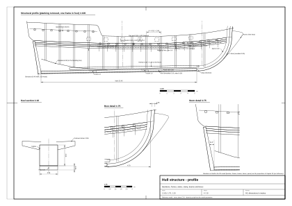

# 03. Konstrukcja kadłuba

## Po co ten etap

Linie z [rozdziału 02](02-hull-lines-and-offsets.md) dają gładką powierzchnię. Prawdziwy kadłub to konstrukcja
z setek elementów: stępki, dziobnicy i tylnicy, wręgów, wzmocnień wzdłużnych, poszycia. Większość jest ukryta, ale
decyduje o tym, co *widać*: o stopniu berghołtów, szwach i stykach poszycia, wierzchołkach wręgów od środka
nadburcia, grubości burty w otworze furty, stępce pod wodą.

Na końcu tego rozdziału będziesz wiedzieć dla każdego elementu konstrukcji, do czego służy, jaki jest duży, jak
wygląda z zewnątrz i z pokładu i jak go zamodelować. Poznasz też kolejność, w jakiej stocznia budowała kadłub; to
najlepsza kolejność także dla modelu.

Konstrukcja pokładu powyżej pokładników (deski pokładu, nadburcia, furty, rufa i galion) jest
w [rozdziale 04](04-decks-bulwarks-stern-head.md).

## Pojęcia

- **Poszycie karawelowe** (*carvel*): klepki ułożone krawędź w krawędź, szwy uszczelnione; kadłub jest gładki.
  Statki tej wielkości budowano na karawelę. (Poszycie klinkierowe, na zakładkę, jest tylko w małych łodziach.)
- **Wręg**: poprzeczne żebro z kilku części: **dennik** w poprzek stępki, nad nim **futoksy**, na górze
  **wierzchołek wręgu**. Części łączy się na zakładkę, nie na styk.
- **Odstęp wręgów** (*room and space*): odległość od środka jednego wręgu do środka następnego.
- **Zamek** (*scarph*): długie połączenie dwóch belek na zakładkę, w stępce, dziobnicy, berghołtach i wzdłużnikach.
- **Kołek** (*treenail*): drewniany gwóźdź mocujący poszycie do wręgów.
- **Berghołt** (*wale*): gruby pas poszycia, który usztywnia kadłub wzdłuż i wystaje z burty.
- **Klepka wklinowana** (*stealer*): krótka klepka kończąca się wewnątrz pasa poszycia, żeby pasy nie robiły się za
  wąskie ku końcom.
- **Sutherland 1711**: William Sutherland, *The Ship-builders Assistant*, podręcznik angielskiego szkutnika. Jego
  liczby dotyczą statku **500-tonowego**; korzystamy z nich przez naukowe opracowanie Kenchingtona [1], który
  ostrzega, że prawdziwe kadłuby były dużo mniej „porządne” niż podręczniki i modele (z epoki, przez [1]).

Reguła skalowania używana niżej (nasz wniosek): dla statku 240-tonowego bierzemy przekroje ok. 0,7–0,8 przekrojów
Sutherlanda dla 500 ton, ale odstęp wręgów zostawiamy prawie bez zmian, bo prawie nie zależał od wielkości (wrak
100-tonowego slupu handlowego z Jamajki miał te same 21¾ in, 552 mm) [2] (wtórne).

*Rysunek 1. Profil konstrukcji modelu wzorcowego; narysowany co czwarty wręg.*

*Rysunek 2. Konstrukcyjny przekrój owręża modelu wzorcowego, lewa połowa.*

## Reguły i proporcje

### Oś kadłuba

| Element | Do czego | Sutherland, 500 t (z epoki [1]) | Nasz statek 240 t (nasz wniosek, chyba że podano inaczej) | Model wzorcowy |
|---|---|---|---|---|
| Stępka | Kręgosłup; wrąb z każdej strony przyjmuje pas przystępkowy | wiąz, do 4 kawałków; zamki pionowe ≥ 4 ft (1,2 m) na 8 śrub 0,95 in; szer. 14 in (356 mm) w śródokręciu, 9,2 in (234 mm) przy tylnicy; prosta, prawie stałej wysokości | szer. 0,26, wys. 0,30, zamki 1,0 m; wrak slupu z Jamajki: szer. 9⅝ in (245 mm) [2] (wtórne) | szer. 0,26; 0,25 pod wrębem + 0,06 fałszywej stępki = 0,31 |
| Fałszywa stępka | Chroni stępkę | wiąz, 3,15 in (80 mm), dokładana późno | 0,06 | 0,06 |
| Dejwudy | Wypełniają wąskie końce litym drewnem; niosą pół-wręgi | dwa, każdy ok. ¼ długości stępki; górna powierzchnia schodkowa | do linii brodaty z tabeli rzędnych | wyznaczają linię brodaty, nie są modelowane |
| Dziobnica | Przód kręgosłupa; wrąb przyjmuje końce klepek | dwa kawałki dębu; u dołu szeroka jak stępka, u góry jak średnica bukszprytu (ok. 30 in) | szer. 0,26 u dołu do 0,40 u góry; grubość 0,35 | jak obok |
| Kontrdziobnica | Wewnętrzna nakładka dziobnicy | 8,13 × 22,9 in (207 × 582 mm) | 0,15 × 0,40 | nie modelowana |
| Gryf | Przednia dolna część ostrogi; łączy stępkę z kolanem galionu; poprawia trzymanie kursu | przykręcony do dziobnicy, zwęża się ku przodowi | jak dziobnica, ostrzejsza krawędź | część bryły stępka–dziobnica |
| Tylnica | Niesie ster i pawęże | jeden kawał dębu, 32 ft (9,75 m), 17,25 in (438 mm) w kwadrat u góry, 25,8 in (655 mm) przy pięcie; na czop w stępce; tylnice wewnętrzna i zewnętrzna | szer. 0,26, grubość 0,40 przy pięcie, 0,28 u góry | jak obok; krawędź tylna = oś zawiasów steru |
| Pawęże | Poziome belki na tylnicy tworzące rufę | wys. 10–11,4 in, co 13 in; najwyższa **pawęż skrzydłowa**, przy pokładzie pawęż pokładowa; kolana pawęży skrzydłowej 12,5 ft | 4–6 pawęży; pawęż skrzydłowa 0,30 × 0,30 | pawęż skrzydłowa na z = +1,25 jako listwa 0,24 wys., wystająca 0,12 |
| Wręg ramowy rufy | Krawędź płaskiej rufy; łączy końce pawęży | dolny koniec słabo zamocowany (Sutherland); później sprowadzany do stępki | – | krawędź płaskiej pawęży |
| Nadstępka | Wzdłużna belka na dennikach | 14 × 15 in (356 × 381 mm); przykręcona przez co drugi dennik | 0,25 × 0,28 | nie modelowana (brak ładowni) |

### Wręgi

| Element | Sutherland, 500 t (z epoki [1]) | Nasz statek 240 t (nasz wniosek) | Model wzorcowy |
|---|---|---|---|
| Dennik | szer. 9,4 in (239 mm), wys. 14 in (356 mm) przy stępce, 11 in (279 mm) na głowicach | 0,20 × 0,26 | – |
| Odstęp wręgów | **21,5 in (546 mm)** między środkami; prześwit 12,1 in (307 mm) | **0,50–0,55** | **0,52** |
| Futoksy | 3 piętra plus wierzchołek; zakładki ≥ 5,5 ft (1,7 m) | 2 piętra plus wierzchołek | – |
| Wierzchołek wręgu | szer. 8,6 in (218 mm) u góry; grubość maleje z 14 in przy stępce do ok. 2,4 in przy relingu (tak w tekście; możliwy błąd OCR) | 0,18 × 0,12 u góry | od środka nadburcia: szer. 0,18, wystaje 0,11, co 0,52 |
| Pół-wręgi | Przy końcach zamiast denników: dwie połówki z dejwudem między nimi | jak u Sutherlanda | – |
| Kłodziny kluzowe | 4 (po 2 na burtę), szer. 22 in (559 mm), płaskie kawałki wzdłuż kadłuba | po 2 na burtę, 0,40 | – |
| Wręgi skośne | u Sutherlanda jeszcze nie; model ramowy z ok. 1715 r. ma je po jednej burcie [1] | opcjonalnie | – |

Sutherland **nie** dopasowywał odstępu wręgów do furt: furty cięto między wierzchołkami, z miejscowymi dodatkami [1]
(z epoki). W modelu furty nie muszą trafiać w wręgi; ale od środka między furtami widać pionowe wierzchołki wręgów
mniej więcej co 0,5 m.

### Wzmocnienia wzdłużne z zewnątrz: berghołty i poszycie

| Element | Sutherland, 500 t (z epoki [1]) | Nasz statek 240 t (nasz wniosek) | Model wzorcowy |
|---|---|---|---|
| Berghołty główne | **dwa pasy 14 × 8,5 in (356 × 216 mm) z cieńszym pasem między nimi**, razem ponad 3 ft (0,9 m) szerokości; tak, by przechodziły przez nie śruby kolan pokładu; zamki poziome; z przodu gięte w ogniu („harpings”); kończą się na pawęży skrzydłowej | 2 × (0,26 × 0,13) + pas środkowy 0,22 × 0,09; górna krawędź na linii pokładu, wzdłuż wzniosu | pasy 0,00–0,26 i 0,48–0,74 pod linią pokładu, **wystają 0,06**; pas środkowy 0,26–0,48, **wystaje 0,02** |
| Berghołty górne | 11,45 × 8 in (dwupokładowce) | brak (jeden pokład) | brak |
| Pas wantowy | 8 × 4 in (203 × 102 mm) | 0,18 × 0,08, tuż pod ławami wantowymi | – |
| Listwy burtowe | kilka listew przy górze burty | 0,10 × 0,06 przy relingu, jedna na wysokości pokładu rufowego | listwy wzdłuż relingu i na wysokości pokładu rufowego |
| Poszycie dna | **3,35 in (85 mm)**; przy berghołtach do 5 in (127 mm); przy wierzchołkach 2 in (51 mm); przejścia grubości na 3–4 pasach | dno 0,065; przy berghołtach 0,09; burta nad pokładem 0,05 | **0,065** |
| Pas przystępkowy | wchodzi w wrąb stępki | grubość 0,07, szerszy (0,30–0,35) | – |
| Mocowanie | kołki 1,75 in (44 mm), bez metalu | kołki 35–40 mm, po 2 na klepkę na każdym wręgu | w teksturze |
| Styki | ≥ 6 ft (1,8 m) wzdłuż albo ≥ 3 całe pasy między stykami na tym samym wręgu; z dala od zamków stępki, pomp i furt | długość klepki 6–9 m (forum: zwykle 20–30 ft [3], wtórne); styk zawsze na wręgu | w teksturze |
| Klepki wklinowane | Sutherland ich nie wymienia; jedna we wraku *Dartmouth* (1655), może naprawa [1] | potrzebne: 2–4 przy dziobie i rufie, nisko | nie modelowane (poszycie jest teksturą) |
| Szerokość klepki | opracowanie jej nie podaje | 0,25–0,30 na dnie i burtach, ok. 0,20 przy końcach (nasz wniosek) | klepki tekstury 0,22 |
| Drewno | dąb; w *Yarmouth* (1695) dolne 10 ft z wiązu lub buku; nad pokładami często deski sosnowe [1] | – | – |

Przy dziobie i rufie Sutherland wolał zwężać pasy, niż ciąć krzywe klepki z dużych kloców („snying”) [1] (z epoki).

### Wnętrze: wzdłużniki, pokładniki, kolana

| Element | Sutherland, 500 t (z epoki [1]) | Nasz statek 240 t (nasz wniosek) | Widok z pokładu |
|---|---|---|---|
| Pokładnik | 13 × 11,7 in (330 × 297 mm), wygięty pod wypukłość 4,8 in (122 mm); jeden pod furtą albo obok niej i jeden między furtami | 0,22 × 0,20, co ok. 1,1–1,3 m; wypukłość 0,12 | od spodu, w ładowni i kabinie |
| Kolana wiszące i leżące | ok. 8,5 in grubości (w tekście „85”), ramiona do 4 ft; śruby 1,6 in co 16–18 in; przed owrężem kolano wiszące z przodu belki, za owrężem z tyłu | grubość 0,15, ramiona 0,8–1,0 | w ładowni i kabinie |
| Wzdłużniki pokładu | 7,3 × 10,6 in, dwa rzędy na burtę | 0,13 × 0,18 | od spodu |
| Legary | 3,8 × 4,5 in co 8 in | 0,07 × 0,09 co 0,20 | od spodu |
| Wzdłużnik podpokładnikowy | 2 pasy 15,5 × 6 in | 1 pas 0,30 × 0,12 | – |
| Wewnętrzne poszycie burty nad ściekiem | 4 in między ściekiem a progami furt; 3 in między furtami | 0,06 | wnętrze nadburcia |
| Wzmocnienia dziobu i rufy | poziome kolana w poprzek dziobu i rufy | – | – |

## Element po elemencie: jak wygląda i jak go zamodelować

**Stępka i fałszywa stępka.** Pod wodą spod poszycia wystaje tylko dolne 0,15–0,25 m; na pochylni albo w suchym
doku widać ciężką belkę z długimi zamkami i rzędem łbów śrub, a pod nią jaśniejszy pas (fałszywa stępka) (nasz
wniosek). *Model:* jedna bryła wzdłuż linii wrębu, stały przekrój, od pięty tylnicy do przejścia w dziobnicę.
W modelu wzorcowym stępka z dziobnicą to jedna bryła zbudowana wzdłuż krzywej wrębu.

**Dziobnica, gryf, kontrdziobnica.** Z zewnątrz: szeroki pionowy pas na dziobie, rozszerzający się ku górze do
0,40 m, z wysuniętym przed niego kolanem galionu. *Model:* przeciągnij prostokąt wzdłuż krzywej wrębu dziobnicy,
rozszerzając go z wysokością; lico 0,35 m przed wrębem. Kontrdziobnicy nie modeluj.

**Tylnica.** Lekko pochylony pionowy pas na rufie z okuciami steru. *Model:* prosta bryła od spodu stępki do pawęży
skrzydłowej; jej tylna krawędź to oś zawiasów steru. W modelu wzorcowym lico tylnicy jest 35 mm przed osią zawiasów,
żeby ster obracał się o ±35° bez styku.

**Dejwud.** Niewidoczny pod poszyciem, ale nadaje rufie kształt „płetwy”. *Model:* nie buduj go; użyj go tylko do
wyznaczenia linii brodaty w tabeli rzędnych (rozdział 02).

**Wręgi.** Widoczne tylko od środka nadburcia (wierzchołki co 0,52 m) i w ładowni. *Model:* prostopadłościany
0,18 × 0,11 od wewnątrz nadburcia, między pokładem a relingiem, z pominięciem otworów furt; nic pod pokładem,
chyba że budujesz ładownię.

**Berghołty.** Najważniejszy detal widziany z wody. Wystają **50–70 mm** ponad poszycie, a górna i dolna powierzchnia
części wystającej są **poziome**, nie prostopadłe do burty; z bliska widać je jako ostre „półki” [1] (z epoki) i (nasz
wniosek co do wymiaru). Nad nimi i pod nimi poszycie grubieje stopniowo na 3–4 pasach [1]. *Model:* osobne, grubsze
pasy biegnące wzdłuż wzniosu pokładu (nie wzdłuż pasów dna), odsunięte na zewnątrz po normalnej, z poziomymi
płaszczyznami górną i dolną. Model wzorcowy buduje je jako rzędy siatki kadłuba odsunięte na zewnątrz o 0,06 i 0,02.

**Poszycie.** Gładka powierzchnia karawelowa; szwy uszczelnione i zalane smołą, więc widać je jako ciemne linie
szerokości 6–10 mm; styki jako krótkie ciemniejsze pionowe kreski co kilka metrów, przesunięte schodkowo; łby kołków
jako jasne kropki, parami na każdym wręgu, raczej nieregularnie niż w idealnej siatce (we wraku *Dartmouth* są
nieregularne [1]). *Model:* do gry albo filmu wystarczy jedna powierzchnia ze szwami, stykami i kołkami w teksturze
i mapie normalnych; prawdziwą grubość daj tylko tam, gdzie widać przekrój deski (otwory furt, rufa, reling). Do
dokładnego modelu studyjnego buduj pasy jako osobne wstęgi (zob. kroki poszycia niżej).

**Kłodziny kluzowe.** Same niewidoczne; to w nich wycina się kluzy (rozdział 04).

**Pokładniki, kolana, wzdłużniki, legary.** Widoczne tylko spod pokładu. Jeśli budujesz kabinę albo ładownię,
pokładniki muszą mieć wypukłość i leżeć na wzdłużniku podpokładnikowym; na kolanach ludzie uderzają się w głowę.

**Ochrona dna.** Miedziowania jeszcze nie było: zaproponowano je w 1708 r. i odrzucono ze względu na koszt; pierwsze
pełne miedziowanie to HMS *Alarm* w 1761 r. [4] (wtórne, dwa zgodne źródła). Zamiast tego (z epoki i nasz wniosek):

- **drewniane poszycie ochronne**: wrak *Dartmouth* (1655) miał deski sosnowe ½ in (13 mm) na warstwie sierści
  i smoły, przybite gwoździami o płaskich łbach, kryjące szwy poszycia [1] (z epoki, archeologia). Na wodach
  karaibskich, przeciw świdrakom, to był standard (nasz wniosek);
- **powłoki**: „white stuff” (tran, kalafonia, siarka), „black stuff” (smoła i pak), „brown stuff” (black stuff
  z siarką) [4] (wtórne). Wygląd: dno kremowobiałe po odnowieniu, potem brudnoszare, z zielonym nalotem przy wodnicy;
  albo czarne (nasz wniosek).

**Malowanie w epoce.**

- Większość kadłubów: **gołe drewno olejowane**, odnawiane skrobaniem i olejem; **berghołty smołowane na czarno** [5]
  (wtórne).
- Rozkaz Admiralicji z 12 lipca 1715 r. kazał malować z zewnątrz na **żółto i czarno**, a wewnątrz jednym kolorem;
  według Konstama (przez Wikipedię) był powszechnie ignorowany [5] (wtórne).
- Żółta albo płowa ochra stopniowo zastępowała sam olej [5] (wtórne). Rzeźby i fryzy często żółte albo złocone;
  model RMG SLR0416 (ok. 1720) ma malowane płyciny nadburcia (fryzy) i malowaną kontrę [6] (z epoki, model).
- **Czerwień wewnątrz nadburcia** powtarza literatura modelarska, ale nie znaleźliśmy źródła dla lat 1700–1720
  (niepotwierdzone).

| Strefa | Model wzorcowy, schemat A (według epoki) | Model wzorcowy, schemat B (wariant ciemny) |
|---|---|---|
| Dno do 0,05 m nad wodnicą | złamana biel („white stuff”) | ciemny czerwonobrązowy |
| Burta od wodnicy do berghołtów | olejowany dąb | czarna |
| Berghołty | czarne | czarne |
| Burta nad berghołtami i pas furt | żółta ochra | czarna, pas ochry wzdłuż furt |
| Reling i listwy | czarne | czarne |
| Wnętrze nadburcia | drewno olejowane (czerwień jako opcja) | czerwone |
| Rzeźby | żółte (jak złocone) | żółte |

Schemat A wynika z przytoczonych wyżej świadectw; schemat B to wariant wyglądający później (model wzorcowy; wybór
kolorów to nasz wniosek).

## Kolejność budowy jak w stoczni

Kolejność prac w drewnianej stoczni epoki, na ile da się ją odtworzyć (nasz wniosek; tekst Sutherlanda w streszczeniu
[1] opisuje elementy, nie harmonogram). Buduj model w tej samej kolejności: każdy krok zależy od poprzedniego.

1. **Połóż stępkę** na klockach na pochylni nachylonej ku wodzie; połącz kawałki zamkami i skręć śrubami.
2. **Postaw dziobnicę i tylnicę** na czopach w stępce i podeprzyj je; dołóż kontrdziobnicę, tylnicę wewnętrzną,
   gryf.
3. **Wstaw dejwudy** na dziobie i rufie, schodkowe od góry, do linii brodaty.
4. **Postaw wręgi owręża** najpierw, potem wręg po wręgu ku końcom, korzystając z formy owręża, linii podniesienia
   i linii zwężenia („whole moulding”) [7] (wtórne). Przy końcach osadź pół-wręgi na dejwudzie, a na rufie pawęże
   i wręgi ramowe.
5. **Utrzymaj wręgi listwami montażowymi**: tymczasowymi listwami przybitymi dookoła od zewnątrz, które przy okazji
   pokazują, czy wręgi są gładkie. Tam, gdzie nie są, wyrównaj je ciosłem.
6. **Połóż nadstępkę** na dennikach i przykręć ją przez nie do stępki.
7. **Załóż berghołty**, najgrubsze pasy, które wyznaczają kształt wzniosu.
8. **Poszyj dno**: od pasa przystępkowego w górę i od berghołtów w dół, zamykając w środku; klepki wklinowane tam,
   gdzie obwód maleje. Styki na wręgach, rozłożone.
9. **Wykończ wnętrze**: wewnętrzne poszycie ładowni, wzdłużniki podpokładnikowe, potem **pokładniki** na
   wzdłużnikach, kolana, wzdłużniki pokładu i legary, ścieki.
10. **Połóż pokład** (rozdział 04) i zbuduj **nadburcia**, furty, relingi, rufę i galion.
11. **Uszczelnij**: wbij pakuły we wszystkie szwy, zalej je gorącą smołą; zeskrob burtę na gładko.
12. **Zabezpiecz dno**: powłoka, a tam, gdzie grożą świdraki, drewniane poszycie ochronne.
13. **Zwoduj**, potem postaw maszty i otakluj statek (rozdziały 05–08, zaczynając od
    [rozdziału 05](05-masts-and-spars.md)), zamontuj mechanizmy pokładu ([rozdział 09](09-deck-machinery.md)).

## Instrukcja krok po kroku: modelowanie konstrukcji

1. **Zdecyduj o poziomie szczegółu.** Dla statku oglądanego z 5 m i dalej zbuduj: lite stępkę i dziobnicę, tylnicę,
   berghołty jako wystające pasy, jedną powierzchnię poszycia z teksturą klepek, wierzchołki wręgów od środka
   nadburcia. Do dokładnego modelu studyjnego dodaj pasy poszycia jako wstęgi, styki i kołki jako geometrię albo
   mapę normalnych i konstrukcję wewnętrzną pod pokładem.
2. **Stępka i dziobnica.** Przeciągnij prostokąt szerokości 0,26 wzdłuż linii wrębu od pięty tylnicy do początku
   łuku, potem wzdłuż krzywej dziobnicy; głębokość pod wrębem 0,31 (stępka) i 0,35 przed wrębem dziobnicy; dziobnicę
   rozszerz z 0,26 do 0,40 ku górze.
3. **Tylnica.** Prosta bryła wzdłuż linii tylnicy pochylonej o 11,4°, szer. 0,26, grubość od 0,40 do 0,28, od spodu
   stępki do pawęży skrzydłowej.
4. **Powierzchnia poszycia.** Weź powierzchnię po wręgach z rozdziału 02 i odsuń ją na zewnątrz o grubość poszycia
   (0,065 m), z grubością malejącą do zera tam, gdzie spotyka dejwud i wrąb dziobnicy.
5. **Pasy poszycia (jeśli potrzebne).** Zmierz obwód każdego wręgu od wrębu do pokładu. W modelu wzorcowym to ok.
   6,0 m na burtę na owrężu i ok. 3,1 m przy wręgu +12,96 (nasze obliczenie z tabeli rzędnych). Podziel obwód owręża
   na 22–24 pasy po 0,25–0,28 m. Przy końcach 24 pasy miałyby tylko 0,13 m, za mało, więc 2–4 dolne pasy zakończ
   wcześniej jako klepki wklinowane tam, gdzie obwód maleje najszybciej (nasz wniosek; ogólna reguła szkutnicza,
   Sutherland jej nie opisuje [1]).
6. **Linie pasów.** W środku burty szwy biegną z wzniosem, niżej coraz bardziej opadają ku końcom; nie są równoległe
   do wodnicy. Skręć pas przystępkowy i 2–3 najniższe pasy tak, żeby przy dejwudzie rufowym stały prawie pionowo;
   bez tego rufa wygląda jak skrzynia (nasz wniosek).
7. **Berghołty.** Zbuduj je jako osobne bryły na poszyciu: dwa pasy wysokości 0,26 wystające o 0,06, a między nimi pas
   0,22 wystający o 0,02; górna krawędź na linii pokładu przy burcie, wzdłuż wzniosu, z końcem na pawęży skrzydłowej.
8. **Styki i kołki.** Klepki 6–9 m; na każdym wręgu co najmniej 3 całe pasy między dwoma stykami; żadnych styków
   przy furtach. Kołki 35–44 mm na każdym skrzyżowaniu z wręgiem, po dwa na klepkę, lekko nieregularnie.
9. **Wierzchołki wręgów od środka.** Co 0,52 m prostopadłościany 0,18 × 0,11 od pokładu do relingu, pominięte
   w otworach furt, z przerwą dość szeroką na lawetę przy każdej furcie.
10. **Strefy malowania.** Podziel powierzchnię na wodnicy (+0,05 m), na dolnej krawędzi berghołtów i na górnej
    krawędzi pasa furt, żeby każda strefa dostała swój materiał.

## Przykład policzony: poszycie modelu wzorcowego

- Obwód owręża po wręgach, od wrębu do pokładu: ok. 6,0 m na burtę (nasze obliczenie). Nasze notatki badawcze podają
  6,5 m, mierzone zapewne do innego punktu (rozbieżność zapisana).
- 6,0 / 0,26 = 23 pasy na burtę; jeśli liczyć berghołty jako trzy z nich, zostaje 20 zwykłych pasów.
- Przy wręgu +12,96 obwód to 3,1 m: 23 pasy miałyby 0,135 m, połowę szerokości z owręża. Przy trzech klepkach
  wklinowanych kończących się między wręgami +9,46 a +12,96 do dziobnicy dochodzi 20 pasów po ok. 0,155 m (nasz
  wniosek).
- Klepki 7,5 m: 28 m / 7,5 m ≈ 4 klepki na pas; styki przesunięte o 1,8–2,5 m między sąsiednimi pasami, zawsze na
  wręgu (wręgi co 0,52 m, więc przesunięcie o 4 wręgi = 2,08 m).
- Kołki: po 2 na klepkę na każdym wręgu, czyli ok. 2 × 54 = 108 na pas na każdej burcie (54 wręgi na 28 m).

## Sprawdź się

- [ ] Stępka wystaje 0,15–0,25 m spod poszycia (model wzorcowy: 0,31 m z fałszywą stępką).
- [ ] Odstęp wręgów 0,50–0,55 m (model wzorcowy 0,52).
- [ ] Poszycie 60–90 mm (model wzorcowy 0,065); szerokość klepki 0,20–0,30.
- [ ] Berghołty wystają 50–70 mm, mają poziome płaszczyzny górną i dolną, górna krawędź na linii pokładu.
- [ ] 20–26 pasów na owrężu; przy końcach żaden pas nie jest węższy niż ok. połowa swojej szerokości z owręża.
- [ ] Styki co 6–9 m wzdłuż pasa, nigdy dwa sąsiednie pasy ze stykiem na tym samym wręgu.
- [ ] Żadnej miedzi na dnie; dno białawe, czarne albo brązowawe.
- [ ] Furty wycięte między wręgami, z wierzchołkami wręgów widocznymi od środka między nimi.

## Typowe błędy

1. Pasy poszycia jako proste poziome linie od dziobu do rufy, bez zbiegania i bez klepek wklinowanych.
2. Za szerokie klepki (0,4–0,6 m) albo jedna tekstura „drewno” bez szwów.
3. Brak berghołtów albo berghołty tylko namalowane, bez wystawania.
4. Stępka o stałej wysokości bez gryfu; dziobnica jako zwykły klin.
5. Nadburcie grubości kartki; brak wierzchołków wręgów od środka.
6. Miedziane dno na statku z 1710 r.
7. Styki ustawione w pionie na kilku pasach.
8. Kołki w idealnej siatce.

## Źródła

1. T. Kenchington, „The Structures of English Wooden Ships: William Sutherland's Ship, circa 1710”, *The Northern
   Mariner* III/1 (1993), 1–43, z modelem ramowym z ok. 1715 r., kontraktem *Yarmouth* (1695) i wrakiem *Dartmouth*
   (1655). https://cnrs-scrn.org/northern_mariner/vol03/tnm_3_1_1-43.pdf. © CNRS-SCRN; streszczone własnymi
   słowami. Główne źródło rozdziału.
2. „Analysis of Wooden Vessel Structure Remaining at BISC-0002”, za G. Cookiem (1997) o slupie handlowym z XVIII w.
   w St. Ann's Bay na Jamajce (dane z drugiej ręki; wrak może być z końca XVIII w.).
   https://www.researchgate.net/publication/292145951_Analysis_of_Wooden_Vessel_Structure_Remaining_at_BISC-0002.
3. Fora modelarskie o poszyciu i stykach (niska pewność):
   https://modelshipworld.com/topic/14192-18th-century-deck-planking-shifts.
4. USNI *Naval History*, „Copper-Bottoming the Royal Navy” (2019)
   https://www.usni.org/magazines/naval-history-magazine/2019/june/copper-bottoming-royal-navy; Wikipedia „Copper
   sheathing” https://en.wikipedia.org/wiki/Copper_sheathing (CC BY-SA).
5. Wikipedia, „Nelson Chequer” (za Konstamem 2010 i Goodwinem 2013) https://en.wikipedia.org/wiki/Nelson_Chequer
   (CC BY-SA).
6. Royal Museums Greenwich, model SLR0416, slup 12-działowy ok. 1720
   https://www.rmg.co.uk/collections/objects/rmgc-object-66377 (tylko do oglądania, licencja RMG).
7. Boats & Builders Project, „Whole Moulding” https://www.boatsandbuilders.com/blog/boat-building/whole-moulding.
8. W. Sutherland, *The Ship-builders Assistant* (1711), skan w domenie publicznej:
   https://archive.org/details/bim_eighteenth-century_the-ship-builders-assist_sutherland-william-shi_1711 (użyty
   przez [1]).
9. D. Steel, *The Shipwright's Vade-Mecum* (1805), skan w domenie publicznej:
   https://archive.org/details/shipwrightsvade00steegoog (późniejszy; do nazw elementów i ogólnej praktyki).

## Terminy użyte w rozdziale

| Angielski | Polski | Objaśnienie |
|---|---|---|
| keel | stępka | Główna belka wzdłużna na dnie. |
| false keel | fałszywa stępka | Ochronna listwa pod stępką. |
| keelson (kelson) | nadstępka | Belka wzdłużna na dennikach, nad stępką. |
| deadwood | dejwud | Lite drewno w wąskich końcach nad stępką. |
| stem | dziobnica | Przedni element kręgosłupa kadłuba. |
| apron, false stem | kontrdziobnica | Wewnętrzna nakładka dziobnicy. |
| gripe, forefoot | gryf (ostroga podwodna) | Przednia dolna część, gdzie stępka przechodzi w dziobnicę. |
| sternpost | tylnica | Tylny element kręgosłupa; niesie ster. |
| inner post / false post | tylnica wewnętrzna / zewnętrzna | Nakładki tylnicy. |
| transom | pawęż (belka pawężowa) | Pozioma belka w poprzek tylnicy. |
| wing transom | pawęż skrzydłowa | Najwyższa pawęż, u góry płaskiej rufy. |
| fashion piece | wręg ramowy rufy (wręg skośny rufowy) | Wręg tworzący krawędź płaskiej rufy. |
| frame, timber | wręg | Poprzeczne żebro. |
| floor (timber) | dennik | Najniższa część wręgu, w poprzek stępki. |
| futtock | futoks | Środkowe części wręgu. |
| top timber | wierzchołek wręgu | Górna część wręgu; jej głowica jest widoczna od środka nadburcia. |
| half timber | pół-wręg | Połówka wręgu osadzona na dejwudzie przy końcach. |
| cant frame | wręg skośny | Wręg nieprostopadły do stępki, przy końcach. |
| room and space | odstęp wręgów | Rozstaw wręgów między środkami. |
| hawse piece | kłodzina kluzowa | Belka w dziobie, w której wycina się kluzy. |
| scarph (scarf) | zamek (połączenie na zakładkę) | Długie połączenie na zakładkę. |
| planking, strake, plank | poszycie, pas poszycia, klepka | Zewnętrzna powłoka; jeden ciąg klepek; jedna klepka. |
| garboard strake | pas przystępkowy | Pas przy stępce. |
| stealer | klepka wklinowana | Pas kończący się wcześniej, żeby szerokości były równe. |
| butt | styk klepek | Połączenie dwóch klepek końcami. |
| treenail (trenail) | kołek (gwóźdź drewniany) | Drewniany kołek mocujący klepkę do wręgu. |
| carvel | karawelowe (krawędź w krawędź) | Klepki ułożone krawędź w krawędź. |
| wale, main wale | berghołt | Gruby wystający pas wzmacniający kadłub wzdłuż. |
| channel wale | pas wantowy | Cienki berghołt pod ławami wantowymi. |
| sheer rail, moulding | listwa burtowa | Ozdobna listwa wzdłuż burty. |
| deck beam | pokładnik | Poprzeczna belka niosąca pokład. |
| hanging / lodging knee | kolano wiszące / leżące | Kątowniki łączące pokładnik z burtą, pionowe / poziome. |
| carling | wzdłużnik pokładu | Krótka belka wzdłużna między pokładnikami. |
| ledge | legar | Mała belka poprzeczna między wzdłużnikami. |
| clamp | wzdłużnik podpokładnikowy | Wewnętrzny pas wzdłużny, na którym leżą pokładniki. |
| spirketting, ceiling | wewnętrzne poszycie burty | Deski od wewnątrz burty. |
| breasthook / crutch | wzmocnienie dziobu / rufy (poziome kolano) | Poziome kolano w poprzek dziobu / rufy. |
| ribband | listwa montażowa (rybanda) [niepewny termin] | Tymczasowa listwa trzymająca wręgi przed poszyciem. |
| caulking, oakum, paying | uszczelnianie (kalfatowanie), pakuły, zalewanie smołą | Uszczelnianie szwów. |
| sheathing | poszycie ochronne | Cienka ochronna warstwa na dnie. |
| coppering | miedziowanie | Obicie dna miedzią; nie przed 1761 r. |
| shipworm | świdrak | Mięczak drążący drewno. |
