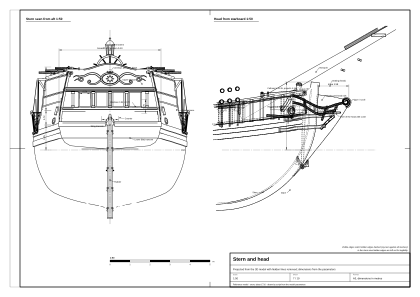

# 04. Pokłady, nadburcia, rufa i galion

## Po co ten etap

Ten etap zamyka kadłub od góry i nadaje mu twarz: pokład, po którym chodzą ludzie, nadburcia, o które się opierają,
furty działowe, okucia do olinowania i kotwic, zdobioną rufę i galion. Te części ogląda się z najbliższa w grze,
filmie albo na stojaku modelu, więc wymagają największej staranności co do wymiarów i rozmieszczenia.

Na końcu tego rozdziału będziesz mieć:

- pokład główny i pokład rufowy z deskami, wypukłością i wzniosem;
- nadburcia z relingiem, furty z pokrywami, szpigaty, ławy wantowe;
- kotbelki, kluzy i knechty bukszprytu na dziobie;
- płaską pawęż z oknami, kontrą i rzeźbami;
- ster zawieszony na czopach i okuciach;
- kolano galionu z policzkami, relingami, kratownicami i zwojem;
- układ pokładu, który zostawia miejsce na chodzenie i pracę.

Powierzchnia kadłuba pochodzi z [rozdziału 02](02-hull-lines-and-offsets.md), konstrukcja pod pokładem
z [rozdziału 03](03-hull-construction.md). Mechanizmy stojące na pokładzie opisuje
[rozdział 09](09-deck-machinery.md); tu tylko rezerwujemy na nie miejsce.

## Pojęcia

- **Śródokręcie** (*waist*): otwarta część pokładu głównego między bakiem (jeśli jest) a pokładem rufowym.
- **Pokład rufowy** (*quarterdeck*): podniesiony pokład nad tylną częścią statku; pod nim jest kabina.
- **Bak** (*forecastle*): podniesiony pokład na dziobie. Model wzorcowy go nie ma.
- **Próg** (*break*): gródź, na której kończy się podniesiony pokład; uskok nadburcia w tym miejscu to **hance**.
- **Ściek** (*waterway*): gruba deska wzdłuż krawędzi pokładu przy burcie, prowadząca wodę do szpigatów.
- **Reling, pokrywa relingu** (*rail, rail cap*): górna krawędź nadburcia.
- **Ława wantowa** (*channel*): gruba deska na zewnątrz kadłuba, która odsuwa wanty od relingu.
- **Kontra** (*counter*): nawis rufy między pawężą skrzydłową a oknami; przez **otwór steru** (*helm port*) w niej
  przechodzi trzon steru.
- **Galion** (*head*): konstrukcja przed dziobnicą: kolano galionu, policzki, relingi galionu, kratownice, figura.

*Rysunek 1. Plan pokładu modelu wzorcowego z wynikiem testu chodzenia.*

## Reguły i proporcje

### Pokłady

| Element | Wartość z epoki albo wtórna | Model wzorcowy | Pewność |
|---|---|---|---|
| Pokład główny przy burcie, owręże | – | z = +0,90 (0,91 przy s = 0), 1,03 m w osi | model wzorcowy |
| Wznios przy dziobnicy / pawęży | – | +1,05 przy s = +14,6, +0,48 przy s = −15,0 ponad wartość z owręża | model wzorcowy; zakres z badań 0,7–1,3 / 0,3–0,7 (nasz wniosek) |
| Wypukłość | 4,8 in (122 mm) na pokładzie działowym statku 500 t [1] | 0,12 m (parabola, mierzona na półszerokości burty 3,80) | z epoki, przeskalowane (nasz wniosek) |
| Grubość desek pokładu | dąb 2,9 in (74 mm) dla 500 t [1]; *Yarmouth* 4 in (102 mm) z sosną między lukami [1] | 0,07 | z epoki; model wzorcowy |
| Szerokość deski pokładu | *Royal Caroline* 1749 ok. 5,75 in (146 mm) [2] | 0,18–0,25 (tekstura 0,24) | wtórne (forum); nasz wniosek |
| Długość desek, styki | styki na pokładnikach, ≥ 3 pasy między stykami na tym samym pokładniku [2] | 6–9 m | wtórne; nasz wniosek |
| Mocowanie | 2 gwoździe na pokładnik, 2 kołki na legar [1] | w teksturze | z epoki |
| Ściek | *Yarmouth*: zagłębiony 6 in, szer. 14 in, przekrój „L” prowadzący wodę do szpigatów [1] | szer. 0,25, grubość 0,10 | z epoki; model wzorcowy |
| Wysokość pokładu rufowego nad głównym | – | 1,70 | model wzorcowy (z badań 1,6–1,8, nasz wniosek) |
| Początek pokładu rufowego (próg) | ok. ⅓ długości od rufy | s = −5,04 | model wzorcowy |
| Pokładniki i deski pokładu rufowego | 7,2 × 4,8 in co 24–28 in; deski 2 in, bez wzdłużników [1] (500 t) | pokładniki 0,15 × 0,11 co 0,6; deski 0,05 | z epoki; nasz wniosek |
| Prześwit w kabinie | – | ok. 1,5–1,6 (1,70 minus pokładniki) | nasz wniosek |

### Nadburcia i furty

| Element | Wartość z epoki albo wtórna | Model wzorcowy | Pewność |
|---|---|---|---|
| Wysokość nadburcia w śródokręciu | – | 1,05 nad pokładem przy burcie, rośnie do 1,20 na dziobie | model wzorcowy (z badań 0,95–1,15, nasz wniosek) |
| Nadburcie pokładu rufowego | – | 0,90 nad pokładem rufowym (reling 2,60 nad linią pokładu głównego) | model wzorcowy |
| Grubość nadburcia | – | 0,14 (poszycie 0,05 + wierzchołki wręgów 0,12, reszta od środka) | model wzorcowy |
| Pokrywa relingu | – | 0,30 × 0,07 | model wzorcowy, tymczasowo |
| Furta, statek 500 t | 32 × 27 in (813 × 686 mm), próg 25 in (635 mm) nad deskami pokładu [1] | – | z epoki |
| Szerokość furty, okręt VI rangi 20 dział (6 lb) | 2 ft 3 in (686 mm) [3] | – | wtórne (forum, „wymiar z etatu”) |
| Reguła Murraya (1765) | próg ≈ 3,5 średnicy kuli nad pokładem; wysokość furty ≈ 6 średnic [3] | – | wtórne (transkrypcja na forum) |
| Furta dla 4-funtówki (kula 77 mm) | – | **0,60 szer. × 0,50 wys., próg 0,32 nad pokładem** | nasz wniosek z wierszy wyżej; model wzorcowy |
| Furta dla 6-funtówki (kula 89 mm) | – | 0,66 × 0,55, próg 0,35 | nasz wniosek |
| Rozstaw furt | *Wolf*: 8 par na 87,5 ft; *Drake*: 7 par na 85 ft [4] | 2,45 m między środkami | wtórne; rozstaw nasz wniosek |
| Furty w modelu wzorcowym | – | 7 par, środki w s = −6,24 (zamknięta, pod pokładem rufowym), −3,79, −1,34, +1,11, +3,56, +6,01, +8,46 | model wzorcowy |
| Próg nad wodnicą | – | 1,22–1,50 (najniżej na owrężu) | zmierzone w modelu wzorcowym |
| Pokrywy furt | zawiasy u góry, otwierane na zewnątrz linką przez otwór nad furtą do małej talii wewnątrz; od środka sztaba do zamykania [5] | grubość 0,07, wygięte jak burta, dwie żelazne taśmy zawiasów; otwarte 95°, zakres 0–100° (85° przy furtach pod ławami wantowymi, 75° przy ostatniej) | wtórne (późniejszy regulamin); model wzorcowy |
| Pokrywy na slupach | nie wszystkie furty miały pokrywy [5] | wszystkie furty mają pokrywy | wtórne |
| Furty wiosłowe | między furtami działowymi; *Drake*: dwie pary przy każdej furcie działowej [4]; SLR0416: 10 furt wiosłowych [6] | brak w modelu wzorcowym; proponowane 0,15–0,20 w kwadrat, środek 0,30–0,40 nad pokładem | wtórne / z epoki (model); wymiar nasz wniosek |
| Szpigaty | otwory przez ściek wyłożone ołowiem, z zewnątrz skórzana klapa [5] | między furtami oraz jeden z przodu i jeden z tyłu, 7 na burtę; ołowiane rynienki 0,16 × 0,08 | wtórne; model wzorcowy |

### Okucia burty i dziobu

| Element | Wartość z epoki albo wtórna | Model wzorcowy | Pewność |
|---|---|---|---|
| Ławy wantowe | 500 t: do 26 in szerokości × 3–5 in grubości [1] | szer. 0,45 × grubość 0,09, na górze nadburcia nad furtami | z epoki; model wzorcowy (z badań 0,40–0,50 × 0,08–0,10) |
| Puttingi | żelazne ogniwa od jufersów w dół do śrub w pasie wantowym albo berghołcie [1] | między furtami | z epoki; rozmieszczenie nasz wniosek z modeli |
| Kotbelki | belka wystająca na boki i do przodu pod ok. 45°, 2–3 krążki na zewnętrznym końcu, wewnętrzny koniec na belce pokładowej [7] | 0,25 w kwadrat, 1,15 za burtę, w s = +12,35, na wysokości relingu, z wygiętym wspornikiem pod spodem | wtórne; model wzorcowy (z badań 1,0–1,6 za burtę) |
| Kluzy | w kłodzinach kluzowych, po 1 (czasem 2) na burtę, wysoko przy dziobnicy pod kotbelką; wyłożone ołowiem; zatykane w sztormie [5] | po 1 na burtę, Ø 0,28, środek w s = +13,05, z = +1,50, drewniany pierścień obłożenia | wtórne; wymiar nasz wniosek |
| Knechty bukszprytu | pionowe belki po bokach bukszprytu nad dziobnicą: nowość ok. 1710 r.; pokolenie wcześniej bukszpryt leżał obok dziobnicy [1] | 0,22 w kwadrat, w x = ±0,31 | z epoki; model wzorcowy |

### Rufa

| Element | Wartość z epoki albo wtórna | Model wzorcowy | Pewność |
|---|---|---|---|
| Typ rufy | płaska pawęż (*square tuck*): w 1710 r. angielscy budowniczowie porzucili ją prawie tylko w dwupokładowcach [1]; slupy z Bostonu miały przeważnie rufy płaskie [8] | płaska pawęż, pochylona o 11,4° jak tylnica | z epoki; model wzorcowy |
| Pawęż skrzydłowa | górna krawędź płaskiej pawęży; kończą się na niej berghołty [1] | z = +1,25 | z epoki; model wzorcowy |
| Kontra | nad pawężą skrzydłową, z nawisem; w niej otwór steru; listwa kontry ok. 10 × 7,5 in dla 500 t [1] | od z = +1,25 do +1,97, nawis 0,85 m | z epoki; model wzorcowy (z badań 0,6, powiększone, żeby zmieściła się głowica steru) |
| Górna pawęż (płyta z oknami) | – | od z = +1,97 do +4,15, pochylona ok. 8°, zaokrąglona w rzucie o 0,22 m | model wzorcowy, tymczasowo |
| Okna rufowe | na slupie 2–4 | 4 okna 0,54 × 0,70, progi na z = +2,18, środki x = ±0,42, ±1,26, pilastry między nimi | nasz wniosek; model wzorcowy |
| Galerie | galeria rufowa i boczne to cecha dużych okrętów; na slupie 20–28 m rzeźbiona płaskorzeźba narożnika albo nic | bez galerii; po jednym małym okienku 0,46 × 0,36 na każdym boku pokładu rufowego, z rzeźbioną ramą | nasz wniosek; model wzorcowy |
| Dekoracja | SLR0416: malowana i rzeźbiona kontra [6] | fryz nad oknami (kartusz, wstęgi w kształcie S), rzeźbione narożniki, korona na relingu rufowym, latarnia | z epoki (model); model wzorcowy, kształty rzeźb tymczasowe |

### Ster

| Element | Wartość z epoki albo wtórna | Model wzorcowy | Pewność |
|---|---|---|---|
| Zawieszenie | czopy na sterze, okucia na tylnicy; 3–5 par [5] | 5 par, czopy na z = −2,9, −1,9, −0,9, +0,1, +0,95 | wtórne; model wzorcowy |
| Głowica steru | zamknięta wewnątrz kadłuba w okrętach angielskich od 1690–1700 [1] | trzon Ø 0,34 przez otwór steru do kabiny | z epoki; model wzorcowy |
| Szerokość płetwy | 0,8–1,0 u dołu | 0,95 u dołu, 0,92 na z −2,0, 0,82 na −0,5, 0,66 na +0,5, 0,45 na +1,1, 0,30 powyżej +1,45 | nasz wniosek; model wzorcowy |
| Grubość płetwy | – | 0,26 przy krawędzi zawiasów, 0,13 przy krawędzi tylnej | model wzorcowy |
| Wychylenie | ok. ±35° | ±35° | wtórne (wartość do gry) [5]; model wzorcowy |

### Galion

| Element | Wartość z epoki albo wtórna | Model wzorcowy | Pewność |
|---|---|---|---|
| Kolano galionu | przykręcone przez dziobnicę, zwęża się ku przodowi [1] | wysunięte do 1,58 m przed lico dziobnicy, grubość 0,24 malejąca ku górze | z epoki; model wzorcowy (z badań 1,5–2,0) |
| Figura | małe statki ok. 1720 r.: **zwój** (plan *Swift* 1721, SLR0416) [6], [9]; standardową figurą mniejszych okrętów RN w XVII–XVIII w. był **lew** [10]; list Navy Board z 1710 r. krytykuje nadmiar dekoracji [11] | zwój o promieniu 0,30 m, 1,6 obrotu, na z = +2,30 | z epoki (plan, model); wtórne |
| Policzki | wygięte kolana łączące kolano galionu z dziobem | po 2 na burtę, na z = +1,05 i +1,62, przekrój 0,16 × 0,11 | nasz wniosek; model wzorcowy |
| Relingi, słupki, kratownice galionu | 2–3 wygięte relingi na burtę od kotbelki do figury, kratownice między nimi (ustęp załogi) | 2 relingi na burtę (Ø 0,10), 3 słupki na burtę, kratownice na z = +1,86 z listwami co 0,075 | nasz wniosek; model wzorcowy |

## Instrukcja krok po kroku: pokład i jego krawędzie

1. **Linia pokładu przy burcie.** Weź wysokości pokładu przy burcie z tabeli B rozdziału 02 i poprowadź gładką
   krzywą wzdłuż wnętrza kadłuba (wznios). W modelu wzorcowym: z = 0,90 przy s = +1,96, rośnie do 1,85 przy dziobnicy
   i 1,38 przy s = −15,0.
2. **Wypukłość.** Dla każdego położenia s wysokość pokładu w odległości x od osi to
   z = z_burty + 0,12 · (1 − (x / 3,80)²), gdy burta jest na pełnej półszerokości. W modelu wzorcowym wszystkie
   pokładniki pochodzą z jednej krzywej: z(s, x) = z_osi(s) − 0,12 · (x / 3,80)².
3. **Deski pokładu.** Układaj je **równolegle do osi, nie do burty**. Szerokość 0,18–0,25 (0,24 w teksturze modelu
   wzorcowego), długość 6–9 m, styki na pokładnikach, co najmniej trzy pasy między stykami na tym samym pokładniku;
   czarne szwy; rzędy łbów mocowań w poprzek pokładu nad każdym pokładnikiem.
4. **Ściek.** Wzdłuż burty deska 0,25 × 0,10 wystająca ponad pokład, z zaokrągleniem do nadburcia. Na końcach, gdzie
   burta się wygina, deski pokładu wpuszczaj w ściek zamiast je giąć (nasz wniosek).
5. **Nadburcie.** Odsuń powierzchnię kadłuba do środka o grubość nadburcia (0,14 w modelu wzorcowym) od pokładu do
   relingu. Od środka ustaw wierzchołki wręgów co 0,52 m (rozdział 03) albo deski (wewnętrzne poszycie). Wysokość
   relingu: 1,05 w śródokręciu, 0,90 nad pokładem rufowym.
6. **Pokrywa relingu.** Deska 0,30 × 0,07 na górze, z profilowaną zewnętrzną krawędzią, wzdłuż wzniosu; ciągnie się
   w poprzek rufy jako reling rufowy.
7. **Pokład rufowy.** Zacznij w s = −5,04 grodzią w poprzek statku. Pokład 1,70 nad głównym, z własnym wzniosem
   i wypukłością. W grodzi: dwoje drzwi kabiny 0,72 × 1,56 w x = ±1,25 i schody w osi. Na górze balustrada 0,90
   z tralkami co 0,22 m, z przerwą na schody.
8. **Uskok nadburcia.** Tam, gdzie nadburcie wznosi się do pokładu rufowego, zrób przejście krzywą z rzeźbioną wolutą.
9. **Furty.** Wytnij prostokątne otwory o pionowych bokach, z progiem i nadprożem wzdłuż wzniosu. Ścianki otworu
   muszą mieć pełną grubość burty (widać je z bliska). Próg 0,32 nad pokładem przy burcie, nadproże 0,82,
   szerokość 0,60.
10. **Pokrywy.** Każda pokrywa to osobny obiekt grubości 0,07, wygięty jak burta, z osią zawiasów wzdłuż górnej
    krawędzi od zewnątrz, otwierany na zewnątrz i w górę; zakres 0–100°. Sprawdź każdą otwartą pokrywę wobec ław
    wantowych i listew i ogranicz kąt, jeśli koliduje (85° i 75° w modelu wzorcowym).
11. **Szpigaty.** Małe otwory wyłożone ołowiem tuż pod linią pokładu, między furtami.
12. **Ławy wantowe i puttingi.** Deska 0,45 × 0,09 od zewnątrz, na górze nadburcia, przy wantach grotmasztu
    i fokmasztu; puttingi w dół do berghołtów między furtami (olinowanie w [rozdziale 06](06-standing-rigging.md)).

## Instrukcja krok po kroku: rufa

1. **Płaszczyzna pawęży.** Przedłuż pochylenie tylnicy (11,4°) w górę od pięty do pawęży skrzydłowej; ta płaszczyzna
   to płaska dolna rufa. Jej obrys jest końcem każdej wodnicy i poszycia.
2. **Pawęż skrzydłowa.** Ciężka listwa w poprzek rufy na z = +1,25 (wys. 0,24, wystaje 0,12).
3. **Kontra.** Nad pawężą skrzydłową rufa wychyla się do tyłu i wygina w górę do z = +1,97 (nawis 0,85). Zostaw
   w środku otwór steru na trzon.
4. **Górna pawęż.** Od z = +1,97 do relingu rufowego, pochylona ok. 8°, lekko zaokrąglona w rzucie. Listwy na górze
   kontry, pod oknami i nad nimi oraz na wysokości pokładu rufowego.
5. **Okna.** Cztery okna 0,54 × 0,70, progi na z = +2,18, środki ±0,42 i ±1,26; ramy szerokości 0,07; szyba tuż
   za licem; pilastry między oknami.
6. **Dekoracja.** Fryz nad oknami (kartusz, wstęgi w kształcie S, drobne liście), rzeźbione pilastry narożne, korona
   na relingu rufowym, latarnia rufowa na żelaznym wsporniku. Płasko (płaskorzeźba, nie galerie).
7. **Boki rufy.** Po każdej stronie pokładu rufowego: listwa w połowie wysokości, małe okno z rzeźbioną ramą. Bez
   galerii bocznej.

*Rysunek 2. Rufa i galion modelu wzorcowego.*

## Instrukcja krok po kroku: ster

1. **Oś zawiasów.** To tylna krawędź tylnicy, prosta pod kątem 10,1° do pionu. Tylnica zwęża się od 0,40 m przy
   pięcie do 0,28 m u góry, więc jej tylna krawędź stoi nieco bardziej stromo niż linia wrębu (11,4°). Wokół osi
   zawiasów odbywa się cały obrót; `data/moving-parts.csv` podaje ją jako `axis_dir` steru.
2. **Płetwa.** Przeciągnij przekrój wzdłuż osi zawiasów od spodu stępki do ok. z = +1,7: półokrągła krawędź natarcia
   na osi (grubość 0,26), przechodząca w ściętą krawędź tylną grubości 0,13; szerokość 0,95 u dołu, malejąca ku górze
   (zob. tabelę).
3. **Trzon.** Okrągły trzon Ø 0,34 biegnie dalej wzdłuż osi przez otwór steru do kabiny, z żelaznymi obręczami.
4. **Czopy i taśmy.** Pięć żelaznych czopów na osi zawiasów; taśmy na obu bokach płetwy, kończące się 0,10 m za osią,
   żeby przy obrocie nigdy nie dotknęły tylnicy.
5. **Okucia.** Na tylnicy, naprzeciw czopów, z ramionami długości 0,65 m po obu stronach kadłuba.
6. **Punkt obrotu.** Umieść początek obiektu na osi zawiasów, a jego lokalną oś wzdłuż niej; obrót ±35°. Rumpel
   (wariant pokładowy) albo rumpel w kabinie (wariant z kołem) są dziećmi steru (rozdział 09).

## Instrukcja krok po kroku: galion i okucia dziobu

1. **Kolano galionu.** Bryła grubości 0,24 przed dziobnicą, wygięta do przodu do 1,58 m wysunięcia, potem cofnięta pod
   figurę.
2. **Figura.** Zwój (woluta) o promieniu ok. 0,30 m na z = +2,30, z okiem po obu stronach; albo lew dla okrętu
   wojennego, który go potrzebuje.
3. **Deski ozdobne i policzki.** Rzeźbiona deska po każdej stronie kolana; po dwa policzki na burtę od poszycia dziobu
   do kolana.
4. **Relingi galionu.** Po dwa wygięte relingi na burtę od miejsca tuż przed kotbelką w dół i do przodu, do tyłu
   figury; po trzy słupki na burtę łączą je z policzkami.
5. **Kratownice.** Dwie połówki kratownicy po bokach kolana na z = +1,86, z obramowaniem.
6. **Kotbelki.** Belka 0,25 w kwadrat od pokładu, przez nadburcie pod ok. 45° do przodu, 1,15 m za burtę, z dwiema
   szczelinami na krążki i rzeźbionym czołem; pod nią wygięty wspornik.
7. **Kluzy.** Po jednej na burtę, poniżej kotbelki i za nią, Ø 0,28, z drewnianym obłożeniem dookoła i wyłożeniem
   z żelaza albo ołowiu.
8. **Knechty bukszprytu.** Dwa słupy 0,22 w kwadrat po bokach bukszprytu, wystające ponad reling.

## Układ pokładu modelu wzorcowego

Położenia s od połowy długości pokładu, dodatnie ku dziobowi; x w poprzek, dodatnie ku lewej burcie (model wzorcowy;
aktualne wartości są w `data/parameters.json` i `data/deck-layout.json`).

| Przedmiot | s (m) | x (m) | Wymiar (m) | Poziom |
|---|---|---|---|---|
| Dziobnica na pokładzie | +14,00 | 0 | – | główny |
| Knechty bukszprytu, kluzy, kotbelki | +13,4 / +13,05 / +12,35 | ±0,31 / burta / burta | zob. wyżej | główny |
| Fokmaszt | +10,08 | 0 | Ø 0,45 przy pokładzie | główny |
| Luk dziobowy | +8,05 … +9,05 | 0 | 1,0 × 1,2, zrębnica 0,25 | główny |
| Komin kambuza | +7,35 | 0 | 0,35 × 0,35 × 0,8 | główny |
| Luk główny | +2,90 … +5,30 | 0 | 2,4 × 1,8, zrębnica 0,25 | główny |
| Kabestan | +0,95 | 0 | głowica Ø 0,94, drągi do promienia 1,75 | główny |
| Grotmaszt / maszt snow | −1,40 / −1,85 | 0 | Ø 0,49 / 0,17 | główny |
| Pompy | −4,35 | ±1,05 | Ø 0,35, dźwignia 1,5 | główny |
| Beczka do picia | −4,45 | −2,95 | Ø 0,65 × 0,9 | główny |
| Próg pokładu rufowego, schody | −5,04 | 0 | schody szer. 0,9, 9 stopni | – |
| Dzwon | −5,45 | +1,55 | rama szer. 0,75 | rufowy |
| Skrzynia z bronią | −6,0 | +2,35 | 1,2 × 0,5 × 0,5 | rufowy |
| Zejściówka do kabiny | −7,35 … −6,35 | 0 | szer. 0,9, wys. 1,0 | rufowy |
| Kojce | −8,1 | ok. ±2,6 | 1,5 × 0,6 × 0,6 | rufowy |
| Szafka kompasowa | −10,35 | 0 | 0,9 × 0,45 × 0,85 | rufowy |
| Koło sterowe (domyślnie) | −11,55 | 0 | Ø 1,40, oś 1,05 nad pokładem | rufowy |
| Działka relingowe | −6,6, −9,4, −12,2, +11,6 | oba relingi | – | relingi |
| Działa na lawetach | −1,34, +1,11, +3,56, +6,01, +8,46 | obie burty | laweta 1,5 × 0,8 | główny |
| Łódź (jol) | domyślnie holowana za rufą | – | 5,0 × 1,72 × 0,72 | – |

### Zasady rozmieszczenia

Użyte do sprawdzenia modelu wzorcowego postacią o promieniu 0,30 m i wzroście 1,75 m (model wzorcowy; same zasady to
nasz wniosek):

1. **Przejścia co najmniej 0,8 m** wszędzie między przedmiotami i nadburciami (test nie znalazł węższych).
2. **Każde stanowisko pracy osiągalne** od schodów bez przechodzenia przez przeszkody (127 stanowisk na pokładach,
   wszystkie osiągalne).
3. **Drągi kabestanu muszą obracać się swobodnie** obok masztów, luków i pomp. W modelu wzorcowym drągi sięgają
   1,75 m od osi (koło 3,5 m); nasze badania sugerowały drągi 2,8–3,2 m (koło 6,5 m), które nie mieszczą się między
   masztami na pokładzie szerokim na 7,6 m (sprzeczność zapisana).
4. **Odrzut działa** ok. 1,5 m nie może zamykać jedynego przejścia. W modelu wzorcowym odrzut części dział ogranicza
   nagielbank grotmasztu, podstawa kabestanu, luk główny i luk dziobowy (0,4–1,3 m); pełne 1,5 m mają tylko działa
   w s = +6,01.
5. **Schody** pod ok. 41°: wznios stopnia 0,19, głębokość 0,22, szerokość 0,9 (model wzorcowy: 9 stopni na pokład
   rufowy).
6. **Luki** małego statku 1,2–1,8 m, nie 3 m (nasz wniosek); zrębnice 0,2–0,3 wysokości (nasz wniosek).
7. **Nadburcie** 1,0–1,1 m: od biodra do piersi człowieka; furta nigdy nie może być wyższa od człowieka [3] (nasz
   wniosek z długości dział: lufa 4-funtówki ma ok. 1,8 m).
8. **Prześwit** pod pokładem rufowym ok. 1,5–1,6 m; oficerowie chodzili pochyleni.

## Przykład policzony: progi furt modelu wzorcowego

Pokład przy burcie przy furcie s = +1,11 jest na z = 0,90; próg jest 0,32 wyżej, czyli na z = 1,22 nad wodą. Przy
przedniej furcie s = +8,46 pokład wzniósł się do ok. 1,18, więc próg jest na ok. 1,50. Plik kontrolny modelu podaje
progi 1,22–1,50 m nad wodnicą (zmierzone w modelu wzorcowym). Reguła „próg furty ok. 1,2 m nad wodą w śródokręciu”
(nasz wniosek) jest spełniona.

## Sprawdź się

- [ ] Deski pokładu równoległe do osi; styki na pokładnikach; szerokość 0,18–0,25.
- [ ] Wypukłość 1–2 % szerokości (model wzorcowy 0,12 na 7,6, 1,6 %).
- [ ] Nadburcie śródokręcia 0,95–1,15 m (model wzorcowy 1,05); pokładu rufowego ok. 0,9.
- [ ] Furty 0,55–0,66 szer., 0,50–0,55 wys.; próg 0,30–0,55 nad pokładem (źródła się różnią, zob. niżej); rozstaw
      2,3–2,6 m; progi co najmniej 1,2 m nad wodą.
- [ ] Pokrywy otwierają się na zewnątrz z zawiasem u góry i otwarte nie kolidują z ławami wantowymi.
- [ ] Płaska pawęż z dolną krawędzią na wodnicy; 2–4 okna rufowe; bez galerii.
- [ ] Ster na 4–5 czopach, obraca się o ±35° bez dotykania tylnicy.
- [ ] Kotbelki 1,0–1,6 m za burtę; kluzy pod nimi.
- [ ] Każde przejście ≥ 0,8 m; drągi kabestanu i działa mogą się ruszać, niczego nie uderzając.

## Typowe błędy

1. Deski pokładu wzdłuż krzywizny burty albo bez styków; brak ścieku.
2. Nadburcie grubości kartki; reling bez profilu.
3. Za duże furty (jak na fregacie 18-funtowej), za wysoko nad pokładem albo rozstawione aż po dziobnicę i rufę.
4. Pokrywy furt z zawiasem z boku albo otwierane do środka.
5. Galerie rufowe i rufa liniowca na jednostce 25 m; okrągła rufa.
6. Ster bez czopów i okuć, przyklejony do tylnicy.
7. Galion „billethead” albo figura z XIX w.; brak kolana galionu.
8. Za duże schody, drzwi i luki; prześwit jak w domu.
9. Przedmioty postawione tam, gdzie uderzą je drągi kabestanu albo odrzut działa.

### Gdzie źródła się różnią

- **Wysokość progu furty**: nasze notatki o kadłubie podają 0,32 m dla 4-funtówki (z reguły Murraya z 1765 r.,
  3,5 średnicy kuli), notatki o mechanizmach pokładu 0,45–0,55 m; statek Sutherlanda (500 t) miał 0,64 m. Model
  wzorcowy używa 0,32.
- **Wysięg kotbelki**: 1,0–1,3 m (notatki o kadłubie) albo 1,2–1,6 m (notatki o mechanizmach); model używa 1,15.
- **Dzwon**: notatki o kadłubie stawiają go na baku (jak na SLR0416); model wzorcowy nie ma baku i wiesza go na
  przedniej krawędzi pokładu rufowego.

## Źródła

1. T. Kenchington, „The Structures of English Wooden Ships: William Sutherland's Ship, circa 1710”, *The Northern
   Mariner* III/1 (1993), 1–43. https://cnrs-scrn.org/northern_mariner/vol03/tnm_3_1_1-43.pdf. © CNRS-SCRN.
2. Forum ModelShipWorld, „18th century deck planking shifts” (niska pewność)
   https://modelshipworld.com/topic/14192-18th-century-deck-planking-shifts.
3. Forum ShipsOfScale, „18th Century British Gun Ports” (Murray 1765; furta 2 ft 3 in)
   https://shipsofscale.com/sosforums/threads/18th-century-british-gun-ports.19006/; INA Quarterly 30/4 (długości
   dział z *La Belle*) https://nauticalarch.org/wp-content/uploads/2016/03/INAQ2003-30-4.pdf.
4. Wikipedia, „Drake-class sloop” https://en.wikipedia.org/wiki/Drake-class_sloop i „Wolf-class sloop”
   https://en.wikipedia.org/wiki/Wolf-class_sloop (CC BY-SA).
5. J. Mathews, „Gun Drill” (za Davisem i Mullerem, 1780) https://navyandmarine.org/ondeck/1800gundrill.htm; nasze
   notatki o mechanizmach pokładu opracowane na jego podstawie i na podstawie forów modelarskich (pokrywy furt,
   szpigaty, kluzy, wychylenie steru).
6. Royal Museums Greenwich, model SLR0416 https://www.rmg.co.uk/collections/objects/rmgc-object-66377 (tylko do
   oglądania).
7. Wikipedia, „Cathead” https://en.wikipedia.org/wiki/Cathead (CC BY-SA).
8. W. A. Baker, „Vessel Types of Colonial Massachusetts” https://www.colonialsociety.org/node/1977.
9. Royal Museums Greenwich, plan ZAZ4853 *Swift* (1721) https://www.rmg.co.uk/collections/objects/rmgc-object-84644
   (tylko do oglądania).
10. Royal Museums Greenwich, figura lwa z małego okrętu, przełom XVII i XVIII w.
    https://www.rmg.co.uk/collections/objects/rmgc-object-18794 (tylko do oglądania).
11. History is Now, „What are naval figureheads?” (list Navy Board z 1710 r.)
    https://historyisnowmagazine.com/blog/2019/12/1/what-are-naval-figureheads-a-brief-history-of-this-curious-tradition
    (wtórne).
12. Model SLR0229 (podniesiony pokład rufowy, rumpel, działka relingowe na słupkach)
    https://www.rmg.co.uk/collections/objects/rmgc-object-66190 (tylko do oglądania).

## Terminy użyte w rozdziale

| Angielski | Polski | Objaśnienie |
|---|---|---|
| main deck | pokład główny | Ciągły górny pokład statku jednopokładowego. |
| waist | śródokręcie (pokład między bakiem a rufówką) | Otwarta część pokładu głównego w środku statku. |
| quarterdeck | pokład rufowy (rufówka) | Podniesiony pokład na rufie nad kabiną. |
| forecastle | bak | Podniesiony pokład na dziobie. |
| break, hance | próg (gródź) pokładu rufowego, uskok nadburcia | Koniec podniesionego pokładu; uskok nadburcia w tym miejscu. |
| deck planking | poszycie pokładu (deski pokładu) | Deski pokładu. |
| waterway | ściek | Gruba deska przy krawędzi pokładu prowadząca wodę do szpigatów. |
| scupper | szpigat | Otwór odpływowy w burcie na wysokości pokładu. |
| bulwark | nadburcie | Burta powyżej pokładu. |
| rail, rail cap, taffrail | reling, pokrywa relingu, reling rufowy | Górna krawędź nadburcia; w poprzek rufy. |
| gun port / port lid | furta działowa / pokrywa furty | Otwór na działo / jego zawiasowa pokrywa. |
| port sill / lintel | próg / nadproże furty | Dolna / górna krawędź furty. |
| oar port, sweep port | furta wiosłowa | Mały otwór na długie wiosło. |
| channel | ława wantowa | Deska od zewnątrz odsuwająca wanty. |
| chain plate | putting | Żelazna taśma od jufersa w dół do kadłuba. |
| cathead | kotbelka | Belka na dziobie trzymająca kotwicę z dala od burty. |
| hawse hole, hawse bolster | kluza, obłożenie kluzy | Otwór na linę kotwiczną; jego grube obramowanie. |
| knighthead | knecht bukszprytu | Pionowa belka obok bukszprytu. |
| head, knee of the head | galion, kolano galionu | Konstrukcja przed dziobnicą. |
| cheeks of the head | policzki galionu | Wygięte kolana łączące galion z dziobem. |
| head rails, head timbers | relingi galionu, słupki galionu | Relingi i pionowe elementy galionu. |
| grating | krata, kratownica | Krata z listew. |
| figurehead, scroll | figura dziobowa, zwój (woluta) | Rzeźba na przodzie galionu. |
| trailboard | deska ozdobna galionu [niepewny termin] | Rzeźbiona deska na boku kolana galionu. |
| flat transom (square tuck) | płaska pawęż (rufa pawężowa) | Płaska dolna część rufy. |
| counter, counter rail | kontra, listwa kontry | Nawis rufy nad pawężą skrzydłową; jego listwa. |
| helm port | otwór steru | Otwór na trzon steru. |
| stern lights | okna rufowe | Okna kabiny w rufie. |
| stern gallery / quarter gallery | galeria rufowa / boczna | Balkon na rufie / na bokach rufy (nie na małych statkach). |
| quarter piece, badge | płaskorzeźba narożnika rufy | Rzeźba na narożnikach rufy zamiast galerii. |
| rudder, pintle, gudgeon | ster, czop, okucie | Ster; sworzeń na sterze; gniazdo na tylnicy. |
| rudder stock | trzon steru | Górna część steru, na której osadza się rumpel. |
| companion | zejściówka | Kryte wejście ze schodami do kabiny. |
| ladder | schody, drabina | Strome schody między pokładami. |
| coaming | zrębnica | Podniesiona rama wokół luku. |
