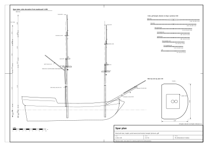

# 05. Maszty i drzewca

## Po co ten etap

Drzewca to szkielet, na którym wisi każda lina i każdy żagiel. Zanim narysujesz pierwszą wantę,
musisz wiedzieć, gdzie stoi każdy maszt, jak jest wysoki i gruby, gdzie są jego top, ezelhoft i saling oraz gdzie
wisi każda reja. Ten rozdział zamienia dwie liczby kadłuba (długość pokładu i szerokość) w pełny plan drzewc małego
dwumasztowego żaglowca rejowego z lat ok. 1700–1720 (snow albo bryg), a potem pokazuje, jak go wykreślić i
zamodelować.

Na końcu tego rozdziału będziesz mieć:

- tabelę drzewc: długość, średnica i zbieżność każdego masztu, rei, gafla i drzewc bukszprytu (oraz bomu wariantu brygu);
- widok z boku masztów ze wszystkimi wysokościami (dublinki, marsy, ezelhofty, salingi, reje);
- model 3D albo CAD drzewc, gotowy do założenia olinowania stałego z [rozdziału 06](06-standing-rigging.md).

Oznaczenia pewności są takie same jak w całym przewodniku ([rozdział 01](01-ship-type-and-era.md)). Każda
liczba ma numer źródła w nawiasie kwadratowym (lista na końcu) i jedno z oznaczeń:

- **(z epoki)** źródło z epoki albo kilka zgodnych źródeł. Najbogatsze źródło z epoki, Steel, wydano w
  **1794 r.**, ok. 80 lat po latach, o które nam chodzi; tam, gdzie wcześniejsze źródła (1707, 1711–1719) podają co
  innego, piszemy to wprost.
- **(wtórne)** współczesne opracowanie, forum, model kitowy, replika albo streszczenie, którego nie dało się porównać
  z oryginałem.
- **(nasz wniosek)** nasze obliczenie albo rekonstrukcja, bez bezpośredniego źródła.
- **(model wzorcowy)** liczba z danych modelu wzorcowego (`data/parameters.json`, `data/rigging-lines.json`,
  `data/spars.csv`). Model jest jeszcze poprawiany; te liczby to przykład, nie reguła.

Jednostki: metry i milimetry. Miary z epoki podajemy w nawiasie w jednostce oryginalnej
(1 stopa = 0,3048 m, 1 cal = 25,4 mm, 1 jard = 0,9144 m).

## Pojęcia: części masztu (od dołu)

```
            gałka  o
                   |      bramstenga (z krótkim szczytem nad olinowaniem)
  ezelhoft   [==]  |
             ||    |  <- top stengi (dublinka z bramstengą)
     saling  ===+==+===
                |         stenga
                |
  ezelhoft [=====]|
   top       || |  <- top kolumny (dublinka: top kolumny + pięta stengi)
   mars ======+=+======   belki marsa, pomost
   policzki  /|\
             |||          kolumna masztu (wuldingi co ok. 1 m)
   pokład ===|||====      opętnik (kliny wokół masztu w pokładzie)
             |||
   kilson ===[_]==        jarzmo (gniazdo pięty masztu)
```

| Część | Co to jest |
|---|---|
| Kolumna masztu | Najniższe i najgrubsze drzewce. **Pięta** stoi w **jarzmie** na kilsonie, kolumna przechodzi przez pokład w **opętniku**, a jej górny koniec to **top**. |
| Policzki (hounds, cheeks) | Drewniane występy po bokach masztu tuż pod topem; niosą belki marsa. |
| Belki marsa (trestle-trees, crosstrees) | Belki wzdłużne i poprzeczne u podstawy topu. Niosą **mars**. |
| Mars | Pomost na belkach. Rozpiera wanty stengowe i jest stanowiskiem pracy. |
| Ezelhoft | Gruby drewniany blok na samym szczycie topu. Tylnym otworem siedzi na czopie kolumny, przednim obejmuje stengę. |
| Stenga | Wsuwana od dołu **przed** top kolumny, przez ezelhoft. Spoczywa na **sztabie** (fid), czyli pręcie przełożonym przez jej piętę i leżącym na belkach marsa. |
| Dublinka | Odcinek, na którym dwa drzewca zachodzą na siebie (top kolumny i pięta stengi; top stengi i pięta bramstengi). |
| Saling | Mniejsza rama belek na topie stengi; rozpiera wanty bramstengowe. |
| Bramstenga | Najwyższe drzewce. W epoce krótka, czasem z krótkim szczytem bez want, zakończona **gałką**. |
| Wuldingi | Opaski z liny co ok. 1 m na kolumnie złożonej z kilku kawałków. |
| Rak | Lina z drewnianymi kulkami, która trzyma reję przy maszcie. |

## Jaki takielunek budujemy?

| Kwestia | Stan w latach 1702–1718 | Pewność |
|---|---|---|
| „Bryg” | Skrót od „brigantine”; późniejszy bryg (oba maszty rejowe, grotmaszt z trzech części) to rozwój XVIII w. | (wtórne) [8] |
| Brygantyna ok. 1700–1720 | Fokmaszt w pełni rejowy; na grotmaszcie żagiel skośny (gaflowy) oraz rejowy marsel, czasem bramsel; 30–150 t | (wtórne) [8] |
| Snow | Dwa maszty rejowe i cienki **maszt snow** (trysail mast) tuż za grotmasztem, na którym chodzi gafel; dzięki temu snow nosi rejowy grot. Powszechny w marynarkach na początku XVIII w.; żagiel gaflowy pierwotnie bez bomu | (wtórne) [9] |
| Bukszpryt | Od 1705 r. mniejsze okręty zastępują blindę-stengę **bomstengą**; w ciągu ok. 20 lat robią to wszystkie. **Blindareja pod bukszprytem zostaje** do ok. 1800 r. | (z epoki) [6], [7] |
| Marsy | W XVII w. okrągłe; nie znaleźliśmy pewnej daty przejścia na marsy prostokątne z zaokrąglonym przodem na małych okrętach ok. 1700–1720 | (nasz wniosek) [10] |

Model wzorcowy to **snow**: rejowy grot, gafel na maszcie snow, bomstenga, blindareja. Żagiel gaflowy **nie ma
bomu** i jest podgarniany gejtawami do masztu, jak zwykle w latach 1700–1720 (model wzorcowy, `has_boom = false`
w `data/parameters.json`). Bom żagla gaflowego należy do późniejszego brygu, który przewodnik traktuje jako wariant
([rozdział 12](12-designing-other-ships.md)).



*Rysunek 1. Plan drzewc modelu wzorcowego, widok z prawej burty w skali 1:150, z wysokościami pięt, pokładu,
marsów, ezelhoftów, salingów i gałek nad wodnicą (arkusz `plans/spar-plan.svg`).*

## Reguły proporcji

Zaczynamy od dwóch liczb kadłuba (jak opisać kadłub, mówi [rozdział 02](02-hull-lines-and-offsets.md)):

- **L**: długość pokładu (dolnego albo jedynego), w metrach;
- **B**: największa szerokość, w metrach.

Podstawowa reguła („reguła A”) pochodzi od Steela (1794) i jest przypisywana także angielskiemu etatowi z lat
1711–1719.

### Długości

| Drzewce | Reguła | Źródło, pewność |
|---|---|---|
| Grotmaszt (cała kolumna, od pięty do ezelhoftu) | **M = (L + B) / 2** | Steel s. 39 [1], [4] (z epoki, 1794); ta sama reguła przypisywana latom 1711–1719 [5] (wtórne) |
| Grotmaszt, wariant | 3 × B (mały statek, 1707); traktować jako górną granicę, wychodzi bardzo wysoki | [3] (wtórne) |
| Grotmaszt, wariant | 2,34 × B (60 dział, 1719); 2,22 × B (1745) | Lees przez forum [5] (wtórne) |
| Fokmaszt | 8/9 × M | [1] (z epoki) |
| Stenga grota | 3/5 × M | [1] (z epoki) |
| Stenga foka | 8/9 × stenga grota | [1] (z epoki) |
| Stengi, wariant | 2/3 kolumn | [3] 1707 (wtórne) |
| Bramstengi | 1/2 × stenga | [1] (z epoki) |
| Bukszpryt | 3/5 × M (okręty do 74 dział) | [1] (z epoki) |
| Bomstenga | ok. 5/7 × bukszpryt; 1/3 jej długości leży w ezelhofcie i na bukszprycie | [1] (wtórne: streszczenie miesza bomstengę z latającą bomstengą) |
| Grotreja | 8/9 × M | [1] (z epoki) |
| Grotreja, wariant | (2/3 + 1/12) × M = 0,75 × M | [3] 1707 (wtórne) |
| Fokreja | 7/8 × grotreja | [1] (z epoki) |
| Grotmarsreja | 5/7 × grotreja | [1] (z epoki) |
| Marsreja, wariant | 1/2 × dolna reja | [3] 1707 (wtórne) |
| Fokmarsreja | 7/8 × grotmarsreja | [1] (z epoki) |
| Bramreje | 3/5 × marsreja tego masztu (małe okręty); stosunek 0,58 w 1719 r., 0,69 w 1745 r. | [1] (z epoki); [5] (wtórne) |
| Blindareja | = fokmarsreja | [1] (z epoki) |
| Bom żagla gaflowego | 2/3 × maszt (slup); na okrętach bom bezana = grotmarsreja | [1] (z epoki dla slupów i okrętów; dla brygu i snow przez analogię: nasz wniosek) |
| Gafel | 3/5 × bom (slup); 5/8 × bom (bezan okrętu) | [1] (z epoki; dla brygu i snow: nasz wniosek) |
| Top kolumny (dublinka) | 5 cali na jard długości masztu (= 5/36 długości) | [1] (z epoki) |
| Top stengi | 4 cale na jard długości stengi (= 4/36 długości) | [1] (z epoki) |
| Mars, szerokość (w poprzek) | 1/3 × długość stengi | [1] (z epoki) |
| Mars, długość (wzdłuż) | 3/4 × szerokość marsa | [1] (z epoki) |
| Maszt snow | od pokładu do spodu belek grotmarsa, średnica ok. 0,35 × średnica grotmasztu | (nasz wniosek) |

### Średnice

Steel podaje średnice jako „cale na jard długości”. Jeden cal na jard to dokładnie **1/36 długości**.

| Drzewce | Reguła (średnica w opętniku albo w środku rei) | Źródło, pewność |
|---|---|---|
| Grotmaszt (bryg) | 1 cal na jard długości (= M / 36) | [1], [4] (z epoki) |
| Fokmaszt | 9/10 × średnica grotmasztu | [1] (z epoki) |
| Stengi, bramstengi | 1 cal na jard własnej długości | [1] (z epoki) |
| Dolne reje | 0,7 cala na jard (średnica w środku) | [1] (z epoki) |
| Marsreje | 5/8 cala na jard | [1] (z epoki) |
| Bramreje | 0,6 cala na jard | [1] (z epoki) |
| Bukszpryt | = średnica grotmasztu (okręty do 50 dział) | [1] (z epoki) |
| Bomstenga | 7/8 cala na jard | [1] (z epoki) |
| Ezelhoft dolny | długość 4 × średnica stengi + 3 cale (76 mm); szerokość 2 × średnica stengi + 2 cale (51 mm); grubość 4/9 × szerokość | [1] (z epoki) |

### Zbieżność

Średnica nie jest stała. Steel podaje ją w stałych punktach jako ułamek największej średnicy (z epoki) [1]:

| Drzewce | Punkty (od najgrubszego miejsca) | Ułamki |
|---|---|---|
| Kolumna masztu | opętnik, 1/4, 1/2, 3/4 drogi do policzków; pod topem; szczyt topu | 1, 60/61, 14/15, 6/7; 3/4; 5/8 |
| Stenga | przy ezelhofcie, 1/4, 1/2, 3/4 drogi do salingu; pod salingiem; szczyt | 1, 60/61, 14/15, 6/7; 13/16; 6/11 |
| Reja | środek (stropy), 1/4, 1/2, 3/4 drogi do noku; nok | 1, 30/31, 7/8, 7/10; 3/7 |

Dolne reje i marsreje mają **ośmiokątny środek**; pozostałe reje są okrągłe na całej długości (z epoki) [1]. Top ma
przekrój kwadratowy (nasz wniosek, z plansz Steela; model wzorcowy robi kwadrat o boku 5/8 średnicy masztu, model wzorcowy).

### Położenie, pochylenie, wznios

| Parametr | Wartość | Pewność |
|---|---|---|
| Grotmaszt brygu | ok. 2/3 długości za głowicą dziobnicy | [1] (z epoki) |
| Fokmaszt brygu | 3/20 długości za głowicą dziobnicy (dla porównania okręty Royal Navy: fok 1/9, grot 5/9, bezan 17/20 długości dolnego pokładu) | [1] (wtórne: ułamek dla brygu z automatycznego streszczenia) |
| Pochylenie grota w tył | 3/4 cala na jard (ok. 1,2°; 12 m nad pokładem top jest ok. 0,25 m za pionem) | [1] (z epoki) |
| Pochylenie foka | „pełna 1/8 cala” na jard (ok. 0,2°, prawie pion) | [1] (wtórne) |
| Reguła ogólna | statki krótkie i szerokie mają maszty mocniej pochylone w tył, długie prawie pionowe | [1] (z epoki) |
| Wznios bukszprytu | ok. 36° nad poziomem (Steel, ogólnie) | [1] (z epoki dla 1794) |
| Dolna reja | wisi na stropach **pod** marsem, ok. 0,5–1 m pod belkami | [1] (z epoki co do stropów; nasz wniosek co do odstępu) |

## Krok po kroku: od liczb kadłuba do planu drzewc

1. **Weź L i B** z kadłuba ([rozdział 02](02-hull-lines-and-offsets.md)): długość pokładu między wrębami i szerokość z poszyciem, w metrach.
2. **Długość grotmasztu:** `M = (L + B) / 2`. To cała kolumna, od pięty do szczytu topu (gdzie siedzi ezelhoft).
3. **Pozostałe długości** z tabeli „Długości” wyżej, w tej kolejności: fokmaszt, stengi, bramstengi, bukszpryt, bomstenga,
   dolne reje, marsreje, bramreje, blindareja, bom, gafel. Licz z pełną dokładnością, zaokrąglaj na końcu.
4. **Średnice:** dla każdego drzewca `d = długość / 36 × k`, gdzie k z tabeli „Średnice” (1 dla masztów, dodatkowo 0,9 dla
   fokmasztu, 0,7 dolne reje, 0,625 marsreje, 0,6 bramreje, 0,875 bomstenga).
5. **Topy:** `top kolumny = 5/36 × długość masztu`, `top stengi = 4/36 × długość stengi`.
6. **Marsy i ezelhofty:** szerokość marsa = długość stengi / 3, długość marsa = 3/4 szerokości; ezelhoft z tabeli „Średnice”.
7. **Ustaw maszty na pokładzie.** Mierz od głowicy dziobnicy wzdłuż pokładu: fokmaszt w 3/20 L (ok. 0,15 L), grotmaszt
   w ok. 2/3 L. Jeśli przeszkadza nadbudowa (próg pokładu rufowego, luk, kabestan), przesuń grotmaszt do przodu i
   zapisz to; model wzorcowy tak robi (zob. „Gdzie model wzorcowy odbiega od reguł”).
8. **Wysokość pięty.** Pięta stoi na kilsonie. Zaznacz ją na profilu (kilson opisuje [rozdział 03](03-hull-construction.md)). Długość M
   liczy się od pięty, więc część nad pokładem zależy od głębokości kadłuba.
9. **Pochylenie.** Narysuj oś masztu przez punkt na pokładzie, pochyloną w tył o kąt pochylenia (grot ok. 1,2°, fok
   ok. 0,2°). Wszystkie dalsze wysokości mierz wzdłuż tej osi; przy 1° różnica między długością osi a wysokością jest
   pomijalna (cos 1,2° = 0,9998).
10. **Top kolumny.** Od pięty odmierz M wzdłuż osi: to szczyt topu (spód ezelhoftu). Odmierz w dół długość topu: to
    **górna krawędź policzków**, na której leżą belki marsa i mars.
11. **Stenga.** Narysuj ją **przed** topem kolumny, równolegle do osi masztu. Odległość osi = połowa boku topu +
    połowa średnicy stengi + mały luz (model wzorcowy: 30 mm, model wzorcowy). Pięta (sztaba) leży tuż nad belkami marsa; stenga
    przechodzi przez ezelhoft. Odmierz jej długość; odejmij długość topu stengi, a dostaniesz położenie salingu.
12. **Bramstenga.** Tak samo, przed topem stengi, przez ezelhoft stengi; pięta tuż nad salingiem. Możesz dodać szczyt
    nad olinowaniem (model wzorcowy dodaje 1,0 m, model wzorcowy) i gałkę.
13. **Reje.** Dolną reję zawieś 0,5–1 m pod marsem. Marsreję opuszczoną połóż na ezelhofcie kolumny, podniesioną pod
    salingiem. Bramreję opuszczoną tuż nad ezelhoftem stengi.
14. **Gafel.** Na snow narysuj maszt snow tuż za grotmasztem, od pokładu do spodu belek grotmarsa. Szczęki gafla
    chodzą po nim nieco pod marsem. Model wzorcowy nie ma bomu; w brygu z bomem (wariant) szczęki bomu umieść kilka
    metrów nad pokładem, tak wysoko, żeby bom nie uderzał ludzi na pokładzie rufowym.
15. **Bukszpryt.** Od pięty (na pokładzie za dziobnicą, często oparta o bity) w górę nad głowicą dziobnicy pod kątem
    wzniosu. Bomstengę połóż na nim tak, żeby ok. 1/3 bomstengi zachodziło na bukszpryt. Blindareję zawieś pod
    zewnętrzną częścią bukszprytu.
16. **Sprawdź** z listą w „Sprawdź się” i zapisz wszystkie liczby w tabeli (`data/spars.csv` zawiera tabelę modelu wzorcowego).

## Przykład policzony: model wzorcowy

Liczby kadłuba modelu wzorcowego: długość pokładu **L = 28,0 m**, szerokość z poszyciem **B = 7,6 m** (model wzorcowy). Nasz
dokument badawczy policzył tę samą tabelę dla B = 8,5 m (M = 18,25 m); różnica wynosi ok. 2% (nasz wniosek).

`M = (28,0 + 7,6) / 2 = 17,80 m` (model wzorcowy).

### Tabela drzewc (model wzorcowy, policzona według powyższych reguł, chyba że zaznaczono inaczej)

| Drzewce | Reguła | Długość [m] | Średnica [m] | Top / dublinka [m] | Uwagi |
|---|---|---|---|---|---|
| Kolumna grota | (L+B)/2 | 17,80 | 0,494 | top 2,47 | |
| Kolumna foka | 8/9 M | 15,82 | 0,445 | top 2,20 | |
| Stenga grota | 3/5 M | 10,68 | 0,297 | top 1,19 | |
| Stenga foka | 8/9 stengi grota | 9,49 | 0,264 | top 1,05 | |
| Bramstenga grota | 1/2 stengi | 5,34 (+1,00 szczyt) | 0,148 | | szczyt dodany w modelu |
| Bramstenga foka | 1/2 stengi | 4,75 (+1,00 szczyt) | 0,132 | | szczyt dodany w modelu |
| Maszt snow | (nasz wniosek) | od pokładu do belek grotmarsa | 0,173 | | 0,45 m za osią grotmasztu |
| Bukszpryt | 3/5 M | 10,68 | 0,494 | | zwęża się do 0,62 × d na zewnętrznych 65% |
| Bomstenga | 5/7 bukszprytu | 7,63 | 0,185 | | zakładka: zob. odstępstwa niżej |
| Grotreja | 8/9 M | 15,82 | 0,308 | | ośmiokątny środek |
| Fokreja | 7/8 grotrei | 13,84 | 0,269 | | ośmiokątny środek |
| Grotmarsreja | 5/7 grotrei | 11,30 | 0,196 | | ośmiokątny środek |
| Fokmarsreja | 7/8 grotmarsrei | 9,89 | 0,172 | | ośmiokątny środek |
| Grotbramreja | 3/5 marsrei | 6,78 | 0,113 | | |
| Fokbramreja | 3/5 marsrei | 5,93 | 0,099 | | |
| Blindareja | = fokmarsreja | 9,89 | 0,172 | | |
| Bom (tylko wariant brygu, nie ma go w modelu wzorcowym) | wybrany z 11,6–12,2 | 11,90 | 0,176 | | wybór (nasz wniosek); `boom_length_m` w `data/parameters.json` |
| Gafel | wybrany z 7,3–7,6 | 7,40 | 0,176 | | wybór (nasz wniosek), 38° nad poziomem |
| Grotmars | szerokość × długość | 3,56 × 2,67 | | | |
| Fokmars | szerokość × długość | 3,16 × 2,37 | | | |
| Ezelhoft dolny grota | tabela „Średnice” | 1,27 × 0,64 × 0,29 | | | długość × szerokość × grubość |
| Ezelhoft dolny foka | tabela „Średnice” | 1,14 × 0,58 × 0,26 | | | |

Sprawdź jedną średnicę ręcznie: grotmaszt 17,80 m = 19,47 jarda, więc 19,47 cala = 0,494 m. Grotreja: 15,82 m =
17,30 jarda × 0,7 cala = 12,1 cala = 0,308 m.

### Zbieżność grotmasztu i grotrei (model wzorcowy)

| Punkt | Kolumna grota d [m] | Stenga grota d [m] | Grotreja d [m] |
|---|---|---|---|
| najgrubsze miejsce (opętnik / ezelhoft / stropy) | 0,494 | 0,297 | 0,308 |
| 1/4 | 0,486 | 0,292 | 0,298 |
| 1/2 | 0,461 | 0,277 | 0,270 |
| 3/4 | 0,424 | 0,254 | 0,216 |
| pod topem / nok | 0,371 | 0,241 | 0,132 |
| szczyt topu | 0,309 | 0,162 | |

### Położenie i wysokości (model wzorcowy, z nad wodnicą)

| Element | Fokmaszt | Grotmaszt |
|---|---|---|
| Położenie na pokładzie, za głowicą dziobnicy | 3,92 m (0,14 L) | 15,40 m (0,55 L) |
| Pochylenie w tył | 0,2° | 1,2° |
| Pięta (na kilsonie, 0,5 m nad wrębem stępki) | −2,21 | −2,41 |
| Pokład przy maszcie (w osi) | ok. 1,44 | ok. 1,04 |
| Pomost marsa (wierzch) | 11,72 | 13,22 |
| Ezelhoft dolny (szczyt topu) | 13,62 | 15,39 |
| Saling | 19,91 | 22,46 |
| Ezelhoft stengi | 20,96 | 23,64 |
| Gałka bramstengi | 25,70 | 28,84 |
| Dolna reja (0,75 m pod marsem) | 10,67 | 12,16 |
| Marsreja opuszczona na ezelhoft | 14,22 | 16,02 |
| Bramreja opuszczona | 21,40 | 24,08 |
| Szczęki gafla (0,9 m pod grotmarsem, na maszcie snow) | | 12,01 |
| Szczęki bomu (tylko wariant brygu) | | pokład + 3,95 |

Bukszpryt: wznios 30°, spód 0,20 m nad głowicą dziobnicy; pięta bomstengi w 0,62 długości bukszprytu; blindareja w
0,83 długości bukszprytu, ok. 0,25 m pod nim (model wzorcowy).

Kontrola wiarygodności: Niagara (1813, szerokość 9,8 m) ma gałkę grota ok. 36 m nad wodą [11]; po przeskalowaniu do
szerokości 7,6 m daje to ok. 28 m, blisko 28,84 m modelu wzorcowego (nasz wniosek).

## Gdzie model wzorcowy odbiega od reguł

| Element | Reguła | Model wzorcowy | Różnica | Powód |
|---|---|---|---|---|
| Położenie grotmasztu | ok. 2/3 L za głowicą dziobnicy (18,7 m) | 0,55 L (15,4 m) | 3,3 m bardziej z przodu | przy 2/3 L maszt stałby na progu pokładu rufowego i nie zmieściłyby się schody (model wzorcowy) |
| Położenie fokmasztu | 3/20 L = 4,20 m | 0,14 L = 3,92 m | 0,28 m do przodu | (model wzorcowy) |
| Wznios bukszprytu | ok. 36° (Steel, ogólnie) | 30° | o 6° płaściej | nasz wcześniejszy szacunek (nasz wniosek) |
| Zakładka bomstengi | ok. 1/3 bomstengi (2,54 m) | 4,06 m (53%) | o 1,5 m więcej | pięta w 0,62 długości bukszprytu (model wzorcowy) |
| Bramstengi | 1/2 stengi | 1/2 stengi + 1,0 m szczytu | +1,0 m | szczyt nad olinowaniem (model wzorcowy) |
| Wysokość nad pokładem | reguła liczy od pięty | kadłub jest płytki (ok. 3,4 m od pokładu do pięty), więc kolumna wystaje ok. 14,4 m nad pokład | | wynika z reguły, to nie błąd (nasz wniosek) |

## Jak wykreślić i zamodelować drzewca

### Na papierze albo w 2D CAD

1. Narysuj profil kadłuba z wodnicą i linią kilsonu (rozdziały [02](02-hull-lines-and-offsets.md) i [03](03-hull-construction.md)).
2. Narysuj oś każdego masztu jako linię pochyloną o kąt pochylenia. Zaznacz na niej długościami: piętę, pokład,
   policzki, ezelhoft, saling, gałkę.
3. Narysuj obrys każdego drzewca z tabeli zbieżności: w każdym punkcie odłóż połowę średnicy po obu stronach osi i
   połącz punkty gładką krzywą (wystarczy splajn przez 5–6 punktów).
4. Osie stengi i bramstengi narysuj równolegle do osi kolumny, przesunięte do przodu (krok 11 wyżej).
5. Reje narysuj w widoku z przodu (w poprzek) w pełnej długości; w widoku z boku są kółkami albo krótkimi ośmiokątami
   na swoich wysokościach.
6. Dodaj rzut z góry każdego marsa (kształt litery D: prosty tył, zaokrąglony przód, otwór w środku) i ezelhoftu.

### W Blenderze albo 3D CAD

1. **Jeden obiekt na każdą część ruchomą.** Maszty, marsy, ezelhofty i salingi mogą być jedną siatką. Każda reja
   i gafel (oraz bom wariantu brygu) muszą być **osobnymi obiektami**, bo się obracają (brasowanie, podnoszenie
   gafla). Początek obiektu rei ustaw w punkcie obrotu, z lokalną osią Z wzdłuż osi masztu; wtedy obrót wokół lokalnej
   Z to brasowanie. Na prawdziwym statku reja obraca się tam, gdzie rak trzyma ją przy przodzie masztu. Model
   wzorcowy stawia punkt obrotu na samej osi masztu, na wysokości rei, więc środek rei leży trochę przed punktem
   obrotu (model wzorcowy; punkty obrotu w `data/moving-parts.csv`, końce rej w `data/spars.csv`). W grze różnicy
   prawie nie widać; przy animacji z bliska punkt obrotu przy raku trzyma reję przy maszcie (nasz wniosek).
   Zob. rozdział 07.
2. **Kolumna:** przeciągnij okrąg (16 boków, model wzorcowy) wzdłuż osi ze skalowaniem z tabeli zbieżności. Top zrób jako
   prostopadłościan o boku 5/8 średnicy masztu, od belek marsa do ezelhoftu.
3. **Policzki:** dwa prostopadłościany po bokach masztu, ok. 1,7 m długie, kończące się pod belkami marsa (model wzorcowy).
4. **Wuldingi:** opaski z liny (3 zwoje) co ok. 0,95 m na kolumnie, od 1,5 m nad pokładem do 2 m pod marsem (model wzorcowy).
5. **Mars:** dwie belki wzdłużne, trzy poprzeczne, pomost z desek z prostą krawędzią tylną i półeliptycznym przodem,
   otwór o szerokości ok. 40% szerokości marsa i listwa obrzeża (model wzorcowy).
6. **Ezelhoft:** prostopadłościan o wymiarach z tabeli „Średnice”.
7. **Stenga:** przeciągnięcie 12-kątne z własną zbieżnością, kwadratowa pięta (ze sztabą) i kwadratowy top (model wzorcowy).
8. **Saling:** dwie belki wzdłużne i dwie poprzeczne, rozstaw ok. 0,62 szerokości marsa (model wzorcowy).
9. **Reje:** przeciągnięcie 12-kątne ze zbieżnością z tabeli rei, dwie żelazne obręcze na każdym noku (w 0,93 i 0,985
   połowy długości), klampy przy środku i na nokach (model wzorcowy). Ośmiokątny środek może być osobnym 8-bocznym odcinkiem, jeśli
   modelujesz zbliżenia.
10. **Gafel (i bom wariantu brygu):** zwężane przeciągnięcie i dwa wygięte rogi szczęk obejmujące maszt snow (albo grotmaszt, jeśli
    masztu snow nie ma).
11. **Bukszpryt:** przeciągnięcie 16-kątne, stała średnica na wewnętrznych 35% i zwężenie ku końcowi; ezelhoft na
    końcu; nakładki (bees) ok. 0,8 długości; bity przy pięcie; bomstenga jako zwężany walec na wierzchu (model wzorcowy).
12. Zapisz tabelę drzewc jako dane (CSV albo JSON) i generuj z niej geometrię; wtedy zmiana L albo B przebudowuje cały
    takielunek.

## Kolejność stawiania masztów i podnoszenia drzewc

Dokument badawczy podaje kolejność z epoki dla **olinowania** (rozdział 06); dla samych drzewc:

1. Postaw kolumny: pięta w jarzmie na kilsonie, przez opętnik, zaklinowana w pokładzie (jarzmo i opętnik opisuje
   [rozdział 03](03-hull-construction.md); nożyc, którymi podnoszono maszty, nasze źródła nie opisują) (nasz wniosek).
2. Załóż bukszpryt, potem wiązanie i sztagi bukszprytu (rozdział 06, krok 1) [1] (z epoki).
3. Olinuj każdy top kolumny (wanty, sztagi), potem nałóż mars na top i ezelhoft [1] (z epoki).
4. Podnieś każdą stengę od dołu **liną do wciągania stengi** (top-rope: przez blok przy ezelhofcie i krążek w pięcie
   stengi), przez belki marsa i ezelhoft; gdy pięta jest nad belkami, załóż sztabę [1] (z epoki).
5. Olinuj stengi, potem podnieś dolne reje i marsreje; na końcu bramstengi i ich olinowanie [1] (z epoki).
6. Opuszczenie stengi (sztorm, uszkodzenie) to krok 4 w odwrotnej kolejności: ciężar na linę, wyjąć sztabę, opuścić
   [1], [2] (z epoki).

## Sprawdź się

- [ ] Grotmaszt M = (L + B) / 2; dla L = 28,0 m i B = 7,6 m to 17,80 m.
- [ ] Fokmaszt = 0,889 M (15,82 m); stengi 0,6 M i 0,533 M (10,68 m, 9,49 m).
- [ ] Bramstengi są **krótkie**: połowa stengi (5,34 m, 4,75 m), a nie tyle co stenga.
- [ ] Grotreja 0,889 M (15,82 m) jest mniej więcej tak długa jak fokmaszt; fokreja 13,84 m.
- [ ] Średnica grotmasztu to M/36 (0,494 m), czyli ok. 1/36 długości, **nie** 1/20.
- [ ] Każda stenga stoi **przed** topem swojej kolumny.
- [ ] Dolne reje wiszą **pod** marsami (0,5–1 m), nie nad nimi.
- [ ] Szerokość grotmarsa = stenga grota / 3 (3,56 m).
- [ ] Top kolumny ma 5/36 długości masztu (grot 2,47 m), top stengi 4/36 (1,19 m).
- [ ] Grotmaszt pochylony w tył o ok. 1,2°, fokmaszt prawie pionowy.
- [ ] Pod bukszprytem wisi blindareja (szczegół epoki do ok. 1800 r.).
- [ ] Reje i gafel (oraz bom brygu) są osobnymi obiektami z punktem obrotu na osi masztu.

## Typowe błędy

- **Drzewca dużo za grube.** Skanowane albo generowane modele statków często mają maszty 1,6–2,5 raza za grube
  (grotmaszt 0,8 m to maszt 74-działowca, nie małego brygu) (nasz wniosek).
- **Bramstengi tak długie jak stengi.** W epoce były krótkie (nasz wniosek, z reguł).
- **Dolne reje nad marsem.** Dolna reja wisi na stropach pod marsem [1] (z epoki).
- **Za małe marsy.** Mars musi rozpierać wanty stengowe: szerokość 1/3 długości stengi.
- **Stenga za topem kolumny** albo bez ezelhoftu i sztaby.
- **Delfiniak** pod bukszprytem: anachronizm dla 1710 r. (nasz wniosek).
- **Brak pochylenia** albo jednakowe pochylenie obu masztów.
- **Mierzenie M od pokładu** zamiast od pięty.
- **Brak blindarei,** najbardziej „epokowego” szczegółu sylwetki.

## Źródła

1. D. Steel, *The Elements and Practice of Rigging and Seamanship*, 1794, transkrypcja:
   https://whalesite.org/anthology/1794_Steel_Elements_and_Practice.htm
2. D. Lever, *The Young Sea Officer's Sheet Anchor* (pierwodruk 1808; kopia online: wydanie Blunta, Nowy Jork):
   https://archive.org/details/youngseaofficers00leve
3. *The Sea-Man's Vade Mecum*, 1707, rozdział o masztach (strona niedostępna w czasie badania; treść z wyników
   wyszukiwania): http://www.bruzelius.info/Nautica/Rigging/Vademecum(1707)_p131.html
4. Nautical Research Guild, „Spreadsheets for Modelling Calculations”: https://www.thenrg.org/articles/spreadsheets-for-modelling
5. Model Ship World, „Relationship between mast and hull dimensions”:
   https://modelshipworld.com/topic/17315-relationship-between-mast-and-hull-dimensions/
6. Oxford Reference, „Jib-boom”: https://www.oxfordreference.com/display/10.1093/oi/authority.20110803100020673
7. P. K. Allan, „The Evolution of Sails in Eighteenth-Century Warships”:
   https://brewminate.com/the-evolution-of-sails-in-eighteenth-century-warships/
8. Wikipedia, „Brigantine”: https://en.wikipedia.org/wiki/Brigantine
9. Wikipedia, „Snow (ship)”: https://en.wikipedia.org/wiki/Snow_(ship)
10. Wikipedia, „Top (sailing ship)”: https://en.wikipedia.org/wiki/Top_(sailing_ship)
11. Wikipedia, „USS Niagara (1813)”: https://en.wikipedia.org/wiki/USS_Niagara_(1813)
12. Wikipedia (pl), „Maszt (żeglarstwo)”: https://pl.wikipedia.org/wiki/Maszt_(żeglarstwo)
13. Wikipedia (pl), „Mars (żeglarstwo)”: https://pl.wikipedia.org/wiki/Mars_(żeglarstwo)
14. Wikipedia (pl), „Reja”: https://pl.wikipedia.org/wiki/Reja

Do dalszej lektury (bez dostępu w naszym badaniu): J. Lees, *The Masting and Rigging of English Ships of War
1625–1860*; R. C. Anderson, *The Rigging of Ships in the Days of the Spritsail Topmast 1600–1720*.

## Terminy użyte w rozdziale

| Angielski | Polski | Znaczenie |
|---|---|---|
| lower mast | kolumna masztu | Najniższa, najgrubsza część masztu składanego [12]. |
| heel | pięta (masztu) | Dolny koniec masztu albo drzewca. |
| step | jarzmo masztu | Gniazdo na kilsonie, w którym stoi pięta [12]. |
| partners | opętnik (niepewne) | Obramowany otwór z klinami, przez który maszt przechodzi w pokładzie. |
| masthead | top (masztu) | Górna część kolumny albo stengi, nad policzkami [12]. |
| hounds, cheeks | policzki (niepewne) | Występy na maszcie, na których leżą belki marsa. |
| trestle-trees | belki wzdłużne marsa (niepewne) | Belki wzdłuż statku u podstawy topu, niosą mars. |
| crosstrees | saling; belki poprzeczne marsa | Belki w poprzek; na topie stengi tworzą saling [13]. |
| top | mars | Pomost na topie kolumny [13]. |
| lubber's hole | otwór w marsie | Otwór w pomoście marsa przy maszcie. |
| cap | ezelhoft (niepewne) | Blok na topie łączący maszt z wyższym drzewcem; termin zwyczajowy z niderl. *ezelshoofd*. |
| topmast | stenga | Druga część masztu [12]. |
| fid | sztaba | Pręt przez piętę stengi, oparty na belkach marsa. |
| doubling | dublinka (niepewne) | Odcinek, na którym dwie części masztu zachodzą na siebie. |
| topgallant mast | bramstenga | Trzecia, najwyższa część masztu [12]. |
| pole, truck | szczyt bramstengi, gałka (niepewne) | Goły koniec najwyższego drzewca i drewniany krążek na nim. |
| woldings | wuldingi (niepewne) | Opaski z liny wokół masztu składanego. |
| snow mast, trysail mast | maszt snow | Cienki maszt za grotmasztem, na którym chodzi gafel. |
| bowsprit | bukszpryt | Drzewce wystające do przodu nad dziobnicą. |
| jib-boom | bomstenga | Przedłużenie bukszprytu. |
| spritsail yard | blindareja | Reja pod bukszprytem [14]. |
| yard, yardarm | reja, nok | Poziome drzewce żagla rejowego; jego zewnętrzny koniec [14]. |
| slings | stropy | Lina albo łańcuch, na którym wisi dolna reja. |
| parrel | rak | Obejma trzymająca reję przy maszcie [14]. |
| gaff, boom, jaws | gafel, bom, szczęki | Drzewca żagla skośnego; widełki obejmujące maszt. |
| rake | pochylenie (masztu) | Pochylenie masztu w tył. |
| steeve | wznios (bukszprytu) | Kąt bukszprytu nad poziomem. |
| taper | zbieżność | Zmniejszanie się średnicy wzdłuż drzewca. |
