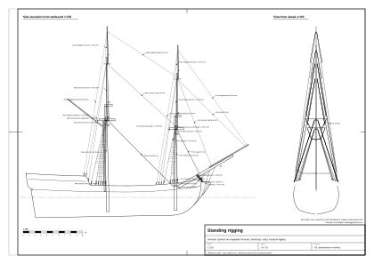
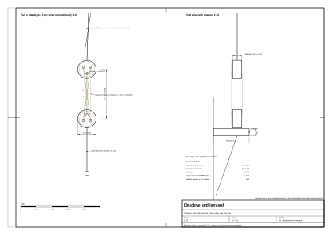

# 06. Olinowanie stałe

## Po co ten etap

Olinowanie stałe trzyma maszty. W zwykłej żegludze się nie porusza: napina się je raz i tylko
dociąga (talrepami), gdy konopie się wyciągną. Wanty trzymają maszt przed siłami z boku i od tyłu, sztagi od przodu,
a bukszpryt jest ściągany w dół przeciw sztagom foka. Z bliska to najbardziej charakterystyczna część statku:
wachlarze want, czarne szczeble wyblinek, jasne talrepy między parami jufersów, sztagi zbiegające się w osi statku.

Na końcu tego rozdziału będziesz mieć całe olinowanie stałe dwumasztowego snow albo brygu: wanty dolne, stengowe i bramstengowe z
jufersami, talrepami i wyblinkami; podwantki i ściągacze; paduny; wszystkie sztagi; wiązanie, watersztagi i wanty
bukszprytu; liny stałe na rejach (stropy, perty, strzemiona). Do tego tabela wszystkich lin z oboma końcami,
średnicą, liczbą i kolorem.

Przed startem potrzebny jest plan drzewc z [rozdziału 05](05-masts-and-spars.md) i kadłub z ławami wantowymi i
puttingami ([rozdział 04](04-decks-bulwarks-stern-head.md)). Oznaczenia pewności jak w [rozdziale 01](01-ship-type-and-era.md): (z epoki; główne źródła z epoki to Steel 1794 i Lever 1808), (wtórne), (nasz wniosek), (model wzorcowy). Grubości lin w źródłach z
epoki podano jako **obwód w calach**; przeliczamy wzorem **d [mm] = C [cal] × 25,4 / π ≈ 8,09 × C**.



*Rysunek 1. Olinowanie stałe modelu wzorcowego, widok z prawej burty w skali 1:150, każda lina podpisana liczbą
i średnicą (arkusz `plans/standing-rigging.svg`).*

## Pojęcia

| Pojęcie | Co to jest |
|---|---|
| Wanta | Lina z topu masztu w dół do burty, za masztem. Wanty robi się **parami**: jedna lina zgięta w pół na topie, oba końce schodzą na tę samą burtę. Nieparzysta ostatnia wanta to **swifter**. |
| Jufers | Okrągły drewniany blok z trzema otworami (kipami), bez krążka. Jeden jest wpleciony w dolny koniec wanty, drugi przymocowany do puttingu na ławie wantowej. |
| Talrep | Cienka lina przewleczona przez kipy pary jufersów; wybieranie jej napina wantę. |
| Ława wantowa | Deska wystająca z burty, która rozsuwa wanty (część kadłuba). |
| Putting | Żelazne ogniwo albo płaskownik od dolnego jufersa w dół po burcie. |
| Wyblinki | Cienkie poziome liny wiązane w poprzek want jako szczeble. |
| Podwantki | Krótkie liny od krawędzi marsa w dół do **drążka podwantek** przywiązanego w poprzek dolnych want; przenoszą siłę want stengowych. |
| Ściągacze want | Krótkie liny pod marsem ściągające ku sobie wanty obu burt. |
| Wanty stengowe i bramstengowe | To samo dla wyższych drzewc; wanty stengowe kończą się na jufersach na krawędzi marsa, bramstengowe na końcach salingu. |
| Padun | Lina z topu stengi albo bramstengi w dół do ławy wantowej za wantami. **Padun przesuwny** ustawia się po nawietrznej. |
| Sztag | Lina z topu w przód i w dół, w osi statku: grotsztag, foksztag, sztagi stengowe, bramstengowe, sztag kliwra. **Sztag zapasowy** to drugi, cieńszy sztag równoległy do pierwszego. |
| Mysz | Gruszkowate zgrubienie na sztagu pod topem; nie pozwala pętli sztagu zsunąć się w dół. |
| Obroża, serce | Pierścień z liny wokół masztu albo bukszprytu, do którego napina się sztag; serce to blok z jednym dużym otworem z rowkami, używany na sztagach zamiast jufersów. |
| Wiązanie bukszprytu | Owinięcie, które przyciąga bukszpryt w dół do dziobnicy. |
| Watersztag | Lina z bukszprytu w dół do dziobnicy pod galionem. |
| Wanty bukszprytu | Liny z bukszprytu do burt dziobu, po jednej albo dwie na burtę. |
| Perta, strzemię | Lina pod reją, na której stają ludzie, zawieszona na krótkich strzemionach (szelkach). |
| Stropy | Lina (w walce łańcuch) z topu, na której wisi dolna reja. |

## Reguły i proporcje

### Liczba lin

| Element | Wartość | Pewność |
|---|---|---|
| Wanty dolne | Slup Pegasus z 1776 r. (16 dział, zbliżony rozmiarem): grot **8 na burtę**, fok **7 na burtę** | [3] (wtórne) |
| Wanty dolne brygu | Steel: u brygów fok ma „cztery pary”, a przednia wanta i wisior są z jednego kawałka; nie wiadomo, czy na burtę. Przyjmujemy **5–7 na burtę** | [1] (wtórne) / (nasz wniosek) |
| Wanty stengowe | 3 na burtę | (nasz wniosek) |
| Wanty bramstengowe | 2 na burtę; w dwóch przednich parach kausze zamiast bloków | [1] (z epoki); liczba (nasz wniosek) |
| Podwantki | tyle co want stengowych, 3–4 na burtę | (nasz wniosek) |
| Ściągacze want | 4, najkrótszy z przodu (4 stopy = 1,22 m na małych okrętach), każdy kolejny o 1 cal dłuższy | [1] (z epoki) |
| Paduny stengowe | 1–2 na burtę; bramstengowe 1 na burtę | [1] (z epoki); liczba (nasz wniosek) |
| Watersztagi | 2 pary na okrętach królewskich, zwykle 1 na statkach handlowych | [1] (z epoki) |
| Wanty bukszprytu | 1–2 na burtę | [1] (z epoki); liczba (nasz wniosek) |
| Wiązanie bukszprytu | 9 albo 11 zwojów na przemian przez bukszpryt i przez otwór w kolanie dziobowym, w środku ściągnięte zwojami krzyżowymi | [1] (z epoki) |
| Perty | 1 na nok, wiszą ok. 3 stopy (0,9 m) pod dolnymi rejami; **4 strzemiona na burtę** na dolnych rejach | [1] (z epoki) |

### Grubości lin

Jak powstała tabela (nasz wniosek): (1) reguła Andersona przytoczona na forum, **średnica grotsztagu = 1/6 średnicy grotmasztu**,
co przy maszcie 20 cali daje sztag o obwodzie ok. 10,5 cala [5] (wtórne); (2) Pegasus 1776: grotsztag 10 cali, wanty
grota 7 cali [3] (wtórne); (3) kit brygu Syren (1803, 94 stopy, prawie nasz rozmiar): wanty dolne ok. 4,2 cala, sztagi
ok. 5,6 cala, przeliczone z nici 1:64 [4] (wtórne); (4) reguły z forum: wanty = 1/2 sztagu, talrepy = 1/2 wanty,
topenanty = 3/8 wanty, wisiory brasów = 1/2 wanty [5] (wtórne). Kity zwykle zaniżają grubości, a Pegasus jest
większy, więc bierzemy środek. Wszystkie wartości domyślne poniżej to zatem **(nasz wniosek)** zbudowane na źródłach (wtórne).

| Lina | Obwód [cal] (zakres) | Średnica domyślna [mm] | Kolor | Liczba |
|---|---|---|---|---|
| Grotsztag | 10 (8–10,5) | **80** | smołowany | 1 (+1 cieńszy zapasowy, opcja) |
| Foksztag | 9 (7–9,5) | **73** | smołowany | 1 |
| Wanty dolne grota | 6 (4,5–7) | **49** | smołowane | 5–7 na burtę |
| Wanty dolne foka | 5,5 (4,5–7) | **45** | smołowane | 5–6 na burtę |
| Talrepy want dolnych | 3 | **24** | **jasne** | 1 na wantę |
| Wyblinki | 1–1,5 | **10** | smołowane | co 0,33–0,40 m |
| Podwantki | 3,5 | **28** | smołowane | 3–4 na burtę |
| Wanty stengowe | 3,5 (2,5–4) | **28** | smołowane | 3 na burtę |
| Talrepy want stengowych | 1,75 | **14** | jasne | |
| Paduny stengowe | 4,5 | **36** | smołowane | 1–2 na burtę |
| Sztagi stengowe | 5 (4–5,5) | **40** | smołowane | 1 na maszt |
| Wanty bramstengowe | 2 | **16** | smołowane | 2 na burtę |
| Paduny bramstengowe | 2,5 | **20** | smołowane | 1 na burtę |
| Sztagi bramstengowe | 2,5 | **20** | smołowane | 1 na maszt |
| Watersztag | 7 | **57** | smołowany | 1 (statek handlowy) – 2 |
| Wanty bukszprytu | 5 | **40** | smołowane | 1–2 na burtę |
| Wiązanie bukszprytu | 4 | **32** | smołowane | 9–11 zwojów |
| Sztag kliwra | 4 | **32** | smołowany | 1 |
| Perty dolnych rej | 3 | **24** | smołowane | 1 na nok |
| Strzemiona | 2,5 | **20** | smołowane | 4 na burtę dolnej rei, 2–3 na marsrei |

### Jufersy, talrepy, wyblinki, sztagi

| Element | Wartość | Pewność |
|---|---|---|
| Średnica jufersa | 1,5 × obwód wanty (wanta 6 cali → jufers 9 cali ≈ 0,23 m); grubość ok. 1/2 średnicy; 3 kipy | [6], [10] (wtórne) |
| Odstęp jufersów (górny–dolny) | ok. 2,5–3 średnice jufersa (0,6–0,7 m dla want grota) | [7] (wtórne) |
| Talrep | przez 3 kipy każdego jufersa (6 odcinków widocznych między jufersami); węzeł (walnut, Matthew Walker) na końcu w górnej tylnej kipie; smarowany łojem; **niesmołowany, jasny**; grubość ok. 1/2 wanty | [1], [2] (z epoki); [3] (wtórne) |
| Pętle na topie | kolejne pary obwiązane opaską pod podkładką, każda następna opaska o jedną szerokość niżej; 7 zwojów pod spodem, 6 na wierzchu i podwójny zwój krzyżowy | [1] (z epoki) |
| Obszycie | pętla na topie obszyta (worming, parcelling, serving) na 1/4 długości; przednia noga przedniej wanty na całej długości (ociera się o reję) | [1] (z epoki); [3] (wtórne) |
| Odstęp wyblinek | pierwsza 13 cali (0,33 m) pod drążkiem podwantek, potem **co 13 cali** | [1] (z epoki). Inne źródła i repliki: 15–16 cali (0,38–0,41 m) (nasz wniosek) |
| Węzeł wyblinki | wyblinka (clove hitch) na wantach wewnętrznych, pętla z opaską na skrajnych; najniższe 6 wyblinek nie obejmują skrajnych want | [1] (z epoki); [9] (wtórne) |
| Zwis wyblinek | wyraźny, ok. 1–2% rozpiętości | (nasz wniosek) |
| Drążek podwantek | przywiązany w poprzek dolnych want ok. 1,5–2 m pod marsem | [1], [8] (z epoki) |
| Podwantki | przed połową XIX w. kończyły się na dolnych wantach, a ściągacze równoważyły ich ciągnięcie | [8] (wtórne) |
| Wanty stengowe | z topu stengi do jufersów na krawędzi marsa; na przedniej blok siostrzany dla topenanty marsrei | [1] (z epoki) |
| Mysz | ok. 1/3 długości sztagu od topu; Steel: podstawa myszy 1/3 obwodu sztagu; praktyka modelarzy: ok. 3 średnice sztagu | [1] (z epoki); [3] (wtórne) |
| Obszycie sztagów | sztag obszyty (worming) na 1/3 długości, obroża na całej długości | [1] (z epoki) |

### Którędy biegną sztagi brygu i snow

| Sztag | Przebieg | Pewność |
|---|---|---|
| Grotsztag | z topu grota (pętla nad wantami) w przód i w dół do pokładu u stopy fokmasztu albo przez serce na obroży wokół fokmasztu | [1] (wtórne); przebieg u brygu (nasz wniosek) |
| Foksztag | z topu foka do obroży na bukszprycie, napinany sercem na obroży i talrepem przez dwa serca | [1] (z epoki) |
| Grotsztag stengowy | z topu stengi grota przez blok, napinany talią przy foku | [1] (z epoki) |
| Foksztag stengowy | z topu stengi foka przez nakładki (bees) na bukszprycie, napinany talią na pokładzie | [1] (z epoki) |
| Sztagi bramstengowe | grota do salingu foka, foka do bomstengi | (nasz wniosek) |
| Sztag kliwra | wzdłuż bomstengi; kliwer chodzi po nim na raksach albo na pierścieniu | (nasz wniosek) |
| Sztagi zapasowe | drugi, cieńszy sztag równoległy do grot- i foksztagu | [3] (wtórne) |

### Bukszpryt

- **Wiązanie bukszprytu**: 9 albo 11 zwojów, każdy napięty, w środku ściągnięte zwojami krzyżowymi [1] (z epoki).
- **Watersztagi**: 2 pary na okrętach królewskich, 1 na statkach handlowych; dolny koniec przez kolano dziobowe,
  górny napinany sercem albo jufersem i talrepem [1] (z epoki).
- **Wanty bukszprytu**: na hakach do ucha na każdej burcie dziobu, ściągane sercem albo jufersem [1] (z epoki).
- **Perty bukszprytu** (horses): od ezelhoftu bukszprytu do głowic przy dziobie, równolegle do bukszprytu [1] (z epoki).

### Co jest smołowane

- **Ciemne (smoła sztokholmska, brąz prawie czarny):** całe olinowanie stałe, wyblinki, perty, obszycia i opaski
  [1] (z epoki); [4] (wtórne: olinowanie stałe czarne).
- **Jasne (lina niesmołowana, „biała”, płowa konopna):** talrepy want [3] (wtórne), liny talii (Steel wymienia linę talii
  z „5-calowej białej liny”) [1] (z epoki), większość olinowania ruchomego [4] (wtórne). W niektórych flotach olinowanie
  ruchome też lekko smołowano, więc zakres sięga od płowego do średniego brązu (nasz wniosek).

## Kolejność zakładania w epoce

„Progressive method of rigging” Steela [1] (z epoki):

1. **Bukszpryt:** wiązanie, watersztagi, wanty bukszprytu, obroże sztagów.
2. **Każdy top kolumny:** bloki pomocnicze (girtline), podkładki (bolsters) ze smołowanego płótna na belkach marsa,
   potem **wanty parami, na przemian: pierwsza para prawa burta, pierwsza para lewa burta, druga prawa i tak dalej**;
   dzięki takiemu ułożeniu pętli reje dają się mocniej zbrasować. Na koniec swifter, sztag i sztag zapasowy.
3. **Mars** wciągnięty i nałożony na top, potem ezelhoft.
4. **Jufersy** wplecione w dolne końce want (przy linie kablowej lewoskrętnie, pod prąd skrętu), talrepy przewleczone,
   wanty napięte, potem wyblinki.
5. **Stengi:** lina do wciągania stengi, wanty stengowe, podwantki, paduny, sztagi stengowe, ezelhoft stengi.
6. **Dolne reje, marsreje, bramstengi** i ich olinowanie.

Ta kolejność wyznacza też **stos pętli na topie**, od dołu: wanty → swifter → sztag → sztag zapasowy. Z bliska ten stos
widać, więc model musi go zachować [1] (z epoki).

Nowe konopie się wyciągają: Steel rozciąga wanty talią na kabestanie, do 1,5 długości pętli, i zostawia je na 24
godziny; sztagi wyciąga, aż popękają przędze rdzenia [1] (z epoki). Po sztormie talrepy trzeba dociągnąć (zob.
[dodatek](appendix-sail-handling.md)).

## Instrukcja budowy krok po kroku

Współrzędne jak w modelu wzorcowym: s wzdłuż statku (+ ku dziobowi), x w poprzek (+ lewa burta), z w górę od wodnicy.

### A. Ławy wantowe i dolne jufersy

1. Dla każdego masztu znajdź ławę wantową ([rozdział 04](04-decks-bulwarks-stern-head.md)). W modelu wzorcowym leży tuż pod zewnętrzną krawędzią
   pokrywy relingu, ma 0,45 m szerokości i 0,09 m grubości (model wzorcowy).
2. Rozmieść dolne jufersy wzdłuż ławy: pierwszy ok. 0,30 m za masztem, kolejne co 0,40 m ku rufie (model wzorcowy). Omijaj furty:
   każdy jufers co najmniej pół szerokości furty + 0,11 m od jej środka (model wzorcowy). Potrzebne jest jedno miejsce na każdą
   wantę dolną i jedno na każdy padun.
3. Rozmiar jufersa: `D = 1,5 × π × d_wanty` (czyli 1,5 × obwód). Grot: 1,5 × π × 0,049 = **0,231 m**; fok: **0,212 m**;
   jufersy padunów 0,85 × D (model wzorcowy). Grubość D/2, trzy kipy; sam jufers opisuje [rozdział 08](08-ropes-blocks-and-sails.md).
4. Dolny jufers ustaw na zewnętrznej krawędzi ławy, licem na zewnątrz, a od niego putting w dół po burcie do
   berghołtu.

### B. Wanty dolne

5. **Punkty na topie.** Każda wanta zaczyna się tuż nad belkami marsa, przy boku kwadratowego topu (model wzorcowy:
   x = ±(połowa topu + 0,13 m); każda następna para 0,03 m wyżej i 0,05 m dalej ku rufie) (model wzorcowy).
6. **Górny jufers.** Na prostej od dolnego jufersa do punktu na topie, w odległości 2,5–3 D (model wzorcowy 2,7 D =
   0,62 m dla want grota) (model wzorcowy). Wanta biegnie od górnej krawędzi górnego jufersa do punktu na topie.
7. **Talrep.** Przewlecz go jak na rysunku 2: węzeł za górną tylną kipą, potem w dół i w górę przez trzy kipy każdego
   jufersa, sześć widocznych odcinków; koniec obłożony wokół wanty nad górnym jufersem.

```
   górny jufers       o  o  o        (kipy widziane z zewnątrz)
                      |\ |\ |
                      | \| \|        6 odcinków talrepu między jufersami
                      |  \  \
   dolny jufers       o  o  o
                         ||
                       putting
```



*Rysunek 2. Para jufersów wanty grota z przewleczonym talrepem, w skali 1:10 (arkusz
`plans/deadeye-and-lanyard.svg`).*

8. **Pętle na topie.** Zamodeluj pętle jako pierścienie wokół topu tuż nad belkami marsa, w kolejności z części „Kolejność zakładania w epoce” (wanty,
   swifter, sztag, sztag zapasowy). Model wzorcowy ma 4 pierścienie na maszt o grubości wanty (model wzorcowy).
9. **Kolejność want.** Pary na przemian prawa–lewa burta; przy nieparzystej liczbie na burtę ostatnia z tyłu to
   swifter.

### C. Drążek podwantek, podwantki, ściągacze, wyblinki

10. **Drążek podwantek:** drewniany drążek przywiązany w poprzek want każdej burty, 1,6 m pod marsem (model wzorcowy; w epoce
    1,5–2 m).
11. **Podwantki:** od żelaznych płytek przechodzących przez krawędź marsa w dół do drążka, po jednej na wantę stengową
    (w modelu wzorcowym 3 na burtę, 28 mm, ok. 2,0–2,2 m długości) (model wzorcowy).
12. **Ściągacze want:** 4 krótkie liny pod marsem łączące drążki obu burt za masztem (24 mm, 1,7–1,8 m w modelu
    wzorcowym) (model wzorcowy).
13. **Wyblinki:** zacznij ok. 0,55–0,8 m nad górnymi jufersami i skończ tuż pod drążkiem. Odstęp 0,33–0,40 m (model
    wzorcowy 0,36 m). Każda wyblinka to osobny krótki odcinek między dwiema sąsiednimi wantami ze zwisem 1–2% (model
    wzorcowy 1,5%). W najniższych 6 rzędach pomiń skrajne wanty (model wzorcowy).

### D. Wanty stengowe i bramstengowe, paduny

14. **Wanty stengowe:** od topu stengi (tuż pod salingiem) do małych jufersów na krawędzi marsa (D = 0,13 m, odstęp
    2,7 D, talrep 14 mm) (model wzorcowy). Wyblinki tak samo, do ok. 0,9 m pod topem stengi (model wzorcowy).
15. **Wanty bramstengowe:** od ok. 1 m pod gałką bramstengi w dół do końców salingu, bez jufersów i bez wyblinek (model wzorcowy).
16. **Paduny:** od topu stengi (i bramstengi) do jufersów na ławie za wantami, z talrepami (model wzorcowy).

### E. Sztagi

17. **Grotsztag:** z topu grota (pętla nad wantami) do serca na obroży wokół stopy fokmasztu, 0,55 m nad pokładem,
    napięty krótkim jasnym talrepem (model wzorcowy). Mysz w 1/3 długości od topu.
18. **Foksztag:** z topu foka do obroży na bukszprycie (w modelu wzorcowym w 0,40 długości bukszprytu) (model wzorcowy), z myszą.
19. **Sztagi stengowe:** z topu stengi grota do topu kolumny foka (tuż nad fokmarsem); z topu stengi foka do
    bukszprytu (w modelu wzorcowym 0,62 jego długości; w epoce przez nakładki i w dół do talii na pokładzie)
    (model wzorcowy; [1]).
20. **Sztagi bramstengowe i sztag kliwra:** z topu bramstengi grota do topu stengi foka; z topu bramstengi foka do
    końca bomstengi; sztag kliwra z topu stengi foka do miejsca blisko końca bomstengi (model wzorcowy).
21. Wszystkie sztagi leżą w osi statku; sztag mijający reję musi przejść **przed** nią (zwinięty żagiel na rei ustępuje
    sztagowi) (model wzorcowy).

### F. Bukszpryt

22. **Wiązanie:** 9 zwojów liny 32 mm, ciasno obok siebie, przez bukszpryt tuż nad głowicą dziobnicy i przez otwór w
    kolanie dziobowym (model wzorcowy).
23. **Watersztagi:** od spodu bukszprytu (0,56 i 0,66 jego długości) w dół do kolana dziobowego tuż nad wodą, z sercami
    (model wzorcowy).
24. **Wanty bukszprytu:** od bukszprytu (0,48 i 0,58 jego długości) do uch na obu burtach dziobu (model wzorcowy).

### G. Liny stałe na rejach

25. **Stropy:** z topu kolumny do środka każdej dolnej rei (32 mm, smołowane) (model wzorcowy).
26. **Perty:** od noku do punktu 0,45 m za środkiem rei, wiszące z tyłu rei. W epoce perta wisiała ok. 0,9 m pod dolną
    reją [1]. Model wzorcowy ma parametr zwisu 0,9 m (dolne reje) i 0,6 m (marsreje, blindareja), ale rysuje krzywą z
    0,55 tej wartości, więc perty dolnych rej wiszą tylko ok. 0,5 m pod reją (model wzorcowy).
27. **Strzemiona:** 4 na burtę na dolnych rejach, 3 na burtę na marsrejach i blindarei, od rei w dół do perty (model wzorcowy).
28. Perty i strzemiona zrób **dziećmi swojej rei**, żeby obracały się razem z nią (model wzorcowy).

### H. Materiały

29. Każda lina dostaje jeden z dwóch materiałów: **smołowana** (wszystko powyżej) albo **jasna** (talrepy, talrep serca
    grotsztagu). Kolory i tekstury opisuje rozdział 08.

## Przykład policzony: olinowanie stałe modelu wzorcowego

Wszystkie wartości (model wzorcowy), z `data/parameters.json` (liczby, średnice) i `data/rigging-lines.json` (geometria,
długości). „Długość” to długość jednej liny w modelu, bez pętli i splotów.

| Lina | Liczba | d [mm] | Od | Do | Długość jednej [m] | Kolor |
|---|---|---|---|---|---|---|
| Wanty dolne grota | 6 na burtę | 49 | top grota, nad belkami marsa | górne jufersy na ławie grota | 10,1–10,9 | smołowane |
| Wanty dolne foka | 5 na burtę | 45 | top foka | górne jufersy na ławie foka | 8,3–9,2 | smołowane |
| Opaski górnych jufersów | 1 na jufers | 39 / 36 | wokół górnego jufersa | | 0,78 / 0,72 | smołowane |
| Dolne jufersy | na wantę | D 231 / 212 | ława | | | drewno |
| Talrepy want dolnych | 5 odcinków na parę | 24 | górny jufers | dolny jufers | 0,48–0,62 na odcinek | jasne |
| Wyblinki | 464 odcinki | 10 | wanta k | wanta k+1 | | smołowane |
| Podwantki | 3 na burtę na maszt | 28 | krawędź marsa | drążek 1,6 m pod marsem | 2,0–2,2 | smołowane |
| Ściągacze want | 4 (tylko fok) | 24 | drążek, lewa burta | drążek, prawa burta (za masztem) | 1,7–1,8 | smołowane |
| Wanty stengowe | 3 na burtę | 28 | top stengi | jufersy (D 130) na krawędzi marsa | 7,8–8,9 | smołowane |
| Talrepy want stengowych | 5 odcinków na parę | 14 | | | | jasne |
| Wanty bramstengowe | 2 na burtę | 16 | 0,95 m pod gałką | końce salingu | 4,7–5,3 | smołowane |
| Paduny stengowe | 2 na burtę na maszt | 36 | top stengi | jufersy na ławie za wantami | 17,7–19,7 | smołowane |
| Paduny bramstengowe | 1 na burtę na maszt | 20 | top bramstengi | ostatni jufers ławy | 22,6 (fok), 24,2 (grot) | smołowane |
| Talrepy padunów | 5 odcinków na parę | 19 | | | | jasne |
| Grotsztag | 1 | 80 | top grota | serce na obroży u stopy foka, 0,55 m nad pokładem | 15,8 | smołowany |
| Obroża grotsztagu | 1 | 50 | wokół fokmasztu | | 1,6 | smołowana |
| Talrep serca grotsztagu | 1 | 30 | serce | obroża | 0,14 | jasny |
| Foksztag | 1 | 73 | top foka | bukszpryt, 0,40 jego długości | 8,5 | smołowany |
| Grotsztag stengowy | 1 | 40 | top stengi grota | top kolumny foka | 15,8 | smołowany |
| Foksztag stengowy | 1 | 40 | top stengi foka | bukszpryt, 0,62 jego długości | 15,8 | smołowany |
| Grotsztag bramstengowy | 1 | 20 | top bramstengi grota | top stengi foka | 14,3 | smołowany |
| Foksztag bramstengowy | 1 | 20 | top bramstengi foka | koniec bomstengi | 19,8 | smołowany |
| Sztag kliwra | 1 | 32 | top stengi foka | 0,6 m od końca bomstengi | 16,1 | smołowany |
| Watersztagi | 2 | 57 | bukszpryt w 0,56 i 0,66 | kolano dziobowe, 0,25 i 0,50 m nad wodą | 4,4; 5,0 | smołowane |
| Wanty bukszprytu | 2 na burtę | 40 | bukszpryt w 0,48 i 0,58 | burty dziobu | 3,6; 4,9 | smołowane |
| Wiązanie bukszprytu | 9 zwojów | 32 | przez bukszpryt | przez kolano dziobowe | 3,7 na zwój | smołowane |
| Stropy | 1 na dolną reję | 32 | top kolumny | środek rei | 0,7 | smołowane |
| Perty | 1 na nok dolnych rej, marsrei i blindarei | 24 | nok | 0,45 m za środkiem rei | 5,2–8,0 | smołowane |
| Strzemiona | 4 na burtę (dolne), 3 (marsreje, blindareja) | 20 | reja | perta | 0,4–0,7 | smołowane |

Sumy w modelu (model wzorcowy): wyblinki 96 m, talrepy 116 m, wanty dolne z opaskami i pierścieniami na topie 247 m, wanty
stengowe 100 m, wanty bramstengowe 40 m, paduny 242 m, sztagi z watersztagami i wantami bukszprytu 134 m, wiązanie
33 m. Wyblinki sięgają od 3,35 m do 21,37 m nad wodnicą.

### Gdzie model wzorcowy odbiega od reguł

| Element | Reguła / badania | Model wzorcowy | Uwagi |
|---|---|---|---|
| Odcinki talrepu | 6 odcinków między jufersami | 5 odcinków | o jeden mniej (model wzorcowy) |
| Początek wyblinek | ok. 0,8 m nad jufersem (tabela w dokumencie badawczym) | 0,55 m nad górną krawędzią górnego jufersa | ok. 0,1–0,2 m niżej (model wzorcowy) |
| Obroża foksztagu | ok. 1/4 długości bukszprytu od pięty | 0,40 długości | sztag przed reją foka (model wzorcowy) |
| Grotsztag stengowy | przez blok, napinany talią przy foku | kończy się na topie kolumny foka | bez bloku i talii (model wzorcowy) |
| Foksztag stengowy | przez nakładki, w dół do talii na pokładzie | kończy się na bukszprycie | bez prowadzenia na pokład (model wzorcowy) |
| Ściągacze na grocie | 4 | brak | tam stoi maszt snow (model wzorcowy) |
| Pętle na topie | pary, każda opaska o szerokość niżej, sztag nad nimi | 4 jednakowe pierścienie | stos uproszczony (model wzorcowy) |
| Zwis pert pod dolnymi rejami | ok. 0,9 m (3 stopy) | ok. 0,5 m (0,55 × parametr 0,9 m) | ok. 0,4 m za wysoko (model wzorcowy) |
| Perty bukszprytu | są | nie zamodelowane | (model wzorcowy) |
| Sztagi zapasowe | opcja | brak | (model wzorcowy) |
| Blok siostrzany na przedniej wancie stengowej | dla topenanty marsrei | nie zamodelowany | zob. rozdział 07 (model wzorcowy) |

## Sprawdź się

- [ ] Wanty grota 5–7 na burtę (49 mm), foka 5–6 (45 mm); grotsztag ok. 1/6 średnicy grotmasztu (80 mm).
- [ ] Dolne jufersy mają ok. 0,23 m średnicy (1,5 × obwód wanty), para 0,6–0,7 m od siebie.
- [ ] Talrepy są **jasne**, cała reszta olinowania stałego **ciemna**.
- [ ] Wyblinki 10 mm, co 0,33–0,40 m, z lekkim zwisem; najniższe 6 pomija skrajne wanty.
- [ ] Podwantki biegną od krawędzi marsa do drążka 1,5–2 m niżej, nie do pokładu.
- [ ] Wanty stengowe kończą się na jufersach na krawędzi marsa, bramstengowe na salingu.
- [ ] Paduny schodzą **za** wantami na tę samą ławę.
- [ ] Każdy sztag leży w osi statku i biegnie w przód i w dół; grotsztag do stopy foka, foksztag do bukszprytu.
- [ ] Sztagi mają mysz pod topem (co najmniej grot- i foksztag).
- [ ] Bukszpryt ma wiązanie (9–11 zwojów), watersztagi i wanty bukszprytu.
- [ ] Perty wiszą 0,9 m pod dolnymi rejami na 4 strzemionach na burtę.
- [ ] Pętle na topie leżą warstwami: wanty, swifter, sztag, sztag zapasowy.

## Typowe błędy

- **Wanty schodzące wprost do kadłuba** bez jufersów i talrepów (nasz wniosek).
- **Wszystkie liny w jednym kolorze.** Jasne talrepy między ciemnymi wantami to znak rozpoznawczy epoki (nasz wniosek).
- **Wyblinki jak sztywne pręty** bez zwisu albo zbyt rzadko (nasz wniosek).
- **Brak podwantek**, przez co wanty stengowe wyglądają, jakby wisiały w powietrzu (nasz wniosek).
- **Sztagi kończące się w powietrzu** albo na złym maszcie; grotsztag idzie do stopy foka, nie na dziób (nasz wniosek).
- **Paduny przed wantami** (nasz wniosek).
- **Za małe marsy**, które nie rozpierają want stengowych (rozdział 05).
- **Brak wiązania bukszprytu**, przez co bukszpryt wygląda na niepodparty (nasz wniosek).
- **Delfiniak pod bukszprytem**: anachronizm dla 1710 r. (nasz wniosek).

## Źródła

1. D. Steel, *The Elements and Practice of Rigging and Seamanship*, 1794:
   https://whalesite.org/anthology/1794_Steel_Elements_and_Practice.htm
2. D. Lever, *The Young Sea Officer's Sheet Anchor* (1808; kopia online wydania nowojorskiego):
   https://archive.org/details/youngseaofficers00leve
3. Lehman Shipyard, HMS Pegasus (1776): Standing Rigging: https://lehmanshipyard.com/2024/04/06/standing-rigging-shrouds-stays/
4. Model Shipways, kit 2003, instrukcja (s. 12, 18): https://www.manualsdir.com/manuals/123057/model-shipways-2003.html?page=12
5. Model Ship World, wątki o grubościach lin:
   https://modelshipworld.com/topic/28520-what-are-the-rules-for-determining-the-thicknesses-of-rope-for-standing-and-running-rigging/ ;
   https://modelshipworld.com/topic/27881-formula-for-the-thickness-of-rope-on-any-scale-ship/
6. VAKA, „Making Deadeyes and Wooden Blocks”: https://www.vaka.earth/2026/04/making-deadeyes-and-wooden-blocks.html
7. Finescale Modeler Forum, „shrouds and lanyards”: https://forum.finescale.com/t/shrouds-and-lanyards/143536
8. Wikipedia, „Futtock shrouds”: https://en.wikipedia.org/wiki/Futtock_shrouds
9. Wikipedia, „Ratlines”: https://en.wikipedia.org/wiki/Ratlines
10. Wikipedia (pl), „Jufers”: https://pl.wikipedia.org/wiki/Jufers
11. Wikipedia (pl), „Talrep”: https://pl.wikipedia.org/wiki/Talrep
12. Wikipedia (pl), „Olinowanie stałe”: https://pl.wikipedia.org/wiki/Olinowanie_stałe
13. potempski.com, nazwy ożaglowania i olinowania: https://potempski.com/rejowe/inne/zagle.htm
14. Diki, „futtock shrouds”: https://www.diki.pl/slownik-angielskiego?q=futtock+shrouds
15. Wikipedia (pl), „Reja”: https://pl.wikipedia.org/wiki/Reja

## Terminy użyte w rozdziale

| Angielski | Polski | Znaczenie |
|---|---|---|
| standing rigging | olinowanie stałe | Liny, które trzymają maszty i nie poruszają się w żegludze [12]. |
| shroud | wanta | Lina z topu do burty, za masztem [13]. |
| swifter | swifter (polskiego terminu nie znaleźliśmy) | Pojedyncza nieparzysta wanta na końcu zestawu. |
| topmast / topgallant shrouds | stenwanty / bramstenwanty (wanty stengowe / bramstengowe) | Wanty wyższych drzewc [13]. |
| deadeye | jufers | Blok z trzema kipami do napinania wanty [10]. |
| lanyard | talrep | Lina przewleczona przez parę jufersów [11]. |
| channel | ława wantowa (niepewne) | Deska na burcie rozsuwająca wanty. |
| chainplate | putting (niepewne) | Żelazo od dolnego jufersa do kadłuba. |
| ratlines | wyblinki | Szczeble z liny w poprzek want (nazwa niepotwierdzona w słowniku; węzeł to wyblinka). |
| futtock shrouds, futtock stave | podwantki (petingi), drążek podwantek | Liny od marsa do drążka w poprzek want dolnych [13], [14]. |
| catharpins | ściągacze want (niepewne) | Liny ściągające wanty obu burt pod marsem. |
| backstay | padun | Lina z topu stengi do ławy za wantami [13]. |
| stay, preventer stay | sztag, sztag zapasowy | Lina z topu w przód; druga, równoległa. |
| main stay, fore stay | grotsztag, foksztag | Sztagi kolumn [13]. |
| topmast stay, topgallant stay | sztag stengowy, sztag bramstengowy | Sztagi wyższych drzewc. |
| jib stay | sztag kliwra | Sztag, na którym stawia się kliwer. |
| mouse | mysz | Zgrubienie na sztagu zatrzymujące jego pętlę. |
| collar, heart | obroża, serce (niepewne) | Pierścień na drzewcu dla sztagu; blok z jednym otworem do napinania. |
| gammoning | wiązanie bukszprytu (niepewne) | Owinięcie przyciągające bukszpryt do dziobnicy. |
| bobstay | watersztag | Lina z bukszprytu w dół do dziobnicy [13]. |
| bowsprit shrouds | wanty bukszprytu | Liny z bukszprytu do burt dziobu [13]. |
| footrope, stirrup | perta, strzemię (szelka) | Lina do stania pod reją; jej wieszak [13], [15]. |
| slings | stropy | Lina, na której dolna reja wisi na topie. |
| service, worming, parcelling | obszywanie (brak potwierdzonych osobnych polskich nazw) | Warstwy ochronne na linie (rozdział 08). |
