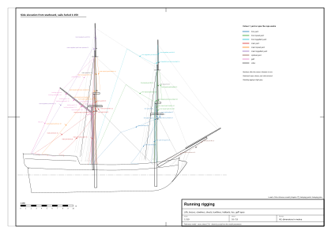
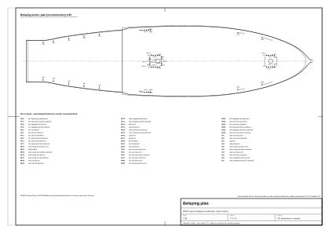

# 07. Olinowanie ruchome i belegowanie

## Po co ten etap

Olinowanie ruchome to wszystko, za co ciągnie załoga: liny, które podnoszą reje i żagle,
obracają reje do wiatru, rozpinają żagle i je zbierają. Każda lina zaczyna się na drzewcu albo żaglu, przechodzi przez
jeden lub kilka bloków i kończy się na pokładzie, gdzie się ją **beleguje** (obkłada) na kołku, knadze albo bicie. Żeby
ją narysować, trzeba znać dla każdej liny trzy rzeczy: gdzie się zaczyna, którędy biegnie i gdzie jest zabelegowana. Do
gry potrzebna jest czwarta: który koniec się porusza, gdy reja jest brasowana.

Na końcu tego rozdziału będziesz mieć:

- przebieg każdej liny żagli rejowych, żagla gaflowego, sztaksli i kliwra;
- plan belegowania (z wyraźnym zastrzeżeniem: dla brygu albo snow z ok. 1710 r. to rekonstrukcja);
- listę lin dynamicznych w modelu wzorcowym (koniec na ruchomym drzewcu) i opis, jak zapisano je w danych;
- ograniczenia brasowania rej.

Przed startem potrzebujesz: drzewca z [rozdziału 05](05-masts-and-spars.md), olinowanie stałe z
[rozdziału 06](06-standing-rigging.md) (wiele lin ruchomych biegnie przez bloki na sztagach i wantach). Oznaczenia pewności jak w [rozdziale 01](01-ship-type-and-era.md): (z epoki; główne źródła z epoki to Steel 1794 i Lever 1808), (wtórne), (nasz wniosek), (model wzorcowy). Średnice lin poniżej to nasze szacunki **(nasz wniosek)**, o ile nie zaznaczono inaczej; jak powstały, opisuje
rozdział 06.



*Rysunek 1. Olinowanie ruchome modelu wzorcowego przy zwiniętych żaglach, widok z prawej burty w skali 1:150, każda
lina podpisana średnicą (arkusz `plans/running-rigging.svg`).*

## Pojęcia

| Pojęcie | Do czego służy |
|---|---|
| Fał, tie | Podnosi reję, gafel albo żagiel. **Tie** to pojedyncza lina z rei przez krążek w maszcie; **fał** to talia na jej dolnym końcu. |
| Stropy, fał dolnej rei (jeers, slings) | Lina i talia, na których wisi dolna reja. |
| Topenanta | Podtrzymuje nok rei i ustawia reję w pionie. |
| Bras | Obraca reję w poziomie wokół masztu. Zwykle **wisior** (krótka lina z blokiem) na noku i bras przewleczony przez jego blok. |
| Szot | Ciągnie dolny róg żagla (róg szotowy) w dół i w tył. |
| Hals | Trzyma nawietrzny róg dolnego żagla z przodu. |
| Gejtawa | Podciąga róg szotowy do rei. |
| Gording | Podciąga lik dolny żagla rejowego do rei, przed żaglem. |
| Nokgording | Podciąga lik boczny dolnego żagla w górę i do środka. |
| Bulina | Ciągnie nawietrzny lik do przodu przy żegludze na ostro; mocowana do liku przez **wąsy**. |
| Talia refowa | Podciąga ucho refowe do noku przed refowaniem. |
| Gardafał, pikfał | Podnoszą wewnętrzny i zewnętrzny koniec gafla. |
| Gaja | Trzyma nok gafla na boki. |
| Dirka | Podtrzymuje koniec bomu. |
| Gejtawa żagla gaflowego (brail) | Ściąga żagiel gaflowy bez bomu do masztu i gafla jak kurtynę. |
| Kontrafał (niderhol) | Ściąga sztaksel albo kliwer w dół po sztagu. |
| Belegować; nagiel (kołek), knaga, knaga relingowa, bity | Obłożyć linę; drewniany kołek w listwie, rogate okucie, duża knaga na nadburciu, mocne słupy. |
| Kołkownica, nagielbank | Listwa z otworami na kołki wzdłuż nadburcia; rama z listew wokół stopy masztu. |

## Reguły: którędy biegnie każda lina

### Dolne reje i dolne żagle

| Lina | Od → przez → do | d [mm] (nasz wniosek) | Przebieg (pewność) |
|---|---|---|---|
| Stropy, fał dolnej rei | top → środek rei; talia z topu do pokładu przy maszcie | 32 | [1] (z epoki) |
| Topenanta | nok → blok pod ezelhoftem (na stropie wokół topu) → w dół przy maszcie → knaga albo bit przy maszcie | 20 | [1] (z epoki) |
| Bras (+ wisior) | nok (wisior z blokiem) → **foka: do obroży grotsztagu i dalej na pokład przy grocie; grota: na rufę, do krążka w nadburciu rufy** („brygi prowadzą tak samo”, Steel) | wisior 24, bras 18 | [1] (z epoki) |
| Hals | róg halsowy → dziób (fok) albo burta przed grotmasztem przez chesstree (grot) | 32 (zwężany) | [2] (z epoki) |
| Szot | róg szotowy → blok → krążek w burcie → knaga albo bit na burcie, z tyłu | 28 | [2] (z epoki) |
| Gejtawa dolnego żagla | blok na rei 4 stopy (1,22 m) od środka → róg szotowy → pokład | 16 | [1], [2] (z epoki) |
| Gordingi | bloki pod marsem → w dół **przed** żaglem → do likliny dolnej (2–4 na żagiel) → pokład | 12 | [2] (z epoki) |
| Nokgordingi | blok pod marsem → blok na rei 10 stóp (3,05 m) od noku → lik boczny (ucha bulinowe) | 10 | [1], [2] (z epoki) |
| Bulina (+ wąsy) | ucha na liku nawietrznym → fok: na bak; grot: przez blok na foku na drugą burtę | 16 | [2] (z epoki) |

### Marsle i bramsle

| Lina | Przebieg | d [mm] (nasz wniosek) | Pewność |
|---|---|---|---|
| Tie i fał marsrei | z rei przez krążek w stendze, w dół na tie; talia do ucha w ławie wantowej; fały foka i grota po **przeciwnych burtach** | 32 / 20 | [1], [3] (z epoki) |
| Topenanty marsrei | nok → blok siostrzany w wancie stengowej → na pokład, zabelegowane przy dolnych jufersach | 16 | [1] (z epoki) |
| Brasy fokmarsrei | wisior na noku → blok na obroży grotsztagu → przy luku → zabelegowane na kołku | 16 | [1] (z epoki) |
| Brasy grotmarsrei (bryg) | na okręcie stały koniec przy bezanie; **bryg bezana nie ma**, więc do relingu rufy albo do padunów | 16 | (wtórne)/(nasz wniosek) |
| Szoty marsla | róg szotowy → krążek w noku dolnej rei → blok ćwiartkowy w środku dolnej rei → pokład przy maszcie (bity) | 28 | [1], [3] (z epoki) |
| Gejtawy marsla | blok 3 stopy (0,91 m) od środka rei → róg → w dół przez otwór w marsie | 14 | [1], [2] (z epoki) |
| Talie refowe | przez krążek w noku i blok przy uchu refowym → pokład | 16 | [1], [2] (z epoki) |
| Brasy bramrei | stały koniec na sztagu stengowym następnego masztu → blok → pokład | 10 | [1] (z epoki) |
| Topenanty bramrei | pojedyncze, przez kauszę w wantach bramstengowych → mars → jufersy | 10 | [1] (z epoki) |

### Gafel (i bom brygu)

| Lina | Przebieg | d [mm] (nasz wniosek) | Pewność |
|---|---|---|---|
| Gardafał | blok na topie → blok przy szczękach gafla; talia do pokładu | 20 | [2] (z epoki) |
| Pikfał | blok podwójny pod salingiem → blok na gaflu → z powrotem → hak przy ezelhofcie (u brygów częściej pojedyncze tie gafla) | 20 | [2] (z epoki) |
| Gaje gafla | z noku gafla do obu narożników rufy (talie) | 16 | [1] (z epoki) |
| Szot bomu (tylko bryg z bomem) | z noku bomu do pokładu rufowego (talia) | 24 | [2] (z epoki) |
| Dirki (tylko bryg z bomem) | z topu przez bloki do obu stron końca bomu, zabelegowane na knagach na bomie | 20 | [2], [1] (z epoki) |
| Gejtawy żagla gaflowego | przy żaglu bez bomu (1700–1720): z bloków na gaflu do liku tylnego; ściągają żagiel do masztu | 12 | [1] (gejtawy bezana u Steela, przez analogię) (wtórne) |

### Sztaksle i kliwer

Każdy ma **fał** (z topu przez blok, w dół na pokład), parę **szotów** (po jednym na burtę, przez bloki na burtach) i
**kontrafał** (od rogu fałowego wzdłuż sztagu na dziób). Kliwer ma też **pierścień** (traveller) na bomstendze z
wybieraczem [2] (z epoki). Kolejność zrzucania kliwra według Levera: obsadzić kontrafał, zluzować fał, zluzować szot,
ściągnąć żagiel po sztagu, wciągnąć go pod ezelhoft bukszprytu i zwinąć [2] (z epoki).

## Belegowanie: zasady i rekonstrukcja planu

**Zastrzeżenie.** **Planu kołków z epoki dla brygu ani snow nie znaleźliśmy.** Opis planu z 1719 r. na forum wspomina
listwy na wantach bezana i pionowe stojaki przy maszcie, ale nic w nadburciu [4] (wtórne). Na małych statkach stojaki z
kołkami na wantach pojawiają się wcześnie; na dużych okrętach angielskich kołkownice dopiero w drugiej połowie XVIII w.
Ok. 1710 r. liny obkładano głównie na **knagach, głowicach wręgów, bitach, knagach relingowych i knagach na wantach**
[4] (wtórne). Poniższy plan to nasza **rekonstrukcja (nasz wniosek)** oparta na przebiegach lin u Steela i Levera.

### Sześć zasad

1. Lina schodzi blisko masztu, do którego należy; im wyższy żagiel, tym dalej ku rufie przy wantach jest jej kołek
   albo knaga (nasz wniosek).
2. Prawa i lewa burta są lustrzane; wyjątek to fały marsrei, foka i grota po przeciwnych burtach [3] (wtórne).
3. Fały, tie i szoty marsli kończą się przy stopie masztu (bity z krążkami, knagi na maszcie) (nasz wniosek, z [1]).
4. Gejtawy, gordingi i nokgordingi kończą się na knagach albo stojakach po wewnętrznej stronie dolnych want albo na
   głowicach wręgów przy wantach (nasz wniosek).
5. Brasy foka idą na rufę (ku grotmasztowi), brasy grota na rufę (rufa, nadburcie, reling rufowy) (nasz wniosek, z [1]).
6. Halsy kończą się przed swoim żaglem, szoty za nim; szoty dolnych żagli przez krążki w burcie (nasz wniosek, z [2]).

### Rekonstrukcja planu dla małego snow ok. 1710 r. (nasz wniosek)

```
                 DZIÓB
       [bak] fał i szoty kliwra, kontrafał kliwra, buliny foka, hals foka
  ------------------------------------------------------------------------
   wanty foka (knagi/stojaki):   gejtawy foka | gordingi foka | nokgordingi
                                  gejtawy fokmarsla | topenanty fokmarsla (przy jufersach)
   bity foka (przy maszcie):      tie/fał fokmarsla | szoty fokmarsla | topenanty foka
                                  fał fokbramsla | fał sztaksla stengowego
  ------------------------------------------------------------------------
   śródokręcie, burty:            szoty foka (krążek w burcie -> knaga)
                                  brasy foka i fokmarsla (blok na grotsztagu -> pokład przy grocie)
                                  hals grota (chesstree) | brasy fokbramsla
  ------------------------------------------------------------------------
   wanty grota (knagi/stojaki):   gejtawy grota | gordingi | nokgordingi | gejtawy grotmarsla
                                  topenanty grotmarsla | buliny grota (z foka, na krzyż)
   bity grota (przy maszcie):     tie/fał grotmarsla | szoty grotmarsla | topenanty grota
                                  gardafał | pikfał | fał grotbramsla
  ------------------------------------------------------------------------
   rufa, nadburcie, reling:       szoty grota | brasy grota | brasy grotmarsla (?)
                                  gaje gafla | gejtawy żagla gaflowego
                 RUFA
```



*Rysunek 2. Punkty belegowania modelu wzorcowego, rzut z góry w skali 1:80, każdy kołek, knaga i knaga relingowa
ponumerowane z liną na nich; z dopiskiem „rekonstrukcja” (arkusz `plans/belaying-plan.svg`).*

### Buchty

Po zabelegowaniu nadmiar liny zwija się **zgodnie ze skrętem** (linę prawoskrętną **zgodnie z ruchem wskazówek
zegara**) i wiesza buchtę na kołku albo knadze; liny talii zwija się na pokładzie. Ozdobne płaskie spirale („flemish”)
to późniejszy zwyczaj portowy [5], [6] (wtórne).

## Krok po kroku: budowa olinowania ruchomego

1. **Najpierw wybierz stan żagli:** postawiony, zgejtowany, zrefowany albo zwinięty. Przebieg liny się nie zmienia,
   zmienia się to, czy jest napięta czy luźna i gdzie jest jej koniec na drzewcu (nasz wniosek). Model wzorcowy pokazuje wszystkie
   żagle zwinięte, statek na kotwicy (model wzorcowy).
2. **Rozmieść punkty belegowania:** nagielbank wokół stopy każdego masztu, kołkownice albo stojaki przy wantach, knagi
   relingowe na nadburciu pokładu rufowego, bity ([rozdział 09](09-deck-machinery.md)). Ponumeruj każdy kołek.
3. **Dla każdej rei, po obu burtach,** w tej kolejności: topenanta, wisior brasu i bras, gejtawa, szot, potem gordingi i
   nokgordingi. Dla każdej liny:
   1. zaznacz punkt początkowy na drzewcu (np. nok w 0,96 połowy długości, lekko nad reją);
   2. ustaw każdy blok na jego stropie (pod ezelhoftem, na sztagu, na rei);
   3. wybierz kołek według sześciu zasad wyżej, najbliższy przebiegowi liny;
   4. rysuj proste odcinki od bloku do bloku; zwis dawaj tylko linom luźnym (rozdział 08);
   5. powieś buchtę na kołku.
4. **Fały marsrei:** tie od środka marsrei w górę do krążka w topie stengi, talia w dół do ławy wantowej, fok i grot po
   przeciwnych burtach.
5. **Gafel:** gardafał z topu do szczęk, pikfał spod topu stengi do dwóch albo trzech punktów na gaflu, gaje z noku do
   narożników rufy.
6. **Bom (tylko wariant brygu):** dirki z topu do końca bomu po obu burtach, talia szotu bomu z końca bomu do
   relingu rufowego. Model wzorcowy nie ma bomu: jego żagiel gaflowy podgarnia się gejtawami do masztu snow
   (po trzy gejtawy na burtę; zob. przykład policzony niżej).
7. **Blindareja:** topenanty do ezelhoftu bukszprytu, brasy do relingu dziobu (a przy postawionej blindzie także szoty i
   gejtawy, których model wzorcowy nie ma).
8. **Żagle przednie:** fały, szoty, kontrafały (w modelu wzorcowym brak, bo żagle są zwinięte).
9. **Zapisz każdą linę w danych:** grupa, średnica, materiał, punkty, a dla każdego końca na części ruchomej nazwę tej
   części i punkt końca w jej układzie lokalnym (zob. „Liny dynamiczne” niżej).

## Przykład policzony: olinowanie ruchome modelu wzorcowego

Wszystkie pozycje (model wzorcowy) z `data/rigging-lines.json` i `data/parameters.json`. „L/P” oznacza obie burty, w lustrze.

### Punkty belegowania w modelu (model wzorcowy)

| Punkt | Gdzie | Wymiar |
|---|---|---|
| Nagielbank foka i grota | wokół stopy każdego masztu | 1,2 × 1,2 m, 0,9 m wysokości, kołki co 0,2 m |
| Kołkownice | po wewnętrznej stronie nadburcia: s od −3,30 do −1,92 (grot), od 6,60 do 7,40 i od 9,05 do 10,30 (fok) | 0,82 m nad pokładem |
| Knagi relingowe | nadburcie pokładu rufowego, przy s −7,4, −8,9, −10,5, −12,1, −13,1, obie burty | 0,62 m nad pokładem rufowym |
| Bloki na pokrywie relingu | na śrubach oczkowych w pokrywie relingu: brasy grota, gaje, szoty dolnych żagli, brasy blindarei | |

Kołkownice wzdłuż nadburcia to prawdopodobny **anachronizm** dla angielskiego statku z 1710 r. (zob. część o belegowaniu wyżej); bliższe
epoce byłyby stojaki na wantach i knagi (nasz wniosek).

### Liny i przebiegi w modelu (model wzorcowy)

| Lina | d [mm] | Od (koniec na drzewcu) | Przez | Zabelegowana | Koniec dynamiczny |
|---|---|---|---|---|---|
| Topenanta dolnej rei, L/P | 20 | nok | blok pod dolnym ezelhoftem, 0,42 m od osi; punkt 0,9 m pod marsem | nagielbank tego masztu | reja |
| Topenanta marsrei, L/P | 16 | nok | blok pod ezelhoftem stengi; w dół przy topie | nagielbank | reja |
| Topenanta bramrei, L/P | 10 | nok | blok 1 m pod gałką bramstengi | nagielbank | reja |
| Wisior brasu, L/P | 24 (16 na bramrejach), smołowany | nok | 0,89 m, blok na końcu | | reja |
| Brasy foka, L/P | 18 (12 bramreja) | blok wisiora | blok w połowie grotsztagu (fokreja), grotsztagu stengowego (fokmarsreja), grotsztagu bramstengowego (fokbramreja) | kołkownica przy grotmaszcie, s ok. od −2,15 do −2,55 | |
| Brasy grota, L/P | 18 (12 bramreja) | blok wisiora | blok na pokrywie relingu przy s −12,95 (grotreja), −11,55 (grotmarsreja), −13,4 (grotbramreja) | knaga relingowa na pokładzie rufowym | |
| Gejtawy dolnych żagli, L/P | 16 | blok na rei 1,25 m od środka | | kołkownica przy maszcie (fok s ok. 9,2, grot s ok. −2,75) | reja |
| Gejtawy marsli, L/P | 14 | blok na rei 0,9 m od środka | otwór w marsie | nagielbank | reja |
| Szoty dolnych żagli, L/P | 28 | róg zwiniętego żagla pod reją | wisi luźno (zwis 7%) do bloku na pokrywie relingu, 4,75 m za fokmasztem albo 6,9 m za grotmasztem | kołkownica przy s ok. 6,75 (fok), knaga relingowa przy s ok. −7,4 (grot) | |
| Szoty marsli, L/P | 28 | róg zwiniętego marsla | nok dolnej rei, wzdłuż dolnej rei, blok ćwiartkowy 0,45 m od środka | nagielbank | marsreja, dolna reja |
| Gordingi | 12 | blok pod marsem / salingiem | tylko do rei (dolna część nie zamodelowana) | | |
| Tie marsrei | 32, jasne | środek marsrei | do topu stengi | | marsreja |
| Fał marsrei | 20, trzy odcinki | blok przy topie stengi | blok 0,6 m nad ławą wantową | fok: prawa burta; grot: lewa burta | |
| Gardafał | 20 | top grota | szczęki gafla | nagielbank grota | w chwili pisania nieoznaczony |
| Pikfał | 20 | pod topem stengi grota | dwa odcinki do gafla w 0,55 i 0,92 jego długości | nagielbank grota | |
| Gaje, L/P | 16 | nok gafla (zwis 2%) | blok na pokrywie relingu przy s −13,6 | knaga relingowa | gafel |
| Gejtawy żagla gaflowego, L/P, po trzy na burtę | 12 | gafel w 0,30, 0,55 i 0,80 jego długości, każda z krótką odnogą pod gaflem | blok między grotmasztem a masztem snow, 11,3–11,7 m nad wodą | nagielbank grota | gafel (w chwili pisania tylko gejtawa najdalsza od masztu) |
| Topenanty blindarei, L/P | 16 | nok blindarei | | ezelhoft bukszprytu | blindareja |
| Brasy blindarei, L/P | 16 | nok blindarei (zwis 1,5%) | | blok na relingu dziobu przy s 11,9 | blindareja |
| Buchty | ≤ 20 | | | 54 buchty po cztery zwoje (216 odcinków), 0,45 m, na zajętych kołkach | |

**W modelu wzorcowym nie ma** (żagle zwinięte): halsów, bulin, nokgordingów, talii refowych, gejtaw i szotów bramsli,
fałów, szotów i kontrafałów sztaksli i kliwra, szotów i gejtaw blindy oraz dolnej części gordingów (model wzorcowy).

### Gdzie przebiegi w modelu odbiegają od epoki

| Lina | Przebieg w epoce | Model wzorcowy | Uwagi |
|---|---|---|---|
| Brasy foka | do obroży grotsztagu, w dół na pokład **przy grocie** | przez blok w połowie grotsztagu, w dół do kołkownicy przy grotmaszcie, s ok. od −2,15 do −2,55 | blisko przebiegu z epoki (model wzorcowy) |
| Topenanty marsrei | przez blok siostrzany w wancie stengowej, zabelegowane przy dolnych jufersach | blok pod ezelhoftem stengi, zabelegowane na nagielbanku | (model wzorcowy) |
| Topenanty bramrei | przez kauszę w wantach bramstengowych, na mars, do jufersów | blok pod gałką, do nagielbanku | (model wzorcowy) |
| Szoty dolnych żagli | blok, krążek w burcie, knaga | luźno do bloku na pokrywie relingu, potem do kołkownicy (fok) albo knagi relingowej (grot) | (model wzorcowy) |
| Pikfał | blok podwójny pod salingiem, blok na gaflu, hak przy ezelhofcie | dwa stałe odcinki do gafla | (model wzorcowy) |
| Żagiel gaflowy | bez bomu, podgarniany gejtawami (1700–1720); gejtawy od bloków na gaflu do tylnego liku | bez bomu; po trzy gejtawy na burtę od gafla przez bloki przy maszcie do nagielbanku grota | (model wzorcowy) |
| Belegowanie | knagi, głowice wręgów, bity, stojaki na wantach | kołkownice w nadburciu | prawdopodobny anachronizm (nasz wniosek) |

## Liny dynamiczne: końce na częściach ruchomych

Gdy reja jest brasowana albo gafel podnoszony lub przekładany, każda przymocowana do nich lina musi pójść za nimi.
Model wzorcowy oznacza takie liny w danych i w pliku modelu.

**Trzy rodzaje zamocowania (model wzorcowy):**

1. **Dzieci drzewca.** Perty, strzemiona, raki i zwinięte żagle są dziećmi swojej rei i obracają się z nią same. W
   `data/rigging-lines.json` ich pole `parent` podaje reję.
2. **Liny dynamiczne.** Lina bez rodzica, której początek albo koniec leży na części ruchomej (reja, gafel,
   laweta, pokrywa furty, rumpel, koło sterowe i inne). Dane podają nazwę części w `from_object` / `to_object`, a punkt
   końca w jej układzie lokalnym w `from_local` / `to_local`. W pliku modelu każda taka lina jest osobnym węzłem o nazwie
   `rope_dynamic_<group>_<id>_glb` (`<id>` to `id` odcinka), z extras `from_object`, `to_object`, `dynamic` i, gdzie
   trzeba, `variant` (rozdział 14).
3. **Liny statyczne.** Cała reszta, scalona w jeden obiekt na grupę.

**Pola jednej pozycji w `data/rigging-lines.json`** (w chwili pisania; zob. też `data/SCHEMA.pl.md`):

| Pole | Znaczenie |
|---|---|
| `id` | numer odcinka (kolejność generatora) |
| `rope`, `segment`, `segments` | nazwa liny i numer tego odcinka w linie |
| `group` | rodzina lin, np. `running`, `stays`, `main_shrouds`, `ratlines` |
| `kind` | `standing`, `running` albo `coil` |
| `material` | `tarred` (smołowana) albo `untarred` (jasna) |
| `diameter_m`, `length_m` | prawdziwa średnica w metrach; długość łamanej |
| `from`, `to` | punkty końcowe w układzie statku [x, s, z] (x + ku lewej burcie, s + ku dziobowi, z w górę od wodnicy) |
| `via` | punkty pośrednie [x, s, z] (krzywa zwisu albo punkty przebiegu); pusta lista, jeśli ich nie ma |
| `parent` | drzewce, do którego odcinek jest przymocowany (porusza się z nim), albo null |
| `from_object`, `to_object` | część ruchoma pod tym końcem albo null |
| `dynamic` | true, jeśli koniec leży na części ruchomej |
| `from_local`, `to_local` | ten koniec w układzie lokalnym części ruchomej (osie programu do modelowania, Z w górę; glTF: rozdział 14) |
| `variant` | wariant projektu, do którego należy odcinek (`steering_wheel_variant`, `deck_tiller_variant`), albo null |
| `belayed_to` | id punktu belegowania ostatniego odcinka liny |
| `one_sided` | lina istnieje tylko po jednej burcie (bez lustra) |

**Jak przeliczyć linę dynamiczną po ruchu drzewca (nasz wniosek):**

1. Weź ruchomy koniec w układzie lokalnym (`from_local` albo `to_local`) i przekształć go bieżącą macierzą świata
   drzewca.
2. Drugi koniec zostaw (jest na bloku, sztagu albo kołku).
3. Jeśli lina miała zwis (punkty `via`), przelicz krzywą zwisu między nowymi końcami (rozdział 08); jeśli była prosta,
   rysuj ją prosto.
4. Dynamiczny jest tylko odcinek, który dotyka drzewca: lina biegnąca z noku do bloku i dalej do kołka jest zapisana
   jako kilka odcinków, a odcinki od bloku do kołka zostają na miejscu (w rzeczywistości lina przesuwa się przez blok,
   ale jej kształt za blokiem się nie zmienia).

**Co jest dynamiczne w modelu wzorcowym** (w chwili pisania): 100 odcinków (`counts`
w `data/rigging-lines.json`). To olinowanie ruchome na rejach i gaflu (topenanty, wisiory brasów, gejtawy dolnych
żagli i marsli, szoty marsli, gaje, gejtawy i fały gafla, topenanty i brasy blindarei), grupa
`slings_and_ties` (stropy dolnych rej i tie marsrei) oraz liny wyposażenia pokładu (talie dział, sterliny i talie
rumpla, linka dzwonu). Liczby zmieniają się przy każdej przebudowie modelu; bierz je z pliku, a odcinki dynamiczne
znajduj po polu `dynamic`.

## Ograniczenia brasowania

| Element | Wartość | Pewność |
|---|---|---|
| Po co wanty zakłada się parami na przemian | żeby reje dało się mocniej zbrasować | [1] (z epoki) |
| Reje obrasowane na ostro (bajdewind) | skręcone o ok. 30–35° (szacunek z dokumentu badawczego) | (nasz wniosek) |
| Najostrzej do wiatru | 6 rumbów (67,5°) najlepsze statki; typowo 7 rumbów (78,75°); ok. 70° | [7], [8] (wtórne) |
| Co zatrzymuje reję | dolne reje: wanty dolne i paduny; marsreje: wanty stengowe i paduny; zwinięty żagiel pogrubia reję | (nasz wniosek) |

**Ograniczenia w modelu wzorcowym** (w chwili pisania; aktualne wartości są w `data/moving-parts.csv`:
`range_min` / `range_max` dla rei tak, jak wisi w modelu, opuszczonej ze zwiniętym żaglem, oraz
`range_hoisted_min` / `range_hoisted_max` dla rei podniesionej do pozycji roboczej o `working_height_dz_m`). Każdą
reję obracano co 5° do 35° w każdą stronę, aż ona, jej zwinięty żagiel albo jej liny dotknęły want, sztagów,
wyblinek albo masztu; w teście rei podniesionej zwinięty żagiel się pomija, bo przy podniesionej rei żagiel jest
postawiony:

| Reja | Opuszczona, żagiel zwinięty | Ogranicza | Podniesiona do pozycji roboczej | Podniesienie |
|---|---|---|---|---|
| Fokreja | ±5° | sztagi | ±35° | 0 (dolnych rej się nie podnosi) |
| Fokmarsreja | ±10° | wyblinki | ±35° | 4,78 m |
| Fokbramreja | ±35° | nic w badanym zakresie | ±35° | 2,90 m |
| Grotreja | ±10° | sztagi | ±35° | 0 |
| Grotmarsreja | ±5° | wyblinki | ±35° | 5,53 m |
| Grotbramreja | ±35° | nic w badanym zakresie | ±35° | 3,36 m |
| Blindareja | ±35° | poza testem; zakres taki, jak ustawiono w danych | – | – |
| Gafel | ±35° | poza testem; zakres taki, jak ustawiono w danych | – | – |

**Co to znaczy (nasz wniosek):** przy rejach opuszczonych i żaglach zwiniętych, jak na kotwicy, dolne reje i marsreje
prawie nie dają się brasować; dolne reje zatrzymują ich zwinięte żagle na sztagach, marsreje wyblinki. Po podniesieniu
do pozycji roboczej, z postawionym żaglem, każda reja dochodzi do ±35°, co obejmuje 30–35° oczekiwane dla rej
obrasowanych na ostro. Test kończy się na 35°, więc większy kąt nie jest wykluczony, tylko niesprawdzony.

**Uwagi do gry (nasz wniosek):** podnieś reję (postaw żagiel), zanim zbrasujesz ją poza zakres rei opuszczonej; reje
każdego masztu brasuj razem; źle obrasowany grotmarsel zabiera wiatr żaglom foka; po każdym kroku brasowania
przeliczaj liny dynamiczne albo ukrywaj cienkie powyżej 60 m (rozdział 08).

## Sprawdź się

- [ ] Każda reja ma na burtę: topenantę, bras z wisiorem, gejtawę, szot (a dolne żagle przy postawionym żaglu także hals,
      bulinę, gordingi, nokgordingi).
- [ ] Brasy foka idą **w tył**, ku grotmasztowi; brasy grota w tył, na rufę.
- [ ] Szoty marsli biegną przez nok **dolnej** rei i wzdłuż niej do bloku ćwiartkowego przy środku.
- [ ] Bloki gejtaw dolnych żagli ok. 1,2 m od środka rei; bloki gejtaw marsli ok. 0,9 m.
- [ ] Fały marsrei foka i grota są po **przeciwnych** burtach.
- [ ] Gordingi biegną **przed** żaglem.
- [ ] Gafel ma gardafał, pikfał i dwie gaje (a w brygu z bomem bom ma dwie dirki i szot).
- [ ] Olinowanie ruchome jest jasne (poza wisiorami brasów, które są ze smołowanej liny jak olinowanie stałe).
- [ ] Na kołku każdej zabelegowanej liny wisi buchta.
- [ ] Liny z końcem na ruchomym drzewcu są oznaczone i zapisane z punktami lokalnymi.
- [ ] Granice obrotu rej są sprawdzone z wantami, padunami i sztagami.

## Typowe błędy

- **Liny ruchome kończące się w powietrzu** albo na burcie bez punktu belegowania (nasz wniosek).
- **Brasy foka prowadzone do przodu**, na dziób (nasz wniosek).
- **Szoty marsli prosto na pokład**, z pominięciem noku dolnej rei (nasz wniosek).
- **Wszystkie liny smołowane na czarno** (nasz wniosek).
- **Statyczne liny na obracających się rejach:** reja się obraca, a topenanta zostaje na miejscu (nasz wniosek).
- **Kołkownice na całym nadburciu** w statku z 1710 r. (prawdopodobny anachronizm) (nasz wniosek).
- **Rysowanie każdej liny**, także z daleka: model zamienia się w szarą mgłę (rozdział 08 o poziomach szczegółów).

## Źródła

1. D. Steel, *The Elements and Practice of Rigging and Seamanship*, 1794:
   https://whalesite.org/anthology/1794_Steel_Elements_and_Practice.htm
2. D. Lever, *The Young Sea Officer's Sheet Anchor* (1808), tekst OCR:
   https://archive.org/stream/youngseaofficers00leve/youngseaofficers00leve_djvu.txt ; strona:
   https://archive.org/details/youngseaofficers00leve
3. Model Shipways, kit 2003, instrukcja: https://www.manualsdir.com/manuals/123057/model-shipways-2003.html?page=12
4. Finescale Modeler Forum, „Pin Rails and Belaying Pins”: https://forum.finescale.com/t/pin-rails-and-belaying-pins/144639
5. Wikipedia, „Belaying pin”: https://en.wikipedia.org/wiki/Belaying_pin
6. Sail Magazine, „Coil with the sun”: https://sailmagazine.com/diy/coil-with-the-sun/
7. Improve Sailing, „How did old ships sail against the wind”:
   https://improvesailing.com/questions/how-did-old-ships-sail-against-the-wind
8. Wikipedia, „Battle of Trafalgar order of battle”: https://en.wikipedia.org/wiki/Battle_of_Trafalgar_order_of_battle
9. Wikipedia (pl), „Olinowanie ruchome”: https://pl.wikipedia.org/wiki/Olinowanie_ruchome
10. Wikipedia (pl), „Gejtawa”: https://pl.wikipedia.org/wiki/Gejtawa
11. Wikipedia (pl), „Kołkownica”: https://pl.wikipedia.org/wiki/Kołkownica
12. potempski.com, nazwy ożaglowania i olinowania: https://potempski.com/rejowe/inne/zagle.htm
13. potempski.com, manewry: https://potempski.com/rejowe/inne/manewry.htm
14. SJP PWN, „gording”: https://sjp.pwn.pl/sjp/gording;2559468.html
15. Rejsy Chorwacja, słownik żeglarski (bulina): https://rejsychorwacja.com/r/slownik-zeglarski

## Terminy użyte w rozdziale

| Angielski | Polski | Znaczenie |
|---|---|---|
| running rigging | olinowanie ruchome | Liny, za które ciągnie załoga [9]. |
| halliard, tie | fał, tie (brak powszechnego polskiego terminu dla tie) | Podnosi reję albo żagiel; pojedyncza lina przez krążek w maszcie [12]. |
| jeers | fał dolnej rei | Talia podnosząca dolną reję. |
| lift | topenanta | Podtrzymuje nok rei [12]. |
| brace, pendant | bras, wisior | Obraca reję; krótka lina z blokiem na noku [12]. |
| sheet, tack | szot, hals | Ciągną rogi żagla w tył / w przód [12]. |
| clewline, clew garnet | gejtawa (grejtawa) | Podciąga róg szotowy do rei [10]. |
| buntline, leechline | gording, nokgording | Podciągają lik dolny / lik boczny [14]. |
| bowline, bridles | bulina, wąsy | Ciągnie nawietrzny lik do przodu [15]. |
| reef tackle | talia refowa | Podciąga ucho refowe do noku. |
| throat / peak halliard | gardafał (niepewne) / pikfał | Podnoszą wewnętrzny / zewnętrzny koniec gafla [9]. |
| vang | gaja (gafla) | Trzyma nok gafla [12]. |
| topping lift (boom) | dirka | Podtrzymuje koniec bomu [9]. |
| main sheet (boom) | szot bomu | Talia od bomu do rufy. |
| brail | gejtawa żagla gaflowego | Ściąga żagiel gaflowy do masztu. |
| downhaul | kontrafał (niderhol) | Ściąga sztaksel w dół po sztagu [9]. |
| traveller | pierścień (traveller) | Pierścień na bomstendze z rogiem halsowym kliwra. |
| belay | belegować, obkładać | Zamocować linę. |
| belaying pin, pin rail, fife rail | nagiel (kołek), kołkownica, nagielbank | Kołek; listwa z kołkami przy burcie; rama wokół stopy masztu [11], [12]. |
| cleat, kevel, bitts | knaga, knaga relingowa (niepewne), bity (polery) | Okucia do obkładania lin. |
| block, sheave, quarter block, sister block | blok, krążek, blok ćwiartkowy, blok siostrzany | Zob. rozdział 08. |
| coil | buchta | Zwinięty nadmiar zabelegowanej liny. |
| brace up, square the yards | brasować na ostro, brasować prostopadle | Obrócić reje ku osi statku / z powrotem w poprzek [13]. |
