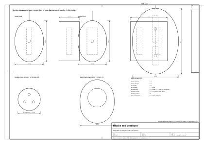
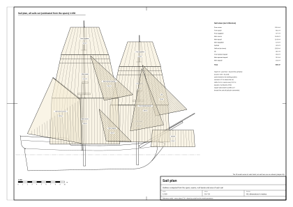

# 08. Liny, bloki i żagle

## Po co ten etap

Rozdziały 06 i 07 mówią, którędy biegnie każda lina. Ten rozdział dotyczy samych rzeczy: jak
zrobiona jest lina konopna i ile wytrzymuje i waży, jak wyglądają bloki i jufersy i jakiej są wielkości, jak zszywa
się żagiel i jak wygląda w każdym stanie, oraz jak to wszystko pokazać w grafice 3D, żeby olinowanie nie zamieniło się
w migoczący szum.

Na końcu tego rozdziału będziesz mieć reguły skrętu, grubości, wytrzymałości i masy lin; proporcje bloków, jufersów i serc; budowę żagli
rejowych i gaflowych z liczbą brytów dla modelu wzorcowego; kształty żagli zwiniętych i postawionych; przepis na
geometrię liny, teksturę skrętu, krzywe zwisu, minimalną grubość na ekranie i poziomy szczegółów.

Oznaczenia pewności jak w [rozdziale 01](01-ship-type-and-era.md): (z epoki; główne źródła z epoki to Steel 1794 i Lever 1808), (wtórne), (nasz wniosek), (model wzorcowy). Grubość liny: **d [mm] = C [cal] × 25,4 / π ≈ 8,09 × C**.

## Pojęcia

- **Skręt**: kierunek, w którym skręcone są pasma liny: prawy (Z) albo lewy (S).
- **Obwód**: źródła z epoki podają grubość liny jako obwód w calach; d [mm] ≈ 8,09 × C.
- **Blok**: drewniana obudowa z jednym albo kilkoma krążkami (kółkami z rowkiem), po których biegnie lina.
- **Jufers**: okrągły drewniany blok z trzema otworami bez krążka, używany parami z talrepem.
- **Serce**: blok z jednym dużym otworem z rowkiem, do napinania sztagu.
- **Bryt**: jeden pas płótna żaglowego; żagiel zszywa się z brytów. **Lik**: lina obszyta wzdłuż krawędzi żagla.
- **Lik górny, dolny, boczny, róg szotowy**: górna, dolna i boczna krawędź oraz dolny róg żagla.
- **Pas refowy**: pas w poprzek żagla ze szkentlami refowymi, do zmniejszania żagla.
- **Postawiony, zwinięty**: rozpięty na wietrze; zwinięty i przywiązany do rei.
- **Zwis, krzywa łańcuchowa**: o ile lina wisi poniżej prostej między końcami; krzywa wiszącej liny.
- **Poziom szczegółów (LOD)**: prostsze wersje modelu pokazywane z daleka.

## Lina

### Jak zrobiona jest lina konopna

| Element | Wartość | Pewność |
|---|---|---|
| Budowa | włókna konopi przędzie się w **przędze**, przędze skręca w **pokrętki**, pokrętki w linę | [2] (z epoki) |
| Lina trzypokrętkowa (hawser-laid) | 3 pokrętki, skręt **prawy** („z biegiem słońca”, Z) | [2] (z epoki) |
| Lina czteropokrętkowa (shroud-laid) | 4 pokrętki, skręt prawy | [2] (z epoki) |
| Lina kablowa (cable-laid) | 9 pokrętek (3 liny po 3), skręt **lewy** (S) | [2] (z epoki) |
| Wanty dolne | Steel robi je z „cablet”, małej liny kablowej (dlatego jufers wplata się lewoskrętnie); sztagi stengowe są kablowe | [1] (z epoki) |
| Przędz w pokrętce | liklina 6 cali ma 98 przędz na pokrętkę, 3 cale ma 25, 1,5 cala ma 7 | [1] (z epoki) |
| Przędz w linie | ok. 8–9 × C² (C w calach) | (nasz wniosek) |
| Marlina (spun-yarn) | 3–4 przędze ze zużytej liny, smołowane i skręcone; na opaski i obszycia | [1] (z epoki) |

### Wytrzymałość, masa, wyciąganie się

| Element | Wartość | Pewność |
|---|---|---|
| Siła zrywająca, konopie niesmołowane | ok. 1371 × C² funtów (C w calach) | [3] (wtórne, XIX w.) |
| Siła zrywająca, konopie smołowane | ok. 1045 × C² funtów | [3] (wtórne) |
| Ostrożna reguła robocza | C² / 3 tony | [3] (wtórne) |
| Przykład: smołowana wanta 6 cali (49 mm) | ok. 37 600 funtów ≈ 167 kN (ok. 17 t) | (nasz wniosek) |
| Masa | ok. 0,07–0,08 × d² kg/m, d w cm: wanta 49 mm ok. 1,8 kg/m, grotsztag 80 mm ok. 4,8 kg/m, wyblinka 10 mm ok. 0,08 kg/m | (nasz wniosek) |
| Wyciąganie się | nowe konopie się wyciągają: Steel rozciąga wanty talią na kabestanie i zostawia na 24 h; po sztormie dociąga się talrepy | [1] (z epoki) |

### Opaski, obszycia, sploty, węzły

- **Opaska okrągła (round seizing):** 6–10 zwojów spodnich, na wierzchu o jeden mniej, dwa zwoje krzyżowe; **opaska
  gardłowa (throat seizing):** zwoje bez krzyżowania, przy jufersach, sercach, blokach [2] (z epoki); Steel: 7 pod spodem,
  6 na wierzchu [1] (z epoki).
- **Worming → parcelling → serving:** marlina w rowki między pokrętkami → owinięcie smołowanym płótnem → ciasne zwoje
  marliny pod prąd skrętu, nakładane drewnianym młotkiem do obszywania [2] (z epoki).
- **Sploty:** krótki (łączy dwa końce, nie przejdzie przez blok), długi (lina zostaje tej samej grubości, przechodzi
  przez blok), oko (pętla na końcu), splot w środku liny (na wisiory) [2] (z epoki). Małe pokrętki przeplata się 2 razy,
  duże 3 [1] (z epoki).
- **Węzły na pokładzie:** wyblinka (na wyblinkach), półsztyk, sztyk drewniany, sztyk przesuwny, węzeł płaski
  (refsejzingi), ratowniczy (bowline), szotowy, rybacki (kotwica), węzły kończące: wall, crown, Matthew Walker (koniec
  talrepu), węzeł wantowy (naprawa przestrzelonej wanty) [2] (z epoki).

### Buchty

Nadmiar liny zwija się **zgodnie ze skrętem**: linę prawoskrętną zgodnie z ruchem wskazówek zegara; buchtę wiesza się
na kołku albo knadze; liny talii zwija się na pokładzie. Płaskie spirale („flemish”) to późniejszy zwyczaj portowy
[8], [9] (wtórne). Model wzorcowy wiesza 54 buchty o średnicy 0,45 m na zajętych kołkach, z liny nie grubszej niż
20 mm (model wzorcowy).

## Bloki, jufersy, serca

*Rysunek 1. Bloki, jufers i serce z proporcjami w średnicach liny d, narysowane dla d = 20 mm w skali 1:2 (arkusz
`plans/blocks-and-deadeyes.svg`): blok pojedynczy, podwójny, skrzypcowy, siostrzany i ćwiartkowy, jufers i serce, każdy z
głównymi wymiarami jako wielokrotność średnicy liny d.*

### Rodzaje

| Rodzaj | Zastosowanie |
|---|---|
| Blok jedno-, dwu-, trzykrążkowy | talie, fały, brasy |
| Blok skrzypcowy (fiddle) | dwa krążki różnej średnicy jeden nad drugim, w ciasnych miejscach (np. przy rei) |
| Blok siostrzany (sister) | dwa krążki w jednym podłużnym klocu wplecionym między nogi wanty; topenanty marsrei [1] |
| Blok ćwiartkowy (quarter) | blok podwójny w środku rei na długich i krótkich nogach; szoty i gejtawy marsli [1] |
| Jufers | okrągły blok bez krążka z trzema kipami; wanty i paduny [1], [6] |
| Serce | jeden duży otwór z rowkami; sztagi i watersztagi [1] |
| Baranek | drewniany pierścień z rowkiem; prowadnica liny [7] |
| Kausza | żelazny pierścień w oczku liny; końce lin, haki [1] |

### Proporcje

| Element | Reguła | Pewność |
|---|---|---|
| Grubość krążka | 1,1 × średnica liny | [1] (z epoki) |
| Średnica krążka | 5 × grubość krążka (ok. 5,5 d) | [1] (z epoki) |
| Szerokość bloku | 6 × grubość krążka | [1] (z epoki) |
| Grubość bloku | ok. 1/2 jego długości; każdy dodatkowy krążek dodaje nieco mniej niż jedno gniazdo krążka | [1] (z epoki) |
| Strop bloku | np. blok 17 cali ma strop z liny 5 cali, blok 6 cali z liny 1,5 cala | [1] (z epoki) |
| Prosta reguła do modelowania | długość ok. 8–9 × d liny (lina 20 mm → blok ok. 0,17 m), szerokość ok. 0,7 × długość, grubość ok. 0,5 × długość (+0,4 × długość na każdy dodatkowy krążek) | (nasz wniosek) |
| Jufers | średnica 1,5 × obwód wanty; grubość ok. 1/2 średnicy; 3 kipy; rowek na obwodzie na strop | [4], [6] (wtórne) |
| Odstęp jufersów | 2,5–3 średnice między górnym a dolnym | [5] (wtórne) |

**Model wzorcowy:** długości bloków 0,14 m (topenanty dolnych rej i marsrei), 0,10 m (topenanty bramrei, gordingi),
0,16 m (wisiory brasów dolnych rej i marsrei, bloki ćwiartkowe szotów marsli), 0,12 m (bloki na sztagach, gejtawy,
bloki na relingu), 0,20 m (fał marsrei), 0,22 m (szot bomu). Jufersy: bryła obrotowa z rowkiem, 10 boków, kipy w 0,45
promienia pod kątami 90°, 210° i 330° (widać je tylko po wchodzących w lico talrepach); grot 0,231 m, fok 0,212 m,
paduny 0,85 tej wartości, wanty stengowe 0,13 m.

## Żagle

### Jakie żagle (1700–1720)

| Żagiel | Bryg późny | Brygantyna 1700–1720 | Snow 1700–1720 |
|---|---|---|---|
| Fok | tak | tak | tak |
| Fokmarsel | tak | tak | tak |
| Fokbramsel | tak | mały, bywa | bywa |
| Grot rejowy | od połowy XVIII w. („snow-brig”) | **nie** | tak |
| Grotmarsel, grotbramsel | tak | tak (bramsel bywa) | tak |
| Żagiel gaflowy grota / trysel | tak (z bomem) | tak (grot gaflowy; bom później) | na maszcie snow, bez bomu |
| Blinda pod bukszprytem | do ok. 1800 r. | tak | tak |
| Kliwer | tak | od ok. 1705 r. | od ok. 1705 r. |
| Sztaksel stengowy foka | tak | tak | tak |
| Grotsztaksel, sztaksel stengowy grota | tak | tak (sztaksle od 1709 r. w Royal Navy, na statkach skośnych wcześniej) | tak |
| Lizle | tak | bywa | bywa |

Źródła: [14], [15], [16], [17] (wtórne); kolumna „bryg późny” [1], [2] (z epoki).

*Rysunek 2. Plan ożaglowania modelu wzorcowego ze wszystkimi żaglami postawionymi (oszacowanie z drzewc), widok
z boku w skali 1:150, z szwami brytów, pasami refowymi i powierzchnią wpisaną w każdy żagiel (arkusz
`plans/sail-plan.svg`).*

### Jak zrobiony jest żagiel

| Element | Wartość | Pewność |
|---|---|---|
| Szerokość brytu | **24 cale = 0,61 m**; bela 38 jardów; brytyjski standard ustawowy od 1746 r. (24 albo 18 cali także w XVI–XVIII w.) | [1] (z epoki); [10], [11] (wtórne) |
| Szew | płaski, zakładka 1,25 cala (bramsle) do 1,5 cala (dolne żagle, marsle); u Steela w grocie gaflowym brygu 3 cale przy liku dolnym, 2 przy górnym, 1 w środku | [11] (wtórne); [1] (z epoki) |
| Rozstaw szwów | 0,61 m − 0,038 m zakładki ≈ **0,57 m** | (nasz wniosek) |
| Płótno | w Royal Navy płótno konopne albo lniane nr 1–8 (grot gaflowy brygu: nr 5–6); „Holland duck” uchodził za najlepszy | [1] (z epoki); [10] (wtórne) |
| Liklina | konopie z Rygi, smołowana; w grocie slupa przy maszcie 2,5–3 cala, reszta 1,5 cala | [1] (z epoki) |
| Ucha (cringles) | z pokrętek likliny o 0,5 cala cieńszych od likliny; rogi szotowe uplecione z 14 skrętów pokrętki | [1] (z epoki) |
| Refbanty | grot gaflowy brygu (1794): **3 refbanty po 6 cali, równoległe do liku dolnego**; marsle późnego XVIII w. do 4 refów; dolne żagle 1–2 | [1] (z epoki); [11] (wtórne) |
| Refy w latach 1700–1720 | refowanie wraca pod koniec XVII w., najpierw na marslach; ok. 1710 r. **marsle 1–2 refy, dolne żagle raczej bonety** (doszywany pas na dole) zamiast refów | (nasz wniosek) ([12] niedostępne; [13]) |
| Pasy wzmacniające | pas środkowy w połowie między najniższym refem a likiem; pasy pod gordingi (4 na dolnym żaglu, 2 na marslu, 0 na bramslu); okładziny liku | [11] (wtórne, opis dla ok. 1800 r.) |
| Luz płótna przy liku przednim żagla gaflowego | 4 cale na jard (11%) | [1] (z epoki) |
| Kolor | naturalne konopie albo len: **kremowy do płowego, nowe jaśniejsze, stare szarawe, łaty w innym odcieniu**; nie biel dakronu; garbowanie na brąz to zwyczaj kutrów rybackich, nie okrętów | (nasz wniosek); [10] (wtórne: garbowanie) |
| Refsejzingi | ok. jeden na bryt, czyli co ok. 0,6 m, wiszące 0,6–0,8 m, ok. 5 mm | (nasz wniosek) |
| Krawaty | płaskie plecione taśmy 25–40 mm szerokości, co 1–1,5 m | (nasz wniosek) |

### Krok po kroku: rozkrój żagla rejowego

1. **Lik górny:** ok. 0,9 × długość rei (noki zostają wolne na topenanty, brasy i perty) (nasz wniosek).
2. **Lik dolny:** ok. lik górny żagla poniżej (lik dolny marsla obejmuje dolną reję; lik dolny dolnego żagla ok. 0,95 ×
   własna reja) (nasz wniosek).
3. **Wysokość:** od rei do rei poniżej; dolny żagiel w dół do mniej więcej wysokości relingu (nasz wniosek).
4. **Bryty:** podziel lik górny przez rozstaw szwów (0,57 m), a dostaniesz liczbę brytów u góry; dodaj kliny (bryty
   klinowe) przy likach bocznych, żeby dojść do liku dolnego (nasz wniosek).
5. **Obrębienia i pasy:** obrębienie wzdłuż wszystkich brzegów; refbanty pod likiem górnym (marsle: 1–2 w 1710 r.),
   pas środkowy i pasy pod gordingi (nasz wniosek, [11]).
6. **Liklina i ucha:** liklina wokół brzegów, ucha w rogach szotowych, przy każdym refbancie i na wąsy bulin na likach
   bocznych [1] (z epoki).
7. **Refsejzingi:** jeden na bryt na każdym refbancie [1]/(nasz wniosek).

### Przykład policzony: żagle modelu wzorcowego (nasz wniosek)

Model wzorcowy ma **tylko żagle zwinięte** (model wzorcowy). Żagle postawione poniżej to nasze szacunki z jego drzewc (rozdział 05), zapisane jako
`set_sail_estimates` w `data/parameters.json`: lik górny = 0,9 × reja; lik dolny = lik górny żagla niżej (żagiel
dolny: 0,95 × jego reja); reje podniesione do pozycji roboczej (marsreje 0,9 m pod salingiem, bramreje 1,4 m pod
gałką); dolne żagle do relingu. Powierzchnie jako trapezy; bryty 0,61 m szerokie, szew co 0,57 m. Wszystko (nasz
wniosek). Liczby zmieniają się razem z drzewcami; aktualne wartości bierz z pliku.

| Żagiel | Lik górny [m] | Lik dolny [m] | Wysokość [m] | Bryty u góry / u dołu | Powierzchnia [m²] |
|---|---|---|---|---|---|
| Grot rejowy | 14,24 | 15,03 | 9,90 | 25 / 26 | 144,8 |
| Grotmarsel | 10,17 | 14,24 | 9,39 | 18 / 25 | 114,6 |
| Grotbramsel | 6,10 | 10,17 | 5,89 | 11 / 18 | 47,9 |
| Fok | 12,46 | 13,15 | 7,94 | 22 / 23 | 101,7 |
| Fokmarsel | 8,90 | 12,46 | 8,34 | 16 / 22 | 89,1 |
| Fokbramsel | 5,34 | 8,90 | 5,30 | 9 / 16 | 37,7 |
| Żagiel gaflowy (na maszcie snow, bez bomu) | | | | | 102,6 |
| Kliwer | | | | | 38,7 |
| Sztaksel stengowy foka | | | | | 46,3 |
| Sztaksel stengowy grota | | | | | 31,3 |
| Grotsztaksel | | | | | 18,3 |
| **Razem (bez blindy i lizli)** | | | | | **773** |
| Blinda | 8,90 | 9,39 | 3,60 | 16 / 16 | 32,9 |

Kontrola: nasz dokument badawczy szacował ok. 660 m² dla nieco szerszego kadłuba z niższymi masztami nad pokładem; Lady
Washington (replika brygantyny, pokład 20 m, szerokość 6,7 m) ma 410 m² [19], co po przeskalowaniu kwadratem szerokości
daje ok. 530 m² dla szerokości 7,6 m; Niagara (bryg wojenny z 1813 r., szerokość 9,8 m) ma 1177 m² [20], po
przeskalowaniu ok. 710 m² (nasz wniosek); nasz szacunek 773 m² jest o ok. 9 % większy. Nasze dolne żagle są wysokie, bo kadłub wzorcowy jest płytki, a kolumny wystają wysoko
nad pokład (rozdział 05).

### Stany żagla

| Stan | Wygląd | Pewność |
|---|---|---|
| **Postawiony, wiatr z tyłu** | brzuch żagla ok. 10–15% cięciwy; lik dolny dolnych żagli wygięty ku przodowi; rogi szotowe ściągnięte w dół i na zawietrzną | (nasz wniosek) |
| **Obrasowany na ostro** | reje skręcone o ok. 30–35° (rozdział 07); buliny ciągną lik nawietrzny do przodu | (nasz wniosek); [1] (z epoki) |
| **Na kontrę** | wiatr od przodu, płótno wypchnięte na maszt; przy dryfie jeden marsel stoi na kontrę | [2] (z epoki) |
| **Zrefowany** | pas nad refbantem zwinięty na rei, refsejzingi związane węzłem płaskim; najpierw ucho nawietrzne | [2] (z epoki) |
| **Zgejtowany** | rogi szotowe podciągnięte gejtawami pod środek rei, gordingi podnoszą lik dolny; żagiel wisi w girlandach pod reją; stan pośredni, ważny w walce i przy zwrotach | [18], [2] (z epoki) |
| **Zwinięty** | wałek płótna na wierzchu i z przodu rei, ciasno owinięty krawatami co 1–1,5 m; w porcie całe płótno w jednym „worku” (bunt) przy maszcie | (nasz wniosek) |
| **Żagiel gaflowy bez bomu (1700–1720)** | zrzucony gejtawami do masztu, nie zwijany na bomie | [15] (wtórne) |

### Żagle zwinięte w modelu wzorcowym

- Każdy zwinięty żagiel rejowy to wałek na wierzchu i z przodu rei, od −0,86 do +0,86 połowy długości, grubszy w
  środku (bunt) i cieńszy na końcach, z małymi losowymi wybrzuszeniami między krawatami.
- Promień wałka w środku / na końcach: dolne żagle 0,30 / 0,15 m, marsle 0,25 / 0,12 m, bramsle 0,16 / 0,085 m,
  blinda 0,21 / 0,11 m.
- Przy środku bunt jest cofnięty ku rei, a przy każdym sztagu promień wałka maleje, więc sztag przechodzi przed reją,
  nie przecinając płótna.
- Krawaty co 1,1 m, płaskie taśmy 6 × 35 mm, pominięte tam, gdzie przechodzi sztag.
- Zwinięty żagiel jest **dzieckiem swojej rei**, więc obraca się razem z nią.
- Żagiel gaflowy jest podgarnięty pod gafel i wzdłuż masztu snow; kliwer zwinięty na bomstendze, sztaksel stengowy foka
  na bukszprycie, grotsztaksel opuszczony u stopy fokmasztu.

## Jak pokazać liny i żagle w grafice 3D

### Geometria liny

Lina to rurka przeciągnięta wzdłuż łamanej. Liczba boków (nasz wniosek, zalecenie z dokumentu badawczego):

| Lina | Z bliska | Normalnie | Z daleka |
|---|---|---|---|
| ≥ 40 mm (sztagi, wanty) | 8 | 6 | 3 albo linia |
| 10–30 mm | 6 | 5 | 3 albo linia |
| wyblinki, talrepy, opaski | 4 | 3 | pominąć |

Model wzorcowy: d ≥ 60 mm → 8 boków, ≥ 35 mm → 6, ≥ 20 mm → 5, poniżej → 4 (model wzorcowy). Skrętu **nie** modeluj geometrią,
z wyjątkiem najbliższego poziomu szczegółów dla najgrubszych sztagów i watersztagów, gdzie na sylwetce widać trzy
garby (nasz wniosek). Wystarczy mapa normalnych i tekstura.

### Tekstura i kierunek skrętu

- **Skok skrętu** (pełny obrót pokrętki wzdłuż liny) to ok. **3–3,5 × d** (nasz wniosek). Skaluj teksturę wzdłuż liny według
  **średnicy**, a nie stałej długości w metrach; inaczej na wyblince 10 mm pokrętki są prawie proste, choć sztag wygląda
  dobrze (nasz wniosek).
- **Mapowanie UV (model wzorcowy):** v biegnie dookoła liny (od 0 do 1), u wzdłuż niej; jeden kafel tekstury obejmuje **dwa skoki**,
  więc `u = długość / (2 × 3,3 × d)`.
- **Kierunek:** olinowanie stałe z „cablet” albo liny kablowej ma skręt **lewy** (S), olinowanie ruchome i liny
  trzypokrętkowe **prawy** (Z) (z epoki, [2], [1]). Model wzorcowy odbija u dla lin smołowanych, żeby dostać skręt lewy (model wzorcowy).
  **Sprawdź na ekranie:** na pionowej linie prawoskrętnej pokrętki biegną jak środkowa kreska litery Z (nasz wniosek).

### Kolor i materiał

| Materiał | Kolor (nasz wniosek) | Chropowatość (nasz wniosek) | Model wzorcowy |
|---|---|---|---|
| Lina smołowana | `#2e241b` do `#3d3024` (brąz prawie czarny, lekko błyszczący) | ok. 0,7 | tekstura liny × (0,26; 0,21; 0,16) |
| Lina jasna | `#a18a66` do `#8c7b5e` (konopie, od słomkowego do płowego) | ok. 0,95 | tekstura liny × (0,86; 0,78; 0,62) |
| Płótno | kremowe do płowego, ok. `#d9cdb0` | wysoka | tekstura płótna; wariant z fotografii lnu barwiony (0,86; 0,82; 0,72) |

Geometrię scal w jedną siatkę na materiał (smołowana, jasna, płótno, drewno) na każdy poziom szczegółów (nasz wniosek).

### Zwis

Lina wisząca między dwoma punktami układa się w **krzywą łańcuchową** [21] (wtórne):

`y(x) = a · (cosh((x − x₀) / a) − 1)`, gdzie `a = H / w` (H: siła pozioma w N, w: ciężar liny w N/m).

Gdy zwis f jest mniejszy niż ok. 10% rozpiętości L, wystarcza **parabola**:

- `f = w · L² / (8 H)`;
- przesunięcie w dół w punkcie t ∈ [0, 1] cięciwy wynosi **δ(t) = 4 f · t · (1 − t)**, mierzone **pionowo**
  (grawitacja), a nie wzdłuż normalnej liny;
- długość i zwis: `S ≈ L + 8 f² / (3 L)`, więc `f ≈ √(3 L (S − L) / 8)`. Lina o 1% dłuższa od cięciwy ma zwis ok. 6%
  rozpiętości (nasz wniosek).

Model wzorcowy rozwiązuje `f = a (cosh(L / 2a) − 1)` względem a metodą bisekcji i próbkuje krzywą cosh (model wzorcowy).

| Lina | Zwis f / L (nasz wniosek) | Model wzorcowy |
|---|---|---|
| Wanty, sztagi stengowe | 0–0,002 | 0 |
| Grotsztag, foksztag (ciężkie, długie) | 0,004–0,008 | 0,005; 0,004 |
| Paduny | 0,002–0,004 | 0 |
| Topenanty (reje opuszczone albo podniesione) | 0,003–0,01 | 0 |
| Brasy | 0,01–0,03 | 0,012 |
| Wyblinki | 0,01–0,02 | 0,015 |
| Szoty i halsy luźne przy zwiniętym żaglu | 0,04–0,10 | szoty dolnych żagli 0,07 |
| Gejtawy, gordingi przy zwiniętym żaglu | napięte (żagiel na nich wisi) | proste |
| Gaje gafla, brasy blindarei | | 0,02; 0,015 |

### Cienkie liny z daleka

Promień na ekranie w pikselach: **r_px = r · H_px / (2 · D · tan(fov / 2))** (r: promień liny, D: odległość, H_px:
wysokość ekranu). Przy 1080p i polu widzenia 50° to ok. **1158 · r / D**. Średnicę 1 px lina osiąga: wyblinka
(r = 5 mm) na **11,6 m**, wanta (r = 25 mm) na **58 m**, grotsztag (r = 40 mm) na **93 m** (nasz wniosek). Dalej cienka rurka
rozpada się na kropki i migocze.

Sprawdzona metoda to **„phone-wire AA”** [22] (wtórne; technika grafiki opublikowana w 2012 r.): w shaderze wierzchołków powiększ promień do co najmniej
0,5–0,7 px, a w shaderze fragmentów zmniejsz pokrycie (alpha) w proporcji promień prawdziwy / promień powiększony; użyj
alpha-to-coverage z MSAA albo ditheringu, wtedy nie trzeba sortować przezroczystości. W three.js da się to zrobić przez
`onBeforeCompile` w standardowym materiale (uniform z wysokością ekranu i projekcją oraz oś liny w atrybucie wierzchołka
albo przesunięcie wzdłuż normalnej) (nasz wniosek). Eksport modelu wzorcowego do gry po prostu ustawia każdej linie średnicę co
najmniej **14 mm** (model wzorcowy): cienkie liny zostają widoczne, ale wyblinki z bliska są o 40% za grube.

### Poziomy szczegółów

| Odległość | Co rysować (nasz wniosek) |
|---|---|
| < 15 m | wszystko: wyblinki jako rurki 3–4-boczne, talrepy (6 odcinków), opaski, myszy, bloki z krążkami, refsejzingi, krawaty |
| 15–60 m | wyblinki jako jeden pas na wachlarz want (czworokąt z teksturą alfa albo rurki 3-boczne z AA); bloki jako proste prostopadłościany; bez refsejzingów i opasek |
| 60–250 m | tylko wanty, paduny, sztagi, topenanty i brasy (linie z AA, co najmniej 1 px z pokryciem); bez lin cieńszych niż 20 mm |
| > 250 m | drzewca, żagle, cień; olinowanie jako 4–6 ciemnych linii na maszt albo wcale |

Najdalszy poziom modelu wzorcowego (LOD2) pomija wyblinki, talrepy, perty, ściągacze, podwantki, buchty, stropy,
wiązanie bukszprytu, całe olinowanie ruchome i wszystkie liny dynamiczne (model wzorcowy).

**Zachowaj z każdej odległości, z której to widać (nasz wniosek):** wachlarz want zbiegający się z szerokiej ławy do topu; pary
jufersów z jasnymi talrepami; poziomy rytm wyblinek z lekkim zwisem; stos pętli na topie; ezelhofty i dublinki (stenga
**przed** kolumną); perty pod rejami; zwis tylko w dół; dwa kolory lin; wałek zwiniętego żagla na wierzchu i z przodu
rei; sztagi zbiegające się w osi; wiązanie bukszprytu; podwantki widoczne z pokładu.

## Sprawdź się

- [ ] Wanty i sztagi lewoskrętne, olinowanie ruchome prawoskrętne; skok skrętu rośnie ze średnicą (ok. 3,3 d).
- [ ] Liny smołowane prawie czarnobrązowe, jasne od słomkowych do płowych, żagle kremowe, nie białe.
- [ ] Jufersy mają średnicę 1,5 × obwód wanty (ok. 0,23 m przy wantach 49 mm), trzy kipy.
- [ ] Bloki mają długość ok. 8–9 × średnica liny (ok. 0,17 m dla liny 20 mm).
- [ ] Bryty 0,61 m szerokości, szwy co ok. 0,57 m; grot rejowy ok. 25 brytów u góry.
- [ ] W 1710 r. marsle mają 1–2 refbanty; dolne żagle raczej bonety niż refy.
- [ ] Zwinięty żagiel na wierzchu i z przodu rei, z krawatami co 1–1,5 m.
- [ ] Zwis jest pionowy; wanty prawie proste, brasy 1–3%, luźne szoty 4–10%.
- [ ] Wyblinki (10 mm) są cieńsze niż 1 px dalej niż ok. 12 m; masz na to sposób (AA albo LOD).

## Typowe błędy

- **Jeden kolor liny** dla wszystkiego (nasz wniosek).
- **Tekstura liny ze stałym skokiem w metrach**, przez co cienkie liny wyglądają jak gładki drut (nasz wniosek).
- **Zwis wzdłuż normalnej** zamiast pionowo w dół (nasz wniosek).
- **Białe żagle** jak współczesny dakron (nasz wniosek).
- **Wiele refbantów na marslach z 1710 r.** albo refy na dolnych żaglach (nasz wniosek).
- **Zwinięty żagiel pod reją** albo owinięty wokół niej jak kiełbasa (nasz wniosek).
- **Wyblinki o prawdziwej średnicy z każdej odległości**, migoczące jak kropki (nasz wniosek).
- **Za duże bloki** (wielkości głowy na linie 16 mm) (nasz wniosek).

## Źródła

1. D. Steel, *The Elements and Practice of Rigging and Seamanship*, 1794:
   https://whalesite.org/anthology/1794_Steel_Elements_and_Practice.htm
2. D. Lever, *The Young Sea Officer's Sheet Anchor* (1808): https://archive.org/details/youngseaofficers00leve
3. S. B. Luce, *Text-Book of Seamanship* (wytrzymałość lin; z wyników wyszukiwania, strona nie odpowiadała):
   https://legacy.maritime.org/doc/luce/part1.php
4. VAKA, „Making Deadeyes and Wooden Blocks”: https://www.vaka.earth/2026/04/making-deadeyes-and-wooden-blocks.html
5. Finescale Modeler Forum, „shrouds and lanyards”: https://forum.finescale.com/t/shrouds-and-lanyards/143536
6. Wikipedia (pl), „Jufers”: https://pl.wikipedia.org/wiki/Jufers
7. potempski.com, nazwy ożaglowania i olinowania: https://potempski.com/rejowe/inne/zagle.htm
8. Wikipedia, „Belaying pin”: https://en.wikipedia.org/wiki/Belaying_pin
9. Sail Magazine, „Coil with the sun”: https://sailmagazine.com/diy/coil-with-the-sun/
10. Wikipedia, „Sailcloth”: https://en.wikipedia.org/wiki/Sailcloth
11. HMS Richmond (rekonstrukcja historyczna), „Sailmaker”: https://www.hmsrichmond.org/sailmker.htm
12. Society for Nautical Research, „Early Reefs” (niedostępne, 403): https://snr.org.uk/early-reefs/
13. Wikipedia, „Top (sailing ship)”: https://en.wikipedia.org/wiki/Top_(sailing_ship)
14. Wikipedia, „Brigantine”: https://en.wikipedia.org/wiki/Brigantine
15. Wikipedia, „Snow (ship)”: https://en.wikipedia.org/wiki/Snow_(ship)
16. Oxford Reference, „Jib-boom”: https://www.oxfordreference.com/display/10.1093/oi/authority.20110803100020673
17. P. K. Allan, „The Evolution of Sails in Eighteenth-Century Warships”:
    https://brewminate.com/the-evolution-of-sails-in-eighteenth-century-warships/
18. Wikipedia (pl), „Gejtawa”: https://pl.wikipedia.org/wiki/Gejtawa
19. Wikipedia, „Lady Washington”: https://en.wikipedia.org/wiki/Lady_Washington
20. Wikipedia, „USS Niagara (1813)”: https://en.wikipedia.org/wiki/USS_Niagara_(1813)
21. Wikipedia, „Catenary”: https://en.wikipedia.org/wiki/Catenary
22. E. Persson (Humus), „Phone-wire AA”: http://www.humus.name/index.php?page=3D&ID=89
23. three.js, TubeGeometry (licencja MIT): https://threejs.org/docs/#api/en/geometries/TubeGeometry
24. M. DesLauriers, „Shaping Curves with Parametric Equations” (budowanie rurek ręcznie; licencji kodu nie
    sprawdzaliśmy): https://mattdesl.svbtle.com/shaping-curves-with-parametric-equations
25. Wikipedia (pl), „Reja”: https://pl.wikipedia.org/wiki/Reja
26. SJP PWN, „refsejzing”: https://sjp.pwn.pl/sjp/refsejzing;2573678.html
27. KŻ Zagłębie, słowniczek żeglarski (krawat): https://www.kzzaglebie.pl/szkolenie/slowniczek-zeglarski

## Terminy użyte w rozdziale

| Angielski | Polski | Znaczenie |
|---|---|---|
| yarn, strand | przędza, pokrętka (splotka) | Skręcone włókna; skręcone przędze tworzące linę. |
| hawser-laid, shroud-laid, cable-laid | lina trzypokrętkowa, czteropokrętkowa, kablowa (niepewne) | 3 pokrętki w prawo; 4 w prawo; 9 w lewo. |
| lay (right / left) | skręt (prawy / lewy) | Kierunek skręcenia pokrętek. |
| spun-yarn, marline | marlina | Cienka smołowana linka do opasek i obszyć. |
| seizing (round, throat) | opaska, bendzel (bencle) | Obwiązanie dwóch lin albo liny i bloku [25]. |
| worming, parcelling, serving | obszywanie (brak potwierdzonych osobnych polskich nazw) | Wypełnienie, owinięcie płótnem i ciasne obwiązanie przeciw przetarciu. |
| splice (short, long, eye) | splot (krótki, długi, oko) | Łączenie albo zakończenie liny przez przeplatanie pokrętek. |
| block, shell, sheave, strop | blok, kloc (niepewne), krążek, strop | Blok; jego korpus; jego koło; lina wokół niego. |
| fiddle, sister, quarter block | blok skrzypcowy, siostrzany, ćwiartkowy (niepewne) | Bloki specjalne (zob. „Rodzaje”). |
| deadeye, heart, bull's eye, thimble | jufers, serce, baranek, kausza | Bloki bez krążka i pierścienie [6], [7]. |
| sail, cloth, seam | żagiel, bryt, szew | Żagiel; pas płótna; połączenie dwóch pasów. |
| bolt-rope, leech, head, foot | liklina, lik boczny, lik górny, lik dolny | Lina na brzegu; brzegi boczny, górny i dolny. |
| clew, earing, cringle | róg szotowy, ucho refowe (niepewne), ucho | Dolny róg; linka rogu refowego; oczko z liny w brzegu. |
| reef band, reef point, bonnet | refbant, refsejzing, boneta (niepewne) | Pas wzmacniający z refsejzingami; linka do wiązania; doszywany pas [26]. |
| gasket | krawat (sejzing) | Taśma wiążąca zwinięty żagiel do rei [7], [27]. |
| bunt | środek żagla, bunt (niepewne) | Środkowa część żagla rejowego albo zwiniętego wałka. |
| course, topsail, topgallant | fok/grot, marsel, bramsel | Dolny, drugi i trzeci żagiel rejowy [7]. |
| jib, staysail, spritsail | kliwer, sztaksel, blinda | Żagle przednie; żagiel pod bukszprytem [7]. |
| studding sail | lizel | Dodatkowy żagiel stawiany za likiem bocznym żagla rejowego. |
| aback, clewed up, furled | na kontrę, zgejtowany, zwinięty | Stany żagla (zob. „Stany żagla”). |
| catenary | krzywa łańcuchowa | Krzywa wiszącej liny. |
| level of detail (LOD) | poziom szczegółów | Uproszczone wersje modelu na większe odległości. |
