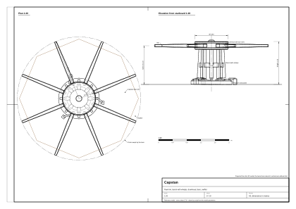
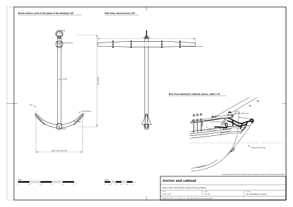
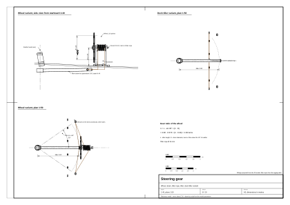
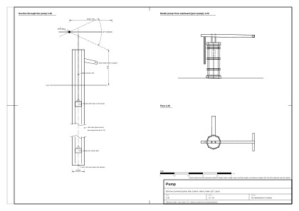
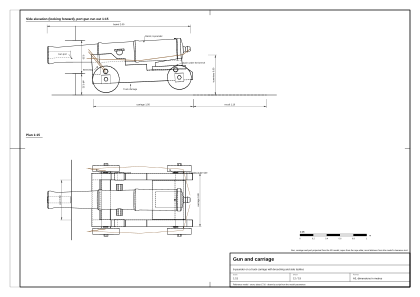

# 09. Mechanizmy i wyposażenie pokładu

## Po co ten etap

Kadłub i takielunek tworzą statek; mechanizmy pokładu sprawiają, że on działa. Kabestan podnosi kotwice, pompy
utrzymują go na wodzie, koło albo rumpel nim steruje, działa walczą. Każdy mechanizm ma wymiar wyznaczony przez
ludzi, którzy przy nim pracują, miejsce wyznaczone przez to, co ciągnie albo porusza, i części, które ruszają się
w znany sposób. Jeśli to się zgadza, pokład wygląda na żywy; jeśli nie, nie pomoże żadna tekstura.

Na końcu tego rozdziału będziesz mieć dla każdego przedmiotu: części, wymiary, sposób obsługi krok po kroku, co się
rusza (oś i zakres), ilu ludzi go obsługuje oraz wskazówki do modelowania i animacji. Miejsce każdego przedmiotu na
pokładzie modelu wzorcowego podaje [rozdział 04](04-decks-bulwarks-stern-head.md); tam jest też sam ster.

Oznaczenia pewności (z epoki, wtórne, nasz wniosek, model wzorcowy) objaśnia [rozdział 01](01-ship-type-and-era.md).
Wielu wymiarów mechanizmów małych statków z lat 1700–1720 **nikt nie zapisał**; takie wartości to nasze szacunki
i tak są oznaczone. Część źródeł jest późniejsza niż nasza data; mają dopisek „(późn.)” z uwagą, czy wolno je
przenieść na naszą epokę.

Jednostki: 1 sążeń (*fathom*) = 6 ft = 1,83 m; 1 cwt (*hundredweight*) = 112 lb = 50,8 kg.

## Pojęcia

- **Kabestan**: pionowy kołowrót obracany przez ludzi pchających drągi; do liny kotwicznej i ciężkich ładunków.
- **Winda kotwiczna (bratszpil)**: poziomy kołowrót obracany drągami ręcznymi, na statkach handlowych z małą załogą.
- **Posłaniec** (*messenger*): lina bez końca na kabestanie, do której grubą linę kotwiczną przywiązuje się krótkimi
  linkami (*nippers*).
- **Kotbelkowanie i odkładanie łap** (*catting, fishing*): podciągnięcie pierścienia kotwicy do kotbelki, potem
  podniesienie łap na burtę.
- **Rumpel, kolderstok, koło sterowe**: trzy sposoby obracania sterem.
- **Szafka kompasowa** (*binnacle*): szafka z kompasami, klepsydrami i światłem przed sternikiem.
- **Laweta okrętowa** (*truck carriage*): czterokołowe drewniane łoże działa okrętowego.
- **Działko relingowe** (*swivel gun*): małe działo na obrotowych widełkach osadzonych w relingu.

## Kabestan

**Części** [1] (z epoki, encyklopedia 1797), [2] (z epoki, 1750):

- **Wrzeciono** (*spindle*): pionowy dębowy pal przechodzący przez pokład, stojący w **gnieździe** (*step*) na pokładzie
  niższym albo na pokładnikach.
- **Bęben** (*barrel*): część, na którą nawija się lina, o przekroju wielobocznym.
- **Żebra** (*whelps*): 6–8 klinowatych listew przybitych do bębna; zwiększają jego obwód, więc każdy obrót nawija
  więcej liny.
- **Głowica** (*drumhead*): szeroki okrągły krążek u góry, w encyklopedii porównany do kamienia młyńskiego,
  z kwadratowymi otworami na drągi.
- **Drągi** (*bars*): drewniane dźwignie wkładane w otwory, numerowane pod swoje otwory, każdy zabezpieczony bolcem na
  łańcuszku.
- **Zapadki** (*pawls*): żelazne sztaby, które nie pozwalają kabestanowi obrócić się wstecz. Zapadki pokładowe opadają
  na zębaty **wieniec zapadkowy** (*pawl rim*) przy podstawie. „Zapaść kabestan” (*pawl the capstan*) znaczy założyć
  zapadki w czasie przerwy.
- **Posłaniec** i **linki przywiązujące**: znane z fregat; dla małego slupa z 1710 r. to nasze założenie (wtórne dla
  fregat [1], nasz wniosek dla slupów).

**Gdzie stoi.** Blanckley (1750) rozróżnia kabestan główny za grotmasztem i kabestan *jeer* między masztami; mały
statek ma jeden kabestan na pokładzie górnym, za grotmasztem albo między masztami [2] (z epoki, późn.).

| Wymiar | Szacunek dla statku 28 m | Model wzorcowy |
|---|---|---|
| Średnica głowicy | 0,85–0,95 (nasz wniosek) | 0,94 |
| Bęben z żebrami | Ø 0,6–0,75 (nasz wniosek) | Ø 0,80 (rdzeń ośmioboczny Ø 0,52, 8 żeber) |
| Wysokość nad pokładem | 0,95–1,05, ok. do pasa (nasz wniosek) | 1,22 do wierzchu głowicy; drągi na 1,10 |
| Drągi | 8 drągów po 2,8–3,2 m; z drągami kabestan potrzebuje koła o średnicy ok. 6,5 m (nasz wniosek) | 8 drągów sięgających 1,75 m od osi (koło 3,5 m), żeby zmieściły się między masztami i lukami |
| Zapadki | – | wieniec zapadkowy na pokładzie (Ø zewn. 1,16, 16 żelaznych zębów) i 3 zapadki na krótkich słupkach |
| Położenie | za grotmasztem albo między masztami | s = +0,95, 2,35 m przed grotmasztem, w osi |

**Jak działa, krok po kroku** [1], [2] i nasz wniosek co do liczb:

1. Włóż drągi i zabezpiecz je bolcami. Przez zewnętrzne końce przeciągnij linę (*swifter*), żeby drągi nie mogły się
   wysunąć.
2. Obsadź drągi: 2–4 ludzi na drąg, razem 16–30 ludzi.
3. Ludzie idą w koło, pchając drągi, umownie zgodnie z ruchem wskazówek zegara patrząc z góry. Bęben nawija posłańca:
   przy Ø 0,7 m jeden obrót wybiera ok. 2,2 m (w modelu wzorcowym, Ø 0,80, ok. 2,5 m).
4. Zapadki przeskakują po zębach wieńca. Gdy ludzie odpoczywają, zapadki trzymają ciężar.
5. Jeśli ludzie puszczą drągi przy podniesionych zapadkach, kabestan rusza wstecz i drągi ich biją: typowy wypadek.
6. Zwoje liny przesuwają się po bębnie i co jakiś czas trzeba je zluzować i cofnąć (*surge*).

**Co się rusza** (model wzorcowy): bęben z głowicą i drągami obraca się wokół osi pionowej, bez ograniczeń; zapadki
unoszą się i opadają na każdym zębie; ludzie idą po okręgu pochyleni do przodu. Orientacyjne tempo: 20 ludzi daje 4–6
obrotów na minutę na płytkiej wodzie i 1–2 przy wyrywaniu kotwicy z dna (nasz wniosek, wartość do gry).

**Modelowanie i animacja.** Podstawę (wieniec, słupki zapadek) zrób jednym obiektem statycznym, a bęben, głowicę
i drągi jednym obiektem ruchomym z początkiem na osi, na wysokości pokładu. Drągi niech będą wyjmowane (osobne obiekty
albo przełącznik widoczności). Odtwarzaj trzask na każdy ząb: przy 16 zębach 16 trzasków na obrót. Sprawdź koło
drągów wobec masztów, luków, pomp i wtoczonych dział (rozdział 04, zasady rozmieszczenia).

*Rysunek 1. Kabestan modelu wzorcowego.*

## Winda kotwiczna (wariant handlowy)

Nie ma jej w modelu wzorcowym; przydaje się dla statków handlowych i przerobionych z nich kaprów.

- **Części** (wtórne [3]): ośmioboczny **wał** w poprzek pokładu dziobowego między dwiema **podporami** (*windlass
  bitts, carrick bitts*); **otwory na drągi** w kilku rzędach; **drągi ręczne** 1,8–2,1 m; środkowa **podpora
  z zapadką** (*pawl bitt*) z zapadką opadającą na zębaty wieniec na wale.
- **Wymiary** (nasz wniosek): wał 3,5–4,5 m długości, Ø 0,4–0,5; podpory 0,30 × 0,35, wysokość 1,0–1,2.
- **Obsługa**: włożyć drąg w otwór, docisnąć go w dół o ćwierć obrotu, wyjąć, włożyć w następny otwór. Wolniej niż
  kabestanem, ale trzeba mniej ludzi i miejsca. Encyklopedia z 1771 r. opisuje windę obracaną drągami, do kotwic
  i ciężarów [4] (z epoki). Winda z dźwignią wahadłową (*pump-brake windlass*) to XIX w. (późn.) [3].
- **Co się rusza**: wał skokowo, zapadka klika; 6–12 ludzi w rytmie „w dół, wyjąć, włożyć”.
- **Który statek**: okręty wojenne z liczną załogą używały kabestanów; statki handlowe z małą załogą i ciasnym
  pokładem wolały windę [5] (wtórne); Blanckley wspomina windę dla małych statków [2].

## Kotwice i ich obsługa

### Kotwica

| Część | Opis (z epoki [2], wtórne [6]) |
|---|---|
| Trzon (*shank*) | Prosty pręt kuty z żelaza. |
| Ramiona (*arms*) | Dwa łuki u dołu trzonu. |
| Łapy (*flukes, palms*) | Trójkątne płyty na końcach ramion. |
| Pazury (*bills, peaks*) | Ostre końce łap. |
| Korona (*crown*) | Miejsce, gdzie ramiona schodzą się z trzonem. |
| Poprzeczka (*stock*) | Dwie dębowe połówki ściągnięte żelaznymi obręczami, prostopadłe do ramion; przewraca kotwicę tak, żeby łapa wbiła się w dno. |
| Kwadrat (*square*) | Górna część trzonu, na której osadza się poprzeczkę. |
| Pierścień (*ring*) | Do liny kotwicznej; zwykle owijany liną (*puddening*). |

Kotwice strumieniowe i warpowe miały często wyjmowaną poprzeczkę, żeby łatwiej je składować [6] (wtórne).

### Liczba i waga

- Blanckley (1750): kotwice główna, zapasowa i *sheet* ważą tyle samo; strumieniowa ¼ głównej; warpowa ⅛ [2] (z epoki,
  późn.). Późniejszy słownik podaje dla dużych okrętów strumieniową ⅓ głównej, a warpową ⅓ strumieniowej [6].
- Steel (1794), przez forum modelarskie (wtórne, późn.): slup 200 t: 3 kotwice główne po 15 cwt (762 kg), 1 warpowa
  3 cwt (152 kg); slup 268–300 t: 3 po 20 cwt (1016 kg), 1 strumieniowa 7 cwt (356 kg), 1 warpowa 3,5 cwt (178 kg)
  [7].
- Dla statku 200–250 t (nasz wniosek): 2 kotwice główne na kotbelkach, 1 zapasowa w śródokręciu, 1 strumieniowa,
  1 warpowa.

| Wymiar, kotwica główna 800–1000 kg | Szacunek (nasz wniosek) | Model wzorcowy |
|---|---|---|
| Trzon | 3,2–3,5 m | 3,3 m, 0,11 w kwadrat |
| Rozpiętość ramion | 1,9–2,1 m | ramiona łukiem o promieniu 1,05 m na 52° w każdą stronę, ok. 1,7 m między łapami |
| Poprzeczka | ok. 3,5 m długości, 0,3 × 0,3 przy trzonie, zwężająca się | 3,5 m, 0,20 w kwadrat w środku, zwężająca się do 0,12, 4 żelazne obręcze |
| Pierścień | – | średnica zewnętrzna ok. 0,27 |

### Lina kotwiczna, kluzy, pachołki

- **Lina kotwiczna**: konopna, kręcona z trzech lin (*cable-laid*). Standardowa długość 100–120 sążni (183–220 m).
  Dla slupa obwód ok. 9–11 in, Ø 73–89 mm (nasz wniosek). Nasze notatki o kadłubie wymiarują kluzy dla liny
  0,15–0,18 m; model wzorcowy rysuje linę Ø 0,16 (sprzeczność zapisana).
- **Kluzy**: po jednej, czasem po dwie na burtę; wyłożone ołowiem; w sztormie zatykane **czopami** (wtórne).
- **Pachołki cumownicze** (*riding bitts*): dwa masywne słupy z poprzeczką za kluzami; na nie zakłada się zwoje liny,
  gdy statek stoi na kotwicy (wtórne). Nie ma ich w modelu wzorcowym; lina biegnie po pokładzie ku fokmasztowi.
- **Bez łańcucha**: łańcuch kotwiczny wszedł do marynarki ok. 1810 r. (wtórne).

### Osprzęt kotbelki

**Kotbelka** trzyma żelazną kotwicę z dala od drewnianej burty, gdy się ją podnosi [8] (wtórne). Osprzęt (wtórne [9]):
**blok kotbelki** z dużym hakiem; **talia kotbelki** przewleczona między krążkami kotbelki a blokiem; **stoper
pierścienia**; **stoper trzonu** (*shank painter*) do łap i trzonu; **żurawik do łap** (*fish davit*) z talią
i **hakiem** (*fish hook*). Wymiary kotbelki są w rozdziale 04.

### Stawanie na kotwicy, krok po kroku (wtórne [9]; długość liny nasz wniosek)

1. Ustaw statek dziobem do wiatru albo prądu; zrzuć albo ustaw żagle „na pływ”, aż statek prawie stanie.
2. Kotwica wisi gotowa na kotbelce, trzymana stoperem pierścienia i stoperem trzonu.
3. „Let go!”: zwolnij oba stopery; kotwica wpada do wody i ciągnie linę przez kluzę.
4. Popuść linę na 3–5 głębokości (parametr gry: więcej liny, lepsze trzymanie).
5. Obłóż linę na pachołkach i załóż stopery; statek obraca się dziobem do wiatru albo prądu.
6. Sondujący sprawdza głębokość, a ktoś obserwuje znaki na brzegu, żeby wykryć, czy kotwica się nie wlecze.

### Podnoszenie kotwicy, krok po kroku (wtórne [9])

1. Obsadź kabestan; połącz posłańca z liną linkami przywiązującymi.
2. **Wybieraj do pionu** (*heave short*): gdy lina stoi pionowo, kotwica jest **na pionie** (*apeak*).
3. **Wyrwij z dna** (*break out*): kotwica puszcza (*aweigh*) i statek zaczyna dryfować, więc teraz stawia się żagle.
   Chwila, w której kabestan i marsowi muszą działać razem, to najlepszy moment na dramaturgię w grze.
4. Wybieraj, aż kotwica wyjdzie z wody: „clear” (czysta) albo „foul” (zaplątana).
5. **Zakotbelkuj**: załóż hak bloku kotbelki na pierścień i wybieraj talię (6–10 ludzi), aż pierścień dojdzie do
   kotbelki; zamocuj go stoperem.
6. **Odłóż łapy na burtę**: hakiem z żurawika podnieś łapy na burtę, a trzon przywiąż stoperem trzonu. Falconer (1780)
   definiuje *fishing* jako podniesienie łap po zakotbelkowaniu [10] (z epoki).
7. Odczep linę od posłańca i złóż ją w **komorze linowej** na dole.

Czas (nasz wniosek): przy 10 m głębokości i 40 m liny wybieranie 10–20 min, kotbelkowanie i odkładanie 5–10 min.

**Co się rusza** (model wzorcowy): lewa kotwica wisi na kotbelce (zakotbelkowana); prawa jest rzucona, jej lina biegnie
z kluzy do wody. Animuj kotwicę jako jeden obiekt wiszący na bloku kotbelki, a linę jako krzywą od kluzy.

*Rysunek 2. Kotwica, kotbelka i składowanie.*

## Sterowanie

Ster z czopami i okuciami opisuje rozdział 04 (5 czopów, ±35° w modelu wzorcowym).

### Rumpel

- Drewniana dźwignia osadzona w głowicy steru. Małe jednostki sterowały rumplem przez cały wiek, nawet dość duże slupy
  i szkunery [11] (wtórne, forum). *Ferret* (1711) jest przedstawiany z rumplem na małym otwartym pokładzie nad kabiną
  [11] (wtórne, niska pewność). Model RMG SLR0229 (1740) ma rumpel [12] (z epoki, model).
- **Talie rumpla**: po jednej z każdej strony, od rumpla do burt; odciążają sternika i trzymają ster w sztormie [11]
  (wtórne).
- Wymiary (nasz wniosek): 3–4 m długości, 0,18 × 0,18 przy głowicy steru, zwężający się do uchwytu.
- Obsada (nasz wniosek): 1 sternik przy dobrej pogodzie, 2–4 w sztormie.
- **Model wzorcowy, wariant z rumplem**: na głowicy steru nad pokładem rufowym, ok. 3,5 m długości (skracany, jeśli
  przy pełnym wychyleniu dotykałby relingu), 0,18 w kwadrat, 0,45 nad pokładem przy głowicy i 0,90 przy uchwycie,
  z toczoną gałką; dwie talie do pierścieni w nadburciu na 0,75 długości rumpla.
- **Co się rusza**: rumpel obraca się w płaszczyźnie poziomej wokół osi steru, ±35°; sternik idzie z nim w bok; talie
  wydłużają się po jednej stronie i skracają po drugiej.

### Kolderstok

- Pionowa dźwignia; dolny koniec łączy się z rumplem pokład niżej, środek przechodzi przez obrotowy krążek w pokładzie
  (*rowle*) [13] (wtórne).
- Sternik przechyla go na boki, a ruch przenosi się na rumpel. Wychylenie steru tylko ok. 5–10° w każdą stronę
  (wtórne).
- W naszej epoce na statkach z rumplem pod pokładem. Blanckley (1750) pisze, że kolderstoki zostały w dużej mierze
  zastąpione kołami [2] (z epoki, późn.). W handlu przetrwał do ok. 1750 r. [14] (z epoki, przez opracowanie).

### Koło sterowe

- **Kiedy**: na początku XVIII w.; wynalazca i dokładna data nieznane. Najczęściej podaje się ok. 1703 r. (modele
  datowane po dekoracji); część badaczy wskazuje raczej ok. 1710 r. i najpierw większe okręty. Model z 1705 r. w NMM
  ma już liny prowadzone do bębna zamiast kolderstoku. Francuzi przyjęli koło oficjalnie w 1709 r., Wenecjanie
  w 1719 r. [15] (wtórne). Nasze notatki o kadłubie, za Kenchingtonem, podają koło w Anglii od lat 90. XVII w.,
  a na okrętach powszechne kilka lat później [14] (z epoki, przez opracowanie). Model RMG SLR0416 (ok. 1720) ma koło
  [12].
- **Rada** (nasz wniosek): dla slupa z lat 1702–1712 najbezpieczniejszy jest rumpel; koło pasuje do statku
  angielskiego zbudowanego po ok. 1712 r., jako nowinka. **Model wzorcowy pokazuje domyślnie koło, a rumpel na
  pokładzie zostaje jako wariant.**
- **Budowa** (wtórne, ogólny opis z XVIII–XIX w.): obręcz z 8–10 szprychami wystającymi poza nią jako uchwyty;
  Ø 1,2–1,5 dla małego statku; na poziomym wale z **bębnem** między dwoma **stojakami**, za szafką kompasową. Na bęben
  nawija się ok. 5 razy **sterlinę**, środkowy zwój jest przybity, żeby ster stał prosto, gdy koło jest w położeniu
  zerowym. Oba końce biegną przez bloki do burt, a stamtąd do końca rumpla.

| Koło, model wzorcowy | Wartość |
|---|---|
| Położenie | płaszczyzna koła na s = −11,55 na pokładzie rufowym, w osi; punkt obrotu w `data/moving-parts.csv` (s = −11,13) to środek bębna, inny punkt tej samej osi wzdłużnej |
| Koło | Ø 1,40, 10 toczonych szprych z uchwytami za obręczą |
| Wysokość osi | 1,05 nad pokładem rufowym |
| Bęben | Ø 0,30, długość 0,50, między dwoma stojakami, z kołnierzami |
| Sterlina | Ø 26 mm, 6 zwojów na bębnie |
| Prowadzenie liny | z bębna w dół przez dwa przepusty z krążkami w pokładzie rufowym, do krążków przy burtach pod pokładem, do końca rumpla |
| Rumpel (pod pokładem) | długość 3,0 m, 0,16 w kwadrat, 0,40 pod pokładem rufowym w kabinie; dziecko steru |

**Przełożenie koła.** Gdy rumpel obraca się o α, jego koniec przesuwa się w poprzek o L_r · sin α; tyle samo liny
nawija się na bęben. Liczba obrotów koła wynosi więc

n = L_r · sin α / (π · D_bębna)

Dla modelu wzorcowego: n = 3,0 × sin 35° / (π × 0,30) = 3,0 × 0,574 / 0,942 = **1,83 obrotu** od położenia zerowego
do pełnego wychylenia, 3,66 obrotu z burty na burtę (model wzorcowy, nasze obliczenie). Nasze notatki o mechanizmach
proponują 2–3 obroty jako wartość do gry; dłuższy rumpel albo mniejszy bęben daje więcej obrotów.

**Co się rusza**: koło z bębnem wokół wzdłużnej osi (bez ograniczeń, ale ±1,83 obrotu odpowiada ±35° steru); lina
przesuwa się po bębnie; rumpel i ster obracają się razem.

**Modelowanie i animacja.** Ster niech będzie rodzicem obu rumpli; steruj kątem steru, a kąt koła wyliczaj jako kąt
steru × (360° × 1,83 / 35°). Ukryj wariant nieużywany. Początek koła leży na osi wału, lokalna oś skierowana ku
dziobowi. Sternik stoi za kołem twarzą ku dziobowi, ręce na szprychach na wysokości osi.

*Rysunek 3. Układ sterowy, oba warianty.*

## Szafka kompasowa i kompas

- Blanckley (1750): szafka z drewna sosnowego na pokładzie rufowym, tuż przed kołem; trzyma kompas, klepsydrę i świecę,
  żeby sternik utrzymał kurs [2] (z epoki, późn.).
- Falconer (1780): trzy przegrody z przesuwanymi drzwiczkami; w dwóch bocznych kompasy, w środkowej lampa albo świeca
  za szybką, która w nocy oświetla oba kompasy [16] (z epoki, późn.).
- Szafka z dwoma kompasami jest opisana w podręcznikach nawigacji od połowy XVII w. [17] (wtórne).
- **Kompas**: róża „sucha” z 32 kierunkami, w drewnianej misce na **zawieszeniu Cardana** (wtórne).
- **Wymiary** (nasz wniosek): 0,9 szer. × 0,45 gł. × 0,8–0,9 wys.
- **Model wzorcowy**: s = −10,35, przed kołem, 0,90 × 0,45 × 0,85 na cokole, dach dwuspadowy, trzy komory
  z oszklonymi drzwiczkami od strony sternika (od rufy).
- **Co się rusza**: róża lekko się kołysze, płomień świecy migocze, drzwiczki się przesuwają.

## Log, klepsydry i tablica kursów

**Log ręczny** [18] (wtórne): drewniany wycinek koła (**deszczułka**, *log-ship*) obciążony ołowiem na łuku, żeby
pływał pionowo; uprząż z trzech linek, z których jedna jest wpięta na kołek wyskakujący po szarpnięciu, żeby deszczułkę
dało się wyciągnąć; **linka logu** na szpuli, z węzłami w równych odstępach, z pierwszym odcinkiem (*stray line*), który
pozwala deszczułce odejść poza kilwater.

- Odstęp węzłów: wcześnie 7 sążni (42 ft) z klepsydrą 30-sekundową, bo milę liczono jako 5000 ft; później 47 ft 3 in
  z klepsydrą 28-sekundową [18] (wtórne). Dla lat 1702–1718 przyjmij 42 ft i 30 s albo podobnie; praktyka się
  różniła (nasz wniosek).
- **Obsługa**, 3 ludzi: jeden trzyma szpulę; drugi trzyma klepsydrę i woła „Turn!” i „Stop!”; oficer wyrzuca
  deszczułkę i liczy węzły przechodzące mu przez palce. Co godzinę albo co dwie godziny.
- **Klepsydry**: 28 s (log), 14 s (przy dużej prędkości), 30 min (wachtowa, do bicia w dzwon).
- **Tablica kursów** (*traverse board*): deska z różą kompasową i kołeczkami; co pół godziny kołek zaznacza kurs, którym
  szedł statek (wtórne).
- **Model wzorcowy**: brak obiektu logu; stanowisko na relingu rufowym w s = −13,9.
- **Animacja**: rzut, linka wybiega przez dłoń, odwrócenie klepsydry, zatrzymanie linki i wybranie jej.

## Sonda ręczna i głębinowa

- **Sonda ręczna** [19] (wtórne): ołowiany ciężarek 7–14 lb (3–6 kg) z wgłębieniem w spodzie **uzbrajanym** łojem,
  który przynosi próbkę dna (piasek, muszle, muł, koral). Linka 20–25 sążni, ze znakami rozpoznawanymi dotykiem
  i kolorem:

| Sążnie | Znak |
|---|---|
| 2 | skórzany pasek z dwoma końcami |
| 3 | skórzany pasek z trzema końcami |
| 5 | biały perkal |
| 7 | czerwona flaga (bunting) |
| 10 | skóra z dziurką |
| 13 | niebieska serża albo perkal |
| 15 | biały perkal |
| 17 | czerwona flaga |
| 20 | sznurek z dwoma węzłami |

  Głębokości bez znaku (*deeps*) sondujący ocenia sam.
- **Sondujący** (*leadsman*): stoi w przednich wantach na ławie wantowej, na zewnątrz nadburcia, z liną asekuracyjną
  na piersi; rozkołysuje ciężarek i wyrzuca go do przodu; gdy linka stanie pionowo, woła np. „By the mark, five!”
  albo „Deep, six!” [19] (wtórne).
- **Sonda głębinowa**: 28 lb i więcej, linka 100–200 sążni; kilku ludzi wzdłuż burty (wtórne).
- **Model wzorcowy**: brak obiektu sondy; stanowisko przy przednich wantach.
- **Animacja**: 2–3 zamachy, rzut, plusk, linka przez dłoń, okrzyk.

## Pompy

### Pompa wiązowa (pompa tłokowa, *elm tree pump*)

- Rurą pompy był wydrążony pień wiązu; na małych statkach bez pomp łańcuchowych była głównym sposobem usuwania wody
  z ładowni [20] (wtórne, forum).
- **Części** [20], [21]:
  1. **Rura** (*pump tree*): wiąz wydrążony na ok. 15–18 cm, od studzienki w zęzie do pokładu; dla naszego statku
     ok. 4–5 m długości, 0,8–1,0 m nad pokładem (nasz wniosek).
  2. **Zawór dolny** (*lower box*): stały, ze skórzaną klapką.
  3. **Tłok, zawór górny** (*upper box, bucket*): na **drągu pompy** (*pump spear*), też ze skórzaną klapką.
  4. **Dźwignia** (*brake*): z dwoma żelaznymi sworzniami; jeden opiera się na „uszach” u góry rury i jest osią obrotu,
     drugi łączy dźwignię z drągiem [21] (z epoki, późn.).
  5. **Wylew** do drewnianego **koryta** (*pump dale*), które prowadzi wodę do szpigatu.
- **Wydajność**: ok. 25 galonów na minutę przy ok. 40 ruchach na minutę, czyli ok. 95–115 l/min [20] (wtórne).
- **Obsada**: 2–4 ludzi na dźwigni, zmiana co kilka minut (nasz wniosek; ok. 100 l/min na 2 ludzi przez ok. 10 minut).
- **Liczba i miejsce**: 2, po obu stronach za grotmasztem, gdzie ładownia jest najniższa (nasz wniosek).
- **Pompa „burr”**: starszy typ, w którym zamiast tłoka z zaworem ciągnie się liną skórzany stożek [22] (wtórne).
- **Model wzorcowy**: 2 pompy w s = −4,35, x = ±1,05 (ok. 3 m za grotmasztem, obok schodów na pokład rufowy; bliżej
  masztu zamykały przejście): rura Ø 0,35, wysokość 1,0, trzy żelazne obręcze, wylew w bok, żelazne widełki u góry;
  dźwignia 1,5 m skierowana ku dziobowi, oś 0,2 nad rurą, wahanie ±25°, z wiszącym żelaznym drągiem.
- **Co się rusza**: dźwignia waha się ±25° wokół poziomej osi poprzecznej; drąg chodzi w górę i w dół; woda tryska
  z wylewu przy każdym opuszczeniu końca dźwigni.
- **Model do nauki**: animowany przekrój pompy zęzowej z części z Museum Batavialand, CC BY 4.0 [23].

*Rysunek 4. Pompa wiązowa.*

### Pompa łańcuchowa i studzienka

- **Pompa łańcuchowa**: łańcuch bez końca z tarczami obszytymi skórą, biegnący w górę jedną rurą i w dół drugą,
  napędzany kołem z korbami przez wielu ludzi. W XVIII-wiecznej Europie na morzu prawie wyłącznie na okrętach
  wojennych; ulepszenia Bentincka i Cole'a pochodzą z lat 70. XVIII w. [22] (wtórne). Dla slupa z lat 1702–1718
  wystarczą dwie pompy wiązowe (nasz wniosek).
- **Studzienka pomp**: deskowana skrzynia wokół dolnych końców pomp przy stopie grotmasztu. Wodę mierzy się żelaznym
  **prętem sondującym** spuszczanym na lince przez rurkę; co wachtę (wtórne).

## Działa

### Lufy

- Borgard (1716) nazwał działa według wagi kuli: 4, 6, 9, 12, 18, 24, 32, 42 funty, z przewodem o średnicy 21/20
  średnicy kuli; Armstrong poprawił wzory w latach 1722 i 1724 [24] (wtórne). Przed ok. 1715 r. na okrętach pływały
  jeszcze działa o starych nazwach (*minion*, *saker*) i różnych wzorów, więc mieszane uzbrojenie jest poprawne
  (wtórne).

| Działo | Długość lufy | Masa lufy | Przewód / kula | Pewność |
|---|---|---|---|---|
| 3-funtowe | 4,5 ft (1,37 m) | ok. 7 cwt (355 kg) | ok. 2,9 in | niska (typowe wartości z literatury) |
| 4-funtowe | 5,5–6 ft (1,7–1,8 m) | 10–12 cwt (510–610 kg) | ok. 3,2 in (81 mm) | niska |
| 6-funtowe | 6–7 ft (1,8–2,1 m) | 16–19 cwt (810–965 kg) | kula 3,5 in (89 mm) [25], przewód ok. 3,7 in | średnia |

Tabel Armstronga nie udało się odczytać (strona źródłowa była niedostępna); długości i masy to wartości typowe do
sprawdzenia u Mullera (1768) [24].

**Części lufy** (do modelu): wylot z pierścieniem wylotowym; **czopy**, na których lufa obraca się w pionie, nieco
przed środkiem ciężkości, więc tył jest cięższy; **otwór zapałowy**; **gałka tylna**, wokół której przechodzi lina
hamująca [25]; **obręcze** wzmacniające. Bez „delfinów” (uchwytów do podnoszenia) na tych angielskich działach (nasz
wniosek, model wzorcowy).

**Donośność** (niska pewność; typowe wartości z literatury): strzał bezpośredni ok. 270–370 m; największa,
z podniesieniem, ok. 1,1–1,4 km.

**Lufa modelu wzorcowego**: długość 2,0 m, czopy 0,92 m od pierścienia dennego; Ø 0,34 przy zamku, Ø 0,26 przy
wylocie; przewód Ø 94 mm; czopy Ø 92 mm. To wymiar 6-funtówki, a furty są zwymiarowane dla 4-funtówek (sprzeczność
zapisana).

### Laweta okrętowa

Części [26] (wtórne; przepisy z połowy XVIII w.):

- **Policzki** (*cheeks, brackets*): dwie deski z dębu albo wiązu, schodkowe z tyłu na drągi; grubość ok. jednego
  kalibru. Przepisy brytyjskie wymagały na policzki i poprzeczkę suchego wiązu, który nie pęka.
- **Poprzeczka** (*transom*): łączy policzki z przodu.
- **Osie** (*axletrees*): przednia i tylna, drewniane.
- **Koła** (*trucks*): cztery pełne krążki, często z kilku desek skręconych sworzniami; przednie nieco większe od
  tylnych (pasuje to do wzniosu pokładu).
- **Ława i klin** (*bed, quoin*): deska na tylnej osi i drewniany klin z uchwytem pod tylną częścią lufy; wsuwa się go
  albo wysuwa, żeby zmienić podniesienie.
- **Obejmy czopów** (*cap squares*): żelazne skoble nad czopami.
- **Ucha i pierścienie**: w policzkach na linę hamującą i talie boczne; z tyłu na talię odciągową.

| Wymiar, laweta 6-funtówki | Szacunek (nasz wniosek) | Model wzorcowy |
|---|---|---|
| Długość | 1,4–1,6 | 1,5 |
| Szerokość | 0,75–0,85 | 0,8 (policzki grubości 0,10) |
| Oś przewodu nad pokładem | ok. 0,6 | 0,60 |
| Koła | Ø 0,35–0,40 | przednie Ø 0,40, tylne Ø 0,36, grubość 0,09 |

### Liny działowe

- **Lina hamująca** (*breeching*): gruba lina przez ucha w policzkach i wokół gałki tylnej, oba końce do pierścieni
  w burcie; długość ok. 3 długości lufy; odrzut kończy się, gdy lina się napnie [25] (wtórne).
- **Talie boczne** (*side tackles*): dwie, z burty do lawety; ich wybieranie wytacza działo do furty [25].
- **Talia odciągowa** (*train tackle*): z tyłu, do pierścienia w pokładzie; trzyma działo wtoczone przy ładowaniu
  i przy przechyle [27] (wtórne, późn.).
- **Na morzu**: działo mocuje się wtoczone albo przy burcie z opuszczonym wylotem. Działo, które się zerwie, jest
  zagrożeniem dla całego pokładu (wtórne).

### Przybory działowe

Źródła [27], [28] (wtórne): **wycior z pobijakiem** (czasem na jednym drzewcu; wycior z owczej skóry moczony w kuble);
**ślimak** (żelazny korkociąg); **szufla** (w naszej epoce używano już w dużej mierze ładunków w workach); **iglica
i świder**; **rożek prochowy**; **lontownica** z lontem i **kubły na lont**; **drągi**; **korek wylotu** i ołowiana
**płytka** na otwór zapałowy; **skrzynka na ładunki** noszona przez chłopców; **stojaki na kule** przy burcie albo przy
zrębnicach luków; skórzany **naparstek**. Zamki skałkowe dział weszły później (połowa XVIII w.), więc nasi
kanonierzy strzelają lontem (wtórne).

### Obsługa działa, krok po kroku

Wzorzec komend z późniejszego regulaminu opartego na Davisie i Mullerze, 1780 (późn.) [27]; kolejność czynności
według [25].

| Krok | Komenda | Co się dzieje | Kto |
|---|---|---|---|
| 0 | „Silence! Man the starboard guns!” | obsady stają przy działach jednej burty | wszyscy |
| 1 | „Cast loose and provide!” | odwiązać działo, wyjąć korek, podać przybory | wszyscy |
| 2 | „Sponge!” | mokry wycior do dna przewodu i obrót | wyciorowy |
| 3 | „Load cartridge!” | ładunek do lufy, szwem do góry | ładowniczy |
| 4 | „Ram cartridge!” | dobić ładunek; kapitan działa sprawdza iglicą przez otwór zapałowy | wyciorowy, kapitan działa |
| 5 | „Load shot!” | przybitka, kula, przybitka | ładowniczy |
| 6 | „Ram shot!” | dobicie | wyciorowy |
| 7 | „Run out!” | wytoczenie na taliach bocznych, aż laweta oprze się o burtę | 4–6 ludzi |
| 8 | „Prime!” | przebić ładunek, zasypać zapał prochem z rożka | kapitan działa |
| 9 | „Point!” | kierunek drągami, podniesienie klinem | drugi kapitan, drągowi |
| 10 | „Fire!” („Fire as your guns bear!”) | przyłożyć lontownicę do otworu; wszyscy poza torem odrzutu | kapitan działa |
| 11 | odrzut | działo cofa się, aż lina hamująca się napnie; zostaje wtoczone do ładowania | – |

- **Obsada**: 6-funtówka 6 ludzi i chłopiec z prochem [27] (wtórne); przyjmujemy 4–5 ludzi dla 4-funtówki i 3–4 dla
  3-funtówki (nasz wniosek). Gdy walczy jedna burta, obsady obu dział z pary idą do tej burty; gdy obie, dzielą się
  [27].
- **Role**: kapitan działa (celuje i odpala), drugi kapitan, ładowniczy, wyciorowy, obsada talii bocznych, obsada talii
  odciągowej, drągowi, chłopiec z prochem [27].
- **Szybkostrzelność**: pod koniec XVIII w. dobra załoga brytyjska oddawała 2–3 salwy w ok. 5 minut (wtórne, późn.);
  dla lat 1702–1718 przyjmij 1 strzał na 2–3 minuty, 1 na 1,5 minuty dla elitarnej załogi (nasz wniosek).
- **Odrzut**: 1–1,5 m dla lekkiego działa (nasz wniosek).
- **Model wzorcowy**: 10 dział (po 5 na burtę) w s = −1,34, +1,11, +3,56, +6,01, +8,46; 7 stanowisk na działo
  (kapitan, ładowniczy, wyciorowy, 2 przy taliach bocznych, 1 przy talii odciągowej, chłopiec z prochem); pełne liny
  (hamująca, talie boczne, odciągowa) przy dwóch działach na burtę; stojak z 5 kulami przy każdym dziale.

**Co się rusza** (model wzorcowy): laweta przesuwa się wzdłuż własnej osi do środka przy odrzucie i na zewnątrz przy
wytaczaniu, do 1,5 m (przy części dział mniej, zob. rozdział 04); lufa obraca się wokół osi czopów od −5° do +10°; klin
się przesuwa; talie wydłużają się i skracają. Początek lawety umieść w miejscu czopów, na pokładzie, żeby odrzut był
zwykłym przesunięciem; ustaw lawetę na wypukłym pokładzie tak, żeby obie osie go dotykały.

*Rysunek 5. Działo i laweta.*

### Furta z pokrywą

Zob. rozdział 04 (wymiar, próg, zawias pokrywy, linka i sztaba). Pokrywa obraca się na górnym zawiasie o ok. 90–100°,
a linka się napina (wtórne).

## Działka relingowe

- **Kaliber**: zwykle ½ funta, ogólnie do ok. 4 funtów [29] (wtórne).
- **Przykłady luf**: brązowa lufa Royal Navy z ok. 1780 r.: długość 23,5 in (0,60 m), przewód 1⅜ in (35 mm) (późn.);
  całe żelazne działka ok. 30–42 in (0,76–1,07 m) (niska pewność; oferty kolekcjonerskie) [29].
- **Budowa**: lufa w **widełkach** z trzpieniem wchodzącym w gniazdo w relingu albo w słupku; z tyłu rączka do
  celowania.
- **Obsada**: 1–2 ludzi; współczesne pokazy wymagają 3 osób [28] (wtórne).
- **Amunicja**: kartacz (worek kul muszkietowych), do odpierania abordażu i strzelania do łodzi.
- **Miejsce**: relingi pokładu rufowego i baku, relingi śródokręcia. Klasa *Swan* (1766, późn.) miała ich 12 [30];
  klasa *Drake* 14 [31] (wtórne). SLR0229 ma działka na słupkach za nadburciem [12].
- **Model wzorcowy**: 8 działek (pary w s = −6,6, −9,4, −12,2 na relingach pokładu rufowego i +11,6 na dziobie); lufa
  z rączką 0,9 m, Ø do 0,12, przewód Ø 40 mm; żelazne widełki; trzpień w gnieździe w pokrywie relingu.
- **Co się rusza**: obrót 360° wokół pionowego trzpienia; podniesienie ±30° w widełkach.
- **Model do nauki**: skan XVIII-wiecznego działka relingowego z wraku „Queen Anne”, CC BY [32].

## Luki, kraty, schody

| Przedmiot | Opis | Model wzorcowy |
|---|---|---|
| Luk główny | prostokątna rama (**zrębnica**) 0,2–0,3 nad pokładem, przykryta kratą albo deskami; w sztormie plandeka zaklinowana listwami (wtórne) | s = +2,90 … +5,30, 2,4 × 1,8 w świetle, zrębnica 0,25 wys., 0,11 grub., krata z wzdłużnikiem pod spodem; pod nią drabina (10 stopni, 2,6 m) |
| Luk dziobowy, włazy | mniejsze ramy; włazy 0,5–0,6 | s = +8,05 … +9,05, 1,0 × 1,2 |
| Krata | krata z listew i legarów, oczka ok. 5–7 cm; wpuszcza światło i powietrze (wtórne) | płyta 35 mm z wyciętą teksturą listew (lekka geometria) |
| Schody, zejściówka | strome schody, poręcze z liny; nad wejściem do kabiny daszek (wtórne) | schody na pokład rufowy: 9 stopni, wznios 0,19, głębokość 0,22, szer. 0,9; zejściówka na pokładzie rufowym 1,0 × 0,9, łukowy daszek, przesuwna klapa |
| Świetlik | oszklona skrzynia nad kabiną kapitana; na małych statkach rzadki (niska pewność) | brak |

**Co się rusza**: kraty się zdejmuje; pokrywy luków i klapa zejściówki się odsuwają.

## Łodzie okrętowe

| Rodzaj | Przeznaczenie | Długość dla naszego statku | Wiosła | Pewność |
|---|---|---|---|---|
| Szalupa (*longboat*) | największa i najmocniejsza; wozi wodę i zapasy [2]; zawozi kotwicę warpową przy warpowaniu | 18–24 ft (5,5–7,3 m); w połowie XVIII w. szalupy dużych okrętów rzadko przekraczały 36 ft, średnio 32 [33] | 8–10 | niska |
| Pinasa (*pinnace*) | łódź dowódcy; każdy okręt miał jedną [2]; w 1781 r. wydawano pinasy 26, 28 i 30 ft (późn.) [33] | raczej nie na slupie | 6–8 | średnia |
| Jol (*yawl*) | najmniejsza łódź okrętowa [2], [33] | 14–18 ft (4,3–5,5 m) | 4–6 | niska |

- **Na naszym statku** (nasz wniosek): szalupa i jol; jol stoi w szalupie na ławach w śródokręciu; przy dobrej
  pogodzie i w porcie jedną łódź holuje się za rufą.
- **Bez żurawików**: według sir Byama Martina łodzi nie noszono na żurawikach przy burcie ani na rufie przed 1790 r.;
  żurawiki weszły między 1790 a 1804 r. [34] (wtórne, za świadkiem z epoki). Od ok. 1625 r. coraz częściej wciągano
  łodzie na pokład, a w drugiej połowie XVII w. stało się to normą [35] (wtórne, forum).
- **Spuszczanie, krok po kroku** (wtórne, forum [35]; nie podręcznik z epoki):
  1. **Talie ze sztagu** między masztami podnoszą łódź z łoża.
  2. **Talie z rej** z końców rei grota i foka wyprowadzają ją za burtę.
  3. Talie z rej opuszczają ją na wodę, a talie ze sztagu się luzuje.
- **Obsada**: 10–20 ludzi przy taliach, 2 w łodzi do odczepienia haków (nasz wniosek).
- **Przed bitwą** łodzie spuszczano i holowano za rufą, żeby nie rozbiły się w drzazgi na pokładzie (wtórne).
- **Model wzorcowy**: jeden jol klinkierowy 5,0 × 1,72 × 0,72 (6 pasów na burtę, wręgi, ławki, wiosła w środku,
  dulki), w jednym z trzech stanów: **holowany za rufą** na faleniu (domyślnie, statek na kotwicy), **na legarach**
  0,42 m nad pokładem nad lukiem głównym albo **brak**.
- **Animacja**: łódź kołysze się na dwóch hakach, talie się wydłużają, łódź dotyka wody, wiosła idą na miejsca.

## Kambuz

- **Palenisko**: do połowy XVIII w. ceglane palenisko obmurowane wokół miedzianego kotła, nadające się tylko do
  gotowania; żelazne piece od lat 50. XVIII w. (późn.) [36] (wtórne).
- **Miejsce**: pod bakiem albo z przodu na pokładzie niższym [36] (wtórne); na małym slupie nieznane (niska pewność).
- **Model wzorcowy**: bez wnętrza kambuza; tylko komin w osi w s = +7,35, 0,35 w kwadrat, wysokość 0,8, z daszkiem
  i drewnianym kołnierzem na pokładzie.
- **Co się rusza**: dym z komina, ogień w środku; w boju ogień się gasi.

## Dzwon i wachty

- **Dzwon**: spiżowy, Ø 0,25–0,3, w drewnianej ramie, na baku albo na przedniej krawędzi pokładu rufowego (wtórne).
- **Wachty** [37] (wtórne): dwie wachty, sterburtowa i bakburtowa, po 4 godziny na zmianę; wachta 16:00–20:00 dzielona
  na dwie **psie wachty** po 2 godziny, żeby układ codziennie się przesuwał; **idlerzy** (kucharz, cieśla, żaglomistrz,
  bednarz) pracują w dzień.
- **Dzwony**: chłopiec obraca półgodzinną klepsydrę i za każdym razem bije w dzwon, dodając jedno uderzenie; po
  4 godzinach „osiem dzwonów” i zmiana wachty; uderzenia parami [37]. Układ w psich wachtach różni się w źródłach.
- **Model wzorcowy**: dzwon Ø 0,28 w s = −5,45, x = +1,55 na pokładzie rufowym, w ramie szerokości 0,75 i wysokości
  1,1 z daszkiem; waha się ±30° wokół osi wzdłużnej; krótka linka od serca.

## Latarnie

- **Latarnia rufowa**: ze szkła szlifowanego na rufie; duże okręty 3, slup 0–1 [2] (z epoki co do rodzaju, nasz
  wniosek co do liczby).
- **Latarnie ręczne**: dla bosmana i cieśli; w prochowni i magazynach latarnie stałe za oszkloną przegrodą [2]
  (z epoki).
- **Model wzorcowy**: jedna sześciokątna latarnia rufowa Ø 0,4, ok. 0,9 wysokości z kopułą, na żelaznym wsporniku nad
  koroną relingu rufowego.
- **Co się rusza**: płomień.

## Inne wyposażenie pokładu

| Przedmiot | Budowa i wygląd | Gdzie | Co się rusza | Pewność | Model wzorcowy |
|---|---|---|---|---|---|
| Beczka do picia (*scuttlebutt*) | beczka z otworem i czerpakiem; hogshead ok. 0,9 wys. × Ø 0,65 | przy grotmaszcie | zatyczka, kubek | wtórne; wymiar niska | s = −4,45, x = −2,95, Ø 0,66 × 0,9 |
| Kojce | skrzynie z kratą na drób; na rufie też koza albo świnia | pokład rufowy, przy relingach | zwierzęta | wtórne | po jednym na burtę, 1,5 × 0,6 × 0,6, s = −8,1 |
| Skrzynia z bronią | skrzynia na broń ręczną | pokład rufowy | wieko | wtórne | s = −6,0, x = +2,35, 1,2 × 0,5 × 0,5 |
| Stojaki na kule | deski z otworami na kule | przy burcie albo przy zrębnicach | zabierane kule | wtórne | po jednym przy dziale, 5 kul |
| Kubły z lontem, kubły z wodą | Ø 0,4 × 0,45, jeden na dwa działa | przy działach | dym z lontu | niska | nie modelowane |
| Nagielbanki, kołkownice | listwy z otworami na kołki ([rozdział 07](07-running-rigging-and-belaying.md)) | przy masztach i burtach | kołki | wtórne | nagielbanki wokół obu masztów, kołkownice między działami |
| Ławy na łodzie (*booms, skids*) | belki w poprzek śródokręcia, na których leżą łodzie i zapasowe drzewca | śródokręcie | – | wtórne | tylko gdy łódź jest na pokładzie |
| Siatki na hamaki | siatki na relingach wypełniane hamakami jako osłona | relingi | – | **niska dla lat 1702–1718**, typowe później | nie modelowane |

## Zestawienie części ruchomych (model wzorcowy)

| Obiekt | Oś | Zakres | Skąd zakres |
|---|---|---|---|
| Bęben kabestanu z głowicą i drągami | pionowa, w osi kabestanu | bez ograniczeń | model wzorcowy |
| Dźwignia pompy | poprzeczna, przez widełki | ±25° | wtórne [20] |
| Ster | oś zawiasów (10,1° od pionu) | ±35° | wtórne, wartość do gry |
| Rumpel na pokładzie / rumpel w kabinie | dzieci steru | ±35° | model wzorcowy |
| Koło z bębnem | wał wzdłużny | ±1,83 obrotu na ±35° | nasze obliczenie |
| Laweta działa | wzdłuż własnej osi | 0 do 1,5 m do środka (mniej, gdzie zablokowane) | nasz wniosek; model wzorcowy |
| Lufa działa | oś czopów | od −5° do +10° | model wzorcowy |
| Pokrywa furty | górny zawias | 0–100° (85° albo 75°, gdzie ograniczona) | model wzorcowy |
| Działko relingowe | pionowy trzpień / widełki | 360° / ±30° | model wzorcowy |
| Dzwon | wzdłużna | ±30° | model wzorcowy |
| Kotwica | wisi na bloku kotbelki | swobodnie | – |

## Przykład policzony: podnoszenie kotwicy w modelu wzorcowym

Głębokość 10 m, wydane 4 × 10 = 40 m liny (nasz wniosek).

1. Wybieranie do pionu: ok. 30 m liny do wybrania. Bęben z żebrami ma Ø 0,80, więc jeden obrót wybiera ok.
   π × 0,80 = 2,5 m; 30 / 2,5 = 12 obrotów. Przy 4–6 obrotach na minutę: 2–3 minuty.
2. Wyrwanie z dna: 1–2 obroty na minutę, póki kotwica się wyrywa; potem pozostałe 10 m (4 obroty) szybciej.
3. Ludzie: 8 drągów × 2–3 ludzi = 16–24 ludzi (model ma 8 oznaczonych stanowisk, po jednym na drąg).
4. Kotbelkowanie: 6–10 ludzi przy talii kotbelki (s = +12,35); odkładanie łap żurawikiem.
5. Razem do gry: ok. 10–20 minut z kotbelkowaniem i odkładaniem, zgodnie z szacunkiem wyżej.

## Sprawdź się

- [ ] Głowica kabestanu 0,85–0,95 średnicy, drągi mniej więcej na wysokości pasa, koło drągów wolne od przeszkód.
- [ ] Jeden obrót bębna wybiera ok. 2,2–2,5 m liny.
- [ ] Kotwice z drewnianymi poprzeczkami prostopadłymi do ramion; lina konopna, bez łańcucha.
- [ ] Sterowanie zgodne z datą: rumpel dla lat 1702–1712; koło możliwe po ok. 1712 r. (z podanym przełożeniem).
- [ ] Szafka kompasowa tuż przed kołem albo rumplem, z kompasem, klepsydrą i światłem.
- [ ] Dwie pompy wiązowe przy grotmaszcie; dźwignie wahają się ±25°.
- [ ] Działa 1,7–2,1 m na czterokołowych lawetach, przednie koła większe; furty dopasowane do dział.
- [ ] 6–7 ludzi na 6-funtówkę, 4–5 na 4-funtówkę; miejsce na odrzut 1–1,5 m.
- [ ] Działka relingowe na trzpieniach w relingach, obrót 360°.
- [ ] Łodzie na legarach albo holowane; bez żurawików.
- [ ] Bez windy z dźwignią wahadłową, bez pompy łańcuchowej na małym slupie, bez zamków skałkowych, bez siatek na hamaki
      bez powodu.

## Typowe błędy

1. Dziewiętnastowieczne koło z mosiężnymi okuciami na slupie z 1705 r.
2. Kabestan bez zapadek albo z drągami za krótkimi, żeby przy nich stanąć.
3. Kotwice z żelaznymi poprzeczkami i łańcuch kotwiczny (XIX w.).
4. Lufy za długie na furty, lawety z kołami szprychowymi, lawety żelazne.
5. Działa ustawione tak, że odrzut trafia w luk, maszt albo kabestan.
6. Żurawiki na rufie; szalupy ratunkowe.
7. Pompy z nowoczesną dźwignią i wylewem.
8. Każdy przedmiot za duży, jakby zrobiony dla statku dwa razy większego.

## Źródła

1. Encyclopaedia Britannica, wyd. 3 (1797), „Capstan”, transkrypcja
   https://jimclifford.ca/early_encyclopedia_britannica/articles/1797/eb_3rd_1797_005267.html; Falconer (1780)
   o zapadkach https://paulturnbull.org/project/southseas/refs/falc/0283.html (teksty z epoki, domena publiczna).
2. T. R. Blanckley, *A Naval Expositor* (1750), Project Gutenberg https://www.gutenberg.org/ebooks/52902 (domena
   publiczna w USA). Hasła Capston, Anchors, Long-boat, Pinnace, Yawl, Bittacle, Helm, Lanterns, Pump.
3. Wątki o budowie windy (fora): https://shipsofscale.com/sosforums/threads/windlass-design-details.17586;
   https://modelshipworld.com/topic/38867-design-of-a-windlass-mounted-on-bitts.
4. Encyclopaedia Britannica, wyd. 1 (1771), „Windlass”
   https://jimclifford.ca/early_encyclopedia_britannica/articles/1771/eb_1st_1771_013273.html.
5. SS Great Britain Trust, „MMC Fittings” https://www.ssgreatbritain.org/wp-content/uploads/2021/07/MMC-Fittings.pdf.
6. 1805 Club Dictionary https://www.1805club.org/resources/1805_www4/books/Dictionary/12-13/ (licencja niejasna).
7. Forum ShipsOfScale, kotwice slupów według Steela https://shipsofscale.com/sosforums/goto/post?id=500019.
8. Wikipedia, „Cathead” https://en.wikipedia.org/wiki/Cathead (CC BY-SA).
9. Wątki o kotbelkowaniu i składowaniu: https://www.shipsofscale.com/sosforums/threads/anchor-catting-stowage.11667/;
   https://modelshipworld.com/topic/18252-raising-and-lowering-an-anchor-on-a-sloop.
10. Falconer (1780), „Fish” https://paulturnbull.org/project/southseas/refs/falc/0055.html.
11. Wątki o rumplu: https://modelshipworld.com/topic/36381-bermuda-and-early-colonial-sloop-steering;
    https://modelshipworld.com/topic/34708-tiller-tackle.
12. Royal Museums Greenwich, modele SLR0229 https://www.rmg.co.uk/collections/objects/rmgc-object-66190 i SLR0416
    https://www.rmg.co.uk/collections/objects/rmgc-object-66377 (tylko do oglądania, licencja RMG).
13. Wikipedia, „Whipstaff” https://en.wikipedia.org/wiki/Whipstaff (CC BY-SA).
14. T. Kenchington, „The Structures of English Wooden Ships: William Sutherland's Ship, circa 1710”, *The Northern
    Mariner* III/1 (1993) https://cnrs-scrn.org/northern_mariner/vol03/tnm_3_1_1-43.pdf (© CNRS-SCRN).
15. Wikipedia, „Ship's wheel” https://en.wikipedia.org/wiki/Ship%27s_wheel; dyskusje o datowaniu
    https://forums.ybw.com/threads/sailing-history-wheels-and-tillers.553601;
    https://www.unseenhistories.com/the-history-of-the-steering-wheel/.
16. Falconer (1780), „Binnacle” https://paulturnbull.org/project/southseas/refs/falc/0148.html.
17. *Journal of Navigation*, „The binnacle at the conn”
    https://www.cambridge.org/core/journals/journal-of-navigation/article/binnacle-at-the-conn/278DA8259E23BD0CEA55F7948B14BAEB.
18. Wikipedia, „Chip log” https://en.wikipedia.org/wiki/Chip_log;
    https://siranah.de/sources/Heaving_the_Log__by__Stuart_Wier_and_Charlotte_Tay_Tahk.pdf.
19. Sonda ręczna: https://navyandmarine.org/planspatterns/soundingline.htm; https://oceannavigator.com/?p=45610;
    https://www.ahoy.tk-jk.net/macslog/HeavingtheLeadandMarkings.html.
20. Wątek o pompach wiązowych https://modelshipworld.com/topic/35215-query-for-knowledge-elm-tree-pumps.
21. Falconer (1780), „Brake” https://paulturnbull.org/project/southseas/refs/falc/0198.html.
22. T. Oertling, *Ships' Bilge Pumps 1500–1900* (opis) https://search.worldcat.org/oclc/44956284;
    https://muse.jhu.edu/article/33301/summary; pompa Bentincka i Cole'a https://pictures.royalsociety.org/image-rs-5469.
23. „Animation common bilge pump (zuigerpomp)”, Frank Postma / Museum Batavialand, Sketchfab, **CC BY 4.0**
    https://sketchfab.com/models/e20752751c2947e3b44a398224e5cc12.
24. A. R. Collins, „British Cannon Design 1600–1800” https://arc.id.au/Cannon.html (strona niedostępna przy sprawdzaniu;
    dane z opisów wyszukiwarki); J. Muller, *A Treatise of Artillery* (1768), domena publiczna
    https://archive.org/details/bim_eighteenth-century_a-treatise-of-artillery_muller-john_1768.
25. Wikipedia, „Naval artillery in the Age of Sail” https://en.wikipedia.org/wiki/Naval_artillery_in_the_Age_of_Sail
    (CC BY-SA).
26. NPS, lawety https://npshistory.com/series/interpretive/3/is3c2.htm;
    https://www.tastesofhistory.co.uk/post/how-to-building-a-cannon-part-three.
27. J. Mathews, „Gun Drill” (za Davisem i Mullerem, 1780) https://navyandmarine.org/ondeck/1800gundrill.htm.
28. NPS, *18th Century Artillery Manual*
    https://webarchive.library.unt.edu/web/20090509060526/http://www.nps.gov/stri/upload/18thCArtyManual_2009-03-12.pdf;
    NPS, *Swivel Gun Manual* (2016)
    https://www.npshistory.com/publications/battlefield/hwp/18th-century-swivel-gun-manual-2016.pdf.
29. Lufy działek relingowych (oferty kolekcjonerskie, niska pewność):
    https://ima-usa.com/products/original-british-18th-century-royal-navy-bronze-swivel-cannon-barrel-with-1-3-8-smooth-bore-circa-1780.
30. Wikipedia, „Swan-class ship-sloop” https://en.wikipedia.org/wiki/Swan-class_ship-sloop (CC BY-SA).
31. Wikipedia, „Drake-class sloop” https://en.wikipedia.org/wiki/Drake-class_sloop (CC BY-SA).
32. „18th century swivel gun (Queen Anne NK47-11)”, Stichting Maritieme Archeologie, Sketchfab, **CC BY**
    https://sketchfab.com/models/09141c5ca89f4c6d85bf806f4e3408e1.
33. Wikipedia, „Ship's boat” https://en.wikipedia-on-ipfs.org/wiki/Ship's_boat (CC BY-SA).
34. Artykuł o łodziach marynarki (Zenodo) https://zenodo.org/records/1838693/files/article.pdf.
35. Wątki o spuszczaniu łodzi:
    https://modelshipworld.com/topic/2313-how-were-boats-launched-from-the-deck;
    https://modelshipworld.com/topic/14688-how-would-the-ships-boats-or-anything-else-that-was-heavy-be-brought-on-board-or-lowered-off-edited-by-admin.
36. The Dockyard, „Fire Brick from Galley” https://collection.thedockyard.co.uk/objects/8916/fire-brick-from-galley;
    RMG, model paleniska https://www.rmg.co.uk/collections/objects/rmgc-object-37331; forum
    https://shipsofscale.com/sosforums/threads/stove-galley-oven-firehearth-chimney-tech-details-and-development-over-time-at-different-navies.2159/page-2.
37. Wikipedia, „Ship's bell” https://en.wikipedia.org/wiki/Ship%27s_bell (CC BY-SA);
    https://historicnavalfiction.com/general-hnf-info/naval-facts/the-watch-system.
38. Wolny rekwizyt do porównania: Poly Haven „Cannon 01”, **CC0**, z przygotowanym szkieletem
    https://polyhaven.com/a/cannon_01.

## Terminy użyte w rozdziale

| Angielski | Polski | Objaśnienie |
|---|---|---|
| capstan | kabestan | Pionowy kołowrót obracany drągami. |
| barrel, whelps, drumhead | bęben, żebra, głowica | Części kabestanu. |
| capstan bar, swifter | drąg kabestanu, linka spinająca drągi | Dźwignia pchana przez ludzi; lina łącząca końce drągów. |
| pawl, pawl rim | zapadka, wieniec zapadkowy | Blokada przed obrotem wstecz; jej zębaty pierścień. |
| messenger, nipper | posłaniec, linka przywiązująca (nipper) | Lina bez końca na kabestanie; krótkie wiązanie do liny kotwicznej. |
| windlass, handspike | winda kotwiczna (bratszpil), drąg ręczny | Poziomy kołowrót; jego dźwignia. |
| bitts, riding bitts | pachołki, pachołki cumownicze | Masywne słupy do obkładania liny. |
| anchor: shank, arm, fluke, crown, stock, ring | kotwica: trzon, ramię, łapa, korona, poprzeczka, pierścień | Części kotwicy. |
| bower, stream, kedge anchor | kotwica główna, strumieniowa, warpowa | Kotwice duże, średnie i małe. |
| cable, cable-laid | lina kotwiczna, kręcona z trzech lin | Konopna lina kotwiczna. |
| cat block, cat fall, stopper, shank painter, fish davit | blok kotbelki, talia kotbelki, stoper, stoper trzonu, żurawik do łap | Osprzęt do podnoszenia i składowania kotwicy. |
| to cat, to fish | zakotbelkować, odłożyć łapy na burtę | Podciągnąć pierścień do kotbelki; podnieść łapy na burtę. |
| apeak, aweigh, heave short, break out | na pionie, puściła z dna, wybierać do pionu, wyrwać z dna | Etapy podnoszenia kotwicy. |
| tiller, tiller tackle | rumpel, talie rumpla | Dźwignia na głowicy steru; talie ją odciążające. |
| whipstaff, rowle | kolderstok, krążek obrotowy kolderstoku [niepewny termin] | Pionowa dźwignia sterowa; jej obrotowe gniazdo w pokładzie. |
| wheel, spoke, drum, standard | koło sterowe, szprycha, bęben, stojak | Części koła sterowego. |
| tiller rope | sterlina (lina sterowa) | Lina od bębna koła do rumpla. |
| binnacle (bittacle) | szafka kompasowa | Szafka z kompasami i światłem. |
| gimbals | zawieszenie Cardana | Pierścienie trzymające kompas w poziomie. |
| chip log, log line, log-ship | log ręczny, linka logu, deszczułka logu | Przyrząd do pomiaru prędkości. |
| sandglass | klepsydra | Odmierza czas logu albo wachty. |
| traverse board | tablica kursów | Deska z kołeczkami do zapisu kursów. |
| hand lead, deep-sea lead, arming | sonda ręczna, sonda głębinowa, uzbrojenie łojem | Przyrządy do pomiaru głębokości. |
| leadsman, chains | sondujący (leadsman) [niepewny termin], ławy wantowe | Człowiek sondujący z przedniej ławy wantowej. |
| elm-tree pump, pump spear, brake, dale | pompa wiązowa, drąg pompy, dźwignia, koryto pompy | Części zwykłej pompy. |
| chain pump | pompa łańcuchowa | Pompa z łańcuchem tarcz. |
| pump well | studzienka pomp | Deskowana skrzynia wokół stóp pomp. |
| truck carriage, cheek, transom, axletree, truck | laweta okrętowa, policzek, poprzeczka, oś, koło | Części lawety. |
| quoin, bed | klin, ława (podstawa klina) | Klin do podniesienia i jego deska. |
| trunnion, cascabel, vent, muzzle, reinforce | czop, gałka tylna, otwór zapałowy, wylot, obręcz | Części lufy. |
| breeching, side tackle, train tackle | lina hamująca, talia boczna, talia odciągowa | Liny działowe. |
| sponge, rammer, worm, ladle, linstock | wycior, pobijak, ślimak, szufla, lontownica | Przybory działowe. |
| cartridge, tompion | ładunek (worek z prochem), korek wylotu | Worek prochu; zatyczka wylotu. |
| powder boy (monkey) | chłopiec z prochem | Chłopiec noszący ładunki. |
| swivel gun, yoke | działko relingowe, widełki | Małe obrotowe działo; jego widełki. |
| hatch, coaming, grating, scuttle | luk, zrębnica, krata, właz | Otwory pokładu i ich zamknięcia. |
| longboat, pinnace, yawl | szalupa, pinasa, jol | Łodzie okrętowe. |
| stay tackle, yard tackle | talia ze sztagu, talia z rei | Talie do podnoszenia łodzi. |
| davit | żurawik łodziowy | Dźwig łodziowy; nie przed ok. 1790 r. |
| fire hearth, galley | palenisko kambuzowe, kambuz | Kuchnia okrętowa. |
| ship's bell, belfry | dzwon okrętowy, rama dzwonu | Dzwon i jego rama. |
| watch, dog watch, idlers | wachta, psia wachta, idlerzy (bez wacht) [niepewny termin] | System służby. |
| poop lantern, stern lantern | latarnia rufowa | Latarnia na rufie. |
| scuttlebutt | beczka do picia | Beczka z wodą do picia na pokładzie. |
| shot garland | stojak na kule | Deska z otworami na kule. |
| match tub | kubeł z lontem | Kubeł na tlący się lont. |
| fife rail, pin rail | nagielbank, kołkownica | Listwy na kołki do obkładania lin. |
| booms, skids | ławy na łodzie | Belki niosące łodzie w śródokręciu. |
| hammock netting | siatki na hamaki | Siatki na relingach na zwinięte hamaki. |
