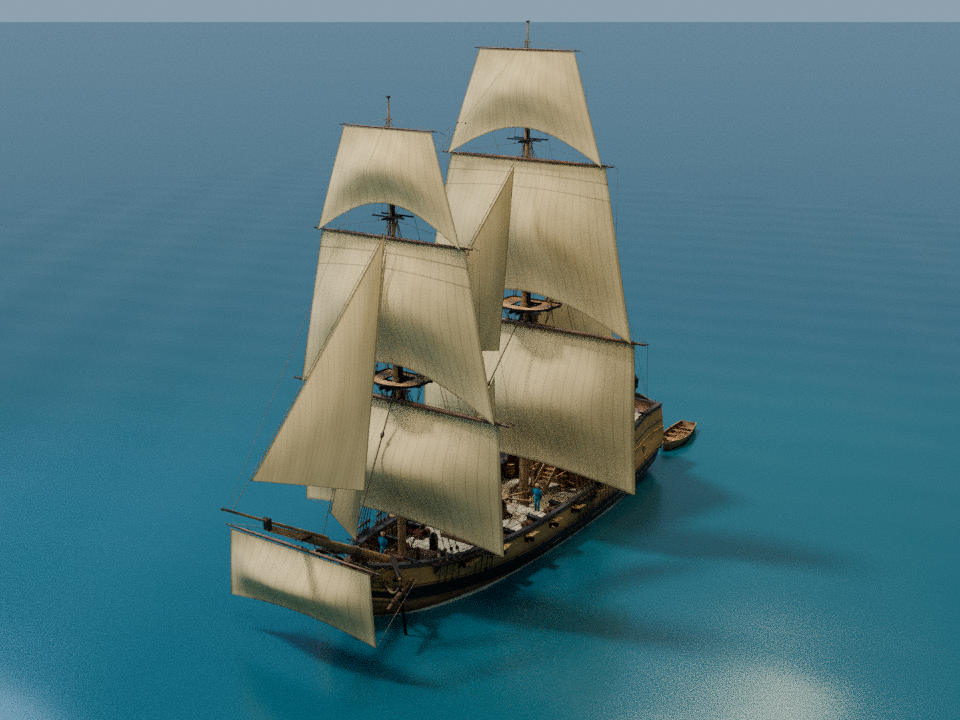
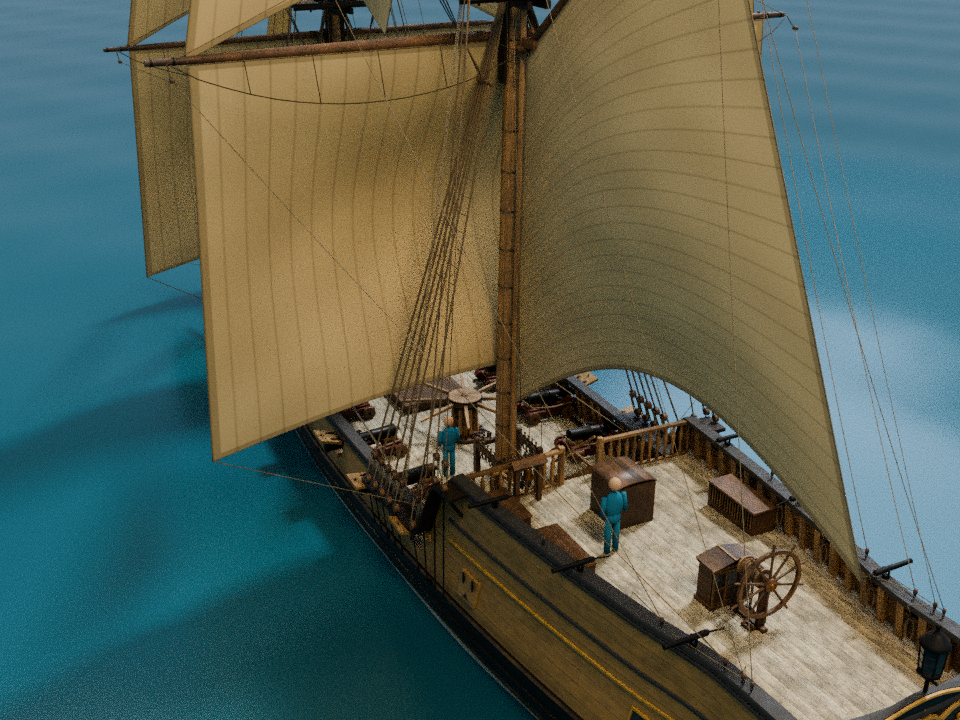

# Snow około 1710 roku — wersja do gry pod żaglami

Model powstaje z `model/snow.glb` i danych tego repozytorium. Zachowuje jego kadłub,
uzbrojenie, wyposażenie, skalę i nazwy. Dodaje 12 postawionych żagli, podnosi reje do
pozycji roboczych, aktualizuje ich liny i dodaje delikatną animację płótna.
Nie przedstawia konkretnego, udokumentowanego okrętu. Obrysy żagli są rekonstrukcją
według rozdziału 08 i `set_sail_estimates`, a nie historycznymi planami.




Wersja do gry skraca fok i grot oraz podcina dolny lik żagla gaflowego i podnosi
róg grotsztaksla. Wstępne obrysy z planu schodziły do przestrzeni zajmowanej przez
załogę. Cel konstrukcyjny to 2,25 m nad pokładem; eksport musi przejść kontrolę
prześwitu co najmniej 2,20 m nad pokładem głównym i rufowym, także dla skrajnych
stanów animacji wiatru. To decyzja ergonomiczna dla gry, nie wartość z epoki.
Podglądy zawierają manekiny kontrolne wysokości 1,75 m, poza eksportem GLB.

Olinowanie jest dopasowane do tej pozy żagli: perty biegną za rejami, topenanty
mają mocowania po tylnej stronie drzewc, a brasy prowadzą przez bloki poza płótnem
i dalej pod dolnymi żaglami. Górne żagle mają wyżej podcięte środki lików dolnych,
żeby omijać sztagi, wanty i osprzęt przy głowicach masztów. Sztaksle mają rogi
szotowe odchylone na lewą burtę; ich liki przednie podążają za krzywizną sztagów
i są połączone z nimi hankami. To roboczy trym modelu do gry, nie zachowany plan.

## Generowanie

Z katalogu głównego **pełnego sklonowanego repozytorium**:

```sh
blender -b --factory-startup --python-exit-code 1 --python game_asset/build_ship.py -- --out build/game_ship
blender -b --factory-startup --python-exit-code 1 --python game_asset/verify_exports.py -- build/game_ship
python game_asset/validate_asset.py build/game_ship
```

Sprawdzone w Blenderze 4.3.2. Skrypt korzysta z `bpy`, `bmesh`, `mathutils` i `numpy`
dostarczanych z Blenderem. Nie wymaga pobierania tekstur ani zewnętrznych pakietów.
`--no-renders` pomija cztery podglądy. Oryginalne pliki `model/` i `data/` są wejściem,
nie są nadpisywane. Kopia skryptu w paczce wynikowej służy do wglądu; do ponownej
budowy użyj plików z katalogu `game_asset/` w pełnym repozytorium.

Same podglądy można odtworzyć z zapisanej sceny, bez ponownego eksportu GLB:

```sh
blender -b build/game_ship/snow_sailing.blend --python-exit-code 1 --python game_asset/render_previews.py -- build/game_ship
```

Opcje `--samples 32 --resolution-percentage 75` przyspieszają roboczy podgląd.

Kontrola wygenerowanych plików bez Blendera: `python game_asset/validate_asset.py build/game_ship`.
W rozpakowanej paczce: `python validate_asset.py .`. Wynik zapisuje się jako `validation.json`.
Walidator porównuje również skróty GLB z raportami ponownego importu i pomiaru
prześwitu oraz wymaga kompletu 12 żagli i wszystkich próbek pętli, aby nie przyjąć
niepełnego raportu albo raportu dotyczącego poprzedniej wersji modelu.
Sprawdza też skróty skryptów zapisane w manifeście: po zmianie źródeł wygeneruj
model ponownie. [Raport ponownej budowy](validated-reference.json) zapisuje wyniki,
skróty plików i kontrole odrzucania nieaktualnych raportów. Niewielkie różnice liczby
trójkątów LOD-ów między uruchomieniami mogą wynikać z triangulacji i decymacji Blendera;
obowiązują liczniki oraz skróty rzeczywiście dostarczonych plików.
Generator dodatkowo sprawdza rzeczywistą geometrię wyeksportowanego GLB i zapisuje
`deck_clearance.json`. Powtórzenie samego pomiaru: `python game_asset/deck_clearance.py build/game_ship`
(ten dodatkowy skrypt wymaga NumPy). Sprawdzenie dotyczy płótna nad pokładami
w pozycji roboczej rej; nie jest oceną stateczności, obciążenia wiatrem ani wszystkich
przejść pomiędzy sprzętem i linami. Gdy zmieniasz brasowanie, trzeba powtórzyć kontrolę.

Przed eksportem generator sprawdza przecięcia lina–płótno i płótno–płótno w klatkach
0, 12, 24, 36, 48, 60, 72, 84 i 96. Wykryte przecięcie wnętrza płótna przerywa
budowę. Kontakt do 25 mm od brzegu jest klasyfikowany osobno jako połączenie
brzegowe; własne likliny są celowym mocowaniem na krawędzi. `verify_exports.py`
powtarza kontrolę na rzeczywiście wyeksportowanym GLB po imporcie do Blendera,
również dla statycznych LOD1 i LOD2. Raport dotyczy badanej pozy rej i tych próbek
animacji, nie dowolnego brasowania ani symulacji zachowania lin na wietrze.

## Pliki wynikowe

| Plik | Zastosowanie |
|---|---|
| `snow_sailing.glb` | pełny model z osadzonymi teksturami, stanowiskami, osobnymi mechanizmami i animacją płótna |
| `snow_sailing.blend` | edytowalna scena z zapakowanymi obrazami; oddzielna kolekcja podglądu z morzem, kamerą i światłami |
| `snow_sailing_lod1.glb` | uproszczona statyczna wersja pod żaglami na średnią odległość |
| `snow_sailing_lod2.glb` | dalszy poziom, z pominięciem drobnych lin i uproszczonym olinowaniem stałym |
| `snow_collision.glb` | oryginalne proste bryły kolizji; importuj oddzielnie i nie renderuj |
| `data/` | oryginalne dane do stanowisk, ruchomych części, chodzenia i lin |
| `asset_manifest.json` | rzeczywista liczba trójkątów, wersja Blendera i odcinki lin przebudowane po podniesieniu rej |
| `deck_clearance.json` | pomiar prześwitu nad oboma pokładami i powierzchni płótna dla 12 żagli |
| `rigging_collisions.json` | kontrola modelu przed eksportem, z osobnym wykazem styków przy krawędziach |
| `export_rigging_collisions_lod*.json` | kontrola trzech GLB po ponownym imporcie, związana ze skrótami plików |
| `sailing-rigging.json` | aktualne punkty przebiegu wygenerowanych i przeprowadzonych od nowa lin |
| `previews/` | cztery rendery rzeczywistego modelu, jeśli nie użyto `--no-renders` |

## Import do silnika

- **Godot 4:** przeciągnij `snow_sailing.glb` do projektu i utwórz scenę dziedziczoną.
  Użyj animacji z importowanego `AnimationPlayer`. Dla kolizji jawnie utwórz kształty
  silnika z oddzielnego GLB; sama nazwa `collision_*` nie gwarantuje fizyki.
- **Unity:** użyj importera glTF, np. glTFast, lub zaimportuj `.blend` przez Blendera.
  Zapisz własny prefab i skonfiguruj collidery, LODGroup i warstwy fizyki.
- **Unreal:** użyj importera glTF/Interchange dostępnego w danej wersji albo
  wyeksportuj FBX z dołączonej sceny. Morphy i animacje zweryfikuj w wybranym
  importerze; alternatywnie animuj blend shapes lub materiał żagla w silniku.

To instrukcje integracji, nie deklaracja przetestowania tych trzech silników.
Zweryfikowanymi wynikami są pliki Blendera i eksport glTF.

## Skala, węzły i animacje

- Metry, pokład między wrębami 28,0 m, szerokość po poszyciu 7,60 m.
- glTF: +Y w górę, dziób ku +Z, +X ku lewej burcie. Początek na wodnicy
  konstrukcyjnej. Blender: +Z w górę i dziób ku −Y.
- Root: `snow_sailing`. Żagle: `fore_course_set`, `main_topsail_set`, `gaff_sail_set`,
  `jib_set` itd. Żagle rejowe są dziećmi odpowiednich rej.
- Morphy `wind_port` / `wind_starboard` mają przypięte krawędzie. Pętla trwa 4 sekundy
  (klatki 0–96, 24 fps). To ruch wizualny, bez symulacji aerodynamiki lub płótna.
- Wybrano koło sterowe. Alternatywny rumpel i jego stanowiska usunięto z modelu
  wizualnego. W oryginalnych danych oraz pliku kolizji nadal są oba warianty:
  filtruj `variant == deck_tiller_variant` w integracji.
- Stanowiska na rejach zostały podniesione i podpięte do rej w GLB. W `data/stations.csv`
  pozostają oryginalne pozycje dla opuszczonych rej; dla tej wersji preferuj węzły GLB.
- LOD1/LOD2 to statyczne pozy pod żaglami. Przykładowe progi 75 i 250 m, histereza 15%,
  wymagają dostrojenia do kamery i urządzenia. Pełny model zachowuj dla walki i ruchu.
  Kształty płótna zachowano podczas upraszczania. LOD2 pomija drobne liny ruchome,
  perty i likliny, zachowując proste odcinki grubego olinowania stałego.
- Włączenie fizyki statku, sterowanie, walka, załoga, wybór LOD i dynamiczne liny
  są zadaniem kodu gry. Pakiet jest modelem, nie gotowym kontrolerem statku.

## Liny i żagle

Marsreje i bramreje podnoszone są o `working_height_dz_m` z uwzględnieniem pochylenia
masztów. Końce lin dynamicznych są ponownie liczone z `from_local` / `to_local`
według rozdziału 14. Podczas dalszego poruszania rejami, działami, gaflem i sterem
silnik musi ponownie obliczać liny; GLB nie realizuje tej zależności automatycznie.
`sailing-rigging.json` zawiera poprawione przebiegi i punkty mocowania tej wersji:
`points_gltf_m` to globalne punkty (x, y, z) glTF, a pola `*_local` nadal używają
lokalnych osi Blendera jak w danych wzorcowych. Nie nadpisano historycznych danych
w `data/rigging-lines.json`. Nowe przebiegi mają pierwszeństwo przed odpowiadającymi
im wierszami wzorca. Scalony węzeł `rigging_running_sailing` przedstawia statyczną
pozę roboczą; przy przestawianiu rej odtwórz związane z nimi odcinki z danych.
Gejtawy, gordingi, szoty i gejtawy gafla dla zwiniętych żagli nie są używane jako
liny postawionego płótna; nowe szoty do rogów szotowych są przybliżeniem wizualnym.
Nie odtworzono kompletu halsów, bulin ani obsługi refowania.

Żagle są dwustronne, kremowe, z panelami co około 0,57 m, liklinami i dwiema
refbantami na marslach. Gaflowy trysel pozostaje bez bomu.
Delikatny brzuch płótna i nowe tekstury są oryginalnym dodatkiem do tego pakietu.

## Ograniczenia i licencja

Obowiązują ograniczenia oryginału: brak wnętrza ładowni i kabiny, brak uszkodzeń,
niewygładzony w pełni wybieg kadłuba pod wodą i historyczne niepewności rekonstrukcji.
Holowana łódź jest częścią statycznego modelu. `boat_water_mask` wymaga w grze maskowania
wody opisanym w rozdziale 14 sposobem; nie wyświetlaj tej powierzchni jak zwykłej siatki.
Morze, kamera i światła są tylko w kolekcji `PRESENTATION` w pliku `.blend`, poza GLB.

Kod i model: MIT, patrz `LICENSE`. Tekstury odziedziczone z modelu: przetworzone zasoby
CC0 Poly Haven; ich wykaz w `reference_texture_sources.json`. Nowe tekstury płótna
są proceduralne i udostępnione z pozostałymi dodatkami na MIT.
