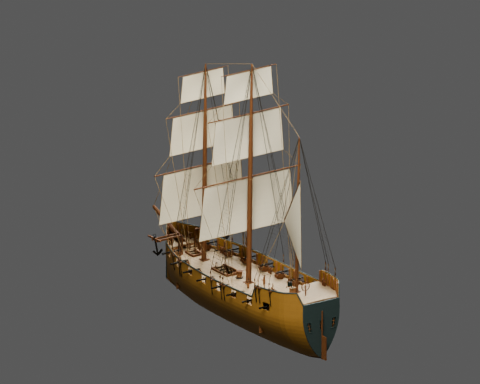
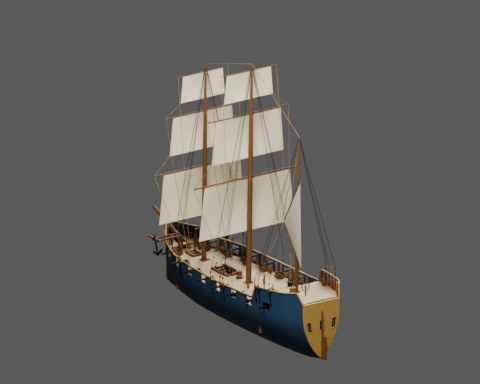
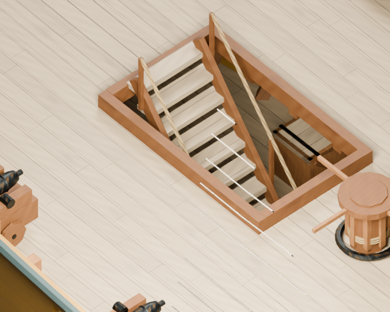
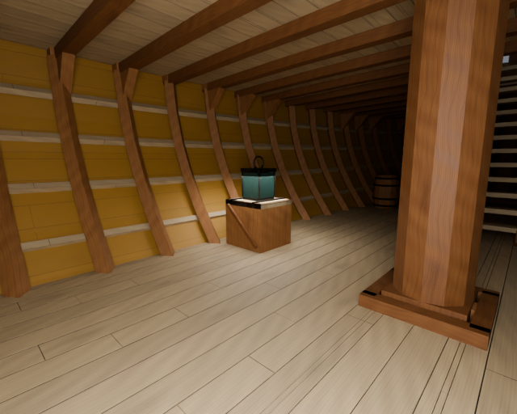
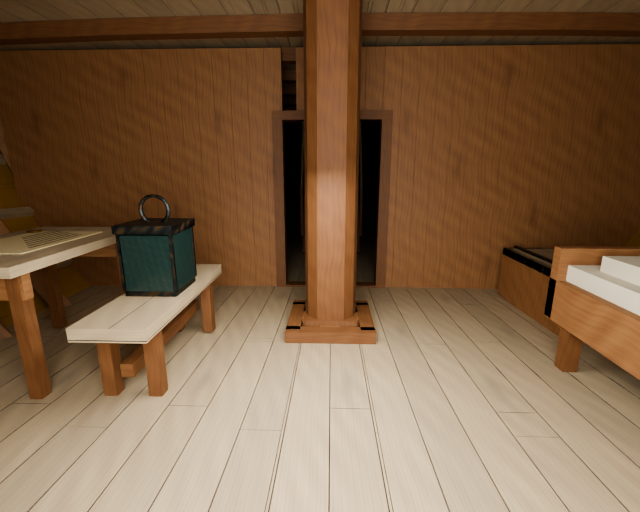
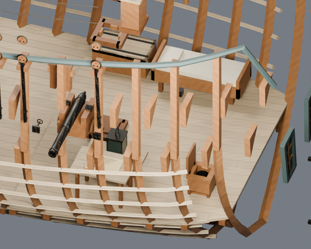

# Bark — POTC 2003 / Barque

Oryginalna rekonstrukcja proceduralna rodziny **Barque** z gry *Pirates of the Caribbean* (2003): klasa **6**, **16 dział**, dwa faktycznie wyeksportowane malowania `ochre` i `navy`. Nazwy modeli źródłowych: `Barque1` / `Barque2`.

| Ochra — ponowny import GLB | Granat — ponowny import GLB |
|---|---|
|  |  |

[Detal ochrowy](previews/ochre/detail.png) · [Detal granatowy](previews/navy/detail.png) · [Raport walidacji](validation.json) · [Porównanie źródła i eksportu](export-review.json)

## Podstawa i granice rekonstrukcji

Skrypty i współczesna grze tabela potwierdzają rodzinę, klasę i liczbę dział. **Nie ustalono oryginalnych wymiarów ani skali modeli gry.** Długość 27 m, szerokość 8.4 m, zanurzenie 2.9 m i wolna burta 2 m są autorskimi założeniami opartymi na metodzie poradnika tego repozytorium. Nie importowano własnościowych siatek ani tekstur gry.

The game family is preserved as a compact three-masted cargo vessel. The period-inspired lateen mizzen is a guide-based interpretation, not a claim that the retail mesh used a modern barque rig.

Materiały referencyjne nie potwierdzają dokładnego rozmieszczenia każdego masztu, kasztelu ani żagla. Geometrię i takielunek należy oceniać jako jawną interpretację rodziny, a nie odzyskany model detal w detal. Palety są autorskie; końcówki `1`/`2` wskazują identyfikatory rodzin ze skryptów, a nie dowód zgodności kolorów z grą.

- [Stock-derived modern script tree, not asserted byte-identical retail dump](https://github.com/storm-devs/potc/blob/2af54be0b92840c7c9f68618d02bc8f81dc13145/PROGRAM/Ships/Ships_init.c#L471-L491): family/model ID, game class, cannon quantity.
- [Contemporary 2004 player table](https://gamefaqs.gamespot.com/pc/914549-pirates-of-the-caribbean/faqs/28651): ordinary family roster, game class, cannon quantity.
- [Construction guide; no retail model geometry](https://github.com/grzegorz2047/OldShipSchematicsAndModel/blob/2e6f7e922e95396722376d42f3e2e0a12256029e/docs/en/12-designing-other-ships.md): hull and spar parameter chain, three-mast and schooner reconstruction method.

## Cechy tej rodziny

- Compact full cargo body with moderate transom and quarterdeck
- Three masts: square fore/main and period-inspired lateen mizzen
- Eight gun pairs on one exposed battery

| Maszt | Położenie, dziób dodatni | Wysokość nad lokalnym pokładem | Żagle |
|---|---|---|---|
| fore | 0.260 L | 21 m | square, square, square |
| main | -0.030 L | 23.5 m | square, square, square |
| mizzen | -0.340 L | 16.7 m | lateen |

W `spec.json` zera wysokości odnoszą się do wodnicy; `s` biegnie od rufy −0,5 L do dziobu +0,5 L. `rig.masts[].height_m` liczy się od rzeczywistego lokalnego pokładu, `sails[].z` jest ułamkiem tej wysokości dla górnej krawędzi żagla, a dodatni `rake` oznacza pochylenie ku rufie. Jednostki: metry. W eksporcie glTF: +Y w górę, +Z ku dziobowi.

## Dwa malowania i pliki

| Wariant | Poszycie malowane | Listwy malowane |
|---|---|---|
| `ochre` | `#A67C36` | `#40504B` |
| `navy` | `#28445F` | `#C7A058` |

Naturalne drewno pokładu i drzewc, płótno, liny oraz metal zachowują te same materiały w obu wariantach. Widok `detail` jest kontrolnym ujęciem kadłuba i pokładów z ukrytymi żaglami, drzewcami oraz linami; pozostawione mocowania należą do pełnego modelu widocznego na `hero`. `model/<paleta>/` zawiera `ship.glb`, `lod1.glb`, `lod2.glb` i edytowalny `source.blend`; `model/collision.glb` jest wspólną geometrią kolizji. `previews/<paleta>/` pokazuje rzeczywisty ponowny import GLB, a `review/<paleta>/source_*.png` odpowiadające mu widoki pliku źródłowego. Raporty `export-review.json` i `validation.json` wiążą kontrolowane pliki skrótami SHA-256.

## Odtworzenie i zakres

Pakiet zbudowano i porównano w **Blender 5.2.3 LTS**. Spakowane pliki `source.blend` wymagają **Blender 5.2 lub nowszego**; pliki GLB są niezależnym eksportem. Wymiary w specyfikacji są nominalne: bukszpryt, ster i ewentualny zaokrąglony nawis rufy powiększają obwiednię modelu.

Uruchom z katalogu repozytorium, używając Blender 5.2.3 LTS:

```sh
blender --background -t 1 --python potc/barque/build.py
```

Model jest **statycznym zasobem do pojedynków okrętów**. Raport obejmuje rzeczywistą geometrię, materiały, LOD, kolizję, osprzęt i zgodność eksportu z plikiem źródłowym. Nie przyznaje przejść dla sterowania, chodzenia, animacji, symulacji żagli ani nawigacji; te zachowania nie należą do dostarczanego zasobu.

## Wnętrza v5: badania i autorski układ

Układ pokładów, rzeczywiste otwory luków i przejścia, wręgi, ładownia oraz umeblowana kajuta są autorską rekonstrukcją opartą na badaniach. Nie odzyskano oryginalnego wnętrza z siatki gry. [`layout-research.json`](layout-research.json) oddziela twierdzenia źródeł od analogii i decyzji przestrzennych.

Compact armed wooden merchant interpretation. Endeavour is a period collier analogue for structure, not proof of the stock model identity or rig.

- Framed cargo hold with timber ceiling planks, dunnage, provision casks and crate lashings, retaining a central clear route.
- Aft modest cabin with desk, bunk, bench and chest below its stern accommodation; windows are authored at that room level.
- Two timber-coamed cargo accesses and a separate personnel descent, hand-worked wooden capstan, twin pumps; a 3m boat is an optional authored fitting only where final gun and rig clearance allows it.
- Bitts, pin rails and an officer close-stool with an actual seat opening and removable pot are authored period fittings. External bow-head access is not established in the preserved hull.

Przenośny stołek sanitarny w kajucie ma rzeczywisty otwór siedziska, uniesione wieko i wyjmowane naczynie; jest jawną adaptacją mebla z epoki. Nie poświadcza nieustalonego układu dziobowych ustępów pierwowzoru gry. Koja i wyposażenie kajuty są pełnymi elementami geometrii umieszczonymi w zmierzonych wolnych obszarach; łódź pozostaje opcjonalna.

W tej konfiguracji szesnastodziałowego barku pominięto opcjonalną łódź długości 3 m: pełny kadłub i podkładki nie mieszczą się w zmierzonych wolnych miejscach pomiędzy rzeczywistymi stanowiskami dział, takielunkiem, osprzętem i otwartymi lukami.

Materiały przeczytane dla tej rodziny:

- [Endeavour (1768), RMG ZAZ7845](https://www.rmg.co.uk/collections/objects/rmgc-object-244406): A wooden period merchant-hull analogue; Endeavour was ship-rigged. This does not identify the POTC Barque or prove its rig, dimensions or exact cabin plan.
- [Life aboard HMB Endeavour, Australian National Maritime Museum](https://www.sea.museum/en/learn/resource/life-aboard-hmb-endeavour): Use timber construction, cask storage and spatial hierarchy as analogues. Do not copy the special exploration conversion or modern replica machinery.
- [Endeavour shipwreck pump well evidence, ANMM (22 November 2023)](https://www.sea.museum/en/about/media/2023/11/museum-releases-further-evidence-to-support-its-case-for-identifying-endeavour-shipwreck): Supports a timber-enclosed pump well as a real working structure; coordinates and pump design in this asset are authored.
- [Life on Board, Vasa Museum](https://www.vasamuseet.se/en/explore/vasa-history/life-on-board): A 1628 warship analogue for construction and room hierarchy only; no claim that a merchant held Vasa-scale decoration or its exact internal arrangement.
- [Cargo vessel; Barque, RMG SLR1096, circa 1880](https://www.rmg.co.uk/collections/objects/rmgc-object-67057): Later generic cargo-access/rig comparator only. Iron/steel construction, whaleback quarterdeck, passenger deckhouse and nineteenth-century machinery are not copied.
- [The Vasa Museum in an hour: teacher guide, 2026, p.3](https://www.vasamuseet.se/globalassets/vasamuseet/dokument/skola/2026/t_teachers-guide-to-the-vasa-museum.pdf): Vasa is a 1628 warship. No identical sanitation arrangement or bow-head access is established for the POTC families.
- [Close stool, Colonial Williamsburg museum 1960-948, England 1700–1725](https://emuseum.colonialwilliamsburg.org/objects/17170/close-stool): A period furniture analogue, not a maritime find or verified stock asset. Its placement in these game-family cabins is authored; it does not establish fifteenth-century caravel equipment.
- [Geschiedenis van de 17e-eeuwse Batavia, Museum Batavialand](https://www.batavialand.nl/zien-en-doen/het-schip-batavia/geschiedenis-van-de-17e-eeuwse-batavia/): Does not establish stock-family boat dimensions or stowage. The 3m tender is an authored compact boat, not a claim to reproduce Batavia’s larger rescue boat.

Położenia w `detailed_layout` biegną od rufy −0,5 do dziobu +0,5 długości; wysokości są w metrach nad wodnicą. Zachowano rodzinny kadłub, ożaglowanie, liczbę dział i dwa niezależne malowania. Geometria przejść statycznego modelu nie jest poświadczeniem sterowania postacią.

## Widoki z aktualnego GLB

Poniższe obrazy pochodzą z ponownie wczytanego eksportu wariantu `ochre`. Zbliżenie pokładu obejmuje pole 4,5 m; ujęcia zamkniętych wnętrz mają obiektyw 20 mm i kamerę 1,23 m nad miejscową podłogą. Przekroje ukrywają wybrane warstwy wyłącznie podczas inspekcji. [Notatki z oględzin](detail-review.json) wiążą wszystkie sześć widoków z aktualnym plikiem modelu i obrazami.







**Przekrój kontrolny kajuty: wybrane warstwy ukryto wyłącznie w tym ujęciu.**



[Kontrolny przekrój ładowni](previews/ochre/detail/hold_cutaway.png) pokazuje jej połączenia i konstrukcję pod pokładem.

## Powierzchnie luf: jawny etap po eksporcie

Poprawiono wyłącznie normalne narożników i obie mapy UV rzeczywistych luf: gładki obwód każdego pasa odlewu, ostre pierścienie profilu i wylot, ciągła projekcja cylindryczna z jedynym szwem na spodzie oraz jawne zagęszczenie projekcji o 5%. Zachowano pozycje wierzchołków, indeksy, wszystkie pozostałe obiekty, materiały, obrazy tekstur i geometrię kolizji. Barwna patyna i refleksy nadal są stylizowane.

Własne `build.py` uruchamia po dotychczasowej budowie ten sam odtwarzalny etap `repair_package(HERE)`. [Rejestr powierzchni](surface-repair.json) zawiera skróty dwóch plików źródłowych i sześciu GLB, niezmieniony COL oraz pomiary zapisanych i ewaluowanych powierzchni źródła względem dostarczonych eksportów. Ten etap nie jest ponowną budową kadłuba ani źródłem historycznych twierdzeń o wnętrzu. Świeże obrazy i pełny audyt pozostają odrębnymi dowodami końcowej kontroli.
