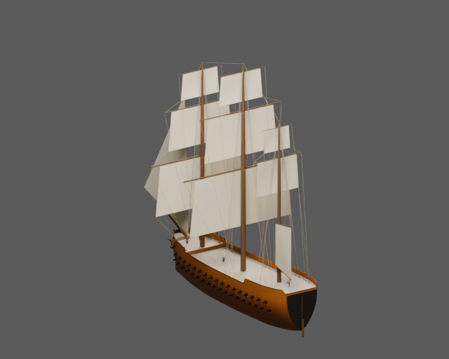
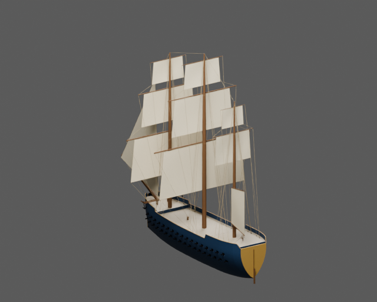
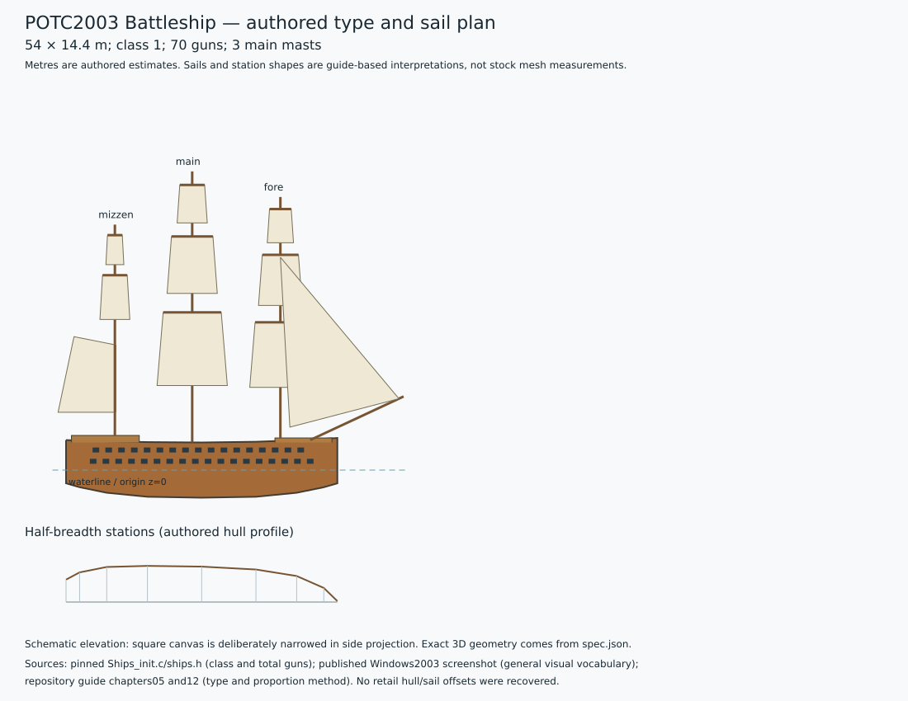

# POTC2003 Battleship — two painted static assets

Full three-masted 70-gun battleship, exactly two complete batteries, substantial quarterdeck and forecastle. No third battery or 100-gun Manowar structure.

The pinned stock-derived script identifies `Battleship1` as class 1 with **70 guns**. The procedural reconstruction uses authored dimensions **54 × 14.4 m**, draught 5.5 m and main-deck freeboard 5.5 m. These are design estimates, not recovered game dimensions. The stock ordinary Battleship class 1 entry gives 70 guns, separately from the excluded special Manowar. The authored two-decker keeps this normal family distinct from the special 100-gun ship.

Ochre and navy variants share geometry, UVs, hierarchy and natural deck, canvas, rigging and metal materials. Only `paint_hull` and `paint_trim` change. Main, LOD1 and LOD2 GLBs plus packed Blender source are in `model/<palette>/`; collision is shared. Source and imported-GLB renders are retained for both views and palettes. `validation.json` and `export-review.json` record actual checks.

| Ochre | Navy |
| --- | --- |
|  |  |

Build with Blender 5.2.3:

```sh
blender -b --python potc/battleship/build.py
```



`spec.json` and `type-profile.json` record the family plan, exact stock-stat evidence, guide references and uncertainty. The 2003 published screenshot is used only for general visual vocabulary; its ship family is not authenticated. No proprietary mesh, texture or paid generated asset is included. The stock-derived modern compatibility script is not claimed to be a byte-identical retail dump.

This is a **static duel asset**. Engine sailing, buoyancy, damage, gun logic and crew controllers are absent. Walking and interior navigation are not claimed and are outside this asset's acceptance scope.
