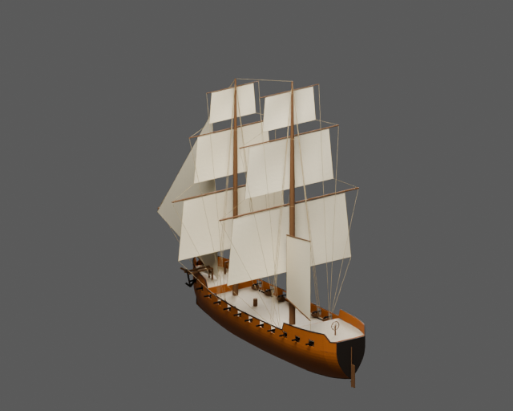
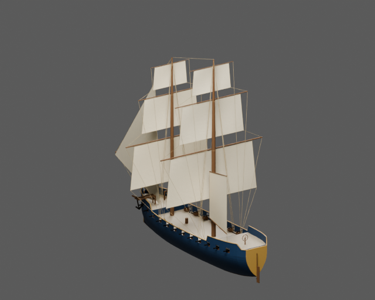
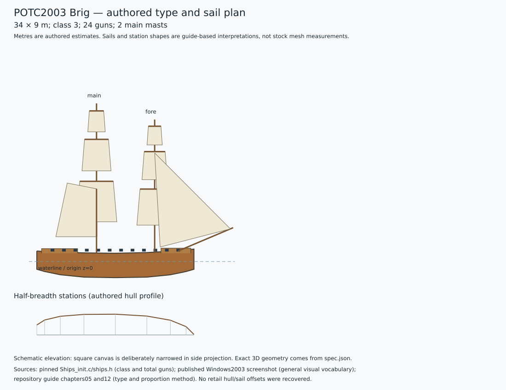

# POTC2003 Brig — two painted static assets

Two principal masts, both fully square-rigged; boom and gaff directly on mainmast; no separate snow/trysail mast. One 24-gun battery, low castles.

The pinned stock-derived script identifies `Brig1` as class 3 with **24 guns**. The procedural reconstruction uses authored dimensions **34 × 9 m**, draught 3.5 m and main-deck freeboard 1.8 m. These are design estimates, not recovered game dimensions. The guide distinguishes the later brig with boom from its reference Snow. This deliberately changes mast structure rather than merely renaming the existing Snow asset.

Ochre and navy variants share geometry, UVs, hierarchy and natural deck, canvas, rigging and metal materials. Only `paint_hull` and `paint_trim` change. Main, LOD1 and LOD2 GLBs plus packed Blender source are in `model/<palette>/`; collision is shared. Source and imported-GLB renders are retained for both views and palettes. `validation.json` and `export-review.json` record actual checks.

| Ochre | Navy |
| --- | --- |
|  |  |

Build with Blender 5.2.3:

```sh
blender -b --python potc/brig/build.py
```



`spec.json` and `type-profile.json` record the family plan, exact stock-stat evidence, guide references and uncertainty. The 2003 published screenshot is used only for general visual vocabulary; its ship family is not authenticated. No proprietary mesh, texture or paid generated asset is included. The stock-derived modern compatibility script is not claimed to be a byte-identical retail dump.

This is a **static duel asset**. Engine sailing, buoyancy, damage, gun logic and crew controllers are absent. Walking and interior navigation are not claimed and are outside this asset's acceptance scope.
