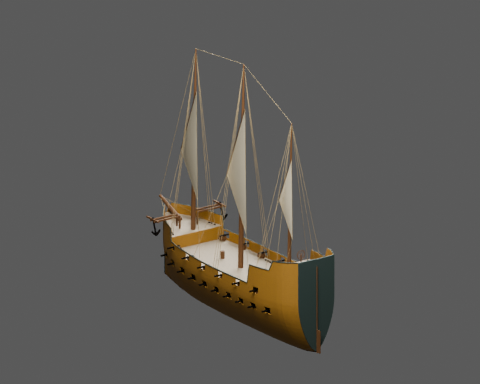
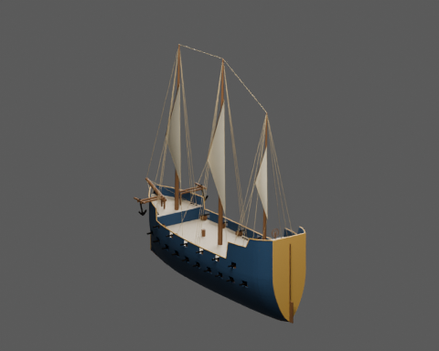

# Karawela — POTC 2003 / Caravel

Oryginalna rekonstrukcja proceduralna rodziny **Caravel** z gry *Pirates of the Caribbean* (2003): klasa **4**, **32 dział**, dwa faktycznie wyeksportowane malowania `ochre` i `navy`. Nazwy modeli źródłowych: `Caravel1` / `Caravel2`.

| Ochra — ponowny import GLB | Granat — ponowny import GLB |
|---|---|
|  |  |

[Detal ochrowy](previews/ochre/detail.png) · [Detal granatowy](previews/navy/detail.png) · [Raport walidacji](validation.json) · [Porównanie źródła i eksportu](export-review.json)

## Podstawa i granice rekonstrukcji

Skrypty i współczesna grze tabela potwierdzają rodzinę, klasę i liczbę dział. **Nie ustalono oryginalnych wymiarów ani skali modeli gry.** Długość 32.8 m, szerokość 9.6 m, zanurzenie 3.5 m i wolna burta 3.6 m są autorskimi założeniami opartymi na metodzie poradnika tego repozytorium. Nie importowano własnościowych siatek ani tekstur gry.

The three-lateen interpretation is supported cautiously by a later community catalogue retaining Caravel1 as Caravela Latina. This is not proof of unchanged retail rig geometry. Castle layout and dimensions are authored. A later New Horizons catalogue distinguishes Caravel1 (lateen) from Caravel2 (square-rigged). This deliverable chooses one authored lateen family reconstruction in two paint palettes; it does not claim to reproduce both original rig variants.

Materiały referencyjne nie potwierdzają dokładnego rozmieszczenia każdego masztu, kasztelu ani żagla. Geometrię i takielunek należy oceniać jako jawną interpretację rodziny, a nie odzyskany model detal w detal. Palety są autorskie; końcówki `1`/`2` wskazują identyfikatory rodzin ze skryptów, a nie dowód zgodności kolorów z grą.

- [Stock-derived modern script tree, not asserted byte-identical retail dump](https://github.com/storm-devs/potc/blob/2af54be0b92840c7c9f68618d02bc8f81dc13145/PROGRAM/Ships/Ships_init.c#L2382-L2402): family/model ID, game class, cannon quantity.
- [Contemporary 2004 player table](https://gamefaqs.gamespot.com/pc/914549-pirates-of-the-caribbean/faqs/28651): ordinary family roster, game class, cannon quantity.
- [Construction guide; no retail model geometry](https://github.com/grzegorz2047/OldShipSchematicsAndModel/blob/2e6f7e922e95396722376d42f3e2e0a12256029e/docs/en/12-designing-other-ships.md): hull and spar parameter chain, three-mast and schooner reconstruction method.
- [Later mod catalogue, not confirmed unchanged retail mesh](https://www.piratesahoy.net/threads/new-complete-guide-for-ships-on-potc-new-horizons.33543/page-2): later community catalogue retaining Caravel1 as lateen Caravela Latina.

## Cechy tej rodziny

- Full high-sided hull with distinct forecastle and two-level aft castle
- Three lateen masts; deliberately distinct from square-rigged merchant ships
- Thirty-two guns in two batteries: twenty lower and twelve upper

| Maszt | Położenie, dziób dodatni | Wysokość nad lokalnym pokładem | Żagle |
|---|---|---|---|
| fore | 0.315 L | 24 m | lateen |
| main | 0.000 L | 27 m | lateen |
| mizzen | -0.320 L | 19.5 m | lateen |

W `spec.json` zera wysokości odnoszą się do wodnicy; `s` biegnie od rufy −0,5 L do dziobu +0,5 L. `rig.masts[].height_m` liczy się od rzeczywistego lokalnego pokładu, `sails[].z` jest ułamkiem tej wysokości dla górnej krawędzi żagla, a dodatni `rake` oznacza pochylenie ku rufie. Jednostki: metry. W eksporcie glTF: +Y w górę, +Z ku dziobowi.

## Dwa malowania i pliki

| Wariant | Poszycie malowane | Listwy malowane |
|---|---|---|
| `ochre` | `#A67C36` | `#40504B` |
| `navy` | `#28445F` | `#C7A058` |

Naturalne drewno pokładu i drzewc, płótno, liny oraz metal zachowują te same materiały w obu wariantach. Widok `detail` jest kontrolnym ujęciem kadłuba i pokładów z ukrytymi żaglami, drzewcami oraz linami; pozostawione mocowania należą do pełnego modelu widocznego na `hero`. `model/<paleta>/` zawiera `ship.glb`, `lod1.glb`, `lod2.glb` i edytowalny `source.blend`; `model/collision.glb` jest wspólną geometrią kolizji. `previews/<paleta>/` pokazuje rzeczywisty ponowny import GLB, a `review/<paleta>/source_*.png` odpowiadające mu widoki pliku źródłowego. Raporty `export-review.json` i `validation.json` wiążą kontrolowane pliki skrótami SHA-256.

## Odtworzenie i zakres

Pakiet zbudowano i porównano w **Blender 5.2.3 LTS**. Spakowane pliki `source.blend` wymagają **Blender 5.2 lub nowszego**; pliki GLB są niezależnym eksportem. Wymiary w specyfikacji są nominalne: bukszpryt, ster i ewentualny zaokrąglony nawis rufy powiększają obwiednię modelu.

Uruchom z katalogu repozytorium, używając Blender 5.2.3 LTS:

```sh
blender --background -t 1 --python potc/caravel/build.py
```

Model jest **statycznym zasobem do pojedynków okrętów**. Raport obejmuje rzeczywistą geometrię, materiały, LOD, kolizję, osprzęt i zgodność eksportu z plikiem źródłowym. Nie przyznaje przejść dla sterowania, chodzenia, animacji, symulacji żagli ani nawigacji; te zachowania nie należą do dostarczanego zasobu.
