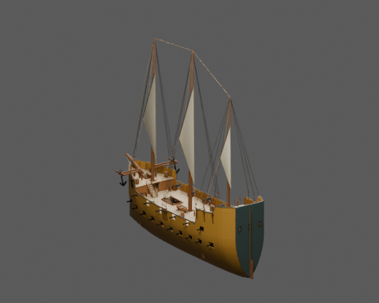
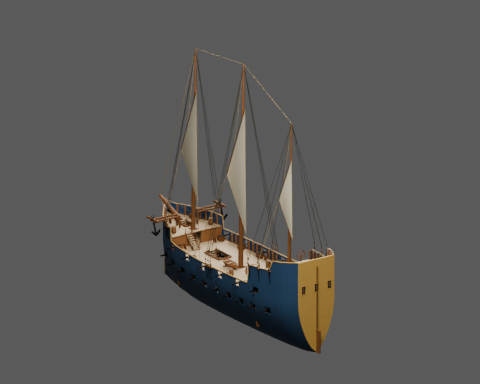
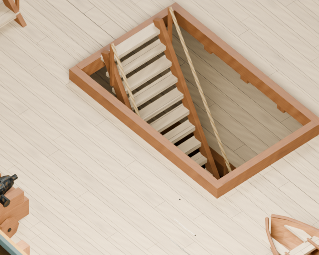
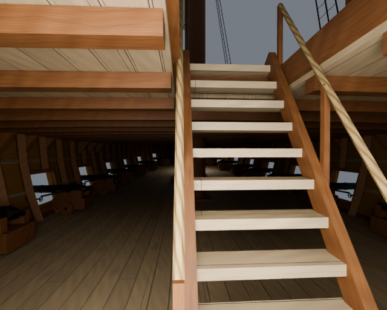
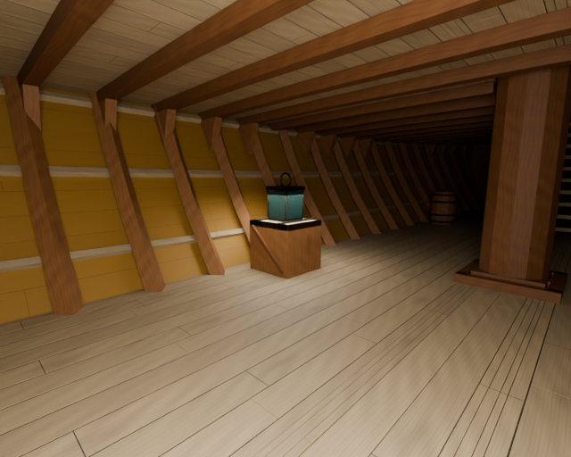
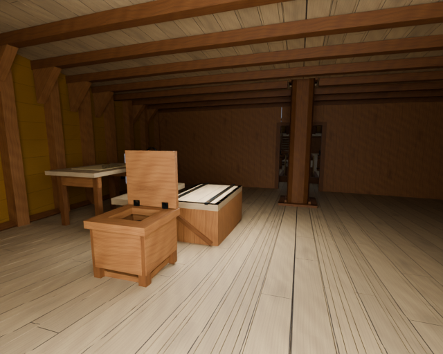
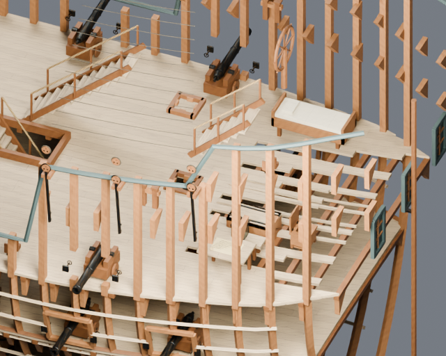

# Karawela — POTC 2003 / Caravel

Oryginalna rekonstrukcja proceduralna rodziny **Caravel** z gry *Pirates of the Caribbean* (2003): klasa **4**, **32 dział**, dwa faktycznie wyeksportowane malowania `ochre` i `navy`. Nazwy modeli źródłowych: `Caravel1` / `Caravel2`.

| Ochra — ponowny import GLB | Granat — ponowny import GLB |
|---|---|
|  |  |

[Detal ochrowy](previews/ochre/detail.png) · [Detal granatowy](previews/navy/detail.png) · [Raport walidacji](validation.json) · [Porównanie źródła i eksportu](export-review.json)

## Podstawa i granice rekonstrukcji

Skrypty i współczesna grze tabela potwierdzają rodzinę, klasę i liczbę dział. **Nie ustalono oryginalnych wymiarów ani skali modeli gry.** Długość 32.8 m, szerokość 9.6 m, zanurzenie 3.5 m i wolna burta 3.6 m są autorskimi założeniami opartymi na metodzie poradnika tego repozytorium. Nie importowano własnościowych siatek ani tekstur gry.

The three-lateen interpretation is supported cautiously by a later community catalogue retaining Caravel1 as Caravela Latina. This is not proof of unchanged retail rig geometry. Castle layout and dimensions are authored. A later New Horizons catalogue distinguishes Caravel1 (lateen) from Caravel2 (square-rigged). This deliverable chooses one authored lateen family reconstruction in two paint palettes; it does not claim to reproduce both original rig variants.

Materiały referencyjne nie potwierdzają dokładnego rozmieszczenia każdego masztu, kasztelu ani żagla. Geometrię i takielunek należy oceniać jako jawną interpretację rodziny, a nie odzyskany model detal w detal. Palety są autorskie; końcówki `1`/`2` wskazują identyfikatory rodzin ze skryptów, a nie dowód zgodności kolorów z grą.

- [Stock-derived modern script tree, not asserted byte-identical retail dump](https://github.com/storm-devs/potc/blob/2af54be0b92840c7c9f68618d02bc8f81dc13145/PROGRAM/Ships/Ships_init.c#L2382-L2402): family/model ID, game class, cannon quantity.
- [Contemporary 2004 player table](https://gamefaqs.gamespot.com/pc/914549-pirates-of-the-caribbean/faqs/28651): ordinary family roster, game class, cannon quantity.
- [Construction guide; no retail model geometry](https://github.com/grzegorz2047/OldShipSchematicsAndModel/blob/2e6f7e922e95396722376d42f3e2e0a12256029e/docs/en/12-designing-other-ships.md): hull and spar parameter chain, three-mast and schooner reconstruction method.
- [Later mod catalogue, not confirmed unchanged retail mesh](https://www.piratesahoy.net/threads/new-complete-guide-for-ships-on-potc-new-horizons.33543/page-2): later community catalogue retaining Caravel1 as lateen Caravela Latina.

## Cechy tej rodziny

- Full high-sided hull with distinct forecastle and two-level aft castle
- Three lateen masts; deliberately distinct from square-rigged merchant ships
- Thirty-two guns in two batteries: twenty lower and twelve upper

| Maszt | Położenie, dziób dodatni | Wysokość nad lokalnym pokładem | Żagle |
|---|---|---|---|
| fore | 0.315 L | 24 m | lateen |
| main | 0.000 L | 27 m | lateen |
| mizzen | -0.320 L | 19.5 m | lateen |

W `spec.json` zera wysokości odnoszą się do wodnicy; `s` biegnie od rufy −0,5 L do dziobu +0,5 L. `rig.masts[].height_m` liczy się od rzeczywistego lokalnego pokładu, `sails[].z` jest ułamkiem tej wysokości dla górnej krawędzi żagla, a dodatni `rake` oznacza pochylenie ku rufie. Jednostki: metry. W eksporcie glTF: +Y w górę, +Z ku dziobowi.

## Dwa malowania i pliki

| Wariant | Poszycie malowane | Listwy malowane |
|---|---|---|
| `ochre` | `#A67C36` | `#40504B` |
| `navy` | `#28445F` | `#C7A058` |

Naturalne drewno pokładu i drzewc, płótno, liny oraz metal zachowują te same materiały w obu wariantach. Widok `detail` jest kontrolnym ujęciem kadłuba i pokładów z ukrytymi żaglami, drzewcami oraz linami; pozostawione mocowania należą do pełnego modelu widocznego na `hero`. `model/<paleta>/` zawiera `ship.glb`, `lod1.glb`, `lod2.glb` i edytowalny `source.blend`; `model/collision.glb` jest wspólną geometrią kolizji. `previews/<paleta>/` pokazuje rzeczywisty ponowny import GLB, a `review/<paleta>/source_*.png` odpowiadające mu widoki pliku źródłowego. Raporty `export-review.json` i `validation.json` wiążą kontrolowane pliki skrótami SHA-256.

## Odtworzenie i zakres

Pakiet zbudowano i porównano w **Blender 5.2.3 LTS**. Spakowane pliki `source.blend` wymagają **Blender 5.2 lub nowszego**; pliki GLB są niezależnym eksportem. Wymiary w specyfikacji są nominalne: bukszpryt, ster i ewentualny zaokrąglony nawis rufy powiększają obwiednię modelu.

Uruchom z katalogu repozytorium, używając Blender 5.2.3 LTS:

```sh
blender --background -t 1 --python potc/caravel/build.py
```

Model jest **statycznym zasobem do pojedynków okrętów**. Raport obejmuje rzeczywistą geometrię, materiały, LOD, kolizję, osprzęt i zgodność eksportu z plikiem źródłowym. Nie przyznaje przejść dla sterowania, chodzenia, animacji, symulacji żagli ani nawigacji; te zachowania nie należą do dostarczanego zasobu.

## Wnętrza v5: badania i autorski układ

Układ pokładów, rzeczywiste otwory luków i przejścia, wręgi, ładownia oraz umeblowana kajuta są autorską rekonstrukcją opartą na badaniach. Nie odzyskano oryginalnego wnętrza z siatki gry. [`layout-research.json`](layout-research.json) oddziela twierdzenia źródeł od analogii i decyzji przestrzennych.

The stock 32-gun fantasy vessel remains a large three-mast lateen caravel interpretation. Museum evidence supports the lateen type, not the unusual artillery scale.

- Provision casks and planked storage crates occupy a framed lower hold with main hatch access.
- The preserved lower gun deck remains a separate working level with open access from the weather deck and a further descent to the hold.
- Plain aft room below the raised sterncastle uses a chart table, seating, bunk and storage furniture; modest glass stern lights are an explicit inferred adaptation.
- Hand-worked capstan and pump well, rope stowage, optional carried-boat skids and a removable-pot officer facility are authored period-style adaptations to the large armed game family; they do not establish exact early-caravel equipment.

Przenośny stołek sanitarny w kajucie ma rzeczywisty otwór siedziska, uniesione wieko i wyjmowane naczynie; jest jawną adaptacją mebla z epoki. Nie poświadcza nieustalonego układu dziobowych ustępów pierwowzoru gry. Koja i wyposażenie kajuty są pełnymi elementami geometrii umieszczonymi w zmierzonych wolnych obszarach; łódź pozostaje opcjonalna.

W gotowym układzie znajduje się pełna łódź długości 3 m z ławkami, wiosłami i podpartymi podkładkami, dopasowana do wolnego miejsca na pokładzie głównym. Wymiary i miejsce są autorską decyzją; relacja o łodzi Batavii nie poświadcza identycznej łodzi ani rozmieszczenia tej rodziny gry. Dodatkowych małych schowków narzędziowych na dolnej baterii nie dodano tam, gdzie brak rzeczywistego miejsca poza działami, taklami i przejściem. Jej wyposażeniem roboczym pozostają rzeczywiste działa na wózkach i ich osprzęt.

Materiały przeczytane dla tej rodziny:

- [Caravela latina, Portuguese Navy Museu de Marinha MM.05724](https://cultura.marinha.pt/pt/museumarinha_web/colecoes_web/pecasemdestaque_web/Paginas/caravela-latina.aspx): Confirms the rig family. The twentieth-century model is not a surviving caravel and gives no verified POTC interior.
- [Caravela Latina de Três Mastros, Portuguese Navy Historical Archive PT/BCM-AH/FG/001-08/20-001](https://arquivohistorico.marinha.pt/details?id=33091): Confirms a recognized three-mast interpretation, with no measured internal arrangement.
- [Caravela Boa Esperança, Câmara Municipal de Lagos photograph and description](https://fototeca.cm-lagos.pt/maritimo/caravela-boa-esperanca-2): This is a two-mast modern training replica; its bunks, toilets, kitchen, fuel and other modern safety/comfort equipment are not treated as historical evidence. The larger armed game-family hull and three lateen masts are retained.
- [Life on Board, Vasa Museum](https://www.vasamuseet.se/en/explore/vasa-history/life-on-board): A 1628 warship analogue for construction and room hierarchy only; no claim that a merchant held Vasa-scale decoration or its exact internal arrangement.
- [Vraag en antwoord over de Batavia, Museum Batavialand](https://www.batavialand.nl/zien-en-doen/het-schip-batavia/vraag-en-antwoord/): Batavia is a Dutch East Indiaman, not a fluit or the game Pinnace. Use room types and visible timber construction as period analogues; the asset layout remains an authored reconstruction.
- [The Vasa Museum in an hour: teacher guide, 2026, p.3](https://www.vasamuseet.se/globalassets/vasamuseet/dokument/skola/2026/t_teachers-guide-to-the-vasa-museum.pdf): Vasa is a 1628 warship. No identical sanitation arrangement or bow-head access is established for the POTC families.
- [Close stool, Colonial Williamsburg museum 1960-948, England 1700–1725](https://emuseum.colonialwilliamsburg.org/objects/17170/close-stool): A period furniture analogue, not a maritime find or verified stock asset. Its placement in these game-family cabins is authored; it does not establish fifteenth-century caravel equipment.
- [Geschiedenis van de 17e-eeuwse Batavia, Museum Batavialand](https://www.batavialand.nl/zien-en-doen/het-schip-batavia/geschiedenis-van-de-17e-eeuwse-batavia/): Does not establish stock-family boat dimensions or stowage. The 3m tender is an authored compact boat, not a claim to reproduce Batavia’s larger rescue boat.

Położenia w `detailed_layout` biegną od rufy −0,5 do dziobu +0,5 długości; wysokości są w metrach nad wodnicą. Zachowano rodzinny kadłub, ożaglowanie, liczbę dział i dwa niezależne malowania. Geometria przejść statycznego modelu nie jest poświadczeniem sterowania postacią.

## Widoki z aktualnego GLB

Poniższe obrazy pochodzą z ponownie wczytanego eksportu wariantu `ochre`. Zbliżenie pokładu obejmuje pole 4,5 m; ujęcia zamkniętych wnętrz mają obiektyw 20 mm i kamerę 1,23 m nad miejscową podłogą. [Notatki z oględzin](detail-review.json) wiążą wszystkie osiem widoków z aktualnym modelem i obrazami.





Schody zajmują znaczną część pierwszego planu baterii; dalsze stanowiska są ciemniejsze. Zachowane działa na wózkach, otwarte ambrazury i podłoga pokazują jej rzeczywiste wyposażenie robocze.





Zachowany tylny maszt częściowo przesłania wejście kajuty; koja znajduje się poza kadrem tego ujęcia i jest widoczna w przekroju.

**Przekrój kontrolny kajuty: wybrane warstwy ukryto wyłącznie w tym ujęciu.**



[Kontrolny przekrój dolnej baterii](previews/ochre/detail/gun_deck_0_cutaway.png) · [Kontrolny przekrój ładowni](previews/ochre/detail/hold_cutaway.png). Przekroje są jasnymi widokami konstrukcyjnymi z ukrytymi warstwami osłonowymi i zachowanymi wyższymi elementami; zamknięte pomieszczenia pokazano oddzielnie.
