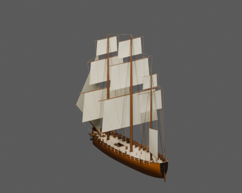
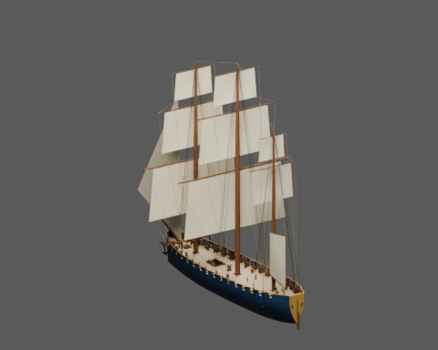
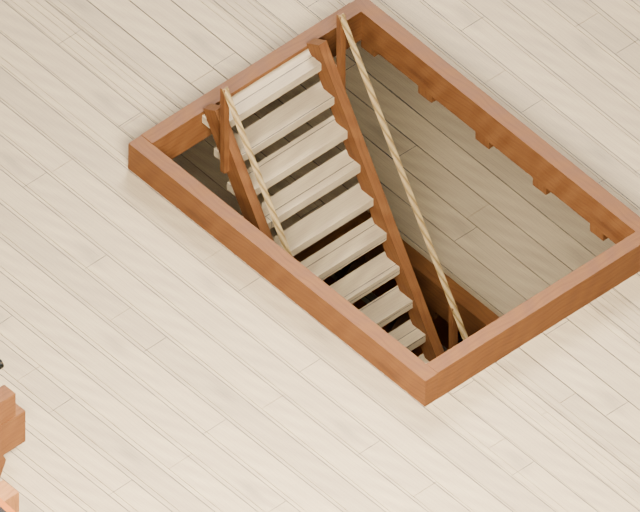
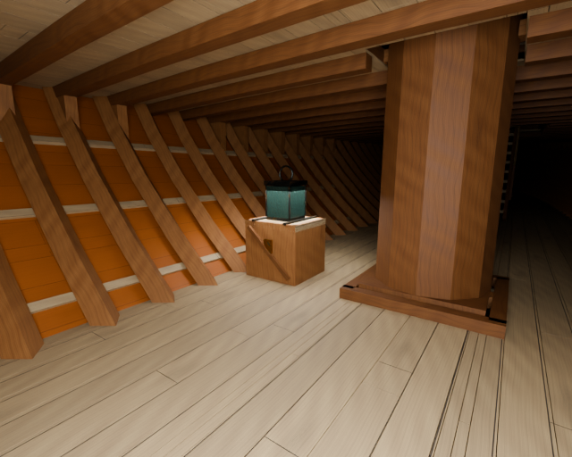
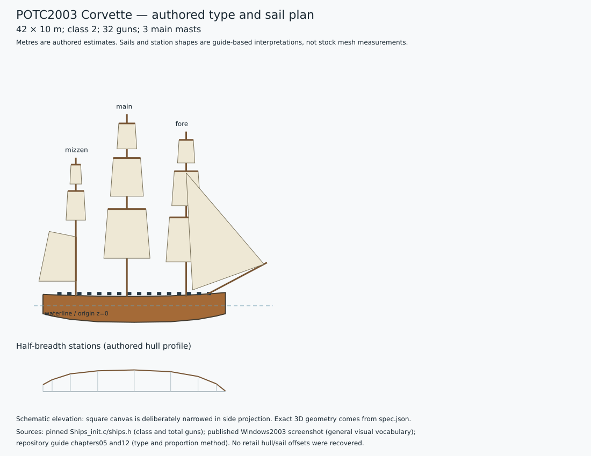

# POTC2003 Corvette — two painted static assets

Slender three-masted, 32-gun corvette with a flush deck and single open battery; square fore/main and square upper mizzen with a gaff spanker.

The pinned stock-derived script identifies `Corvette1` as class 2 with **32 guns**. The procedural reconstruction uses authored dimensions **42 × 10 m**, draught 3.8 m and main-deck freeboard 2.15 m. These are design estimates, not recovered game dimensions. Stock-derived scripts give the Corvette 32 guns and higher speed/turn rates than the Frigate. A single battery, low superstructure and finer lines distinguish the authored corvette from the frigate.

Ochre and navy variants share geometry, UVs, hierarchy and natural deck, canvas, rigging and metal materials. Only `paint_hull` and `paint_trim` change. Main, LOD1 and LOD2 GLBs plus packed Blender source are in `model/<palette>/`; collision is shared. Source and imported-GLB renders are retained for both views and palettes. `validation.json` and `export-review.json` record actual checks.

| Ochre | Navy |
| --- | --- |
|  |  |

<!-- v5-detail-evidence:start -->
## Detailed deck and interiors

The delivered geometry includes individual deck planks, framing, real hatch and door openings, working fittings, furnished storage and an after cabin. Full-resolution main PBR maps, separate distance maps, packed Blender sources, both paint palettes, LOD1/LOD2 and the shared collision model are retained.

| Actual deck close-up | Actual intact hold |
| --- | --- |
|  |  |

The deck view hides rigging for visibility. The hold image retains the complete room geometry. [Intact cabin view](previews/ochre/detail/cabin_interior.png) and the separately labeled cutaways are listed in `detail-render.json`; `detail-review.json` records actual image findings. Rendered PNGs are bound to the delivered GLB and renderer by SHA256. `validation.json` records the physical, source/export, material, detail and package checks.

Historical arrangement sources, with authored dimensions and limitations documented in [the research ledger](layout-research.json):

- [Royal Museums Greenwich: Ganymede (captured 1809), ZAZ3644](https://www.rmg.co.uk/collections/objects/rmgc-object-83435)
- [Royal Museums Greenwich: Ganymede (captured 1809), ZAZ3645](https://www.rmg.co.uk/collections/objects/rmgc-object-83436)

[Actual intact main-deck gun and carriage closeup](previews/ochre/detail/main_deck_gun_closeup.png) separately shows one real gun station, wooden carriage and wheel, mounted breeching eye and rope. This asset declares no separate enclosed `gun_deck` room, so the supplementary image is correctly a deck view. Its explicit [camera configuration](detail-camera-closeups.json) and [local reproducible wrapper](render-detail-closeups.py) use the unchanged frozen v5 review engine, the full delivered GLB and materials, 640 × 512 px and 12 samples. All six default views remain unchanged; no mesh or rigging is hidden in this extra camera.

The intact hold has a shadowed far end. The wide, pale cutaways establish construction and furnishing placement, with limited readability of tiny hardware. The intact cabin camera shows the writing table, chest, lantern and open doorway; the bed is assessed in the separately labeled cutaway. The near gun image visibly retains the barrel's faceted surface and broad wear patches. These render limitations are recorded in the actual manual review.

<!-- v5-detail-evidence:end -->

Build with Blender 5.2.3:

```sh
blender -b --python potc/corvette/build.py
```



`spec.json` and `type-profile.json` record the family plan, exact stock-stat evidence, guide references and uncertainty. The 2003 published screenshot is used only for general visual vocabulary; its ship family is not authenticated. No proprietary mesh, texture or paid generated asset is included. The stock-derived modern compatibility script is not claimed to be a byte-identical retail dump.

[Interior plan](interior-plan.md) and [research ledger](layout-research.json) document the new framed below-deck spaces, real openings, stairs and furnished after cabin. Historical sources inform the arrangement; the dimensions remain authored.

This is a **static detailed ship asset**. Engine sailing, buoyancy, damage, gun logic, player control and crew AI are absent. Geometric access and imported-export checks are recorded in `validation.json`.
