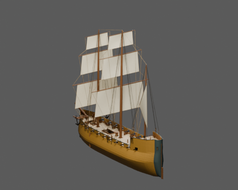
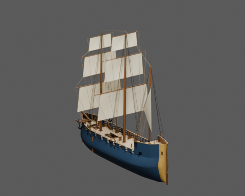

# Fleuta — POTC 2003 / Fleut

Oryginalna rekonstrukcja proceduralna rodziny **Fleut** z gry *Pirates of the Caribbean* (2003): klasa **4**, **20 dział**, dwa faktycznie wyeksportowane malowania `ochre` i `navy`. Nazwy modeli źródłowych: `Fleut1` / `Fleut2`.

| Ochra — ponowny import GLB | Granat — ponowny import GLB |
|---|---|
|  |  |

[Detal ochrowy](previews/ochre/detail.png) · [Detal granatowy](previews/navy/detail.png) · [Raport walidacji](validation.json) · [Porównanie źródła i eksportu](export-review.json)

## Podstawa i granice rekonstrukcji

Skrypty i współczesna grze tabela potwierdzają rodzinę, klasę i liczbę dział. **Nie ustalono oryginalnych wymiarów ani skali modeli gry.** Długość 35.6 m, szerokość 10.6 m, zanurzenie 3.7 m i wolna burta 2.9 m są autorskimi założeniami opartymi na metodzie poradnika tego repozytorium. Nie importowano własnościowych siatek ani tekstur gry.

The stock Fleut family is interpreted as a rounded-stern cargo fluyt. The deck narrowing, hull shape and rig are original guide-based reconstruction rather than measurements of a retail mesh.

Materiały referencyjne nie potwierdzają dokładnego rozmieszczenia każdego masztu, kasztelu ani żagla. Geometrię i takielunek należy oceniać jako jawną interpretację rodziny, a nie odzyskany model detal w detal. Palety są autorskie; końcówki `1`/`2` wskazują identyfikatory rodzin ze skryptów, a nie dowód zgodności kolorów z grą.

- [Stock-derived modern script tree, not asserted byte-identical retail dump](https://github.com/storm-devs/potc/blob/2af54be0b92840c7c9f68618d02bc8f81dc13145/PROGRAM/Ships/Ships_init.c#L2732-L2752): family/model ID, game class, cannon quantity.
- [Contemporary 2004 player table](https://gamefaqs.gamespot.com/pc/914549-pirates-of-the-caribbean/faqs/28651): ordinary family roster, game class, cannon quantity.
- [Construction guide; no retail model geometry](https://github.com/grzegorz2047/OldShipSchematicsAndModel/blob/2e6f7e922e95396722376d42f3e2e0a12256029e/docs/en/12-designing-other-ships.md): hull and spar parameter chain, three-mast and schooner reconstruction method.

## Cechy tej rodziny

- Pear-shaped cargo plan, narrow round stern and strong tumblehome to 72 percent deck beam
- High poop above a deep full cargo body
- Square fore/main and lateen mizzen; ten gun pairs

| Maszt | Położenie, dziób dodatni | Wysokość nad lokalnym pokładem | Żagle |
|---|---|---|---|
| fore | 0.270 L | 27 m | square, square, square |
| main | -0.020 L | 30 m | square, square, square |
| mizzen | -0.330 L | 21 m | lateen |

W `spec.json` zera wysokości odnoszą się do wodnicy; `s` biegnie od rufy −0,5 L do dziobu +0,5 L. `rig.masts[].height_m` liczy się od rzeczywistego lokalnego pokładu, `sails[].z` jest ułamkiem tej wysokości dla górnej krawędzi żagla, a dodatni `rake` oznacza pochylenie ku rufie. Jednostki: metry. W eksporcie glTF: +Y w górę, +Z ku dziobowi.

## Dwa malowania i pliki

| Wariant | Poszycie malowane | Listwy malowane |
|---|---|---|
| `ochre` | `#A67C36` | `#40504B` |
| `navy` | `#28445F` | `#C7A058` |

Naturalne drewno pokładu i drzewc, płótno, liny oraz metal zachowują te same materiały w obu wariantach. Widok `detail` jest kontrolnym ujęciem kadłuba i pokładów z ukrytymi żaglami, drzewcami oraz linami; pozostawione mocowania należą do pełnego modelu widocznego na `hero`. `model/<paleta>/` zawiera `ship.glb`, `lod1.glb`, `lod2.glb` i edytowalny `source.blend`; `model/collision.glb` jest wspólną geometrią kolizji. `previews/<paleta>/` pokazuje rzeczywisty ponowny import GLB, a `review/<paleta>/source_*.png` odpowiadające mu widoki pliku źródłowego. Raporty `export-review.json` i `validation.json` wiążą kontrolowane pliki skrótami SHA-256.

## Odtworzenie i zakres

Pakiet zbudowano i porównano w **Blender 5.2.3 LTS**. Spakowane pliki `source.blend` wymagają **Blender 5.2 lub nowszego**; pliki GLB są niezależnym eksportem. Wymiary w specyfikacji są nominalne: bukszpryt, ster i ewentualny zaokrąglony nawis rufy powiększają obwiednię modelu.

Uruchom z katalogu repozytorium, używając Blender 5.2.3 LTS:

```sh
blender --background -t 1 --python potc/fleut/build.py
```

Model jest **statycznym zasobem do pojedynków okrętów**. Raport obejmuje rzeczywistą geometrię, materiały, LOD, kolizję, osprzęt i zgodność eksportu z plikiem źródłowym. Nie przyznaje przejść dla sterowania, chodzenia, animacji, symulacji żagli ani nawigacji; te zachowania nie należą do dostarczanego zasobu.

## Wnętrza v5: badania i autorski układ

Układ pokładów, rzeczywiste otwory luków i przejścia, wręgi, ładownia oraz umeblowana kajuta są autorską rekonstrukcją opartą na badaniach. Nie odzyskano oryginalnego wnętrza z siatki gry. [`layout-research.json`](layout-research.json) oddziela twierdzenia źródeł od analogii i decyzji przestrzennych.

Cargo-first Dutch fluit interpretation retains the pear hull, strong tumblehome, 72 percent deck beam, rounded stern and high aft accommodation.

- Broad lower hold carries six tied bulk sacks representing grain/salt and two bundles of three timber baulks on dunnage; cargo bays leave a central inspection path.
- Long central cargo hatch and smaller forward access serve the hold without filling the narrow deck with warship furniture.
- Small high aft cabin has plain desk, berth and stores; the number and position of round-stern lights are authored.
- Wooden hand-worked anchor machinery, paired pumps, optional compact carried boat, removable-pot cabin facility and sparse pin/bitt furniture suit the narrow working deck. Bow-head access is not established.

Przenośny stołek sanitarny w kajucie ma rzeczywisty otwór siedziska, uniesione wieko i wyjmowane naczynie; jest jawną adaptacją mebla z epoki. Nie poświadcza nieustalonego układu dziobowych ustępów pierwowzoru gry. Koja i wyposażenie kajuty są pełnymi elementami geometrii umieszczonymi w zmierzonych wolnych obszarach; łódź pozostaje opcjonalna.

Materiały przeczytane dla tej rodziny:

- [Het fluitschip — vrachtschip van de 17de eeuw, Het Scheepvaartmuseum](https://www.hetscheepvaartmuseum.nl/collectie/artikelen/701/het-fluitschip-vrachtschip-van-de-17e-eeuw): Supports cargo-first form and stores. The twenty game-family guns and cabin/hatch coordinates are authored adaptations; do not turn it into a warship interior.
- [Model of a Dutch Fluitschip (c.1645), Science Museum Group 1961-85](https://collection.sciencemuseumgroup.org.uk/objects/co41131/model-of-a-dutch-fluitschip): Supports visual type comparison, not a contemporary construction plan or complete interior.
- [Vraag en antwoord over de Batavia, Museum Batavialand](https://www.batavialand.nl/zien-en-doen/het-schip-batavia/vraag-en-antwoord/): Batavia is a Dutch East Indiaman, not a fluit or the game Pinnace. Use room types and visible timber construction as period analogues; the asset layout remains an authored reconstruction.
- [Endeavour shipwreck pump well evidence, ANMM (22 November 2023)](https://www.sea.museum/en/about/media/2023/11/museum-releases-further-evidence-to-support-its-case-for-identifying-endeavour-shipwreck): Supports a timber-enclosed pump well as a real working structure; coordinates and pump design in this asset are authored.
- [The Vasa Museum in an hour: teacher guide, 2026, p.3](https://www.vasamuseet.se/globalassets/vasamuseet/dokument/skola/2026/t_teachers-guide-to-the-vasa-museum.pdf): Vasa is a 1628 warship. No identical sanitation arrangement or bow-head access is established for the POTC families.
- [Close stool, Colonial Williamsburg museum 1960-948, England 1700–1725](https://emuseum.colonialwilliamsburg.org/objects/17170/close-stool): A period furniture analogue, not a maritime find or verified stock asset. Its placement in these game-family cabins is authored; it does not establish fifteenth-century caravel equipment.
- [Geschiedenis van de 17e-eeuwse Batavia, Museum Batavialand](https://www.batavialand.nl/zien-en-doen/het-schip-batavia/geschiedenis-van-de-17e-eeuwse-batavia/): Does not establish stock-family boat dimensions or stowage. The 3m tender is an authored compact boat, not a claim to reproduce Batavia’s larger rescue boat.

Położenia w `detailed_layout` biegną od rufy −0,5 do dziobu +0,5 długości; wysokości są w metrach nad wodnicą. Zachowano rodzinny kadłub, ożaglowanie, liczbę dział i dwa niezależne malowania. Geometria przejść statycznego modelu nie jest poświadczeniem sterowania postacią.

## Rzeczywista galeria szczegółów v5

[Cały kadłub i takielunek](previews/ochre/detail/hull_rig.png) · [Pokład w skali 4,5 m](previews/ochre/detail/deck_closeup.png) · [Wnętrze ładowni](previews/ochre/detail/hold_interior.png) · [Wnętrze kajuty](previews/ochre/detail/cabin_interior.png)

[Przekrój ładowni](previews/ochre/detail/hold_cutaway.png) i [przekrój kajuty](previews/ochre/detail/cabin_cutaway.png) są osobnymi widokami kontrolnymi z jawnie ukrytym poszyciem i wybranymi górnymi elementami. Dostarczony GLB zachowuje te elementy; wnętrza pokazano również bez przekroju. [Opis obrazów](detail-render.json) i [ręczna ocena względem Bryga Mewa PR 3](detail-review.json) wiążą widoki z konkretnym eksportem.

Końcowa ładownia zawiera sześć wiązanych worków i dwie wiązki po trzy belki na podkładach. Kajuta ma pełnowymiarową koję, stół, siedzisko, schowek, latarnię i stołek sanitarny z otworem. Opcjonalna łódź 3 m nie weszła do końcowego pakietu: na gotowym pokładzie nie ma zmierzonego wolnego miejsca pozwalającego zachować odstęp od dział, luków, takielunku i osprzętu.

Połączenia górnych końców wręg mają dopasowane gniazda w stopach nadstawek. Zakrzywione wręgi zachowują metryczne, izometryczne mapowanie drewna. W rzeczywistym eksporcie testowym udział powierzchni naturalnego drewna z anizotropią powyżej 1,25 spadł z 10,4693% do 0,005414%, przy niezmienionej granicy 8%; gęstość pozostała około 1024 px/m, a zgodność kierunku słojów wyniosła 99,844%.

Odnowienie powierzchni luf jest jawnym etapem po eksporcie, odtwarzalnym przez cztery lokalne moduły gun_surface_*.py i osobny końcowy blok w [build.py](build.py). [Rejestr zmian](surface-repair.json) wiąże dwa pliki Blender i sześć wizualnych GLB: zachowano pozycje, indeksy, materiały, obrazy, pozostałe obiekty i identyczny plik kolizji. Zmiana dotyczy ciągłych metrycznych UV i normalnych powierzchni 20 luf; dopasowane 82 gniazda wręg oraz 41 mapowań drewnianych wręg pozostają zachowane. Końcowe widoki i pełny audyt są wykonywane ponownie po tej zmianie.
