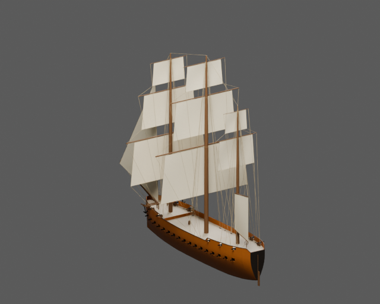
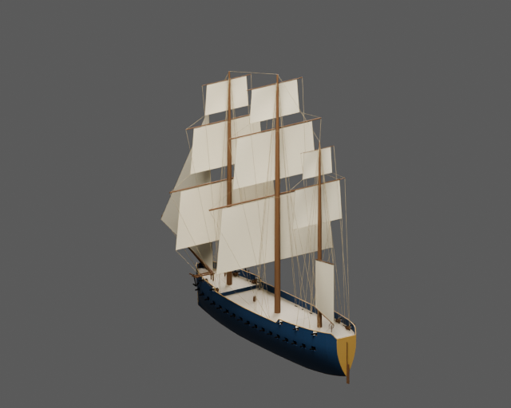
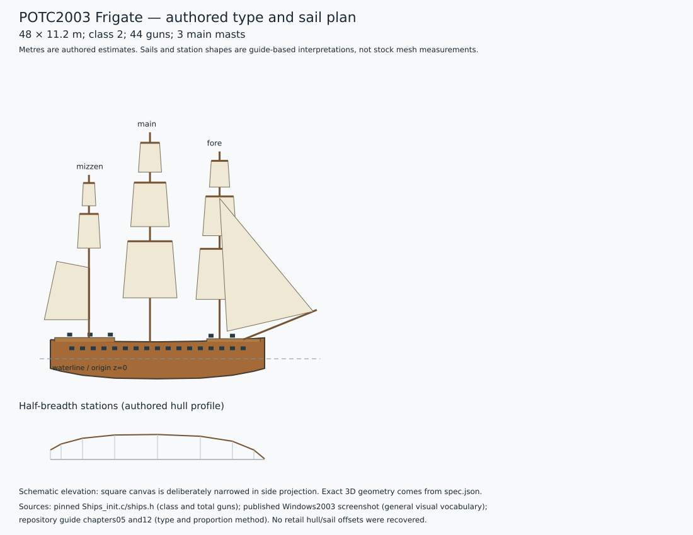

# POTC2003 Frigate — two painted static assets

Three-masted 44-gun frigate with one complete enclosed battery and partial guns on the raised quarterdeck/forecastle; long fine hull, moderate castles.

The pinned stock-derived script identifies `Frigate1` as class 2 with **44 guns**. The procedural reconstruction uses authored dimensions **48 × 11.2 m**, draught 4.5 m and main-deck freeboard 3.8 m. These are design estimates, not recovered game dimensions. The guide links port spacing and working length to gun count. The main enclosed row plus separate upper castle groups makes this 44-gun frigate structurally distinct from the corvette and two-battery battleship.

The upper fore gun-port after edge lies 0.46 m forward of the forecastle break, keeping the entire rectangular opening within the raised forebody.

Ochre and navy variants share geometry, UVs, hierarchy and natural deck, canvas, rigging and metal materials. Only `paint_hull` and `paint_trim` change. Main, LOD1 and LOD2 GLBs plus packed Blender source are in `model/<palette>/`; collision is shared. Source and imported-GLB renders are retained for both views and palettes. `validation.json` and `export-review.json` record actual checks.

| Ochre | Navy |
| --- | --- |
|  |  |

Build with Blender 5.2.3:

```sh
blender -b --python potc/frigate/build.py
```



`spec.json` and `type-profile.json` record the family plan, exact stock-stat evidence, guide references and uncertainty. The 2003 published screenshot is used only for general visual vocabulary; its ship family is not authenticated. No proprietary mesh, texture or paid generated asset is included. The stock-derived modern compatibility script is not claimed to be a byte-identical retail dump.

This is a **static duel asset**. Engine sailing, buoyancy, damage, gun logic and crew controllers are absent. Walking and interior navigation are not claimed and are outside this asset's acceptance scope.
