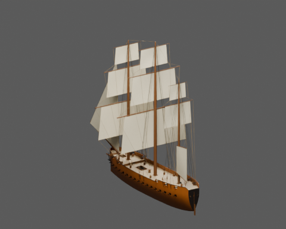
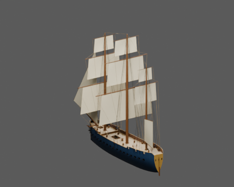
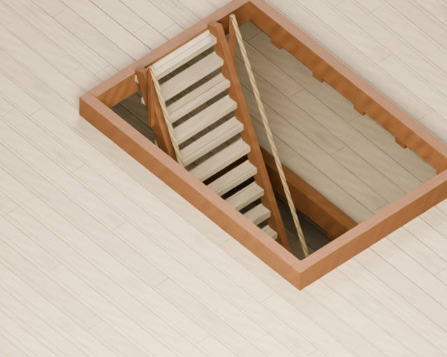
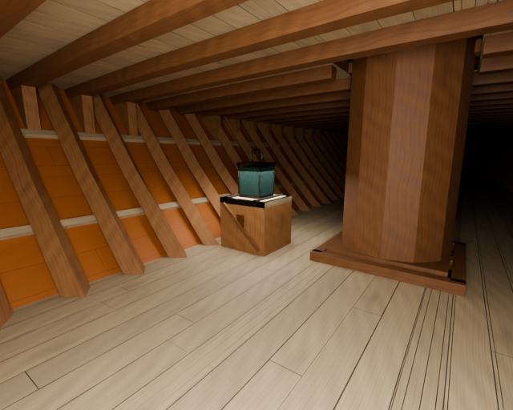
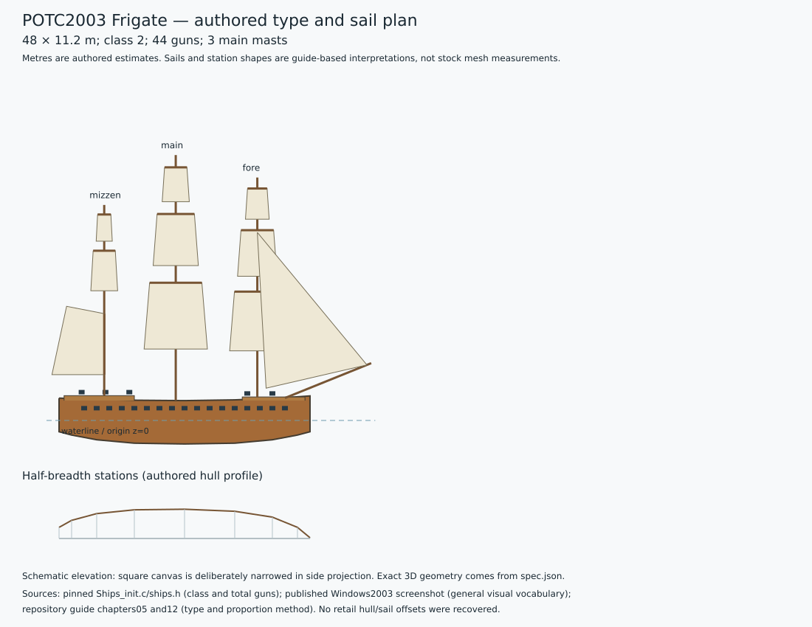

# POTC2003 Frigate — two painted static assets

Three-masted 44-gun frigate with one complete enclosed battery and partial guns on the raised quarterdeck/forecastle; long fine hull, moderate castles.

The pinned stock-derived script identifies `Frigate1` as class 2 with **44 guns**. The procedural reconstruction uses authored dimensions **48 × 11.2 m**, draught 4.5 m and main-deck freeboard 3.8 m. These are design estimates, not recovered game dimensions. The guide links port spacing and working length to gun count. The main enclosed row plus separate upper castle groups makes this 44-gun frigate structurally distinct from the corvette and two-battery battleship.

The upper fore gun-port after edge lies 0.46 m forward of the forecastle break, keeping the entire rectangular opening within the raised forebody.

Ochre and navy variants share geometry, UVs, hierarchy and natural deck, canvas, rigging and metal materials. Only `paint_hull` and `paint_trim` change. Main, LOD1 and LOD2 GLBs plus packed Blender source are in `model/<palette>/`; collision is shared. Source and imported-GLB renders are retained for both views and palettes. `validation.json` and `export-review.json` record actual checks.

| Ochre | Navy |
| --- | --- |
|  |  |

<!-- v5-detail-evidence:start -->
## Detailed deck and interiors

The delivered geometry includes individual deck planks, framing, real hatch and door openings, working fittings, furnished storage and an after cabin. Full-resolution main PBR maps, separate distance maps, packed Blender sources, both paint palettes, LOD1/LOD2 and the shared collision model are retained.

| Actual deck close-up | Actual intact hold |
| --- | --- |
|  |  |

The deck view hides rigging for visibility. The hold image retains the complete room geometry. [Intact cabin view](previews/ochre/detail/cabin_interior.png) and the separately labeled cutaways are listed in `detail-render.json`; `detail-review.json` records actual image findings. Rendered PNGs are bound to the delivered GLB and renderer by SHA256. `validation.json` records the physical, source/export, material, detail and package checks.

The [supplementary intact gun/carriage close-up](previews/ochre/detail/gun_deck_0_gun_closeup.png) shows a near lower-battery station with its actual mounted eye and breeching line. Its explicit camera is reproducible from [the asset-local configuration](detail-camera-closeups.json) and [wrapper](render-detail-closeups.py), using the unchanged frozen renderer, materials and lighting. The default long-battery view remains present and honestly has a dark far end; the wider cutaways show structural arrangement rather than every small fitting.

Historical arrangement sources, with authored dimensions and limitations documented in [the research ledger](layout-research.json):

- [Royal Museums Greenwich: Endymion (1797), ZAZ2228](https://www.rmg.co.uk/collections/objects/rmgc-object-82019)
- [Association Hermione-La Fayette: Chirurgie Marine, deuxième partie](https://fregate-hermione.com/chirurgie-marine-deuxieme-partie/)
- [Association Hermione-La Fayette: Cloisonnement du faux-pont, la Sainte-Barbe](https://fregate-hermione.com/sainte-barbe-3/)
<!-- v5-detail-evidence:end -->

Build with Blender 5.2.3:

```sh
blender -b --python potc/frigate/build.py
```



`spec.json` and `type-profile.json` record the family plan, exact stock-stat evidence, guide references and uncertainty. The 2003 published screenshot is used only for general visual vocabulary; its ship family is not authenticated. No proprietary mesh, texture or paid generated asset is included. The stock-derived modern compatibility script is not claimed to be a byte-identical retail dump.

[Interior plan](interior-plan.md) and [research ledger](layout-research.json) document the new framed below-deck spaces, real openings, stairs and furnished after cabin. Historical sources inform the arrangement; the dimensions remain authored.

This is a **static detailed ship asset**. Engine sailing, buoyancy, damage, gun logic, player control and crew AI are absent. Geometric access and imported-export checks are recorded in `validation.json`.
