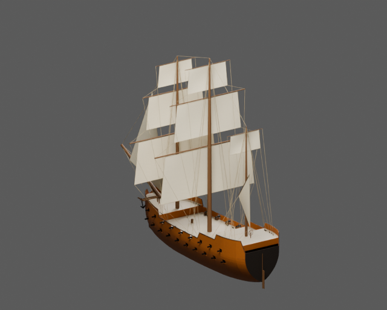
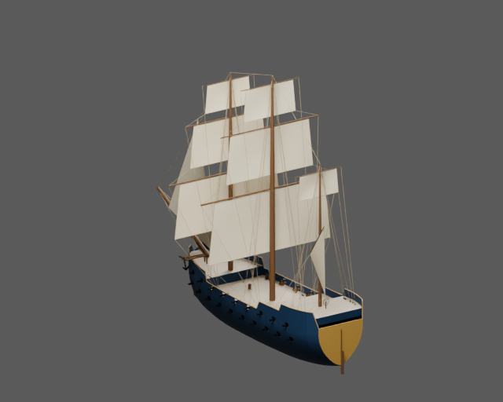
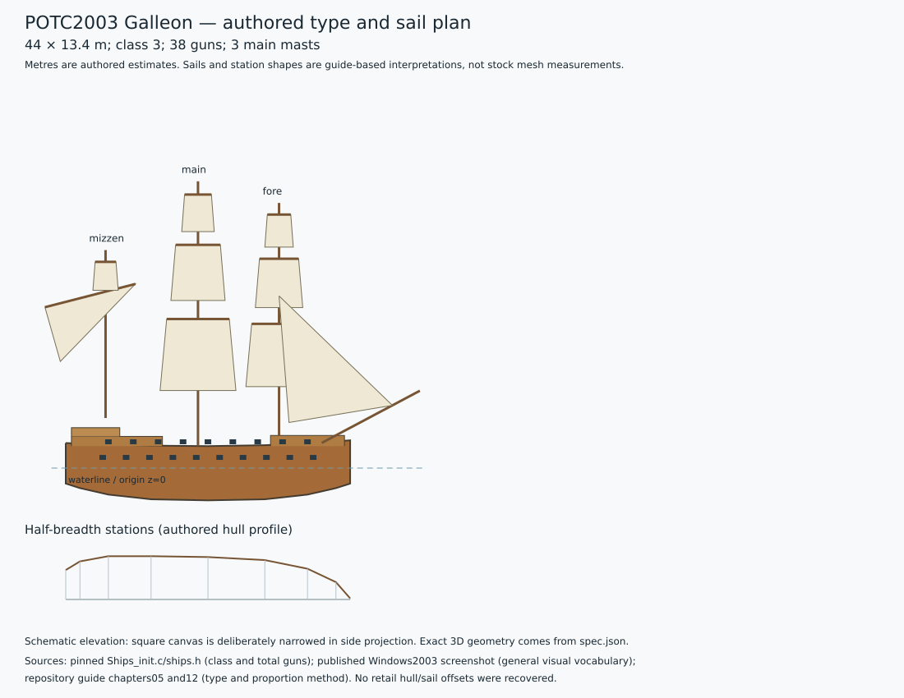

# POTC2003 Galleon — two painted static assets

Fuller three-masted 38-gun galleon with high forecastle, two stepped stern castles, square fore/main rigs and a long lateen mizzen.

The pinned stock-derived script identifies `Galeon1` as class 3 with **38 guns**. The procedural reconstruction uses authored dimensions **44 × 13.4 m**, draught 5 m and main-deck freeboard 3.4 m. These are design estimates, not recovered game dimensions. High castles, broad afterbody and lateen mizzen are the authored earlier galleon type cues. Gun-row distribution is an authored allocation of the stock total, not a recovered game-locator list.

Ochre and navy variants share geometry, UVs, hierarchy and natural deck, canvas, rigging and metal materials. Only `paint_hull` and `paint_trim` change. Main, LOD1 and LOD2 GLBs plus packed Blender source are in `model/<palette>/`; collision is shared. Source and imported-GLB renders are retained for both views and palettes. `validation.json` and `export-review.json` record actual checks.

| Ochre | Navy |
| --- | --- |
|  |  |

Build with Blender 5.2.3:

```sh
blender -b --python potc/galleon/build.py
```



`spec.json` and `type-profile.json` record the family plan, exact stock-stat evidence, guide references and uncertainty. The 2003 published screenshot is used only for general visual vocabulary; its ship family is not authenticated. No proprietary mesh, texture or paid generated asset is included. The stock-derived modern compatibility script is not claimed to be a byte-identical retail dump.

This is a **static duel asset**. Engine sailing, buoyancy, damage, gun logic and crew controllers are absent. Walking and interior navigation are not claimed and are outside this asset's acceptance scope.
