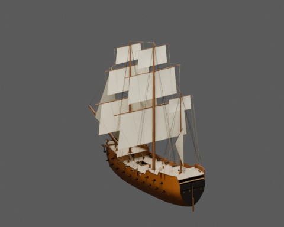
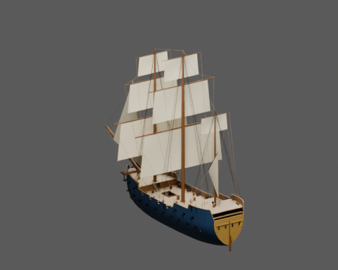
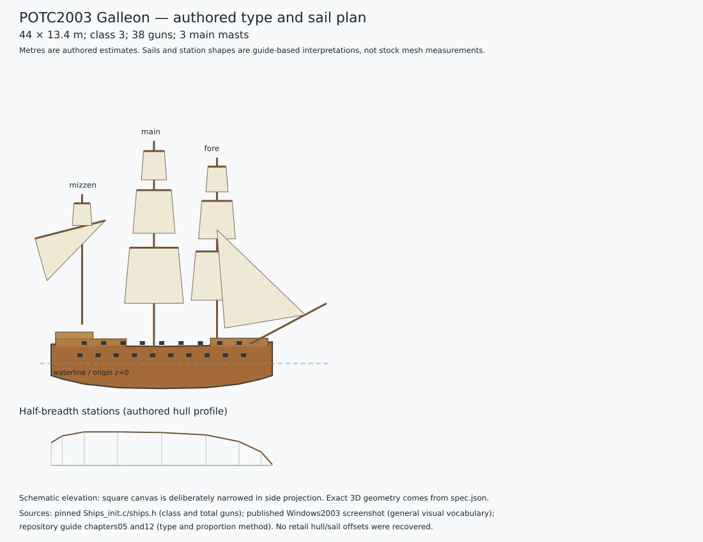

# POTC2003 Galleon — two painted static assets

Fuller three-masted 38-gun galleon with high forecastle, two stepped stern castles, square fore/main rigs and a long lateen mizzen.

The pinned stock-derived script identifies `Galeon1` as class 3 with **38 guns**. The procedural reconstruction uses authored dimensions **44 × 13.4 m**, draught 5 m and main-deck freeboard 3.4 m. These are design estimates, not recovered game dimensions. High castles, broad afterbody and lateen mizzen are the authored earlier galleon type cues. Gun-row distribution is an authored allocation of the stock total, not a recovered game-locator list.

Ochre and navy variants share geometry, UVs, hierarchy and natural deck, canvas, rigging and metal materials. Only `paint_hull` and `paint_trim` change. Main, LOD1 and LOD2 GLBs plus packed Blender source are in `model/<palette>/`; collision is shared. Source and imported-GLB renders are retained for both views and palettes. `validation.json` and `export-review.json` record actual checks.

| Ochre | Navy |
| --- | --- |
|  |  |

Build with Blender 5.2.3:

```sh
blender -b --python potc/galleon/build.py
```



`spec.json` and `type-profile.json` record the family plan, exact stock-stat evidence, guide references and uncertainty. The 2003 published screenshot is used only for general visual vocabulary; its ship family is not authenticated. No proprietary mesh, texture or paid generated asset is included. The stock-derived modern compatibility script is not claimed to be a byte-identical retail dump.

[Interior plan](interior-plan.md) and [research ledger](layout-research.json) document the new framed below-deck spaces, real openings, stairs and furnished after cabin. Historical sources inform the arrangement; the dimensions remain authored.

The authored stern joinery has four symmetric glazed cabin lights around a solid central rudder post. Their count and placement fit the preserved rudder hardware; they are not claimed as recovered retail-game or museum-plan coordinates.

Actual detail views show the [main hatch](previews/ochre/detail/deck_closeup.png), [intact hold](previews/ochre/detail/hold_interior.png) and [intact cabin](previews/ochre/detail/cabin_interior.png). The [lower battery view](previews/ochre/detail/gun_deck_0_interior.png) retains its guns, ports and overhead structure. [Render evidence](detail-render.json) records the cameras, image hashes and explicitly hidden cutaway parts; [manual review](detail-review.json) records the visual observations.

This is a **static detailed ship asset**. Engine sailing, buoyancy, damage, gun logic, player control and crew AI are absent. Geometric access and imported-export checks are recorded in `validation.json`.
