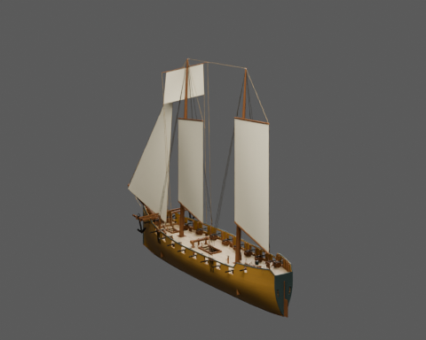
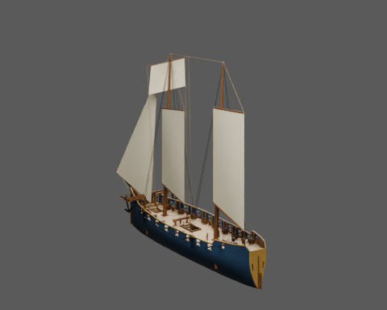
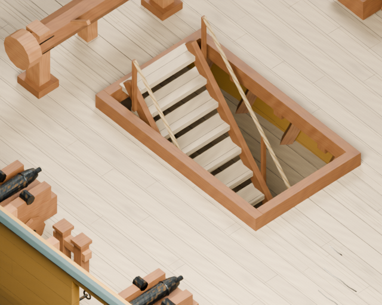
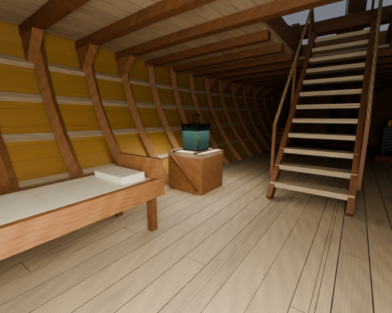
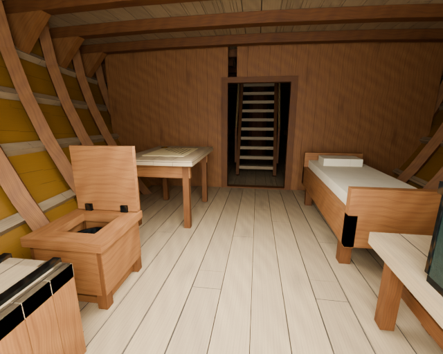
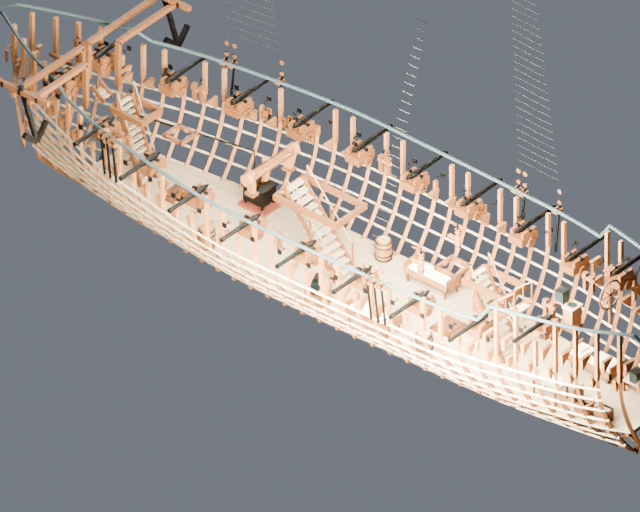

# Szkuner — POTC 2003 / Schooner

Oryginalna rekonstrukcja proceduralna rodziny **Schooner** z gry *Pirates of the Caribbean* (2003): klasa **4**, **20 dział**, dwa faktycznie wyeksportowane malowania `ochre` i `navy`. Nazwy modeli źródłowych: `Schooner1` / `Schooner2`.

| Ochra — ponowny import GLB | Granat — ponowny import GLB |
|---|---|
|  |  |

[Detal ochrowy](previews/ochre/detail.png) · [Detal granatowy](previews/navy/detail.png) · [Raport walidacji](validation.json) · [Porównanie źródła i eksportu](export-review.json)

## Podstawa i granice rekonstrukcji

Skrypty i współczesna grze tabela potwierdzają rodzinę, klasę i liczbę dział. **Nie ustalono oryginalnych wymiarów ani skali modeli gry.** Długość 30.5 m, szerokość 7.4 m, zanurzenie 2.7 m i wolna burta 1.8 m są autorskimi założeniami opartymi na metodzie poradnika tego repozytorium. Nie importowano własnościowych siatek ani tekstur gry.

A two-masted gaff schooner interpretation follows the repository guide. Rig and hull proportions are authored; the original name and gun total are source-backed.

Materiały referencyjne nie potwierdzają dokładnego rozmieszczenia każdego masztu, kasztelu ani żagla. Geometrię i takielunek należy oceniać jako jawną interpretację rodziny, a nie odzyskany model detal w detal. Palety są autorskie; końcówki `1`/`2` wskazują identyfikatory rodzin ze skryptów, a nie dowód zgodności kolorów z grą.

- [Stock-derived modern script tree, not asserted byte-identical retail dump](https://github.com/storm-devs/potc/blob/2af54be0b92840c7c9f68618d02bc8f81dc13145/PROGRAM/Ships/Ships_init.c#L2031-L2051): family/model ID, game class, cannon quantity.
- [Contemporary 2004 player table](https://gamefaqs.gamespot.com/pc/914549-pirates-of-the-caribbean/faqs/28651): ordinary family roster, game class, cannon quantity.
- [Construction guide; no retail model geometry](https://github.com/grzegorz2047/OldShipSchematicsAndModel/blob/2e6f7e922e95396722376d42f3e2e0a12256029e/docs/en/12-designing-other-ships.md): hull and spar parameter chain, three-mast and schooner reconstruction method.

## Cechy tej rodziny

- Fine low hull and shallow raised ends
- Two raked masts with fore-and-aft gaff canvas, fore square topsail and jib
- Ten gun pairs on a long waist with one raised aft pair and one raised fore pair

| Maszt | Położenie, dziób dodatni | Wysokość nad lokalnym pokładem | Żagle |
|---|---|---|---|
| fore | 0.230 L | 24 m | gaff, square |
| main | -0.170 L | 26.5 m | gaff |

W `spec.json` zera wysokości odnoszą się do wodnicy; `s` biegnie od rufy −0,5 L do dziobu +0,5 L. `rig.masts[].height_m` liczy się od rzeczywistego lokalnego pokładu, `sails[].z` jest ułamkiem tej wysokości dla górnej krawędzi żagla, a dodatni `rake` oznacza pochylenie ku rufie. Jednostki: metry. W eksporcie glTF: +Y w górę, +Z ku dziobowi.

## Dwa malowania i pliki

| Wariant | Poszycie malowane | Listwy malowane |
|---|---|---|
| `ochre` | `#A67C36` | `#40504B` |
| `navy` | `#28445F` | `#C7A058` |

Naturalne drewno pokładu i drzewc, płótno, liny oraz metal zachowują te same materiały w obu wariantach. Widok `detail` jest kontrolnym ujęciem kadłuba i pokładów z ukrytymi żaglami, drzewcami oraz linami; pozostawione mocowania należą do pełnego modelu widocznego na `hero`. `model/<paleta>/` zawiera `ship.glb`, `lod1.glb`, `lod2.glb` i edytowalny `source.blend`; `model/collision.glb` jest wspólną geometrią kolizji. `previews/<paleta>/` pokazuje rzeczywisty ponowny import GLB, a `review/<paleta>/source_*.png` odpowiadające mu widoki pliku źródłowego. Raporty `export-review.json` i `validation.json` wiążą kontrolowane pliki skrótami SHA-256.

## Odtworzenie i zakres

Pakiet zbudowano i porównano w **Blender 5.2.3 LTS**. Spakowane pliki `source.blend` wymagają **Blender 5.2 lub nowszego**; pliki GLB są niezależnym eksportem. Wymiary w specyfikacji są nominalne: bukszpryt, ster i ewentualny zaokrąglony nawis rufy powiększają obwiednię modelu.

Uruchom z katalogu repozytorium, używając Blender 5.2.3 LTS:

```sh
blender --background -t 1 --python potc/schooner/build.py
```

Model jest **statycznym zasobem do pojedynków okrętów**. Raport obejmuje rzeczywistą geometrię, materiały, LOD, kolizję, osprzęt i zgodność eksportu z plikiem źródłowym. Nie przyznaje przejść dla sterowania, chodzenia, animacji, symulacji żagli ani nawigacji; te zachowania nie należą do dostarczanego zasobu.

## Wnętrza v5: badania i autorski układ

Układ pokładów, rzeczywiste otwory luków i przejścia, wręgi, ładownia oraz umeblowana kajuta są autorską rekonstrukcją opartą na badaniach. Nie odzyskano oryginalnego wnętrza z siatki gry. [`layout-research.json`](layout-research.json) oddziela twierdzenia źródeł od analogii i decyzji przestrzennych.

Longer, more heavily armed game-family schooner with compact Sultana-inspired lower accommodation.

- Central cargo/stores hold with side crew bunks and a clear fore-and-aft passage; a forward brick-protected galley is adapted from the survey-backed replica.
- Aft window cabin has a chart desk, single bunk and chest, and is entered through a real companionway and doorway.
- Octagonal horizontal wooden windlass, main cargo hatch, forward scuttle and twin mainmast pumps; a 3m carried boat is optional where final gun and rig clearance allows it.
- Stern and bow detail remain modest; a removable-pot close-stool is an authored officer facility. No engines, modern flushing head or gas galley are imported.

Przenośny stołek sanitarny w kajucie ma rzeczywisty otwór siedziska, uniesione wieko i wyjmowane naczynie; jest jawną adaptacją mebla z epoki. Nie poświadcza nieustalonego układu dziobowych ustępów pierwowzoru gry. Koje i palenisko są pełnymi elementami geometrii umieszczonymi w zmierzonych wolnych obszarach; łódź pozostaje opcjonalna.

W tym układzie dwudziestodziałowego szkunera pominięto opcjonalną łódź długości 3 m: pełny kadłub, podkładki oraz wymagane przejścia nie mieszczą się w zmierzonych wolnych miejscach pomiędzy rzeczywistymi stanowiskami dział, takielunkiem i otwartymi lukami. Materiał o mniejszej Sultanie służy jako analogia wyposażenia; nie poświadcza identycznego rozplanowania większej rodziny gry.

Materiały przeczytane dla tej rodziny:

- [A Guide to the 1768 Reproduction Schooner Sultana, Sultana Projects/NPS (2003), pp.22–29](https://sultanaeducation.org/wp-content/uploads/2022/10/PocketGuidetoSultana.pdf): Sultana is much smaller and carried swivel guns. This asset retains the game-family dimensions, two-mast rig and twenty carriage guns. Modern head, engine, gas cooker and life floats are excluded; room positions are adapted.
- [75ft Schooner-rigged Gun Vessel (1795), RMG ZAZ6174](https://www.rmg.co.uk/collections/objects/rmgc-object-85965): Useful period inboard/platform crosscheck; sliding keels and exact hull are not copied.
- [Life on Board, Vasa Museum](https://www.vasamuseet.se/en/explore/vasa-history/life-on-board): A 1628 warship analogue for construction and room hierarchy only; no claim that a merchant held Vasa-scale decoration or its exact internal arrangement.
- [The Vasa Museum in an hour: teacher guide, 2026, p.3](https://www.vasamuseet.se/globalassets/vasamuseet/dokument/skola/2026/t_teachers-guide-to-the-vasa-museum.pdf): Vasa is a 1628 warship. No identical sanitation arrangement or bow-head access is established for the POTC families.
- [Close stool, Colonial Williamsburg museum 1960-948, England 1700–1725](https://emuseum.colonialwilliamsburg.org/objects/17170/close-stool): A period furniture analogue, not a maritime find or verified stock asset. Its placement in these game-family cabins is authored; it does not establish fifteenth-century caravel equipment.
- [Geschiedenis van de 17e-eeuwse Batavia, Museum Batavialand](https://www.batavialand.nl/zien-en-doen/het-schip-batavia/geschiedenis-van-de-17e-eeuwse-batavia/): Does not establish stock-family boat dimensions or stowage. The 3m tender is an authored compact boat, not a claim to reproduce Batavia’s larger rescue boat.

Położenia w `detailed_layout` biegną od rufy −0,5 do dziobu +0,5 długości; wysokości są w metrach nad wodnicą. Zachowano rodzinny kadłub, ożaglowanie, liczbę dział i dwa niezależne malowania. Geometria przejść statycznego modelu nie jest poświadczeniem sterowania postacią.

## Widoki z aktualnego GLB

Poniższe obrazy pochodzą z ponownie wczytanego eksportu wariantu `ochre`. Zbliżenie pokładu obejmuje pole 4,5 m; ujęcia zamkniętych wnętrz mają obiektyw 20 mm i kamerę 1,23 m nad miejscową podłogą. [Notatki z oględzin](detail-review.json) wiążą wszystkie sześć widoków z aktualnym modelem i obrazami.







**Przekrój kontrolny ładowni: wybrane warstwy ukryto wyłącznie w tym ujęciu.**



[Kontrolny przekrój kajuty](previews/ochre/detail/cabin_cutaway.png) pokazuje umeblowanie wśród zachowanych wręg. Jasne oświetlenie kontrolne i ukryte warstwy przekrojów służą oględzinom konstrukcji; zamknięte pomieszczenia pokazano oddzielnie.
