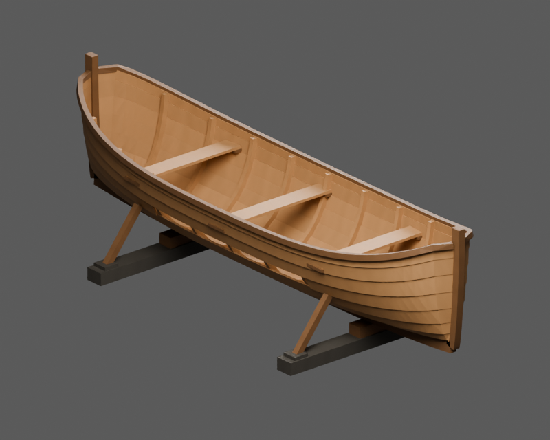
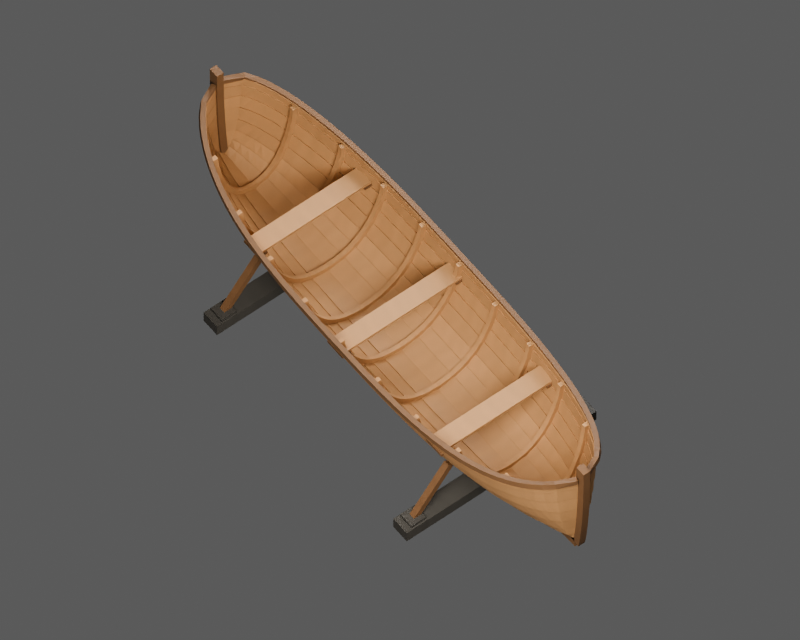
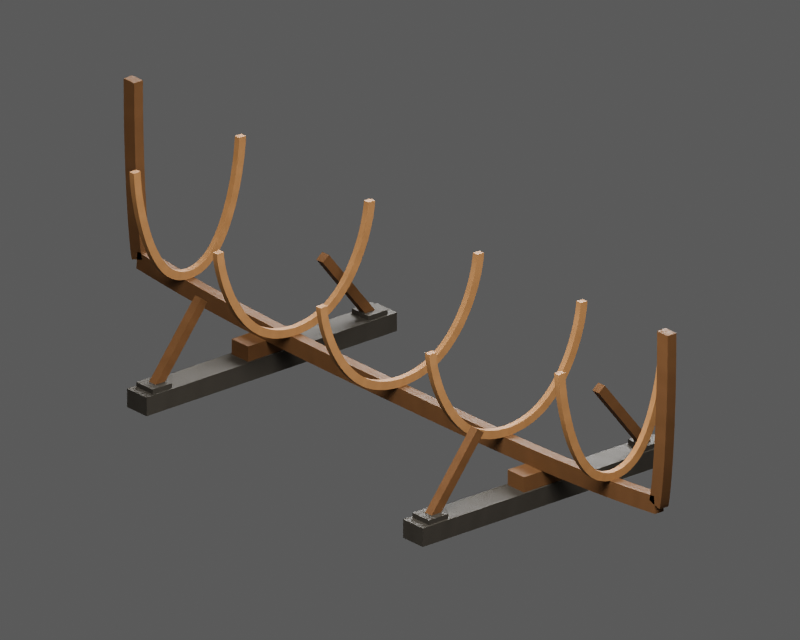
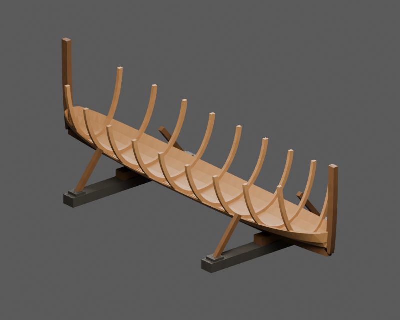
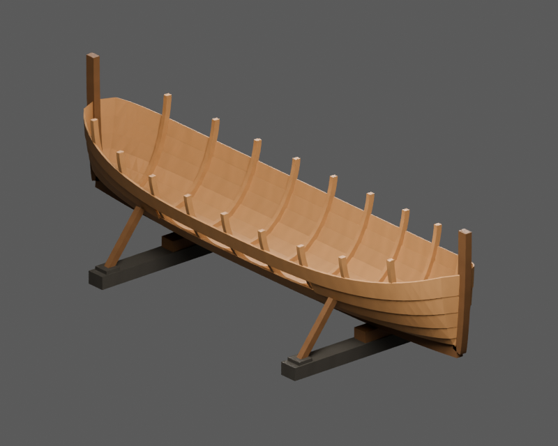
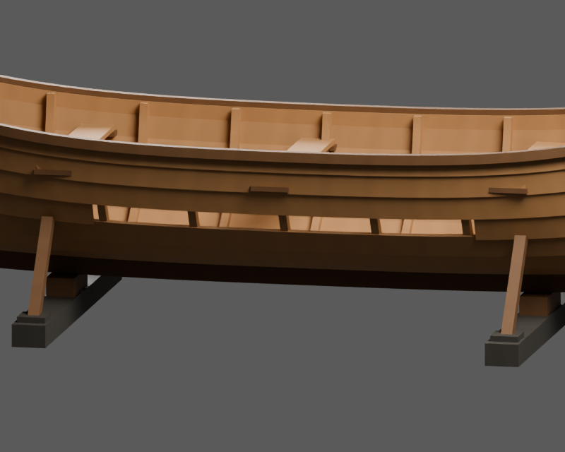
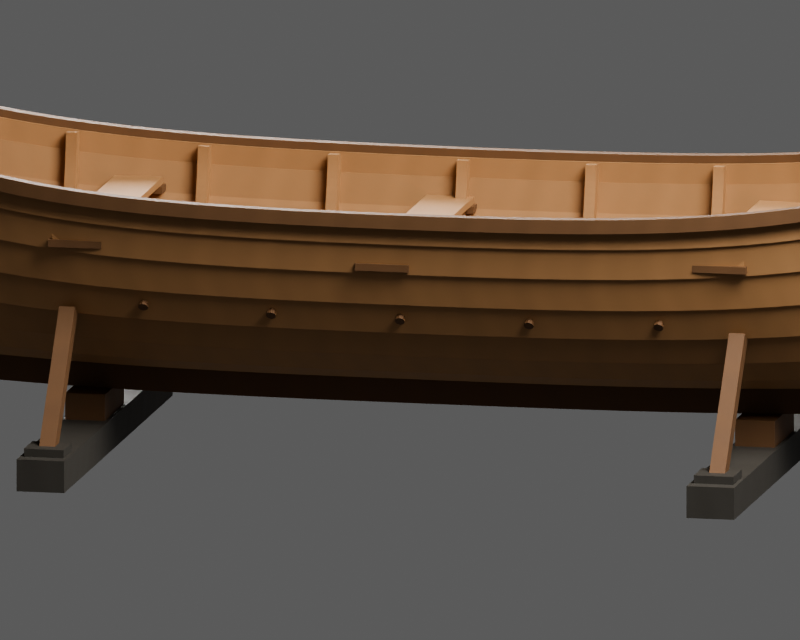

# Mewka — łódź w budowie i naprawie

Drewniana łódź na dwóch kozłach, odpowiadająca aktywnemu obiektowi `boat_frame`
w SailerTales. Cztery osobne eksporty pokazują rzeczywiste kolejne etapy budowy.
Wariant roboczy zachowuje lukę w poszyciu, dopasowywaną deskę, pięć kołków
oraz punkty misji z `boat_work.js`.




Profil gry: **6,50 × 1,72 × 0,92 m**. Ostatnia liczba oznacza głębokość przekroju
na śródokręciu; podniesione końce i kozły zwiększają całkowitą wysokość.
Obrys kozłów ma 2,60 m szerokości. Początek modelu leży na ziemi pod środkiem
stępki. Przesunięcie kadłuba `KEEL_Y = 0,42 m` jest już zapisane w geometrii.
Jednostki: metry; glTF +Y w górę, +Z ku dziobowi, robocza burta wariantu `work=1`
po stronie +X. Ten model nie ma masztu ani steru.

## Etapy

| Etap | Widoczne części | Model | Kolizje |
|---|---|---|---|
| 0 | Stępka, obie stewy, pięć naprzemiennych wręgów, oba kozły | [stage_0.glb](model/stage_0.glb) | [collision_0.glb](model/collision_0.glb) |
| 1 | Wszystkie dziewięć wręgów, pasy poszycia 0–2 | [stage_1.glb](model/stage_1.glb) | [collision_1.glb](model/collision_1.glb) |
| 2 | Dodatkowo pasy 3–5; luka w pasie 4 pozostaje otwarta | [stage_2.glb](model/stage_2.glb) | [collision_2.glb](model/collision_2.glb) |
| 3 | Pasy 6–7, listwy burtowe, trzy ławki i ich podparcia | [ship.glb](model/ship.glb) | [collision.glb](model/collision.glb) |





Każdy plik etapu zawiera tylko istniejące w nim elementy i odpowiadające im
kolizje. `construction_stage` w danych węzłów umożliwia również sterowanie
widocznością kumulacyjnie. Nie wczytywać wszystkich eksportów etapów jednocześnie.
Kozły pozostają widoczne na każdym etapie.

## Naprawa i sterowanie




Luka zajmuje pas **4**, stronę +X i przedział **u = −0,42…+0,42**,
czyli 2,73 m długości parametrycznej. W kanonicznym `ship.glb` deska i kołki
są nieobecne. Osobne części:

- [repair_plank.glb](model/repair_plank.glb): zamknięta deska o grubości 22 mm.
  `Basis` to położenie dopasowane, morf `straight` o wadze 1 pokazuje prostą deskę
  odchyloną od burty. Dla źródłowego `setGapPlank(b)` stosować wagę
  `1 − b²(3 − 2b)`. `null`/`false` ukrywa część.
- [pegs_5.glb](model/pegs_5.glb): pięć oddzielnych kołków `repair_peg_0…4`,
  na wręgach u = −0,4; −0,2; 0; 0,2; 0,4. `setPegs(k)` pokazuje pierwsze k.
- [trim.glb](model/trim.glb) i [trim_collision.glb](model/trim_collision.glb):
  dokładny podzbiór listew, ławek i podparć etapu 3. Są już obecne w głównym
  modelu. `setTrim(false)` wyłącza jednocześnie węzły `trim_*` oraz `col_trim_*`;
  nie dodawać drugiej kopii listew do kanonicznego modelu.

[states.json](states.json) opisuje pliki, etapy, części, morf i punkty zaczepienia.
[hooks.json](hooks.json) zachowuje kontrakty `setStage`, `setTrim`, `setGapPlank`,
`setPegs`, `setWater`, `setLeak`, `setMarks`, `carve` i `point`.
Punkty są także rzeczywistymi węzłami GLB: środek luki, pięć kołków, trzy szwy
przecieków, miejsca kapania na ziemi oraz dwa znaki na dziobnicy.

Źródłowe `point('gap')` ma domyślne **i = 0**, czyli rufowy koniec luki.
Węzły `repair_gap` i `repair_gap_center` są jawnie środkiem, odpowiadającym i = 0,5.
`point('gap', i)` między końcami wyznacza wzór zapisany w `hooks.json`.
Przeciwna strona robocza powstaje przez `--work-side -1`; zmienia położenie luki,
deski, kołków i przecieków. Znaki na dziobnicy pozostają w tym samym miejscu.

**Adapter gry nie jest częścią tego PR.** Ładowanie, przełączanie węzłów,
sterowanie morfem, ruchome kolizje deski oraz efekty wody, przecieków i rzeźbienia
wymagają podłączenia w silniku. Woda, krople, mokre szwy i kreski znaków mają
opisane punkty, parametry i źródłową semantykę; nie dostarczamy działającego
`tick()` ani gotowych efektów Three.js. Kołki są nieblokującymi drobnymi częściami.

## Dostęp i kolizje

Model jest rekwizytem budowy na ziemi. Nie deklaruje chodzenia wewnątrz kadłuba
ani własnego poziomu terenu. [navigation.json](navigation.json) pozostawia trasy
puste i podaje zalecany zewnętrzny obszar pracy; nie przedstawia go jako
przetestowanej siatki nawigacyjnej gry.

Każdy rzeczywisty element ma osobną zamkniętą siatkę kolizji statycznej.
Nie zastępować całej konstrukcji jedną bryłą wypukłą: zasłoniłaby lukę i przestrzeń
między wręgami. Nawigacja po ziemi, interakcje postaci i kolizje podczas gięcia
deski wymagają sprawdzenia po integracji z poziomem gry.

## Konstrukcja, źródła i kontrola

Generator odtwarza wzory `hullB`, `hullSheer`, `hullRocker`, `hullPt` i `stemAt`
z gry. Pełne pochodzenie, przekroje drewna, rozpiska złączy i odstępstwa są
w [design.json](design.json), a skróty źródeł w [spec.json](spec.json).
Źródło gry: [SailerTales ea77e56](https://github.com/grzegorz2047/SailerTales/tree/ea77e560ba4668c9dda55433813addbdb2f50176).
Kontekst brakujących aktywnych modeli opisuje [inwentaryzacja floty](../fleet-inventory-2026-11-14.md).

Względem cienkich powierzchni gry deski mają prawdziwą grubość i zamknięte
krawędzie. Końcowe stacje nie zawijają się przez stewę, pięty wręgów są osadzone
na stępce, ławki mają podparcia, a rozszerzone belki kozłów podpierają zastrzały.
Prosta deska zachowuje źródłowe odchylenie 0,5 rad i wznoszenie, a jej przekrój
obraca się prostopadle do osi deski. To usuwa ścinanie cienkiej powierzchni gry.
Punkt środkowy końca dziobowego pozostaje nieruchomy; kierunek słojów jest
opisany rzeczywistą linią środkową każdego położenia morfu.
Materiały to autorskie proceduralne PBR z istniejącego generatora projektu;
nie są fotografiami ani materiałami z Tripo. Fizyczna skala drewna wynosi 2 m
na teksturę 2048 px, a słoje biegną wzdłuż rzeczywistych elementów.

- [Spakowana scena Blender](model/ship.blend), [LOD1](model/ship_lod1.glb), [LOD2](model/ship_lod2.glb).
- [Audyt niezależnie importowanych eksportów](validation.json).
- [Porównanie źródła z rzeczywistym GLB](export-review.json).

Końcowy audyt: **36 wymaganych kontroli PASS**, 14 niezależnie sprawdzonych
plików GLB oraz pięć próbek morfu (0; 0,25; 0,5; 0,75; 1). Zaliczone są
zamknięcie siatek, orientacja powierzchni, UV i kierunek słojów w każdym
sprawdzanym położeniu. Porównanie źródła z GLB obejmuje trzy widoki.

Wszystkie publiczne PNG powstają z ponownie importowanych dostarczonych GLB.
Obrazy kontrolne w `review/` powstają ze spakowanej sceny. Raporty odróżniają
wynik pomiaru od `NA` i punktów wymagających adaptera lub badania w grze.

## Odtworzenie

Blender 5.2.3 LTS, z katalogu repozytorium:

```sh
blender -b --factory-startup --python-exit-code 1 --python sailertales/boat-frame/build.py -- --out build/final/boat-frame
blender -b --factory-startup --python-exit-code 1 --python sailertales/boat-frame/preview.py -- --asset-dir build/final/boat-frame --resolution 800 --include-pegs
blender -b --factory-startup --python-exit-code 1 --python sailertales/common/v3_prop_audit.py -- sailertales/boat-frame/spec.json --asset-dir build/final/boat-frame
python sailertales/common/v3_prop_integrity.py --asset-dir build/final/boat-frame --source-root .
```

Podstawowe moduły `blender/*.py` i wcześniejsze skrypty `common/v2_*.py` pozostały
bez zmian. Nowy typ ma własny generator i dodatkowy audyt rekwizytów.
