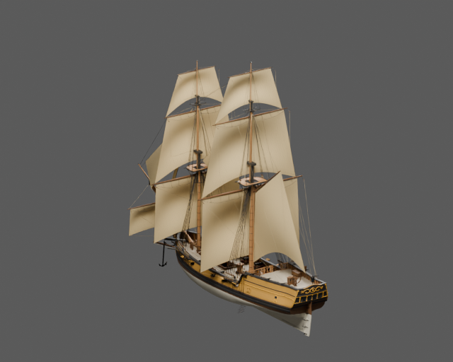
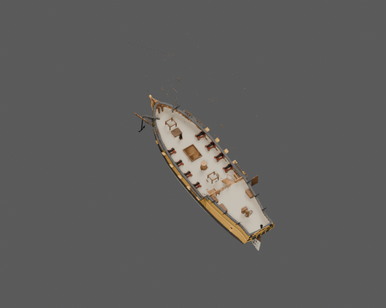
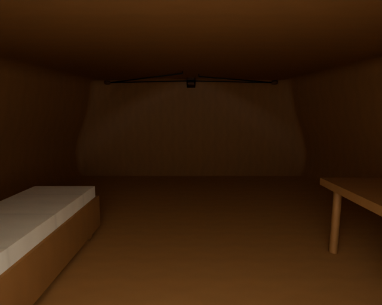
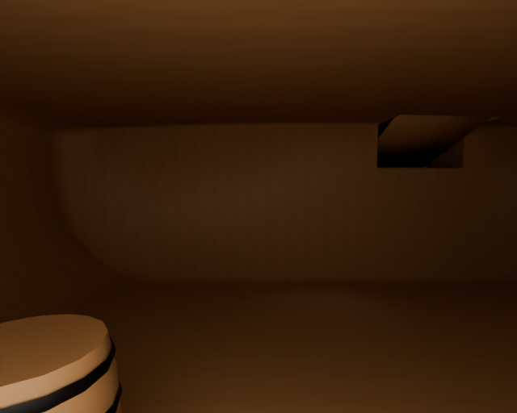

# Bryg Mewa

Osobny model jednostki z SailerTales, przebudowany metodą z poradnika
OldShipSchematicsAndModel. Konstrukcja: Loft kadłuba z tabeli rzędnych, stępka i poszycie z poradnika, proporcje drzewc i pełny takielunek; rzeczywiste wnętrza i przejścia dodane jako rekonstrukcja do gry..

Wymiary profilu: 29 × 8.6 m (profil konstrukcyjny; całkowity obrys z drzewcami jest większy). Pochodzenie liczb, wzory i świadome odstępstwa
są w [design.json](design.json). Identyfikator `brig` pochodzi z gry;
historyczny typ i zakres rekonstrukcji są opisane oddzielnie od nazwy używanej w grze.






## Pliki

- [Główny GLB](model/ship.glb), [LOD1](model/ship_lod1.glb), [LOD2](model/ship_lod2.glb).
- [Kolizje](model/collision.glb) — osobne statyczne siatki wklęsłe; nie otaczać całej jednostki jednym wypukłym colliderem.
- [Spakowana scena Blender](model/ship.blend).
- [Trasy i wymagania kontrolera](navigation.json).
- [Audyt geometrii i macierz rozdziału 13](validation.json).
- [Porównanie rzeczywistego eksportu ze sceną źródłową](export-review.json).

Wszystkie pokazane wyżej obrazy PNG wyrenderowano po ponownym imporcie
dostarczonego GLB. Porównanie ze spakowaną sceną wykorzystuje te same kamery
i światła. Próg różnicy jasności to 10%, udziałów kanałów koloru 0,04.
Wynik porównania: **True**. Wynik wymaganych kontroli audytu: **True**.
To dwie oddzielne kontrole — test dojścia nie zastępuje kontroli konstrukcji i eksportu.

## Dostęp gracza

Postać testowa: promień kapsuły 0,38 m, całkowita wysokość 1,85 m, maksymalne
nachylenie chodzenia 35°. Drabiny mają osobny tryb wspinania; nie są przedstawiane
jako schodnie spełniające limit 35°.

| Trasa | Wymagany ruch |
|---|---|
| main_deck_to_hatch | chodzenie |
| main_deck_to_cabin | chodzenie |
| main_deck_forward | chodzenie |
| hold_ladder | wspinanie po drabinie |
| hold_aisle | chodzenie |
| captains_cabin | chodzenie |
| quarterdeck_access | chodzenie |
| hold_water_supply | chodzenie |

Ten PR dostarcza statyczny asset i metadane integracji. Kontroler postaci,
wspinanie, ruch postaci wraz z płynącym statkiem, animowanie mechanizmów,
maskowanie wody i podłączenie do aktualnej gry wymagają adaptera silnika.
Należy używać tych samych transformacji modelu, kolizji i punktów tras.
Przechył wraku jest już zapisany w geometrii — nie nakładać go drugi raz.

## Źródła i odstępstwa

Źródłem metody są rozdziały 01–09, 12–14 poradnika i wskazane moduły `blender/`.
Model jest rekonstrukcją do gry, nie pomiarem zachowanego historycznego statku
ani certyfikacją stateczności. Wariant proceduralny materiałów jest opisany
w danych; nie przypisujemy mu fotograficznych tekstur CC0.

Źródło profilu gry: [SailerTales ea77e56](https://github.com/grzegorz2047/SailerTales/tree/ea77e560ba4668c9dda55433813addbdb2f50176).

- Interior layout and lowered cabin sole are game reconstructions, not surviving period plans.
- The dummy quarterdeck companion is replaced by the real cabin entrance to keep its stair fragments out of the cabin.
- BRIG is the game identifier; reference historical rig is snow circa 1710.
- A climb controller is required at the hold ladder; no false floor-slope pass is claimed.

## Macierz kontroli

`NA` oznacza wyłączenie z uzasadnieniem lub pomiar pozostający poza zakresem;
nie jest zaliczeniem kontroli. Pełne dane i zakres są w raporcie JSON.
Nie wyciągać z wyniku tras wniosku, że zweryfikowano każdy punkt pokładu,
wszystkie stanowiska załogi albo dowolny ruch takielunku.

| Punkt | Wynik | Dowód lub ograniczenie |
|---|---|---|
| A1 | PASS | {"world_bounds":{"min_blender_m":[-8.355555534362793,-24.352930068969727,-5.223101615905762],"max_blender_m":[8.355555534362793,15.891071319580078,31.209815979003906]},"hull_measurement":{"passed":true,"hull_length_m":30.753257751464844,"hull_breadth_m":8.768487930297852,"nominal_length_m":29.0,"nominal_breadth_m":8.6,"length_acceptance_ratio":[0.8 |
| A2 | PASS | {"navigation_axis_declaration":"glTF X across, Y up, Z forward"} |
| A3 | PASS | {"origin_node_present":true,"design_origin":null} |
| A4 | PASS | {"unapplied_static_mesh_transforms":[]} |
| B1 | PASS | {"invalid_names":[]} |
| B2 | NA | This item needs additional authored evidence; it is not counted as a passing test. |
| B3 | NA | This item needs additional authored evidence; it is not counted as a passing test. |
| B4 | PASS | {"copy_suffix_material_names":[]} |
| C1 | NA | No moving-part contract is declared for this static asset release. |
| C2 | NA | No moving-part contract is declared for this static asset release. |
| C3 | NA | No moving-part contract is declared for this static asset release. |
| C4 | NA | No moving-part contract is declared for this static asset release. |
| D1 | PASS | {"failures":[]} |
| D2 | PASS | {"failures":[]} |
| D3 | PASS | {"reversed_objects":[]} |
| D4 | NA | This item needs additional authored evidence; it is not counted as a passing test. |
| D5 | NA | This item needs additional authored evidence; it is not counted as a passing test. |
| D6 | NA | This item needs additional authored evidence; it is not counted as a passing test. |
| D7 | NA | This item needs additional authored evidence; it is not counted as a passing test. |
| D8 | NA | This item needs additional authored evidence; it is not counted as a passing test. |
| E1 | PASS | {"passed":true,"overlapping_solid_pairs":1186,"surface_contact_pairs":74,"intended_joints":[{"a":"main_yard#island_0","b":"rigging_static_blocks#island_56","reason":"blok na stropie przy noku / środku rei"},{"a":"main_yard#island_0","b":"main_yard_parrel","reason":"rak przywiązany do środka rei"},{"a":"main_yard#island_0","b":"rigging_static_blocks |
| E2 | PASS | {"declared_rules":911,"structured_rules_required":true} |
| E3 | NA | This item needs additional authored evidence; it is not counted as a passing test. |
| E4 | NA | This item needs additional authored evidence; it is not counted as a passing test. |
| E5 | NA | This item needs additional authored evidence; it is not counted as a passing test. |
| E6 | NA | This item needs additional authored evidence; it is not counted as a passing test. |
| F1 | PASS | {"materials":{"v2_wood_ciemne":{"area_m2":155.55365425294028,"texel_density_px_m":{"p5":1023.4702441564385,"median":1023.9998004573617,"p95":1034.7765047571754},"density_p95_p5_ratio":1.011046985161797,"anisotropy_p95":1.1102356995235314,"anisotropy_over_1_25_area_share":0.0,"degenerate_uv_area_m2":0.0,"wood_grain_measured_area_m2":70.4047697138413 |
| F2 | PASS | {"materials_above_p95_p5_1_44":[]} |
| F3 | PASS | {"materials_above_8_percent_area_at_anisotropy1_25":[]} |
| F4 | PASS | {"wood_grain_failures":[],"method":"elongated wooden meshes, side-face U tangent within25deg of major timber axis"} |
| F5 | NA | This item needs additional authored evidence; it is not counted as a passing test. |
| F6 | PASS | {"images":[{"index":0,"name":"wood_normal","width":2048,"height":2048,"bytes":402717,"sha256":"30472911ebedb64d914c65c7fcf9e4d81102f4313b49563864983733e814010b","power_of_two":true},{"index":1,"name":"wood_color","width":2048,"height":2048,"bytes":477670,"sha256":"8c0082fc846475f943a7c0d7737f180057b324e68aecef87984a10004e3eefc3","power_of_two":true |
| F7 | PASS | {"material_slot_failures":[]} |
| F8 | NA | No baked AO texture is supplied; material AO is not claimed. |
| G1 | NA | This item needs additional authored evidence; it is not counted as a passing test. |
| G2 | PASS | {"fractional_plain_metallic_factors":[]} |
| G3 | PASS | {"linear_glTF_factors_valid_0_1":true,"note":"sRGB-to-linear provenance remains in design/material recipe, glTF factor values are linear by specification"} |
| G4 | PASS | {"unjustified_double_sided_materials":[]} |
| G5 | PASS | {"exact_duplicate_materials":0} |
| H1 | PASS | {"bytes":26895920,"budget_bytes":33554432} |
| H2 | PASS | {"triangles":256288,"budget":280000} |
| H3 | PASS | {"passed":true,"source_triangles":273032,"export_triangles":273032,"export_indexed_triangles":256288,"triangle_count_scope":"source and export include every mesh-node instance; indexed count is separate","triangle_relative_difference":0.0,"max_bound_error_m":0.0,"missing_source_mesh_nodes":[],"unexpected_export_mesh_nodes":[],"unpacked_used_images" |
| H4 | PASS | {"distinct_image_role_check":[],"embedded_images":29} |
| H5 | PASS | {"present":true,"passed":true,"fingerprints_match":true,"review":{"schema":1,"source_triangles":273032,"export_triangles":273032,"triangle_match":true,"views":{"hero":{"foreground_pixels":62371,"source_mean_rgb":[0.5907290577888489,0.5185818076133728,0.4110529124736786],"export_mean_rgb":[0.5908647179603577,0.5186989307403564,0.41117337346076965]," |
| H6 | PASS | {"primitives_with_tangents":0,"strategy":"provided tangent attribute or engine-derived glTF tangent basis"} |
| I1 | PASS | {"passed":true,"lod0_triangles":256288,"levels":[{"level":1,"passed":true,"errors":[],"bytes":15358916,"triangles":144597,"nodes":1764,"meshes":1764,"materials":31,"images":[{"index":0,"name":"wood_normal","width":1024,"height":1024,"bytes":25545,"sha256":"ac60be67b5a4e03a2983549a49304318328ff2673318cbfd69682032ecce4391","power_of_two":true},{"inde |
| I2 | NA | This item needs additional authored evidence; it is not counted as a passing test. |
| I3 | PASS | {"topology":true,"route_checks":{"passed":true,"player":{"radius":0.38,"height":1.85,"max_slope_deg":35},"sample_step_m":0.1,"geometry_tolerance_m":0.015,"rounded_foot_lift_m":0.08,"controller_step_allowance_m":0.22,"scope":"sampled authored corridors; climb mode requires a climb controller and real endpoint landings","routes":[{"name":"main_deck_t |
| I4 | NA | No alternate physics variant is exported. |
| J1 | NA | No complete floor-grid flood fill against every declared crew workstation has been run; authored player corridors are a separate required gate. |
| J2 | NA | This item needs additional authored evidence; it is not counted as a passing test. |
| J3 | PASS | {"minimum_tested_capsule_diameter_m":0.8,"scope":"declared walk corridors, strict zero geometric shrink","files":{"model/ship.glb":{"passed":true,"player":{"radius":0.4,"height":1.85,"max_slope_deg":35},"sample_step_m":0.1,"geometry_tolerance_m":0,"rounded_foot_lift_m":0.08,"controller_step_allowance_m":0.22,"scope":"sampled authored corridors; cli |
| J4 | PASS | {"capsule_height_m":1.85,"files":{"model/ship.glb":{"passed":true,"player":{"radius":0.38,"height":1.85,"max_slope_deg":35},"sample_step_m":0.1,"geometry_tolerance_m":0.015,"rounded_foot_lift_m":0.08,"controller_step_allowance_m":0.22,"scope":"sampled authored corridors; climb mode requires a climb controller and real endpoint landings","routes":[{ |
| J5 | NA | This item needs additional authored evidence; it is not counted as a passing test. |
| J6 | NA | This item needs additional authored evidence; it is not counted as a passing test. |
| provenance | PASS | {"passed":true,"source_evidence":{"guide_repository":"grzegorz2047/OldShipSchematicsAndModel","chapters":["01","02","03","04","05","06","07","08","09","12","13","14"]},"rule_evidence":{"mast_main":"(length+breadth)/2","mast_fore":"8/9 main","hull":"reference table of offsets with monotone PCHIP, chapter 02","access":"real hollow voids, lowered cabi |
| rig_clearance | PASS | {"passed":true,"sails":12,"ropes":889,"spars":117,"pairs_tested":393,"scope":"authored static pose; boundary allowance only for explicit, reasoned attachments","edge_contact_tolerance_m":0.025,"edge_contacts":[{"sail":"fore_topgallant_set","other":"fore_topgallant_roband_00","triangle_pairs":4,"reason":"own sewn bolt rope","max_boundary_distance_m" |
| player_destinations | PASS | {"model/ship.glb":{"passed":true,"player":{"radius":0.38,"height":1.85,"max_slope_deg":35},"sample_step_m":0.1,"geometry_tolerance_m":0.015,"rounded_foot_lift_m":0.08,"controller_step_allowance_m":0.22,"scope":"sampled authored corridors; climb mode requires a climb controller and real endpoint landings","routes":[{"name":"main_deck_to_hatch","mode |

## Odtworzenie i kontrola

Instrukcje oraz wymagania narzędzi są w [common/README.md](../common/README.md).
Samodzielne sprawdzenie aktualności plików nie wymaga Blendera:

```sh
python sailertales/common/v2_integrity.py --asset-dir sailertales/brig --source-root .
```

Liczby trójkątów zapisane przez eksport: `{"lod0": 273032, "collision": 21160, "lod1": 144597, "lod2": 35944}`.
