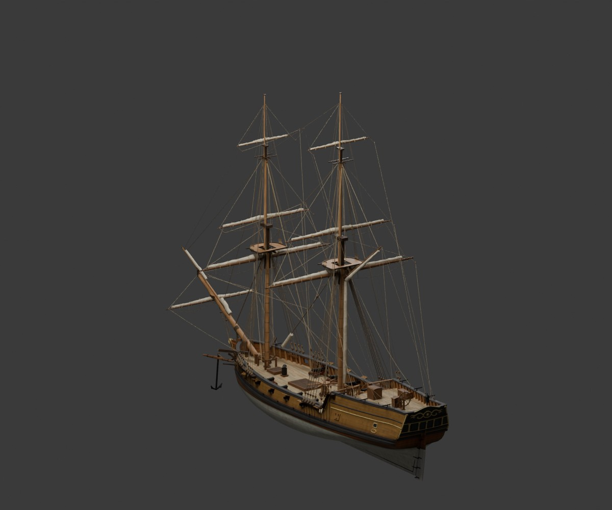

# Przebudowa według poradnika — etap konstrukcji

**Ta scena nie jest gotowym zamiennikiem modelu.** Poprzedni model w `../model/`
pozostaje prototypem przejść i nie spełnia pierwotnego zamówienia.

Nowa baza powstała przy użyciu oryginalnych modułów `blender/` z commita
`2e6f7e922e95396722376d42f3e2e0a12256029e`, uruchomionych przez
`../../common/rebuild_reference.py`. Kadłub jest interpolowany z tabeli
rzędnych, a maszty i reje są ponownie obliczane regułami z rozdziałów 05 i 12.
Wykorzystane są oryginalne moduły konstrukcji, wyposażenia, olinowania,
materiałów i tekstur. Pochodzenie parametrów oraz SHA-256 modułów zapisuje
`provenance.json`.



Wstępna kontrola znalazła 6 krawędzi niemanifoldowych w kadłubie. Generator
zgłosił także ostrzeżenie podczas operacji wycinania otworu steru. Te błędy
wymagają naprawy przed eksportem. Zbudowanie sceny i jej render nie są wynikiem
odbioru technicznego.

Pozostaje do wykonania:

- Naprawa i ponowna kontrola siatki kadłuba, otworu steru i szczelności.
- Wnętrza z rzeczywistymi otworami, dojście do ładowni oraz kajuty kapitana.
- Uzgodnienie nazwy `BRIG` z gry z historycznym takielunkiem snow z poradnika.
- Kontrola nowego ożaglowania w położeniu roboczym i zakresów ruchu.
- Pełna lista kontroli z rozdziału 13, LOD-y, eksport i ponowny import GLB.
- Sprawdzenie tras i stanowisk na nowej geometrii. Poprzednie 34 kontrole
  dotyczą wcześniejszych uproszczonych modeli i nie potwierdzają tej sceny.

Odtworzenie sceny z głównego katalogu repozytorium:

```sh
blender -b --factory-startup --python-exit-code 1 --python sailertales/common/rebuild_reference.py -- sailertales/brig/spec.json --out build/guide-brig
```

Adapter może zapisać proceduralne tekstury za pomocą Blendera, gdy jego Python
nie ma Pillow. Proceduralne materiały są wariantem przewidzianym przez generator;
nie należy opisywać ich jako fotograficznego zestawu CC0 modelu referencyjnego.
