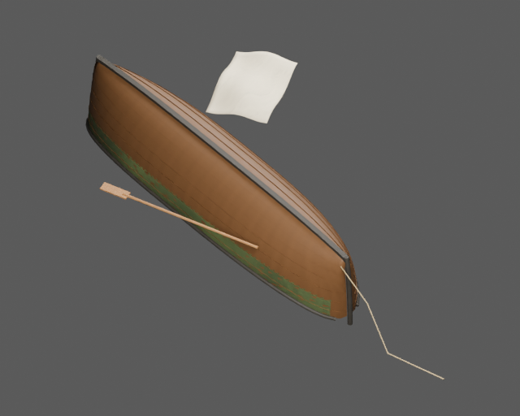
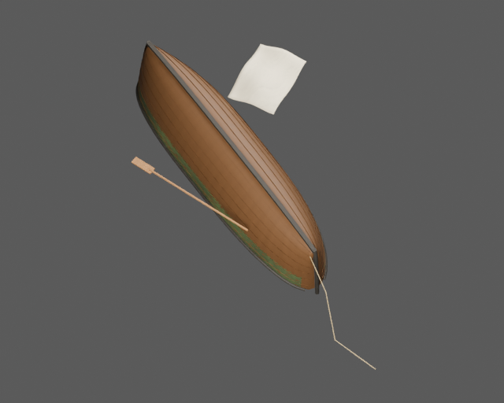
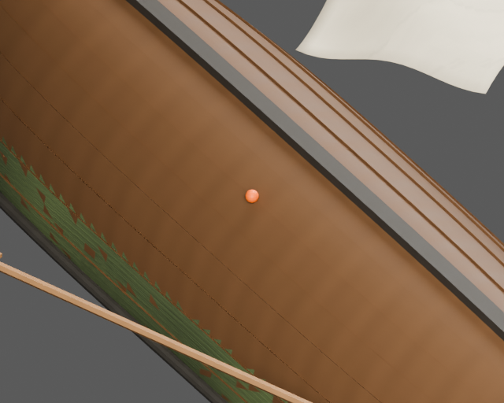

# Wywrócona Mewka — łódź ojca

Aktywny rekwizyt sceny ratunkowej A1.3 z SailerTales: zalana Mewka dnem do góry.
To wariant tego samego kadłuba, opisany w [inwentarzu floty](../fleet-inventory-2026-11-14.md).
Nie jest nową klasą jednostki. Profil źródłowy: 6,5 × 1,72 m i 0,92 m wysokości
burty na śródokręciu; stewy i wznios końców wychodzą poza ten przekrój.







Pomarańczowa kropka w zbliżeniu wskazuje kotwicę siedzącego aktora. To wyłącznie
wskaźnik podglądu, dodany podczas renderowania obu porównywanych scen; nie jest
częścią GLB ani pliku Blender. Pozostałe obrazy przedstawiają sam dostarczony model.

## Model i pliki

Osiem pasów poszycia na każdej burcie to oddzielne zamknięte bryły z realną
grubością 28 mm. Kadłub ma zakładki, stępkę, dwie stewy, listwy burtowe oraz trzy
oryginalne, zanurzone ławki. Nie dodano wręgów, masztu, steru, kajuty ani pozornego
pokładu do chodzenia. Nalot jest przylegającą powłoką materiałową na zewnętrznych
ścianach klepek. Wiosło, kończąca się swobodnie lina i płachta płótna płyną z tym
samym korzeniem rekwizytu.

- [Model GLB](model/ship.glb), [LOD1](model/ship_lod1.glb), [LOD2](model/ship_lod2.glb).
- [Kolizje](model/collision.glb), [spakowana scena Blender](model/ship.blend).
- [Stany, kotwice i parametry pływania](states.json).
- [Kontrakt integracji z grą](integration-contract.json).
- [Pochodzenie i świadome odstępstwa](design.json).
- [Audyt rzeczywistych eksportów](validation.json), [porównanie źródła z GLB](export-review.json).
- [Kontrole dodatnie i ujemne kontraktu](contract-negative-controls.json).

Wszystkie materiały korzystają z proceduralnej ścieżki PBR poradnika. Obrazy
koloru, normalnych i parametrów powierzchni są osadzone w GLB; tekstury nie są
fotograficznym zestawem CC0. Każda bryła kolizji pozostaje zamknięta. W źródłowej
grze ten pływający rekwizyt jest nieprzechodni i nie dodaje zderzaczy; dostarczony
plik kolizji służy opcjonalnym zapytaniom lub przyszłemu adapterowi.

## Ratunek i ruch na fali

Metry, glTF +Y w górę i +Z ku dziobowi. Korzeń jest w spokojnej wodnicy.
Odwrócenie o pół obrotu jest już zapisane w geometrii — nie obracać modelu ponownie.
Rzeczywisty szczyt stępki leży 0,38 m nad spokojną wodą.

`seat_anchor` jest przy x = 0,4 m, z = 0. Wysokość wynika z rzeczywistego poszycia,
z zachowanym 20-milimetrowym zagłębieniem bioder aktora. Źródłowe obliczenie daje
(0,4; 0,185; 0) m; zamknięte grubsze poszycie tego modelu daje około
(0,4; 0,2025; 0) m, na powierzchni około 0,2225 m. Dokładne pomiary są w `design.json`.

Adapter musi wystawić pozycję `seat_anchor` względem korzenia jako `prop.seat`.
Transformację rekwizytu do świata stosuje dopiero `actors.ride`; nie robić tego
dwa razy. Nie używać starej awaryjnej pozycji (0,45; 0,85; 0).

- Wariant `kil`: pozycja siedząca, machanie, yaw π/2; aktor śledzi wysokość,
  pitch i roll pływającej łodzi.
- Wariant w wodzie: kotwica `cling_anchor` (1,15; −1,05; 0), yaw −π/2;
  źródłowa gałąź zachowuje wysokość odniesienia 0 i nie śledzi pitch/roll.

Parametry źródłowe są zachowane: lift 0, span 2,4, beam 0,7, bob 0,03,
sway 0,09, tilt 0,7. Instancja misji używa yaw 0,6 rad i dryfu `windTo × 0.2 m/s`.
Są to dane dla istniejącego mechanizmu gry, nie model hydrodynamiczny ani gotowy
kontroler. Żadne trasy chodzenia nie są deklarowane.

## Odtworzenie

Wymagany Blender 5.2.3 LTS z jego Pythonem i NumPy. Z katalogu głównego:

```sh
blender -b --factory-startup --python-exit-code 1 --python sailertales/capsized-boat/build.py -- sailertales/capsized-boat/spec.json --out build/final/capsized-boat
blender -b --factory-startup --python-exit-code 1 --python sailertales/capsized-boat/review.py -- build/final/capsized-boat --resolution 640
blender -b --factory-startup --python-exit-code 1 --python sailertales/capsized-boat/contract_controls.py -- build/final/capsized-boat
blender -b --factory-startup --python-exit-code 1 --python sailertales/common/v3_prop_audit.py -- sailertales/capsized-boat/spec.json --asset-dir build/final/capsized-boat
python sailertales/common/check_asset.py
```

Audyt importuje wszystkie dostarczone GLB, obejmuje topologię, konkretne połączenia
konstrukcyjne, UV i materiały oraz rzeczywistą kotwicę siedzącego aktora. LOD-y
sprawdzane są jako modele oddalone. Porównanie renderów wiąże źródło i rzeczywisty
GLB z tymi samymi kamerami i oświetleniem. Raporty odróżniają wykonane pomiary od
NA: nie deklarujemy testów chodzenia ani symulacji pływania.

Źródło gry: [SailerTales ea77e56](https://github.com/grzegorz2047/SailerTales/tree/ea77e560ba4668c9dda55433813addbdb2f50176).
Wzory i odwołania do funkcji oraz sumy plików są zapisane w specyfikacji i projekcie.
