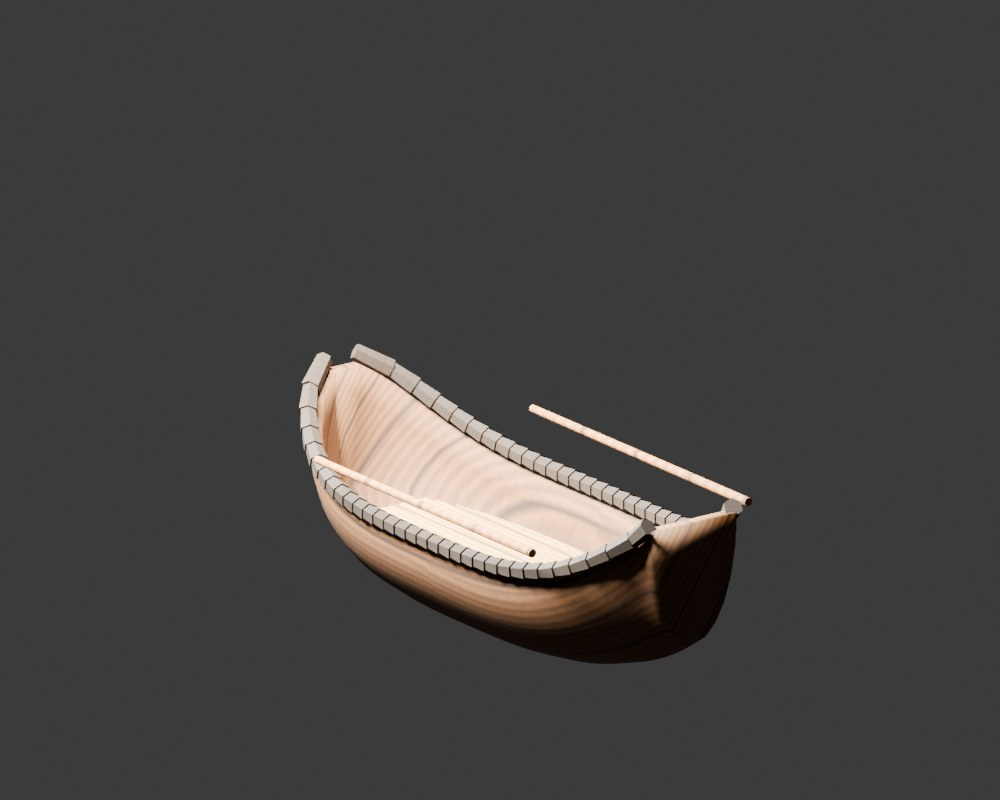
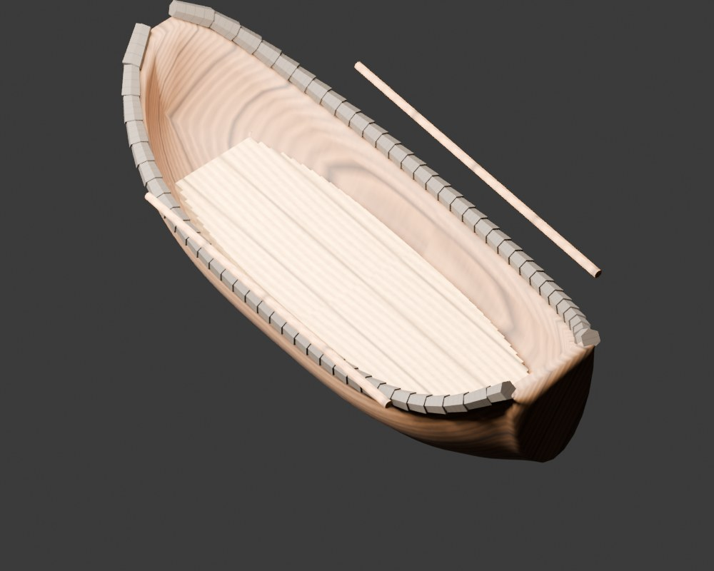

# Szalupa szybkiej podróży

Osobna, uproszczona rekonstrukcja modelu z SailerTales, przygotowana z myślą o
stojącej postaci gracza. Wymiary: 3.25 × 1.2384 m.
Wnętrza i układ przejść są decyzjami do gry. Adapter sterowania postacią i
integracja z SailerTales pozostają do wykonania.

Pliki:

- [Model wizualny](model/ship.glb)
- [Osobne kolizje](model/collision.glb)
- [Scena Blender](model/ship.blend)
- [Trasy i parametry postaci](navigation.json)
- [Raport kontroli eksportów](validation.json)
- [Odtwarzanie modelu i zakres weryfikacji](../common/README.md)

Źródło: [SailerTales, commit ea77e56](https://github.com/grzegorz2047/SailerTales/tree/ea77e560ba4668c9dda55433813addbdb2f50176).

- `src/models/boat.js:DINGHY`

Ograniczenia i odstępstwa:

- Gabaryty wynikają z HULL.L × 0.5 i pełnej szerokości 2×HULL.B × 0.72.
- Tylko lokalne przemieszczanie w małym kokpicie. Nie ma podpokładu ani kajuty.

Raport dotyczy tras zapisanych w `navigation.json` dla kapsuły o promieniu
0,38 m i wysokości 1,85 m. Weryfikator ponownie importuje oba dostarczone GLB,
kontroluje podłoże, nachylenie i miejsce na postać oraz szuka przecięć żagli z
olinowaniem i drzewcami w zapisanym ustawieniu. SHA-256 wiąże wynik z plikami
modelu, specyfikacją, trasami i skryptami. Test nie zastępuje sprawdzenia
kontrolera postaci w działającej grze.
