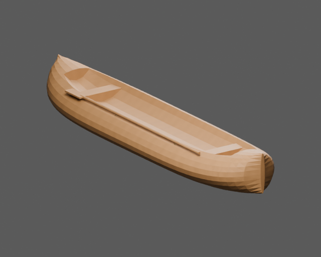
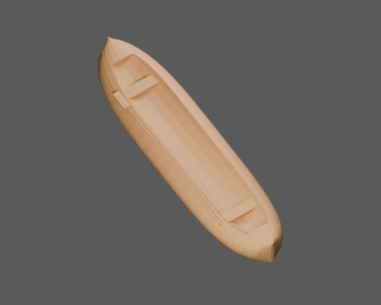

# Dłubanka

Osobny model jednostki z SailerTales, przebudowany metodą z poradnika
OldShipSchematicsAndModel. Konstrukcja: single carved hollow timber; no fabricated frames, strakes or keel.

Wymiary profilu: 5.5 × 1.4 m (profil konstrukcyjny; całkowity obrys z drzewcami jest większy). Pochodzenie liczb, wzory i świadome odstępstwa
są w [design.json](design.json). Identyfikator `dugout` pochodzi z gry;
historyczny typ i zakres rekonstrukcji są opisane oddzielnie od nazwy używanej w grze.




## Pliki

- [Główny GLB](model/ship.glb), [LOD1](model/ship_lod1.glb), [LOD2](model/ship_lod2.glb).
- [Kolizje](model/collision.glb) — osobne statyczne siatki wklęsłe; nie otaczać całej jednostki jednym wypukłym colliderem.
- [Spakowana scena Blender](model/ship.blend).
- [Trasy i wymagania kontrolera](navigation.json).
- [Audyt geometrii i macierz rozdziału 13](validation.json).
- [Porównanie rzeczywistego eksportu ze sceną źródłową](export-review.json).

Wszystkie pokazane wyżej obrazy PNG wyrenderowano po ponownym imporcie
dostarczonego GLB. Porównanie ze spakowaną sceną wykorzystuje te same kamery
i światła. Próg różnicy jasności to 10%, udziałów kanałów koloru 0,04.
Wynik porównania: **True**. Wynik wymaganych kontroli audytu: **True**.
To dwie oddzielne kontrole — test dojścia nie zastępuje kontroli konstrukcji i eksportu.

## Dostęp gracza

Postać testowa: promień kapsuły 0,38 m, całkowita wysokość 1,85 m, maksymalne
nachylenie chodzenia 35°. Drabiny mają osobny tryb wspinania; nie są przedstawiane
jako schodnie spełniające limit 35°.

| Trasa | Wymagany ruch |
|---|---|
| carved_cockpit | chodzenie |

Ten PR dostarcza statyczny asset i metadane integracji. Kontroler postaci,
wspinanie, ruch postaci wraz z płynącym statkiem, animowanie mechanizmów,
maskowanie wody i podłączenie do aktualnej gry wymagają adaptera silnika.
Należy używać tych samych transformacji modelu, kolizji i punktów tras.

## Źródła i odstępstwa

Źródłem metody są rozdziały 01–09, 12–14 poradnika i wskazane moduły `blender/`.
Model jest rekonstrukcją do gry, nie pomiarem zachowanego historycznego statku
ani certyfikacją stateczności. Wariant proceduralny materiałów jest opisany
w danych; nie przypisujemy mu fotograficznych tekstur CC0.

Źródło profilu gry: [SailerTales ea77e56](https://github.com/grzegorz2047/SailerTales/tree/ea77e560ba4668c9dda55433813addbdb2f50176).

- End thwarts and side seats leave a real standing corridor; no solid thwart across that corridor.
- The small craft have no fabricated cabin or lower deck.
- Dimensions specified as game bounds; no hydrostatic seaworthiness certification.

## Macierz kontroli

`NA` oznacza wyłączenie z uzasadnieniem lub pomiar pozostający poza zakresem;
nie jest zaliczeniem kontroli. Pełne dane i zakres są w raporcie JSON.
Nie wyciągać z wyniku tras wniosku, że zweryfikowano każdy punkt pokładu,
wszystkie stanowiska załogi albo dowolny ruch takielunku.

| Punkt | Wynik | Dowód lub ograniczenie |
|---|---|---|
| A1 | PASS | {"world_bounds":{"min_blender_m":[-0.699999988079071,-2.75,-0.34759393334388733],"max_blender_m":[0.699999988079071,2.75,0.4575939178466797]},"hull_measurement":{"passed":true,"hull_length_m":5.5,"hull_breadth_m":1.399999976158142,"nominal_length_m":5.5,"nominal_breadth_m":1.4,"length_acceptance_ratio":[0.8,1.2],"breadth_acceptance_ratio":[0.8,1.2] |
| A2 | PASS | {"navigation_axis_declaration":"glTF X port, Y up, Z bow"} |
| A3 | PASS | {"origin_node_present":true,"design_origin":{"position_gltf_m":[0,0,0],"meaning":"design waterline at hull mid-length"}} |
| A4 | PASS | {"unapplied_static_mesh_transforms":[]} |
| B1 | PASS | {"invalid_names":[]} |
| B2 | NA | This item needs additional authored evidence; it is not counted as a passing test. |
| B3 | NA | This item needs additional authored evidence; it is not counted as a passing test. |
| B4 | PASS | {"copy_suffix_material_names":[]} |
| C1 | NA | No moving-part contract is declared for this static asset release. |
| C2 | NA | No moving-part contract is declared for this static asset release. |
| C3 | NA | No moving-part contract is declared for this static asset release. |
| C4 | NA | No moving-part contract is declared for this static asset release. |
| D1 | PASS | {"failures":[]} |
| D2 | PASS | {"failures":[]} |
| D3 | PASS | {"reversed_objects":[]} |
| D4 | NA | This item needs additional authored evidence; it is not counted as a passing test. |
| D5 | NA | This item needs additional authored evidence; it is not counted as a passing test. |
| D6 | NA | This item needs additional authored evidence; it is not counted as a passing test. |
| D7 | NA | This item needs additional authored evidence; it is not counted as a passing test. |
| D8 | NA | This item needs additional authored evidence; it is not counted as a passing test. |
| E1 | PASS | {"passed":true,"overlapping_solid_pairs":1,"surface_contact_pairs":0,"intended_joints":[{"a":"paddle_blade","b":"paddle_shaft","reason":"The paddle loom is housed in its blade; the paddle is lashed above the carved rim."}],"unintended_penetrations":[],"threshold_m":0.005,"numeric_tolerance_m":1e-05,"connected_solid_parts":3,"method":"connected clos |
| E2 | PASS | {"declared_rules":1,"structured_rules_required":true} |
| E3 | NA | This item needs additional authored evidence; it is not counted as a passing test. |
| E4 | NA | This item needs additional authored evidence; it is not counted as a passing test. |
| E5 | NA | This item needs additional authored evidence; it is not counted as a passing test. |
| E6 | NA | This item needs additional authored evidence; it is not counted as a passing test. |
| F1 | PASS | {"materials":{"v2_wood":{"area_m2":18.553634513420832,"texel_density_px_m":{"p5":1023.999038820763,"median":1024.0000301197324,"p95":1024.0011602876696},"density_p95_p5_ratio":1.0000020717469706,"anisotropy_p95":1.0000038283863584,"anisotropy_over_1_25_area_share":6.278945457439352e-11,"degenerate_uv_area_m2":0.0,"wood_grain_measured_area_m2":17.23 |
| F2 | PASS | {"materials_above_p95_p5_1_44":[]} |
| F3 | PASS | {"materials_above_8_percent_area_at_anisotropy1_25":[]} |
| F4 | PASS | {"wood_grain_failures":[],"method":"elongated wooden meshes, side-face U tangent within25deg of major timber axis"} |
| F5 | NA | This item needs additional authored evidence; it is not counted as a passing test. |
| F6 | PASS | {"images":[{"index":0,"name":"wood_normal","width":2048,"height":2048,"bytes":403169,"sha256":"e818cbf65c8caf36cc80252ef27a2f3a26511538ff7796342ce591c942af2e73","power_of_two":true},{"index":1,"name":"wood_color","width":2048,"height":2048,"bytes":477556,"sha256":"5d5bfe4670209e8c07413a2d338dd5ee11cc701ab76188d3ade7d51c90a859ad","power_of_two":true |
| F7 | PASS | {"material_slot_failures":[]} |
| F8 | NA | No baked AO texture is supplied; material AO is not claimed. |
| G1 | NA | This item needs additional authored evidence; it is not counted as a passing test. |
| G2 | PASS | {"fractional_plain_metallic_factors":[]} |
| G3 | PASS | {"linear_glTF_factors_valid_0_1":true,"note":"sRGB-to-linear provenance remains in design/material recipe, glTF factor values are linear by specification"} |
| G4 | PASS | {"unjustified_double_sided_materials":[]} |
| G5 | PASS | {"exact_duplicate_materials":0} |
| H1 | PASS | {"bytes":1809224,"budget_bytes":33554432} |
| H2 | PASS | {"triangles":3334,"budget":280000} |
| H3 | PASS | {"passed":true,"source_triangles":3334,"export_triangles":3334,"export_indexed_triangles":3334,"triangle_count_scope":"source and export include every mesh-node instance; indexed count is separate","triangle_relative_difference":0.0,"max_bound_error_m":0.0,"missing_source_mesh_nodes":[],"unexpected_export_mesh_nodes":[],"unpacked_used_images":[],"m |
| H4 | PASS | {"distinct_image_role_check":[],"embedded_images":6} |
| H5 | PASS | {"present":true,"passed":true,"fingerprints_match":true,"review":{"schema":1,"source_triangles":3334,"export_triangles":3334,"triangle_match":true,"views":{"hero":{"foreground_pixels":54254,"source_mean_rgb":[0.6802076101303101,0.5397926568984985,0.4139840602874756],"export_mean_rgb":[0.6802067756652832,0.5397940874099731,0.4139849841594696],"brigh |
| H6 | PASS | {"primitives_with_tangents":0,"strategy":"provided tangent attribute or engine-derived glTF tangent basis"} |
| I1 | PASS | {"passed":true,"lod0_triangles":3334,"levels":[{"level":1,"passed":true,"errors":[],"bytes":620520,"triangles":1672,"nodes":5,"meshes":5,"materials":2,"images":[{"index":0,"name":"wood_normal","width":1024,"height":1024,"bytes":25914,"sha256":"1d8eec91b391c2f18542bdc85630177ff5dc21c907bf1bc18ce94b8743708ce7","power_of_two":true},{"index":1,"name":" |
| I2 | NA | This item needs additional authored evidence; it is not counted as a passing test. |
| I3 | PASS | {"topology":true,"route_checks":{"passed":true,"player":{"radius":0.38,"height":1.85,"max_slope_deg":35},"sample_step_m":0.1,"geometry_tolerance_m":0.015,"rounded_foot_lift_m":0.08,"controller_step_allowance_m":0.22,"scope":"sampled authored corridors; climb mode requires a climb controller and real endpoint landings","routes":[{"name":"carved_cock |
| I4 | NA | No alternate physics variant is exported. |
| J1 | NA | No complete floor-grid flood fill against every declared crew workstation has been run; authored player corridors are a separate required gate. |
| J2 | NA | This item needs additional authored evidence; it is not counted as a passing test. |
| J3 | PASS | {"minimum_tested_capsule_diameter_m":0.8,"scope":"declared walk corridors, strict zero geometric shrink","files":{"model/ship.glb":{"passed":true,"player":{"radius":0.4,"height":1.85,"max_slope_deg":35},"sample_step_m":0.1,"geometry_tolerance_m":0,"rounded_foot_lift_m":0.08,"controller_step_allowance_m":0.22,"scope":"sampled authored corridors; cli |
| J4 | PASS | {"capsule_height_m":1.85,"files":{"model/ship.glb":{"passed":true,"player":{"radius":0.38,"height":1.85,"max_slope_deg":35},"sample_step_m":0.1,"geometry_tolerance_m":0.015,"rounded_foot_lift_m":0.08,"controller_step_allowance_m":0.22,"scope":"sampled authored corridors; climb mode requires a climb controller and real endpoint landings","routes":[{ |
| J5 | NA | No carriage guns in this asset. |
| J6 | NA | This item needs additional authored evidence; it is not counted as a passing test. |
| provenance | PASS | {"passed":true,"source_evidence":{"repo":"grzegorz2047/OldShipSchematicsAndModel","commit":"2e6f7e922e95396722376d42f3e2e0a12256029e","source":"docs/en/03-hull-construction.md and 13/14 general timber, mesh and game principles","sha256":"6c0fc58bb6b35197ac50cdf07202b9d8d39d14a9aa3d3a9e13c0d725491d79bc","chapters":["03 hull construction","08 ropes a |
| rig_clearance | PASS | {"passed":true,"sails":0,"ropes":2,"spars":0,"pairs_tested":0,"scope":"authored static pose; boundary allowance only for explicit, reasoned attachments","edge_contact_tolerance_m":0.025,"edge_contacts":[],"intersections":[]} |
| player_destinations | PASS | {"model/ship.glb":{"passed":true,"player":{"radius":0.38,"height":1.85,"max_slope_deg":35},"sample_step_m":0.1,"geometry_tolerance_m":0.015,"rounded_foot_lift_m":0.08,"controller_step_allowance_m":0.22,"scope":"sampled authored corridors; climb mode requires a climb controller and real endpoint landings","routes":[{"name":"carved_cockpit","mode":"w |

## Odtworzenie i kontrola

Instrukcje oraz wymagania narzędzi są w [common/README.md](../common/README.md).
Samodzielne sprawdzenie aktualności plików nie wymaga Blendera:

```sh
python sailertales/common/v2_integrity.py --asset-dir sailertales/dugout --source-root .
```

Liczby trójkątów zapisane przez eksport: `{"lod0": 3334, "collision": 3230, "lod1": 1672, "lod2": 283}`.
