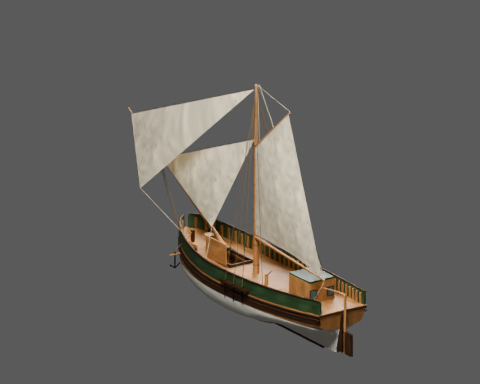
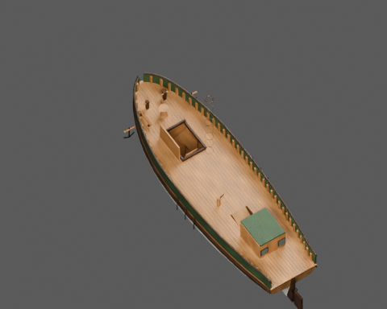
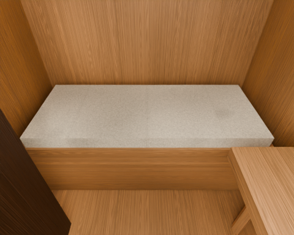
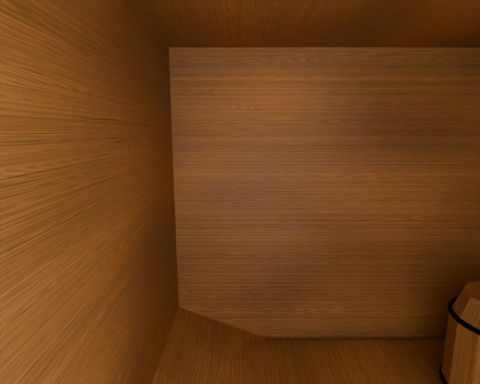

# Slup kupiecki osady

Osobny model jednostki z SailerTales, przebudowany metodą z poradnika
OldShipSchematicsAndModel. Konstrukcja: Chapter02 original offset interpolator; chapter12 revised single-mast sloop parameter chain; chapter09 merchant fittings; independently inferred player interiors..

Wymiary profilu: 17.4 × 5.16 m (profil konstrukcyjny; całkowity obrys z drzewcami jest większy). Pochodzenie liczb, wzory i świadome odstępstwa
są w [design.json](design.json). Identyfikator `merchant-sloop` pochodzi z gry;
historyczny typ i zakres rekonstrukcji są opisane oddzielnie od nazwy używanej w grze.






## Pliki

- [Główny GLB](model/ship.glb), [LOD1](model/ship_lod1.glb), [LOD2](model/ship_lod2.glb).
- [Kolizje](model/collision.glb) — osobne statyczne siatki wklęsłe; nie otaczać całej jednostki jednym wypukłym colliderem.
- [Spakowana scena Blender](model/ship.blend).
- [Trasy i wymagania kontrolera](navigation.json).
- [Audyt geometrii i macierz rozdziału 13](validation.json).
- [Porównanie rzeczywistego eksportu ze sceną źródłową](export-review.json).

Wszystkie pokazane wyżej obrazy PNG wyrenderowano po ponownym imporcie
dostarczonego GLB. Porównanie ze spakowaną sceną wykorzystuje te same kamery
i światła. Próg różnicy jasności to 10%, udziałów kanałów koloru 0,04.
Wynik porównania: **True**. Wynik wymaganych kontroli audytu: **True**.
To dwie oddzielne kontrole — test dojścia nie zastępuje kontroli konstrukcji i eksportu.

Widok pokładu jest przekrojem prezentacyjnym: ukrywa maszty, płótno i liny,
pozostawiając część okuć, w tym obręcze masztu. Pełny model i ujęcie całej jednostki
zachowują kompletne drzewca i ich połączenia.

## Dostęp gracza

Postać testowa: promień kapsuły 0,38 m, całkowita wysokość 1,85 m, maksymalne
nachylenie chodzenia 35°. Drabiny mają osobny tryb wspinania; nie są przedstawiane
jako schodnie spełniające limit 35°.

| Trasa | Wymagany ruch |
|---|---|
| main_deck_starboard | chodzenie |
| main_deck_port | chodzenie |
| working_deck_crossing | chodzenie |
| foredeck_crossing | chodzenie |
| aft_helm_access | chodzenie |
| captains_cabin | chodzenie |
| hatch_approach | chodzenie |
| hold_ladder | wspinanie po drabinie |
| hold_aisle | chodzenie |

Ten PR dostarcza statyczny asset i metadane integracji. Kontroler postaci,
wspinanie, ruch postaci wraz z płynącym statkiem, animowanie mechanizmów,
maskowanie wody i podłączenie do aktualnej gry wymagają adaptera silnika.
Należy używać tych samych transformacji modelu, kolizji i punktów tras.

## Źródła i odstępstwa

Źródłem metody są rozdziały 01–09, 12–14 poradnika i wskazane moduły `blender/`.
Model jest rekonstrukcją do gry, nie pomiarem zachowanego historycznego statku
ani certyfikacją stateczności. Wariant proceduralny materiałów jest opisany
w danych; nie przypisujemy mu fotograficznych tekstur CC0.

Źródło profilu gry: [SailerTales ea77e56](https://github.com/grzegorz2047/SailerTales/tree/ea77e560ba4668c9dda55433813addbdb2f50176).

- The game used a .6-scaled brig; replaced with actual single-mast sloop profile.
- Original reference does not supply interiors: lowered cabin sole .30m and hold sole -1.18m are gameplay inferences.
- The legacy deck/sole scalar fields in spec.json preserve the game profile; the authored deck follows the guide offset sheer and the exact delivered floors are recorded in navigation.json.
- Deckhouse clear width is 1.80m; berth and table are resized independently to retain a verified 0.80m exterior crew corridor.
- Hold ladder requires climb controller, rather than pretending a steep historical ladder is a walkable35deg ramp.
- Authored boom/gaff are shortened approximately4%/2% from the tabulated maximum to keep the working pose over the hull.
- Static authored sailing pose only; arbitrary spar trimming requires rerouted runtime ropes.
- Original source procedural PBR set is used, not the optional photographic CC0 set.

## Macierz kontroli

`NA` oznacza wyłączenie z uzasadnieniem lub pomiar pozostający poza zakresem;
nie jest zaliczeniem kontroli. Pełne dane i zakres są w raporcie JSON.
Nie wyciągać z wyniku tras wniosku, że zweryfikowano każdy punkt pokładu,
wszystkie stanowiska załogi albo dowolny ruch takielunku.

| Punkt | Wynik | Dowód lub ograniczenie |
|---|---|---|
| A1 | PASS | {"world_bounds":{"min_blender_m":[-2.9148969650268555,-14.919604301452637,-1.843273639678955],"max_blender_m":[2.9148969650268555,9.635159492492676,13.553999900817871]},"hull_measurement":{"passed":true,"hull_length_m":17.40000057220459,"hull_breadth_m":5.28345251083374,"nominal_length_m":17.4,"nominal_breadth_m":5.16,"length_acceptance_ratio":[0.8 |
| A2 | PASS | {"navigation_axis_declaration":"glTF X port Y up Z bow"} |
| A3 | PASS | {"origin_node_present":true,"design_origin":null} |
| A4 | PASS | {"unapplied_static_mesh_transforms":[]} |
| B1 | PASS | {"invalid_names":[]} |
| B2 | NA | This item needs additional authored evidence; it is not counted as a passing test. |
| B3 | NA | This item needs additional authored evidence; it is not counted as a passing test. |
| B4 | PASS | {"copy_suffix_material_names":[]} |
| C1 | NA | No moving-part contract is declared for this static asset release. |
| C2 | NA | No moving-part contract is declared for this static asset release. |
| C3 | NA | No moving-part contract is declared for this static asset release. |
| C4 | NA | No moving-part contract is declared for this static asset release. |
| D1 | PASS | {"failures":[]} |
| D2 | PASS | {"failures":[]} |
| D3 | PASS | {"reversed_objects":[]} |
| D4 | NA | This item needs additional authored evidence; it is not counted as a passing test. |
| D5 | NA | This item needs additional authored evidence; it is not counted as a passing test. |
| D6 | NA | This item needs additional authored evidence; it is not counted as a passing test. |
| D7 | NA | This item needs additional authored evidence; it is not counted as a passing test. |
| D8 | NA | This item needs additional authored evidence; it is not counted as a passing test. |
| E1 | PASS | {"passed":true,"overlapping_solid_pairs":773,"surface_contact_pairs":11,"intended_joints":[{"a":"shroud_channel_1","b":"deadeye_1","reason":"Deadeyes seat in the outboard shroud channel, secured by their chainplates."},{"a":"shroud_channel_1","b":"deadeye_5","reason":"Deadeyes seat in the outboard shroud channel, secured by their chainplates."},{"a |
| E2 | PASS | {"declared_rules":58,"structured_rules_required":true} |
| E3 | NA | This item needs additional authored evidence; it is not counted as a passing test. |
| E4 | NA | This item needs additional authored evidence; it is not counted as a passing test. |
| E5 | NA | This item needs additional authored evidence; it is not counted as a passing test. |
| E6 | NA | This item needs additional authored evidence; it is not counted as a passing test. |
| F1 | PASS | {"materials":{"forged_iron":{"area_m2":4.861381601026164,"texel_density_px_m":{"p5":1023.653202017342,"median":1023.9999999999999,"p95":1024.0111465668804},"density_p95_p5_ratio":1.0003496736480997,"anisotropy_p95":1.0006774897470667,"anisotropy_over_1_25_area_share":0.0,"degenerate_uv_area_m2":0.0,"wood_grain_measured_area_m2":0.0,"wood_grain_alig |
| F2 | PASS | {"materials_above_p95_p5_1_44":[]} |
| F3 | PASS | {"materials_above_8_percent_area_at_anisotropy1_25":[]} |
| F4 | PASS | {"wood_grain_failures":[],"method":"elongated wooden meshes, side-face U tangent within25deg of major timber axis"} |
| F5 | NA | This item needs additional authored evidence; it is not counted as a passing test. |
| F6 | PASS | {"images":[{"index":0,"name":"zelazo_normalne","width":2048,"height":2048,"bytes":763100,"sha256":"a709f6fbef5ffb1e80b9d01c97d792e3f5416da08184124cd5d6350de6581d67","power_of_two":true},{"index":1,"name":"zelazo_kolor","width":2048,"height":2048,"bytes":346850,"sha256":"483bf5820d1cea41ab280aca3d97584da3f93938a1d90e12206d76bc373c4da4","power_of_two |
| F7 | PASS | {"material_slot_failures":[]} |
| F8 | NA | No baked AO texture is supplied; material AO is not claimed. |
| G1 | NA | This item needs additional authored evidence; it is not counted as a passing test. |
| G2 | PASS | {"fractional_plain_metallic_factors":[]} |
| G3 | PASS | {"linear_glTF_factors_valid_0_1":true,"note":"sRGB-to-linear provenance remains in design/material recipe, glTF factor values are linear by specification"} |
| G4 | PASS | {"unjustified_double_sided_materials":[]} |
| G5 | PASS | {"exact_duplicate_materials":0} |
| H1 | PASS | {"bytes":19808504,"budget_bytes":33554432} |
| H2 | PASS | {"triangles":68812,"budget":280000} |
| H3 | PASS | {"passed":true,"source_triangles":68812,"export_triangles":68812,"export_indexed_triangles":68812,"triangle_count_scope":"source and export include every mesh-node instance; indexed count is separate","triangle_relative_difference":0.0,"max_bound_error_m":0.0,"missing_source_mesh_nodes":[],"unexpected_export_mesh_nodes":[],"unpacked_used_images":[] |
| H4 | PASS | {"distinct_image_role_check":[],"embedded_images":12} |
| H5 | PASS | {"present":true,"passed":true,"fingerprints_match":true,"review":{"schema":1,"source_triangles":68812,"export_triangles":68812,"triangle_match":true,"views":{"hero":{"foreground_pixels":30384,"source_mean_rgb":[0.556358277797699,0.503974199295044,0.43216565251350403],"export_mean_rgb":[0.5563316941261292,0.5039466619491577,0.43213313817977905],"bri |
| H6 | PASS | {"primitives_with_tangents":0,"strategy":"provided tangent attribute or engine-derived glTF tangent basis"} |
| I1 | PASS | {"passed":true,"lod0_triangles":68812,"levels":[{"level":1,"passed":true,"errors":[],"bytes":18161624,"triangles":37696,"nodes":351,"meshes":351,"materials":11,"images":[{"index":0,"name":"zelazo_normalne","width":2048,"height":2048,"bytes":763100,"sha256":"a709f6fbef5ffb1e80b9d01c97d792e3f5416da08184124cd5d6350de6581d67","power_of_two":true},{"ind |
| I2 | NA | This item needs additional authored evidence; it is not counted as a passing test. |
| I3 | PASS | {"topology":true,"route_checks":{"passed":true,"player":{"radius":0.38,"height":1.85,"max_slope_deg":35},"sample_step_m":0.1,"geometry_tolerance_m":0.015,"rounded_foot_lift_m":0.08,"controller_step_allowance_m":0.22,"scope":"sampled authored corridors; climb mode requires a climb controller and real endpoint landings","routes":[{"name":"main_deck_s |
| I4 | NA | No alternate physics variant is exported. |
| J1 | NA | No complete floor-grid flood fill against every declared crew workstation has been run; authored player corridors are a separate required gate. |
| J2 | NA | This item needs additional authored evidence; it is not counted as a passing test. |
| J3 | PASS | {"minimum_tested_capsule_diameter_m":0.8,"scope":"declared walk corridors, strict zero geometric shrink","files":{"model/ship.glb":{"passed":true,"player":{"radius":0.4,"height":1.85,"max_slope_deg":35},"sample_step_m":0.1,"geometry_tolerance_m":0,"rounded_foot_lift_m":0.08,"controller_step_allowance_m":0.22,"scope":"sampled authored corridors; cli |
| J4 | PASS | {"capsule_height_m":1.85,"files":{"model/ship.glb":{"passed":true,"player":{"radius":0.38,"height":1.85,"max_slope_deg":35},"sample_step_m":0.1,"geometry_tolerance_m":0.015,"rounded_foot_lift_m":0.08,"controller_step_allowance_m":0.22,"scope":"sampled authored corridors; climb mode requires a climb controller and real endpoint landings","routes":[{ |
| J5 | NA | No carriage guns in this asset. |
| J6 | NA | This item needs additional authored evidence; it is not counted as a passing test. |
| provenance | PASS | {"passed":true,"source_evidence":[{"repository":"https://github.com/grzegorz2047/OldShipSchematicsAndModel","ref":"2e6f7e922e95396722376d42f3e2e0a12256029e","paths":["blender/parametry.py","blender/rzedne.py","blender/kadlub.py","docs/en/12-designing-other-ships.md"]},{"repository":"https://github.com/grzegorz2047/OldShipSchematicsAndModel","ref":" |
| rig_clearance | PASS | {"passed":true,"sails":3,"ropes":120,"spars":7,"pairs_tested":68,"scope":"authored static pose; boundary allowance only for explicit, reasoned attachments","edge_contact_tolerance_m":0.025,"edge_contacts":[{"sail":"gaff_main_set_1","other":"gaff_main_bolt_rope_0_1","triangle_pairs":96,"reason":"own sewn bolt rope","max_boundary_distance_m":0.025},{ |
| player_destinations | PASS | {"model/ship.glb":{"passed":true,"player":{"radius":0.38,"height":1.85,"max_slope_deg":35},"sample_step_m":0.1,"geometry_tolerance_m":0.015,"rounded_foot_lift_m":0.08,"controller_step_allowance_m":0.22,"scope":"sampled authored corridors; climb mode requires a climb controller and real endpoint landings","routes":[{"name":"main_deck_starboard","mod |

## Odtworzenie i kontrola

Instrukcje oraz wymagania narzędzi są w [common/README.md](../common/README.md).
Samodzielne sprawdzenie aktualności plików nie wymaga Blendera:

```sh
python sailertales/common/v2_integrity.py --asset-dir sailertales/merchant-sloop --source-root .
```

Liczby trójkątów zapisane przez eksport: `{"lod0": 68812, "lod1": 37696, "lod2": 15816, "collision": 4818}`.
