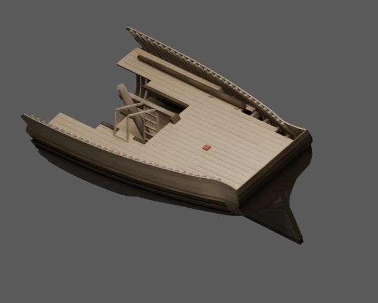
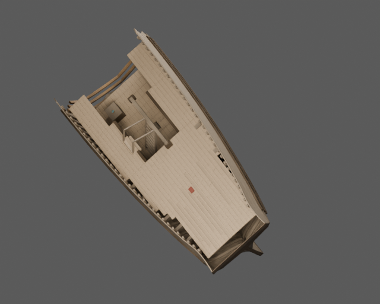
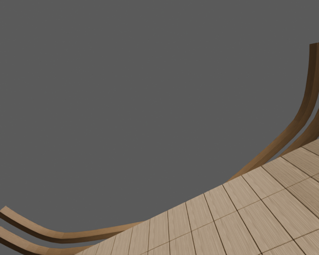

# Wrak kupiecki na rafie

Osobny model jednostki z SailerTales, przebudowany metodą z poradnika
OldShipSchematicsAndModel. Konstrukcja: {"offset_method": "Original rzedne.Kadlub PCHIP evaluation of PR.RZEDNE; no generic hull function", "length_scale": 0.7857142857142857, "breadth_scale": 0.7894736842105263, "vertical_scale": 0.8530370756823102, "stranded_z_offset_m": 1.7254534568049813, "nominal_original_length_m": 22, "nominal_beam_m": 6, "retained_hull": "aft and midbody to staggered fracture at s~+2.35m", "planking_thickness_m": 0.05131578947368421, "frame_pitch_m": 0.4085714285714286, "frame_section_m": [0.14210526315789473, 0.09473684210526316], "deck_plank_width_m": 0.22, "deck_seam_m": 0.008, "deck_thickness_m": 0.07, "mast_lower_length_rule_m": 14.0, "retained_mast_diameter_m": 0.3888888888888889, "heel_rad": 0.4999999999992816, "heel_baked": true, "world_gravity": [0, -1, 0]}.

Wymiary profilu: 22 × 6 m (profil konstrukcyjny; całkowity obrys z drzewcami jest większy). Pochodzenie liczb, wzory i świadome odstępstwa
są w [design.json](design.json). Identyfikator `wreck` pochodzi z gry;
historyczny typ i zakres rekonstrukcji są opisane oddzielnie od nazwy używanej w grze.





## Pliki

- [Główny GLB](model/ship.glb), [LOD1](model/ship_lod1.glb), [LOD2](model/ship_lod2.glb).
- [Kolizje](model/collision.glb) — osobne statyczne siatki wklęsłe; nie otaczać całej jednostki jednym wypukłym colliderem.
- [Spakowana scena Blender](model/ship.blend).
- [Trasy i wymagania kontrolera](navigation.json).
- [Audyt geometrii i macierz rozdziału 13](validation.json).
- [Porównanie rzeczywistego eksportu ze sceną źródłową](export-review.json).

Wszystkie pokazane wyżej obrazy PNG wyrenderowano po ponownym imporcie
dostarczonego GLB. Porównanie ze spakowaną sceną wykorzystuje te same kamery
i światła. Próg różnicy jasności to 10%, udziałów kanałów koloru 0,04.
Wynik porównania: **True**. Wynik wymaganych kontroli audytu: **True**.
To dwie oddzielne kontrole — test dojścia nie zastępuje kontroli konstrukcji i eksportu.

## Dostęp gracza

Postać testowa: promień kapsuły 0,38 m, całkowita wysokość 1,85 m, maksymalne
nachylenie chodzenia 35°. Drabiny mają osobny tryb wspinania; nie są przedstawiane
jako schodnie spełniające limit 35°.

| Trasa | Wymagany ruch |
|---|---|
| aft_deck_to_hatch | chodzenie |
| hatch_to_hold | wspinanie po drabinie |
| hold_mast_bypass | chodzenie |
| book_station | chodzenie |

Ten PR dostarcza statyczny asset i metadane integracji. Kontroler postaci,
wspinanie, ruch postaci wraz z płynącym statkiem, animowanie mechanizmów,
maskowanie wody i podłączenie do aktualnej gry wymagają adaptera silnika.
Należy używać tych samych transformacji modelu, kolizji i punktów tras.
Przechył wraku jest już zapisany w geometrii — nie nakładać go drugi raz.

## Źródła i odstępstwa

Źródłem metody są rozdziały 01–09, 12–14 poradnika i wskazane moduły `blender/`.
Model jest rekonstrukcją do gry, nie pomiarem zachowanego historycznego statku
ani certyfikacją stateczności. Wariant proceduralny materiałów jest opisany
w danych; nie przypisujemy mu fotograficznych tekstur CC0.

Źródło profilu gry: [SailerTales ea77e56](https://github.com/grzegorz2047/SailerTales/tree/ea77e560ba4668c9dda55433813addbdb2f50176).

- The source guide does not specify this wreck; damage, hold, salvage and ladder layout are explicit game inference.
- The source model's broad flat transom family is retained; no historical identity for the wreck is asserted.
- The game's deck/sole/draft values are mapped to a stranded vertical datum; they are not a new hydrostatic floating draft.
- No captain cabin survives; no fabricated room is added.
- Hull fairness is inherited from the documented source offset family, including its disclosed limitations below the aft waterline.
- Procedural MIT guide textures with colour-weathering transform; not photographic CC0 texture set.

## Macierz kontroli

`NA` oznacza wyłączenie z uzasadnieniem lub pomiar pozostający poza zakresem;
nie jest zaliczeniem kontroli. Pełne dane i zakres są w raporcie JSON.
Nie wyciągać z wyniku tras wniosku, że zweryfikowano każdy punkt pokładu,
wszystkie stanowiska załogi albo dowolny ruch takielunku.

| Punkt | Wynik | Dowód lub ograniczenie |
|---|---|---|
| A1 | PASS | {"world_bounds":{"min_blender_m":[-2.1036550998687744,-3.1110525131225586,-1.130308985710144],"max_blender_m":[4.102083206176758,11.53899097442627,4.3276190757751465]},"hull_measurement":{"passed":true,"hull_length_m":14.195678949356079,"hull_breadth_m":6.135427236557007,"nominal_length_m":22.0,"nominal_breadth_m":6.0,"length_acceptance_ratio":[0.4 |
| A2 | PASS | {"navigation_axis_declaration":"glTF X port, Y up, Z bow"} |
| A3 | PASS | {"origin_node_present":true,"design_origin":null} |
| A4 | PASS | {"unapplied_static_mesh_transforms":[]} |
| B1 | PASS | {"invalid_names":[]} |
| B2 | NA | This item needs additional authored evidence; it is not counted as a passing test. |
| B3 | NA | This item needs additional authored evidence; it is not counted as a passing test. |
| B4 | PASS | {"copy_suffix_material_names":[]} |
| C1 | NA | No moving-part contract is declared for this static asset release. |
| C2 | NA | No moving-part contract is declared for this static asset release. |
| C3 | NA | No moving-part contract is declared for this static asset release. |
| C4 | NA | No moving-part contract is declared for this static asset release. |
| D1 | PASS | {"failures":[]} |
| D2 | PASS | {"failures":[]} |
| D3 | PASS | {"reversed_objects":[]} |
| D4 | NA | This item needs additional authored evidence; it is not counted as a passing test. |
| D5 | NA | This item needs additional authored evidence; it is not counted as a passing test. |
| D6 | NA | This item needs additional authored evidence; it is not counted as a passing test. |
| D7 | NA | This item needs additional authored evidence; it is not counted as a passing test. |
| D8 | NA | This item needs additional authored evidence; it is not counted as a passing test. |
| E1 | PASS | {"passed":true,"overlapping_solid_pairs":2616,"surface_contact_pairs":481,"intended_joints":[{"a":"hull_strake_starboard_03","b":"frame_28","reason":"Frames are fitted against inner planking."},{"a":"hull_strake_starboard_03","b":"frame_27","reason":"Frames are fitted against inner planking."},{"a":"hull_strake_starboard_03","b":"frame_29","reason" |
| E2 | PASS | {"declared_rules":27,"structured_rules_required":true} |
| E3 | NA | This item needs additional authored evidence; it is not counted as a passing test. |
| E4 | NA | This item needs additional authored evidence; it is not counted as a passing test. |
| E5 | NA | No rigging in this vessel. |
| E6 | NA | No rigging in this vessel. |
| F1 | PASS | {"materials":{"oak":{"area_m2":583.626643662073,"texel_density_px_m":{"p5":1014.0519459275027,"median":1023.9943267420314,"p95":1033.1921845124998},"density_p95_p5_ratio":1.0188750079932942,"anisotropy_p95":1.0605929863177106,"anisotropy_over_1_25_area_share":0.011092053102531356,"degenerate_uv_area_m2":0.030800123554884155,"wood_grain_measured_are |
| F2 | PASS | {"materials_above_p95_p5_1_44":[]} |
| F3 | PASS | {"materials_above_8_percent_area_at_anisotropy1_25":[]} |
| F4 | PASS | {"wood_grain_failures":[],"method":"elongated wooden meshes, side-face U tangent within25deg of major timber axis"} |
| F5 | NA | No rigging in this vessel. |
| F6 | PASS | {"images":[{"index":0,"name":"drewno_normalne","width":2048,"height":2048,"bytes":1560577,"sha256":"94ea796ba04b7ced2ebf2ddd20d6d02360f9859f52db747262feb4bb5e3cfd48","power_of_two":true},{"index":1,"name":"oak_color","width":2048,"height":2048,"bytes":2501154,"sha256":"9019370755d9d51abec02522f2137fd57ca9475b33272563d3f15d6b1e687495","power_of_two" |
| F7 | PASS | {"material_slot_failures":[]} |
| F8 | NA | No baked AO texture is supplied; material AO is not claimed. |
| G1 | NA | This item needs additional authored evidence; it is not counted as a passing test. |
| G2 | PASS | {"fractional_plain_metallic_factors":[]} |
| G3 | PASS | {"linear_glTF_factors_valid_0_1":true,"note":"sRGB-to-linear provenance remains in design/material recipe, glTF factor values are linear by specification"} |
| G4 | PASS | {"unjustified_double_sided_materials":[]} |
| G5 | PASS | {"exact_duplicate_materials":0} |
| H1 | PASS | {"bytes":17010880,"budget_bytes":33554432} |
| H2 | PASS | {"triangles":60568,"budget":280000} |
| H3 | PASS | {"passed":true,"source_triangles":60568,"export_triangles":60568,"triangle_relative_difference":0.0,"max_bound_error_m":0.0,"missing_source_mesh_nodes":[],"unexpected_export_mesh_nodes":[],"unpacked_used_images":[],"method":"evaluated source visual meshes versus actual GLB mesh names, triangle count and world bounds"} |
| H4 | PASS | {"distinct_image_role_check":[],"embedded_images":6} |
| H5 | PASS | {"present":true,"passed":true,"fingerprints_match":true,"review":{"schema":1,"source_triangles":60568,"export_triangles":60568,"triangle_match":true,"views":{"hero":{"foreground_pixels":86136,"source_mean_rgb":[0.40522146224975586,0.35430631041526794,0.297518253326416],"export_mean_rgb":[0.4048696458339691,0.3539886474609375,0.2972297668457031],"br |
| H6 | PASS | {"primitives_with_tangents":0,"strategy":"provided tangent attribute or engine-derived glTF tangent basis"} |
| I1 | PASS | {"passed":true,"lod0_triangles":60568,"levels":[{"level":1,"passed":true,"errors":[],"bytes":7538468,"triangles":37686,"nodes":1360,"meshes":1360,"materials":9,"images":[{"index":0,"name":"drewno_normalne","width":1024,"height":1024,"bytes":173428,"sha256":"a845506a02cc5043602a2063cafe6691a6aa04448aae198a7c6869fa068a679e","power_of_two":true},{"ind |
| I2 | NA | This item needs additional authored evidence; it is not counted as a passing test. |
| I3 | PASS | {"topology":true,"route_checks":{"passed":true,"player":{"radius":0.38,"height":1.85,"max_slope_deg":35},"sample_step_m":0.1,"geometry_tolerance_m":0.015,"rounded_foot_lift_m":0.08,"controller_step_allowance_m":0.22,"scope":"sampled authored corridors; climb mode requires a climb controller and real endpoint landings","routes":[{"name":"aft_deck_to |
| I4 | NA | No alternate physics variant is exported. |
| J1 | NA | No complete floor-grid flood fill against every declared crew workstation has been run; authored player corridors are a separate required gate. |
| J2 | NA | This item needs additional authored evidence; it is not counted as a passing test. |
| J3 | PASS | {"minimum_tested_capsule_diameter_m":0.8,"scope":"declared walk corridors, strict zero geometric shrink","files":{"model/ship.glb":{"passed":true,"player":{"radius":0.4,"height":1.85,"max_slope_deg":35},"sample_step_m":0.1,"geometry_tolerance_m":0,"rounded_foot_lift_m":0.08,"controller_step_allowance_m":0.22,"scope":"sampled authored corridors; cli |
| J4 | PASS | {"capsule_height_m":1.85,"files":{"model/ship.glb":{"passed":true,"player":{"radius":0.38,"height":1.85,"max_slope_deg":35},"sample_step_m":0.1,"geometry_tolerance_m":0.015,"rounded_foot_lift_m":0.08,"controller_step_allowance_m":0.22,"scope":"sampled authored corridors; climb mode requires a climb controller and real endpoint landings","routes":[{ |
| J5 | NA | No carriage guns in this asset. |
| J6 | NA | No rigging in this vessel. |
| provenance | PASS | {"passed":true,"source_evidence":{"blender/parametry.py":"8c4570feb43cff020bec380863980b76b68b42d0655cce8b665010726cb8e2de","blender/rzedne.py":"5dcc82113caa73e296cdbf6f1b1fa9c241392e04a0d8db856a159f5be5b57200","blender/narzedzia_math.py":"5fd2206e0deef90f915919508536ba31e5f4792883df94b4b91d4b6818524ed5"},"rule_evidence":{"offset_method":"Original  |
| rig_clearance | PASS | {"passed":true,"sails":0,"ropes":0,"spars":2,"pairs_tested":0,"scope":"authored static pose; boundary allowance only for explicit, reasoned attachments","edge_contact_tolerance_m":0.025,"edge_contacts":[],"intersections":[]} |
| player_destinations | PASS | {"model/ship.glb":{"passed":true,"player":{"radius":0.38,"height":1.85,"max_slope_deg":35},"sample_step_m":0.1,"geometry_tolerance_m":0.015,"rounded_foot_lift_m":0.08,"controller_step_allowance_m":0.22,"scope":"sampled authored corridors; climb mode requires a climb controller and real endpoint landings","routes":[{"name":"aft_deck_to_hatch","mode" |

## Odtworzenie i kontrola

Instrukcje oraz wymagania narzędzi są w [common/README.md](../common/README.md).
Samodzielne sprawdzenie aktualności plików nie wymaga Blendera:

```sh
python sailertales/common/v2_integrity.py --asset-dir sailertales/wreck --source-root .
```

Liczby trójkątów zapisane przez eksport: `{}`.
