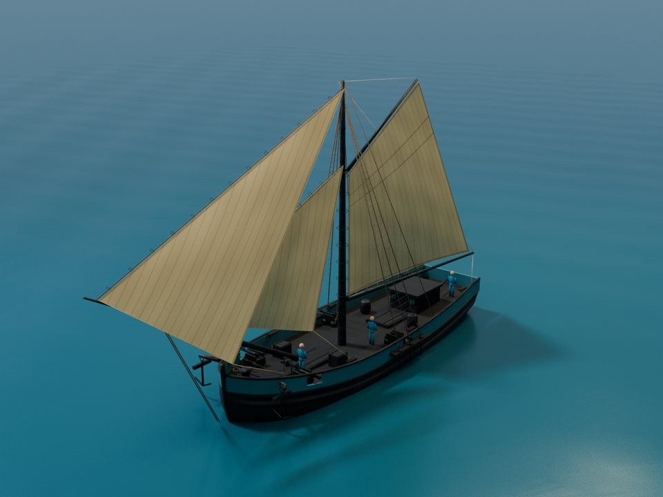
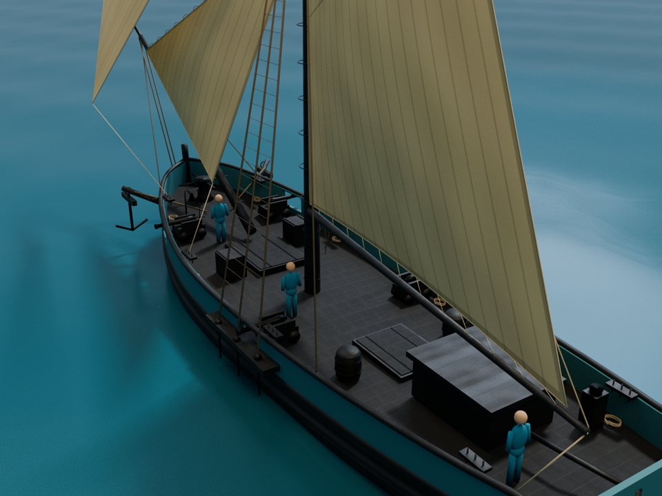

# „Jaskółka” — slup handlowy około 1715 r.

Osobny model do gry: jeden maszt, gaflowy grot i dwa żagle przednie, pokład długości **21 m**, szerokość **6,45 m**, rumpel i cztery niewielkie działa. Otwarty pokład roboczy ma zamknięte luki ładunkowe, beczki, skrzynie, kabestan, dwie kotwice z drewnianymi poprzeczkami i niską kabinę rufową.




To ilustracyjna rekonstrukcja oparta na [wariancie slupa z rozdziału 12](../docs/pl/12-designing-other-ships.md), a nie model udokumentowanej jednostki. Nowy kadłub wykorzystuje rodzinę linii z tabeli rzędnych, przeliczoną do innych proporcji. Pokład, nadburcia, furty, osprzęt, ożaglowanie i olinowanie powstają od nowa. Generator importuje referencyjny `model/snow.glb` wyłącznie po materiały PBR i usuwa wszystkie jego obiekty.

Gałąź zaczyna się bezpośrednio od `main` (`2e6f7e9`). Nie wymaga PR #1 i nie zmienia jego snowa.

## Gotowe pliki

- [Sloop_1715_Game_Asset.zip](https://chatgpt.com/library?file_id=libfile_fde3_f-7e876056f1848191868dcac00b130733_3e6905c6fccc819193bbe72238597acd&account_id=personal)
- [Sloop_1715.glb](https://chatgpt.com/library?file_id=libfile_fde3_f-eb3adb58f41c8191a761853cdd34f58c_3e6905c6fccc819193bbe72238597acd&account_id=personal)
- [Sloop_1715_preview.png](https://chatgpt.com/library?file_id=libfile_fde3_f-e1964456f0b481919b69c956c93e2000_3e6905c6fccc819193bbe72238597acd&account_id=personal)

Paczka zawiera model GLB z materiałami i teksturami, dwa statyczne LOD-y, osobne kolizje, edytowalny plik Blender z zapakowanymi teksturami, cztery rzeczywiste rendery oraz raporty i dane JSON. Obiekty morza, światła i postacie o wzroście 1,75 m służą do podglądu i nie trafiają do GLB.

| Plik | Zawartość |
|---|---|
| `sloop_1715.glb` | 59 570 trójkątów, trzy żagle z zapętlonym ruchem płótna, 4 s / 24 FPS |
| `sloop_1715_lod1.glb` | 39 506 trójkątów, statyczne płótno, scalona siatka |
| `sloop_1715_lod2.glb` | 15 304 trójkąty, uproszczone detale i olinowanie, scalona siatka |
| `sloop_1715_collision.glb` | 25 obiektów: pudła pokładu i przeszkód, maszt, siatki kadłuba i nadburć; 3 778 trójkątów |
| `sloop_1715.blend` | Edytowalny model i scena podglądu; tekstury spakowane |
| `parameters.json`, `asset_manifest.json` | Wymiary, założenia, liczniki, nazwy i zakresy punktów sterowania |
| `workstations.json`, `deck_layout.json` | Dziewięć stanowisk załogi i przeszkody pokładu |
| `rigging_paths.json` | Ścieżki i średnice lin w pozycji wyjściowej |
| `sail_measurements.json` | Zmierzone powierzchnie i geometryczne środki żagli |
| `native_import_validation.json` | Wynik ponownego importu GLB wraz z SHA-256 plików |

## Odtworzenie

Uruchom w katalogu głównym repozytorium po przełączeniu na tę gałąź. Sprawdzono w **Blenderze 4.3.2**, z dołączonym NumPy. Nie potrzeba pobierać tekstur ani instalować pakietów do generowania modelu.

```bash
blender -b --factory-startup --python-exit-code 1 \
  --python sloop_asset/build_sloop.py -- --out build/sloop_1715 --no-render

blender -b --factory-startup --python-exit-code 1 \
  --python sloop_asset/verify_exports.py -- build/sloop_1715

blender -b build/sloop_1715/sloop_1715.blend --python-exit-code 1 \
  --python sloop_asset/render_previews.py -- build/sloop_1715
```

Pominięcie `--no-render` w pierwszym poleceniu od razu wykona również cztery rendery. Generator zapisuje wynik wyłącznie do wskazanego katalogu wyjściowego. Nie nadpisuje modelu referencyjnego.

## Integracja z grą

GLB używa metrów: **+Y do góry, +Z ku dziobowi, +X na lewą burtę**. Lustro wody to Y=0. W źródłach Blendera współrzędna projektowa `s` biegnie ku dziobowi i jest zamieniana na Blenderowe `-Y`.

Punkty sterowania mają stabilne nazwy i metadane `extras`: `main_mast`, `main_boom`, `main_gaff`, `rudder_and_tiller`, `capstan_rotation`, `gun_*_recoil`, `gun_*_elevation`. Rumpel jest dzieckiem steru; lufy mają osobne osie podnoszenia. Żagle mają dwa morphy `wind_port` i `wind_starboard`, z nieruchomym obwodem. Kontroler gry musi obsługiwać ruch jednostki, stanowiska, ostrzał i przełączanie LOD-ów.

**Zakres kontroli kolizji obejmuje zapisane ustawienie żagli i pętlę ruchu płótna.** Obracanie bomu, gafla lub przetrymowanie żagli wymaga aktualizacji lin przez kontroler; podane zakresy obrotu nie oznaczają sprawdzonej symulacji całego takielunku. LOD1 i LOD2 zachowują pozycję wyjściową. Plik kolizji opisuje przeszkody w tej pozycji; kadłub i nadburcia są statycznymi siatkami wklęsłymi, a nie gotowymi bryłami wypukłymi dla pływającego rigidbody. Nawigacja, wyporność i fizyka pływania pozostają po stronie silnika.

## Sprawdzone wyniki

- Zamknięta powłoka kadłuba: **0 krawędzi niemanifoldowych**; wynik nie stanowi oceny hydrostatycznej.
- **0 wykrytych przecięć wnętrza płótna przez liny lub inne żagle**: klatki 0, 12, …, 96; dodatkowo ponowny import LOD0 oraz obu statycznych LOD-ów. Połączenia przy likach są raportowane oddzielnie z tolerancją 25 mm. Audyt bada krawędzie siatek lin względem płótna, nie jest ciągłą symulacją kontaktu.
- Najmniejszy prześwit nad pokładem pod bomem lub płótnem: **2,4248 m**, także po eksporcie. Kontrola próbuje wierzchołki, środki krawędzi i środki trójkątów w dziewięciu klatkach.
- Dziewięć stanowisk dostępnych od steru dla promienia postaci **0,28 m**, na siatce 0,15 m. Sprawdzony plan pokładu uwzględnia kabinę, ładunek, działa, kabestan i maszt. Zamknięte luki są traktowane jako stopnie wysokości 0,185 m. To kontrola dojścia w rzucie, nie navmesh silnika.
- GLB: poprawne indeksy, skończone pozycje, osadzone tekstury, oczekiwane liczby trójkątów, cztery działa skierowane za burty, trzy żagle z działającymi morphami płótna, brak obiektów sceny podglądu.

## Założenia historyczne i pochodzenie

Rozdział 12 stanowi podstawę proporcji i układu jednomasztowego slupa około 1715 r. Cztery działa 3-funtowe, brak dodatkowej stengi, podniesione i zmniejszone obrysy żagli dla prześwitu załogi oraz kupiecki układ pokładu to jawne decyzje tego modelu do gry. Nie przenosimy z przykładu przewodnika deklarowanej powierzchni ożaglowania ani wyporności: rzeczywiste powierzchnie zapisuje `sail_measurements.json`. Objętość całej zamkniętej powłoki w manifeście obejmuje część ponad wodą i nie jest wypornością.

Kod i geometria: [MIT](../LICENSE). Materiały referencyjne oraz ich autorzy i adresy: [spis tekstur CC0](../blender/tekstury_cc0_spis.json), dołączony też do paczki. Nowe płótno jest generowane proceduralnie. Bez miedzianej blachy na dnie, karonad, łańcuchów kotwicznych i współczesnych elementów wyposażenia.
